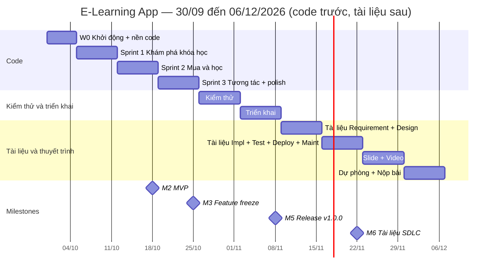
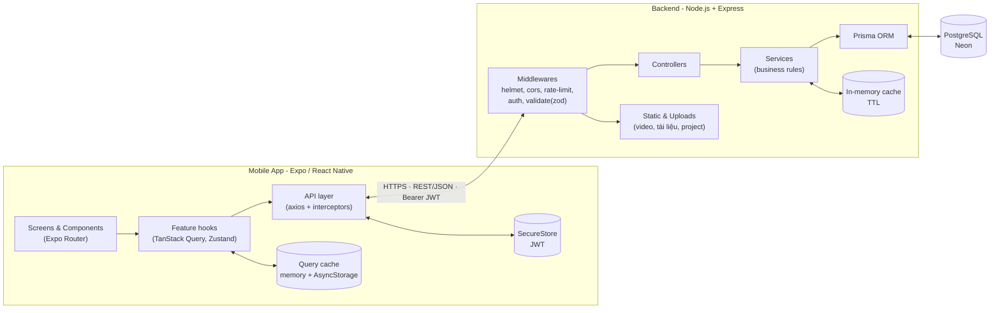
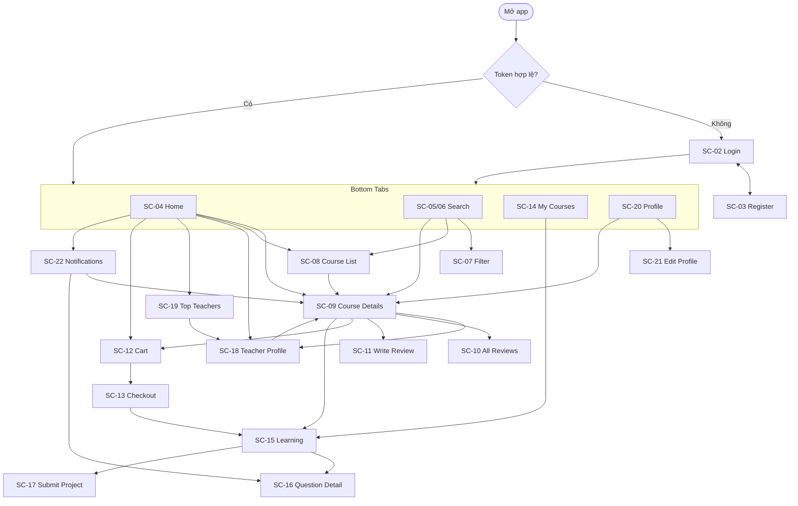
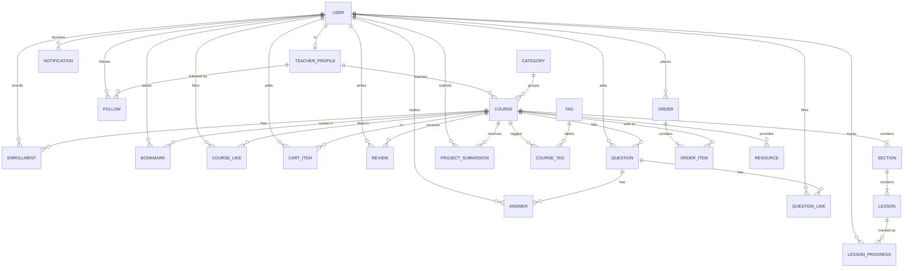

# PLAN.md — Kế hoạch dự án E-Learning App (Đề tài số 5)

> **Phiên bản:** 2.20 (nhóm 3 người · giai đoạn 2: sản phẩm thật) · **Ngày lập:** 30/09/2026 · **Môn:** Lập trình thiết bị di động (React Native + TypeScript)
> **Trạng thái mới nhất 13/10/2026:** `develop` = `main` = `origin` = **`ad12f0c`**, đã deploy production qua CI/CD (eliuh.site). Đã xong giai đoạn 2 + §2.4 Giảng viên & Quản trị + §2.5 Web PC kiểu Netflix + wizard SC-24 + My Courses PC + dịch thông báo lúc hiển thị. Chưa tag/release. Kiểm chứng cuối: server 119 suites/1700 test, mobile 281/2175, typecheck/lint/prettier sạch. Còn lại: test Android/PC thật, APK (PLT-02), release v1.0.0, báo cáo SDLC, slide, video (**hạn nộp mới 05/11/2026** — §22 v2.28).
> Đây là **nguồn sự thật** cho toàn dự án: phạm vi, phân công, timeline, đặc tả màn hình/DB/API, kế hoạch test/deploy/thuyết trình.
> Quy ước code & Git: xem [CLAUDE.md](CLAUDE.md). Thiết kế gốc: [design/](design/).

## Mục lục

0. [Cách đọc & cập nhật](#0-cách-đọc--cập-nhật)
1. [Giả định cần xác nhận](#1-giả-định-cần-xác-nhận)
2. [Mục tiêu & phạm vi](#2-mục-tiêu--phạm-vi)
3. [Nhóm & phân công](#3-nhóm--phân-công)
4. [Timeline & milestones](#4-timeline--milestones)
5. [Kiến trúc & quyết định kỹ thuật](#5-kiến-trúc--quyết-định-kỹ-thuật)
6. [Yêu cầu: Actor, Use case, FR, NFR, Business rules](#6-yêu-cầu)
7. [Đặc tả màn hình](#7-đặc-tả-màn-hình)
8. [Thiết kế cơ sở dữ liệu](#8-thiết-kế-cơ-sở-dữ-liệu)
9. [Đặc tả API](#9-đặc-tả-api)
10. [Chiến lược state & cache phía mobile](#10-chiến-lược-state--cache-phía-mobile)
11. [Dữ liệu mẫu (seed)](#11-dữ-liệu-mẫu-seed)
12. [Tài liệu SDLC cần nộp](#12-tài-liệu-sdlc-cần-nộp)
13. [Kế hoạch chi tiết theo tuần (task list)](#13-kế-hoạch-chi-tiết-theo-tuần)
14. [Kế hoạch kiểm thử](#14-kế-hoạch-kiểm-thử)
15. [Triển khai (Deployment)](#15-triển-khai-deployment)
16. [Bảo trì & cải tiến](#16-bảo-trì--cải-tiến)
17. [Nội dung đặc biệt: Cache · Performance · Offline](#17-nội-dung-đặc-biệt-cache--performance--offline)
18. [Slide & Video](#18-slide--video)
19. [Quản lý rủi ro](#19-quản-lý-rủi-ro)
20. [Quy trình làm việc nhóm](#20-quy-trình-làm-việc-nhóm)
21. [Checklist nộp bài cuối cùng](#21-checklist-nộp-bài-cuối-cùng)
22. [Nhật ký thay đổi kế hoạch](#22-nhật-ký-thay-đổi-kế-hoạch)

---

## 0. Cách đọc & cập nhật

- **Task ID:** `P` khởi động · `R` yêu cầu · `D` thiết kế · `S` server · `M` mobile · `T` kiểm thử · `DEP` triển khai · `MT` bảo trì · `PS` slide/video.
- **Người phụ trách:** `A`, `B`, `C` (bảng §3). **Ưu tiên:** `Must` / `Should` / `Could` (MoSCoW).
- **Trạng thái:** `[ ]` chưa làm · `[~]` đang làm · `[x]` xong (tick khi PR đã merge vào `develop`). `[-]` không làm / đã bị thay thế bởi task khác (ghi rõ task thay thế).
- **Mã yêu cầu:** `UC-xx` use case · `FR-xx` chức năng · `NFR-xx` phi chức năng · `BR-xx` quy tắc nghiệp vụ · `SC-xx` màn hình · `TC-<MODULE>-xx` test case · `BUG-xxx` lỗi.
- Nhánh Git đặt theo task: `feature/M-09-home-screen`. Commit/PR luôn ghi task ID.
- Mọi thay đổi phạm vi/thư viện/API/timeline → ghi vào §22 kèm lý do và ngày.

---

## 1. Giả định cần xác nhận

Nhóm xác nhận ở buổi họp đầu tiên (P-01). Nếu khác, sửa bảng này và điều chỉnh các mục liên quan.

| # | Giả định | Nếu khác thì |
|---|---|---|
| G1 | Nhóm **3 thành viên** (đã xác nhận 30/09) | Nếu có thêm người → §3.3 |
| G2 | Thời gian **30/09/2026 → 05/11/2026 nộp bài, 08/11/2026 thuyết trình** (rút từ 06/12 ngày 26/10 — §22 v2.28; ban đầu thuyết trình tuần 30/11–06/12) | Giữ nguyên thứ tự giai đoạn, co/giãn số sprint (tối thiểu 3 sprint) |
| G3 | Thiết bị test chính: **Android thật + Expo Go**; iOS (Expo Go) nếu có thành viên dùng iPhone | — |
| G4 | Máy không có Docker/Java/Android SDK | DB dùng **Neon** (PostgreSQL cloud free); có thể thêm Docker Compose sau |
| G5 | **Không** tích hợp thanh toán thật → thanh toán **giả lập** | — |
| G6 | **Không** làm web admin; dữ liệu khóa học, giảng viên, bài học tạo bằng **seed** | — |
| G7 | Có **backend riêng** (Express + PostgreSQL) để thể hiện đủ phần Backend/DB/API/ERD/Integration test | Nếu giảng viên khuyến khích BaaS (Supabase/Firebase) → cập nhật §5, §8, §9 và ghi §22 |
| G8 | UI tiếng Anh như design, tài liệu tiếng Việt | — |
| G9 | Thứ tự làm: **code → kiểm thử → triển khai → tài liệu SDLC → slide/video** (nhóm quyết định 02/10/2026) | Xem §4, §12, §13 |

---

## 2. Mục tiêu & phạm vi

### 2.1 Mục tiêu

1. **Sản phẩm:** app E-Learning chạy trên Android/iOS (Expo), bám sát **12 màn hình design** và bổ sung các màn hình cần để luồng hoàn chỉnh (đăng nhập, giỏ hàng, thanh toán giả lập, thông báo, chỉnh sửa hồ sơ…).
2. **Quy trình:** đi đủ **6 giai đoạn SDLC**, mỗi giai đoạn có tài liệu cụ thể (§12, viết ở W6–W7 từ sản phẩm thật) và minh chứng (commit, PR, issue, kết quả test).
3. **Điểm nhấn kỹ thuật:** cache nhiều tầng + xem offline, tối ưu hiệu năng danh sách/ảnh/video, optimistic UI, tiếp tục video từ vị trí cũ (§17) — có số liệu đo để đưa lên slide.

### 2.2 Phạm vi (MoSCoW)

**Must (MVP — bắt buộc có để demo luồng chính):**
- Đăng ký, đăng nhập, duy trì phiên, đăng xuất.
- Home: banner, categories, Popular, Recommended, Course that inspires, Top teachers.
- Tìm kiếm theo từ khóa + hot topics, danh sách kết quả (phân trang cuộn vô hạn).
- Xem khóa học theo danh mục / "View more".
- Chi tiết khóa học: Overview, Lessons (trạng thái khóa/mở/hoàn thành), Review (xem).
- Bookmark (lưu) khóa học.
- Giỏ hàng + thanh toán giả lập → ghi danh; ghi danh khóa miễn phí.
- My Courses (All / On going / Completed) với % hoàn thành.
- Học bài: phát video, chuyển bài, lưu & tiếp tục vị trí xem, tự đánh dấu hoàn thành, cập nhật % khóa học.
- User profile: thống kê (Save / On going / Completed) + danh sách đã lưu.

**Should (làm trong sprint 4 — cần có để bám đủ design):**
- Bộ lọc & sắp xếp kết quả tìm kiếm.
- Viết/sửa đánh giá, xem tất cả đánh giá có lọc theo sao.
- Q&A: đặt câu hỏi, trả lời, like; màn hình chi tiết câu hỏi.
- Projects: mô tả project, tải tài liệu (resources), nộp project (upload), xem project học viên khác.
- Teacher profile (Overview/Courses/Review) + Follow.
- Chỉnh sửa hồ sơ + đổi avatar.
- Thông báo trong app (danh sách, đã đọc, badge).
- Cache offline + banner "mất kết nối".

**Could (nếu dư thời gian):**

> Nhóm 3 người: các mục Could **mặc định không làm**; chỉ làm ở W9 nếu toàn bộ Must + Should đã xong và ổn định.

- Like/Share khóa học (native share sheet).
- Recent searches (lưu local).
- Danh sách tất cả giảng viên (Top teachers → View more).
- Tự động phát bài tiếp theo, tốc độ phát video.
- E2E test bằng Maestro.
- Swagger UI cho API.
- ~~Dark mode~~ → **Must ở giai đoạn 2 (§2.3)**.

**Won't (ngoài phạm vi, đưa vào §16 "đề xuất cải tiến"):**
- Thanh toán thật, hoàn tiền, coupon.
- Web admin / giảng viên tạo khóa học trong app.
- Tải video xem offline, livestream, chứng chỉ PDF.
- Push notification thật (expo-notifications), chat realtime.
- ~~Đa ngôn ngữ (i18n)~~ → **Must ở giai đoạn 2 (§2.3)**.

### 2.3 Giai đoạn 2 — Sản phẩm chạy thật (từ 03/10/2026)

Chức năng lõi (Sprint 1–3) đã code xong và qua kiểm thử W4. Nhóm quyết định nâng thành **sản phẩm chạy thật**:

| Ưu tiên | Hạng mục |
|---|---|
| **Must** | **Thiết kế lại giao diện** (không còn bám ảnh design cũ — **đã chọn concept B · Noir** trong 3 concept ở `notes/concepts/`) · **Tiếng Việt / English** (theo ngôn ngữ máy, đổi trong app) · **Dark mode** (theo hệ thống hoặc chọn tay) · **Deploy thật** lên VPS AWS EC2 Sydney (Free Plan) + domain riêng + HTTPS · **Web app** + **Android APK** · **AI** (Google Gemini free tier): tóm tắt khóa/bài học, **AI Tutor** hỏi đáp theo nội dung khóa (streaming) · **Monitoring** Grafana (API, hạ tầng, log) · **CI/CD** GitHub Actions · **Xác thực chuẩn app thật** (refresh token + quản lý thiết bị, xác minh email OTP, quên mật khẩu, **2FA TOTP** + mã khôi phục, **CAPTCHA Cloudflare Turnstile**, khóa tạm khi sai nhiều lần) |
| **Should** | Mở khóa app bằng sinh trắc học · thông báo đăng nhập thiết bị mới · nhật ký sự kiện bảo mật · AI cá nhân hóa (lộ trình + lý do gợi ý) · AI quiz trắc nghiệm theo bài · backup DB tự động · Uptime Kuma · cài web như PWA |
| **Could** | Đăng nhập Google (OAuth) · Push notification · app iOS thật (cần Apple Developer $99/năm — hiện iPhone dùng bản web) · Sentry · web admin |

- **AI:** gọi qua lớp provider (`server/src/lib/ai/`), mặc định `AI_PROVIDER=mock` khi chưa có `GEMINI_API_KEY` để app vẫn chạy. Free tier có giới hạn request/phút và /ngày → **cache kết quả trong DB** (`AiContent`), **rate limit theo user**, lỗi hạn mức trả 429 `AI_RATE_LIMITED`. Dữ liệu gửi lên free tier có thể được Google dùng để cải thiện sản phẩm → không gửi thông tin cá nhân nhạy cảm.
- **Hạ tầng (đổi theo người dùng 07/10/2026):** AWS EC2 Free Plan, Sydney, Ubuntu 24.04 x86_64, `c7i-flex.large` 2 vCPU / 4 GiB, gp3 40 GiB. Elastic IP `13.238.92.36`, chỉ bật test/demo để tiết kiệm credit. Giữ Docker Compose/Caddy/PostgreSQL/Grafana/Loki/Alloy, domain `eliuh.site`, GHCR/SSH và EAS. Docker/swap/bảo mật đã kiểm chứng; chưa app/DNS/HTTPS. Không nâng cấp trả phí. Hướng dẫn: `deploy/AWS_CLOUD.md`, `deploy/README.md`.

---

### 2.4 Mở rộng Giảng viên & Quản trị (bổ sung 10/10/2026 — v2.16, chờ nhóm duyệt trước khi code)

**Bối cảnh:** trước v2.16, TEACHER chỉ khác STUDENT ở `TeacherProfile`; `Role.ADMIN` có trong DB nhưng không dùng; khóa học chỉ có cờ `isPublished`, 30 khóa đều do seed. Người dùng quyết định (10/10) mở rộng theo **phương án A + B** (§2.4.9 ghi đủ các quyết định): giảng viên **soạn và bán khóa học**, admin **duyệt khóa học**, cùng các use case nối 3 actor.

#### 2.4.1 Actor (bổ sung §6.1)

| Actor | Mô tả |
|---|---|
| **Teacher (Giảng viên)** | Từ v2.16 là **actor chính**: soạn khóa học (nháp → gửi duyệt), sửa khóa đã xuất bản qua bản sửa đổi, xem thống kê, chấm project, trả lời Q&A (huy hiệu Giảng viên, ghim), phản hồi đánh giá, dùng AI soạn khóa. **Kế thừa Learner** (generalization): vẫn duyệt, mua, học khóa của người khác; **không mua được khóa của chính mình**. Tự đăng ký (không cần duyệt tài khoản) |
| **Admin (Quản trị viên)** | Duyệt hoặc từ chối khóa học và bản sửa đổi (có AI kiểm duyệt sơ bộ), ẩn/khôi phục khóa, khóa/mở tài khoản, xem dashboard. **Không đăng ký được**; chỉ tạo bằng seed (dev) hoặc script nâng quyền trên server (production) |
| **Google Gemini** (hệ thống ngoài) | AI soạn khóa (Teacher), AI kiểm duyệt sơ bộ (Admin), cùng các tính năng AI sẵn có của Learner |
| **Google reCAPTCHA · Brevo SMTP · YouTube** (hệ thống ngoài) | CAPTCHA đăng ký/đăng nhập · gửi email (OTP, kết quả duyệt) · nguồn video bài học |

#### 2.4.2 Use case mới (bổ sung §6.2)

| UC | Tên | Actor | FR | Ưu tiên |
|---|---|---|---|---|
| UC-22 | Quản lý khóa học của tôi (tạo nháp, sửa, xóa nháp) | Teacher | FR-39 | Must |
| UC-23 | Soạn chương trình học (chương, bài, video YouTube, bài xem thử) | Teacher | FR-40 | Must |
| UC-24 | Gửi duyệt khóa học | Teacher | FR-41 | Must |
| UC-25 | Sửa khóa đã xuất bản (bản sửa đổi) | Teacher | FR-42 | Must |
| UC-26 | AI hỗ trợ soạn khóa học | Teacher, Gemini | FR-44 | Should |
| UC-27 | Xem thống kê khóa học | Teacher | FR-45 | Should |
| UC-28 | Chấm điểm & nhận xét project | Teacher | FR-46 | Must |
| UC-29 | Trả lời Q&A với vai trò giảng viên (huy hiệu, ghim) | Teacher | FR-47 | Must |
| UC-30 | Phản hồi đánh giá | Teacher | FR-48 | Should |
| UC-31 | Ẩn / khôi phục khóa học | Teacher, Admin | FR-43 | Must |
| UC-32 | Duyệt / từ chối khóa học | Admin | FR-50 | Must |
| UC-33 | Xem AI kiểm duyệt sơ bộ | Admin, Gemini | FR-51 | Must |
| UC-34 | Quản lý người dùng (khóa / mở tài khoản) | Admin | FR-52 | Should |
| UC-35 | Xem dashboard hệ thống | Admin | FR-53 | Should |
| UC-36 | Nhận thông báo khóa mới của giảng viên đang theo dõi | Learner | FR-54 | Must |
| UC-37 | Cập nhật hồ sơ giảng viên | Teacher | FR-49 | Must |

Đặc tả chi tiết (bổ sung vào danh sách bắt buộc của §6.2): **UC-24, UC-25, UC-26, UC-28, UC-32 (gộp UC-33), UC-34**. Luồng xuyên 3 actor dùng làm kịch bản demo/video: *Teacher soạn khóa (AI gợi ý) → gửi duyệt → AI kiểm duyệt sơ bộ → Admin duyệt → follower nhận thông báo → Learner mua, học, nộp project → Teacher chấm → Learner nhận thông báo điểm.*

#### 2.4.3 Yêu cầu chức năng (bổ sung §6.3)

| FR | Mô tả | Ưu tiên |
|---|---|---|
| FR-39 | Teacher tạo khóa ở trạng thái nháp; sửa tiêu đề, phụ đề, mô tả, danh mục, tối đa 5 tag có sẵn, giá, giá gốc, lợi ích, mô tả project, ảnh bìa (upload PNG/JPG); xóa khóa chưa từng xuất bản và chưa có học viên | Must |
| FR-40 | Soạn chương và bài: thêm/sửa/xóa, đổi thứ tự (nút lên/xuống, không kéo thả); bài gồm tiêu đề, link YouTube (chuẩn hóa về `watch?v=`, cho phép `start`/`end`), thời lượng (mm:ss), cờ xem thử, nội dung chữ (nguồn cho AI) | Must |
| FR-41 | Gửi duyệt khi đạt checklist BR-20; trạng thái hiển thị: Nháp · Chờ duyệt · Đã xuất bản · Bị từ chối (kèm lý do) · Đã ẩn | Must |
| FR-42 | Khóa đã xuất bản: sửa trường "nhỏ" áp dụng ngay; trường "lớn" đi qua **một bản sửa đổi** chờ duyệt, học viên vẫn thấy bản cũ (BR-21) | Must |
| FR-43 | Teacher/Admin ẩn khóa (ARCHIVED): biến mất khỏi danh mục/tìm kiếm, học viên đã mua vẫn học; khôi phục về Đã xuất bản | Must |
| FR-44 | AI soạn khóa: từ chủ đề + trình độ + ngôn ngữ → gợi ý phụ đề, mô tả, lợi ích, dàn ý chương/bài; teacher chọn áp dụng từng phần vào form (không tự lưu) | Should |
| FR-45 | Thống kê khóa: số học viên, doanh thu (giả lập), tiến độ trung bình, phân bố số sao, số học viên mới 30 ngày (biểu đồ) | Should |
| FR-46 | Danh sách bài nộp của khóa; chấm điểm 0–100 + nhận xét; chấm lại được; học viên thấy điểm và nhận thông báo | Must |
| FR-47 | Giảng viên của khóa trả lời Q&A không cần ghi danh; câu trả lời có huy hiệu "Giảng viên"; ghim 1 câu trả lời/câu hỏi (hiện đầu danh sách) | Must |
| FR-48 | Giảng viên phản hồi đánh giá (1 phản hồi/đánh giá, sửa/xóa được); người đánh giá nhận thông báo | Should |
| FR-49 | Teacher sửa hồ sơ giảng viên: chức danh, giới thiệu, tổ chức, địa điểm, múi giờ | Must |
| FR-50 | Admin xem hàng chờ (khóa mới + bản sửa đổi), xem trước nội dung (với bản sửa đổi: so sánh cũ/mới), duyệt hoặc từ chối kèm lý do; lưu lịch sử duyệt; teacher nhận thông báo + email | Must |
| FR-51 | AI kiểm duyệt sơ bộ: Gemini đọc nội dung gửi duyệt, trả nhận định + danh sách vấn đề (mức độ, phần, mô tả) theo ngôn ngữ admin; chỉ mang tính tư vấn, cache theo phiên bản nội dung | Must |
| FR-52 | Admin tìm/lọc người dùng (vai trò, trạng thái), khóa tài khoản kèm lý do (thu hồi mọi phiên), mở khóa | Should |
| FR-53 | Admin dashboard: người dùng theo vai trò, người dùng mới 7/30 ngày, doanh thu, đơn hàng, khóa theo trạng thái, số chờ duyệt, top 5 khóa | Should |
| FR-54 | Khi khóa **lần đầu** được xuất bản: thông báo `NEW_COURSE` cho mọi follower của giảng viên | Must |

#### 2.4.4 Quy tắc nghiệp vụ (bổ sung §6.5)

| BR | Quy tắc |
|---|---|
| BR-19 | **Vòng đời khóa học** `CourseStatus`: `DRAFT` → (teacher gửi) `PENDING_REVIEW` → (admin duyệt) `PUBLISHED` · (admin từ chối) `REJECTED` → (teacher sửa, gửi lại) `PENDING_REVIEW`. `PUBLISHED` ↔ `ARCHIVED` (teacher hoặc admin). Teacher rút lại khi đang chờ: `PENDING_REVIEW` → `DRAFT`. Chuyển trạng thái sai → 422 `INVALID_COURSE_STATE`. Chỉ `PUBLISHED` hiện ở danh mục/tìm kiếm/home/hồ sơ giảng viên (thay BR-13 "isPublished") |
| BR-20 | **Checklist gửi duyệt** (422 `COURSE_INCOMPLETE`, `details.missing[]`): tiêu đề 5–120 ký tự; mô tả ≥ 100 ký tự; có ảnh bìa và danh mục; ≥ 1 chương, ≥ 3 bài; mọi bài có link YouTube hợp lệ và thời lượng 1 giây–6 giờ; 1–3 bài xem thử; giá 0 (miễn phí) hoặc 99–99 999 cent; giá gốc (nếu có) > giá |
| BR-21 | **Sửa khóa đã xuất bản:** trường **nhỏ** (phụ đề, mô tả, lợi ích, mô tả project, ảnh bìa) áp dụng ngay. Trường **lớn** (tiêu đề, giá, giá gốc, danh mục, tag, toàn bộ chương/bài) chỉ sửa trong **bản sửa đổi** `CourseRevision` (tối đa 1 bản đang mở/khóa); gửi duyệt cũng qua checklist BR-20. Trong lúc chờ, học viên thấy bản đang xuất bản. Duyệt → áp dụng trong 1 transaction: bài giữ `id` thì cập nhật, bài bị bỏ thì xóa (mất tiến độ bài đó), bài mới thì tạo; tính lại `lessonCount`, `totalDurationSec`. Từ chối → bản sửa đổi về trạng thái bị từ chối, teacher sửa tiếp |
| BR-22 | **Xóa/ẩn:** chỉ xóa được khóa chưa từng xuất bản (`publishedAt = null`) và không có ghi danh; ngược lại chỉ ẩn. Khóa `ARCHIVED`: `GET /courses/:id` trả 404 với người chưa ghi danh; học viên đã mua vẫn học, xem trong My Courses; không thêm giỏ/mua được |
| BR-23 | **Quyền theo vai trò:** route `/teacher/*` cần role TEACHER **và** là chủ khóa (không phải chủ → 404 `COURSE_NOT_FOUND`, không lộ tồn tại); route `/admin/*` cần ADMIN (403 `FORBIDDEN`). Teacher không thêm giỏ/ghi danh/mua khóa của chính mình (422 `OWN_COURSE`). Chủ khóa và admin xem được mọi bài (mở rộng BR-01) mà không ghi tiến độ |
| BR-24 | **Q&A giảng viên:** giảng viên của khóa đăng câu trả lời không cần ghi danh (mở rộng BR-09); DTO trả `isInstructor`; ghim tối đa 1 câu trả lời/câu hỏi (ghim cái mới thì bỏ ghim cái cũ); câu trả lời ghim xếp đầu |
| BR-25 | **Phản hồi đánh giá:** chỉ giảng viên của khóa; 1 phản hồi/đánh giá, 1–1000 ký tự, sửa/xóa được; thông báo `REVIEW_REPLY` cho người đánh giá (lần đầu phản hồi) |
| BR-26 | **Chấm project:** chỉ giảng viên của khóa; điểm nguyên 0–100, nhận xét 1–2000 ký tự; chấm lại được (ghi đè, cập nhật `gradedAt`); thông báo `PROJECT_GRADED` |
| BR-27 | **Thông báo:** duyệt → `COURSE_APPROVED`, từ chối → `COURSE_REJECTED` (kèm lý do) cho teacher, đồng thời gửi email (Brevo; lỗi email không làm hỏng thao tác duyệt). Lần đầu xuất bản → `NEW_COURSE` cho follower (BR-14). Admin thấy số chờ duyệt bằng badge, không có thông báo |
| BR-28 | **Khóa tài khoản:** admin không khóa chính mình hoặc admin khác (422 `CANNOT_DISABLE_ADMIN`); lý do 5–500 ký tự; khóa → thu hồi mọi phiên/refresh token; đăng nhập hoặc refresh → 403 `ACCOUNT_DISABLED`. Khóa của teacher bị khóa tài khoản giữ nguyên trạng thái (admin tự ẩn nếu cần) |
| BR-29 | **AI:** gợi ý soạn khóa chỉ điền form, teacher phải tự lưu; AI kiểm duyệt chỉ tư vấn, admin quyết định. Cả hai dùng quota AI sẵn có (NFR-14), cache trong `AiContent` theo hash nội dung; AI lỗi → vẫn duyệt/soạn tay bình thường |
| BR-30 | **Admin:** không có đăng ký ADMIN (giữ whitelist AUTH-12); dev: seed tạo `admin@example.com`; production: `npm run user:set-role -- --email <email> --role ADMIN` (mặc định dry-run, `--apply` mới ghi) cho tài khoản đã xác minh email |

#### 2.4.5 Thay đổi CSDL (bổ sung §8.2 — 1 migration `teacher_admin`)

- `enum CourseStatus { DRAFT PENDING_REVIEW PUBLISHED REJECTED ARCHIVED }`; `Course`: **bỏ `isPublished`**, thêm `status CourseStatus @default(DRAFT)`, `publishedAt DateTime?`, `submittedAt DateTime?`; index `[status]`. Migration chuyển dữ liệu: `isPublished = true` → `PUBLISHED` (`publishedAt = createdAt`), `false` → `ARCHIVED`.
- `model CourseRevision { id, courseId, payload Json, status (OPEN | PENDING_REVIEW | REJECTED), createdAt, updatedAt, submittedAt? }` — mỗi khóa tối đa 1 bản chưa áp dụng (`@@unique` theo khóa); `payload` validate bằng zod (title, priceCents, originalPriceCents, categoryId, tagIds, sections[{id?, title, lessons[{id?, title, videoUrl, durationSec, isPreview, content}]}]). Duyệt xong thì xóa bản sửa đổi, lịch sử nằm ở `CourseModeration`.
- `enum ModerationAction { SUBMITTED WITHDRAWN APPROVED REJECTED ARCHIVED RESTORED }`; `model CourseModeration { id, courseId, actorId, action, target (COURSE | REVISION), reason?, createdAt }` — lịch sử duyệt, hiện cho teacher và admin.
- `ProjectSubmission`: thêm `grade Int?`, `feedback String?`, `gradedAt DateTime?`.
- `Review`: thêm `teacherReply String?`, `teacherRepliedAt DateTime?`.
- `Answer`: thêm `isPinned Boolean @default(false)` (`isInstructor` tính khi trả DTO, không lưu).
- `User`: thêm `disabledAt DateTime?`, `disabledReason String?`.
- `NotificationType` thêm `COURSE_APPROVED`, `COURSE_REJECTED`, `NEW_COURSE`, `PROJECT_GRADED`, `REVIEW_REPLY`.
- `AiContentKind` thêm `COURSE_DRAFT`, `COURSE_REVIEW`.
- Seed: 30 khóa → `PUBLISHED`; thêm `admin@example.com` (ADMIN); thêm 1 khóa `DRAFT` + 1 khóa `PENDING_REVIEW` của giảng viên seed để demo; 9 tài khoản giảng viên seed vẫn đăng nhập được (cùng `SEED_PASSWORD`).

#### 2.4.6 API mới/đổi (bổ sung §9.2 — mobile cập nhật `src/types/api.ts`)

| Nhóm | Endpoint | Ghi chú |
|---|---|---|
| Teacher · khóa | `GET /teacher/courses` · `POST /teacher/courses` · `GET/PATCH/DELETE /teacher/courses/:id` | `GET` trả đủ chương/bài, bản sửa đổi đang mở, lịch sử duyệt. `PATCH` trên PUBLISHED chỉ nhận trường nhỏ (trường lớn → 422 `REVISION_REQUIRED`) |
| Teacher · chương/bài | `POST /teacher/courses/:id/sections` · `PATCH/DELETE /teacher/sections/:id` · `POST /teacher/sections/:id/lessons` · `PATCH/DELETE /teacher/lessons/:id` · `POST /teacher/courses/:id/reorder` | Chỉ cho DRAFT/REJECTED (PUBLISHED → 422 `REVISION_REQUIRED`) |
| Teacher · luồng duyệt | `POST /teacher/courses/:id/submit` · `POST /teacher/courses/:id/withdraw` · `POST /teacher/courses/:id/archive` · `POST /teacher/courses/:id/restore` | Checklist BR-20 |
| Teacher · bản sửa đổi | `POST /teacher/courses/:id/revision` (tạo từ bản hiện tại) · `PUT /teacher/courses/:id/revision` (lưu payload) · `POST /teacher/courses/:id/revision/submit` · `DELETE /teacher/courses/:id/revision` | BR-21 |
| Teacher · khác | `POST /teacher/uploads/image` (PNG/JPG ≤ 5 MB → `/uploads/courses/…`) · `GET /teacher/courses/:id/stats` · `GET /teacher/courses/:id/submissions` · `PUT /teacher/submissions/:id/grade` · `PUT/DELETE /teacher/reviews/:id/reply` · `PUT/DELETE /teacher/answers/:id/pin` · `GET/PATCH /me/teacher-profile` | |
| Teacher · AI | `POST /teacher/ai/course-draft` `{topic, level, lang}` | Quota AI, cache `COURSE_DRAFT` |
| Admin | `GET /admin/stats` · `GET /admin/courses?status=&type=course\|revision&page=` · `GET /admin/courses/:id` (kèm bản sửa đổi + diff) · `GET /admin/courses/:id/ai-review` · `POST /admin/courses/:id/approve` · `POST /admin/courses/:id/reject` `{reason}` · `POST /admin/courses/:id/archive\|restore` · `GET /admin/users?search=&role=&status=` · `POST /admin/users/:id/disable` `{reason}` · `POST /admin/users/:id/enable` | Cần role ADMIN |
| Đổi | Danh mục/tìm kiếm/home/teacher/recommend: lọc `status = PUBLISHED`. `AnswerDto` + `isInstructor`, `isPinned`; `ReviewDto` + `teacherReply`, `teacherRepliedAt`; `ProjectSubmissionDto` + `grade`, `feedback`, `gradedAt`; `MeDto`/`AuthUserDto` có `role`; cart/enroll/checkout chặn `OWN_COURSE`; login/refresh chặn `ACCOUNT_DISABLED` | |

Mã lỗi mới (§9.4): `INVALID_COURSE_STATE` (422), `COURSE_INCOMPLETE` (422, `details.missing`), `REVISION_REQUIRED` (422), `REVISION_EXISTS` (409), `COURSE_HAS_ENROLLMENTS` (409), `OWN_COURSE` (422), `ACCOUNT_DISABLED` (403), `CANNOT_DISABLE_ADMIN` (422), `NOT_COURSE_TEACHER` (403, Q&A/review/grade của khóa người khác).

#### 2.4.7 Màn hình mới (bổ sung §7.1)

Điều hướng: tab bar thêm **tab thứ 5 theo vai trò** — Teacher thấy tab **"Giảng dạy"** (Studio), Admin thấy tab **"Quản trị"**; Student không đổi. Màn soạn khóa dùng chung web/Android nhưng bố cục tối ưu cho web (2 cột khi rộng ≥ 900 px). Mọi màn: light/dark, vi/en, 4 trạng thái dữ liệu, touch target ≥ 48 dp.

| SC | Màn hình | Route | Owner |
|---|---|---|---|
| SC-23 | Studio — khóa học của tôi (danh sách + chip trạng thái + tóm tắt số liệu) | `(tabs)/studio.tsx` | B |
| SC-24 | Soạn khóa — **wizard 5 bước** (v2.18): Ý tưởng (tên, danh mục, trình độ, AI gợi ý) → Giới thiệu (phụ đề, mô tả + "Viết giúp", lợi ích, ảnh bìa) → Giá & thẻ (Miễn phí/Có phí) → Bài học (trình soạn SC-25) → Xem lại (thẻ xem trước + checklist + Gửi duyệt). Dùng cho cả tạo mới và sửa (nhảy bước qua thanh tiến độ; mục thiếu ở SC-26 mở đúng bước); tự lưu khi bấm Tiếp; một cột | `studio/[id]/edit.tsx?step=` | B |
| SC-25 | Soạn khóa — chương trình học (chương/bài, form bài trong sheet) | `studio/[id]/curriculum.tsx` | B |
| SC-26 | Gửi duyệt / trạng thái duyệt / lịch sử / bản sửa đổi | `studio/[id]/index.tsx` | B |
| SC-27 | AI gợi ý soạn khóa (sheet: nhập chủ đề → xem gợi ý → áp dụng từng phần) | `studio/ai-draft.tsx` (modal) | B |
| SC-28 | Thống kê khóa (biểu đồ SVG) | `studio/[id]/stats.tsx` | A |
| SC-29 | Bài nộp & chấm điểm | `studio/[id]/submissions.tsx` | C |
| SC-30 | Sửa hồ sơ giảng viên | `profile/teacher-edit.tsx` | A |
| SC-31 | Quản trị — dashboard | `(tabs)/admin.tsx` | C |
| SC-32 | Quản trị — hàng chờ duyệt (lọc trạng thái, khóa mới/bản sửa đổi) | `admin/courses.tsx` | C |
| SC-33 | Quản trị — xem & duyệt khóa (nội dung, diff, panel AI kiểm duyệt, duyệt/từ chối) | `admin/courses/[id].tsx` | C |
| SC-34 | Quản trị — người dùng (tìm, lọc, khóa/mở) | `admin/users.tsx` | A |
| — | Bổ sung màn cũ: huy hiệu Giảng viên + ghim (SC-16, Learning Q&A) · phản hồi giảng viên dưới review (SC-09/SC-10) · điểm + nhận xét project (SC-15 tab Projects) · nút "Giảng dạy" ở Profile cho teacher | — | C |

#### 2.4.8 Task (bổ sung §13 "Giai đoạn 2") — agent Sonnet song song, người điều phối kiểm chứng + commit

- [x] **TA-01** (A · Must) Migration `teacher_admin` + seed (BR-19/30), middleware `requireRole`, guard chủ khóa, đổi mọi truy vấn `isPublished` → `status`, `OWN_COURSE`, `ACCOUNT_DISABLED`; script `user:set-role`.
- [x] **TA-02** (A · Must) Module `studio` (teacher): CRUD khóa/chương/bài, upload ảnh, submit/withdraw/archive/restore, bản sửa đổi + áp dụng (BR-20/21/22), hồ sơ giảng viên.
- [x] **TA-03** (A · Must) Module `admin`: hàng chờ, chi tiết + diff, duyệt/từ chối, lịch sử, ẩn/khôi phục, người dùng, dashboard; thông báo + email (BR-27/28).
- [x] **TA-04** (C · Must) Q&A giảng viên (huy hiệu, ghim), phản hồi review, chấm project, thống kê khóa (BR-24/25/26), thông báo follower `NEW_COURSE`.
- [x] **TA-05** (A · Must/Should) AI: `course-draft` (Teacher) + `ai-review` (Admin) qua provider `gemini`/`mock`, cache, quota (BR-29).
- [x] **TA-06** (B · Must) Mobile Studio SC-23…SC-27 + tab theo vai trò.
- [x] **TA-07** (A, C · Must/Should) Mobile SC-28…SC-34 + bổ sung màn cũ.
- [~] **TA-08** (C · Must) Test: unit + integration mỗi endpoint (happy + lỗi quyền/IDOR/trạng thái), mobile hooks/màn chính; cập nhật PLAN §8/§9 + `types/api.ts`.
- [x] **TA-09** (A · Must) Deploy (11/10: CI/CD `ae235ff`, backup `20261011-teacher-admin`, admin production = tài khoản trưởng nhóm): backup DB → push `main` (CI/CD) → migration chạy khi API khởi động → `user:set-role` tạo admin production → kiểm thử khói trên eliuh.site.

Ước lượng: server ~3 ngày, mobile ~4 ngày, test + deploy ~1–2 ngày (agent song song) → mục tiêu xong **trước 20/10**, giữ W4 (26/10) cho test Android + APK; báo cáo W6–W7 không lùi.

#### 2.4.9 Quyết định người dùng 10/10/2026

1. Phạm vi: **A + B** (teacher soạn/bán + thống kê, Q&A huy hiệu, chấm project; admin duyệt + ẩn/hiện, khóa tài khoản, dashboard; email kết quả duyệt).
2. Màn admin **trong cùng app**, chỉ ADMIN thấy (web + Android).
3. Soạn khóa: **một bộ màn hình chung**, tối ưu bố cục cho web.
4. Video bài học: **chỉ link YouTube** + nội dung chữ; không upload video.
5. Sửa khóa đã xuất bản: **phương án (c)** — trường nhỏ áp dụng ngay, trường lớn qua bản sửa đổi chờ duyệt, học viên vẫn thấy bản cũ.
6. **Không duyệt tài khoản giảng viên**, chỉ duyệt khóa học.
7. Admin chỉ tạo bằng seed/script.
8. Teacher kế thừa Learner; chặn mua khóa của chính mình.
9. Khóa đã có người mua: chỉ ẩn, không xóa.
10. Code bằng **agent**, cả nhóm review.
11. Use case: gói lõi (A1 duyệt, T1 chấm project, T2 Q&A giảng viên, S2 thông báo follower, A2 AI kiểm duyệt) + T3 phản hồi review, T4 thống kê, T6 AI soạn khóa, A3 quản lý người dùng, A5 dashboard. Không làm: upload video, mã giảm giá/khuyến mãi theo thời hạn, chia doanh thu, chứng chỉ, hoàn tiền, báo cáo vi phạm.

---

### 2.5 Web PC responsive kiểu Netflix (bổ sung 11/10/2026 — v2.19)

Người dùng muốn bản web trên PC thật (không còn cột điện thoại 520 px ở giữa), lấy **Netflix web** làm mẫu. App Android không đổi.

- **Mốc** (`src/hooks/useBreakpoint.ts`): `phone` < 768 (giao diện hiện tại, thanh tab nổi) · `tablet` 768–1023 (co giãn, không vỡ) · `desktop` ≥ 1024.
- **Điều hướng ≥ 768:** thanh trên cùng kiểu Netflix — logo, Trang chủ, Khóa của tôi, Giảng dạy/Quản trị (theo vai trò); bên phải icon tìm kiếm bung ô nhập, giỏ, chuông, avatar (menu Hồ sơ · Cài đặt · Đăng xuất — Hồ sơ luôn cuối). Trong suốt trên banner, nền đặc khi cuộn; có trên mọi trang. Thứ tự tab điện thoại: Giảng dạy/Quản trị đứng trước Hồ sơ.
- **Trang chủ:** banner tràn viền (khóa nổi bật, Xem thử + Chi tiết), các hàng thẻ cuộn ngang có mũi tên khi rê chuột, thẻ phóng to khi hover (giá, đánh giá, thêm giỏ). **Tìm kiếm/Khóa của tôi/Danh mục:** lưới poster.
- **Khóa học của tôi (v2.20):** chip số liệu (đang học, hoàn thành, giờ đã học) · khối "Tiếp tục học" lớn cho khóa gần nhất · tab dạng viên + lưới thẻ có tiến độ "x% · Bài a/b" · banner tối có chuyển động (gradient trôi + đường xu hướng tự vẽ, tắt khi Reduce Motion; dùng cho cả điện thoại). API thêm trường: `GET /me/stats` → `learningSec`; `GET /me/courses` item → `lessonCount`, `completedLessonCount`, `lastLesson {id,title,number}|null`.
- **Chi tiết khóa:** trang riêng (không popup) — đầu trang kiểu trang phim + 2 cột (nội dung | thẻ giá dính). **Học bài:** video trái, bài học/Q&A/Project phải.
- **Đợt:** (1) khung điều hướng + Trang chủ, Tìm kiếm, Khóa của tôi, Danh mục, Chi tiết khóa, Học bài, Hồ sơ giảng viên; (2) Giảng dạy, Quản trị, thống kê, chấm bài (sau wizard SC-24); (3) giỏ, thanh toán, hồ sơ, cài đặt, đăng nhập/đăng ký (thẻ giữa màn), thông báo. Màn chưa làm vẫn hiển thị trong cột giới hạn (không kéo giãn xấu).
- Task: [x] **WEB-01** khung + điều hướng · [x] **WEB-02** trang chủ/khám phá · [x] **WEB-03** chi tiết khóa/học bài · [x] **WEB-04** đợt 2 (Studio/Admin/Teaching: bảng, wizard có danh sách bước dọc, cột phải dính) · [x] **WEB-05** đợt 3 (giỏ, thanh toán, hồ sơ, cài đặt/bảo mật, đăng nhập/đăng ký kiểu Netflix, thông báo, AI tutor, quiz, hộp thoại; commit `c38f023`). *(11/10: xong WEB-01…04 + wizard SC-24, mobile 258 suites/2008 test; đã xem thật trên web local 1440×900 và 390×844; chưa commit.)*

---

## 3. Nhóm & phân công

### 3.1 Vai trò

| Mã | Họ tên | MSSV | Vai trò chính | Tính năng phụ trách | Tài liệu SDLC phụ trách |
|---|---|---|---|---|---|
| **A** | Lê Hoàng Khang | 23701881 | **Team Lead · Backend Lead · DevOps** | **Server:** nền tảng, Auth, Catalog/Search, Home, Cart/Order/Enroll, Teacher, Projects, Notifications, Me (hồ sơ/thống kê/avatar) · **Mobile:** TeacherCard, Teacher profile (SC-18), Edit profile (SC-21), Notifications (SC-22) | User stories, SRS (tổng hợp), SDS (kiến trúc, ADR, ERD, API spec), Setup guide (server), Module structure, Deployment guide, Changelog, Sprint reports |
| **B** | Nguyễn Văn Sỹ | 23724681 | **Mobile Lead · UI/UX · Presenter** | **Mobile:** nền tảng (theme, UI kit, navigation, API client, cache), Login/Register, Home, Search/Filter, Course list, Course details (khung + Overview), Cart/Checkout, User profile (SC-20), tab Projects + Submit project (SC-17), app icon/splash, EAS build | Persona & phỏng vấn, UI design doc, Coding standard, Install guide, **Slide & Video (lead)** |
| **C** | Hoàng Ngọc Hải | 23730741 | **Mobile Dev · QA Lead · Performance** | **Server:** curriculum/tiến độ/My Courses (lesson, enrollment), Q&A, Reviews, Bookmark · **Mobile:** CurriculumList, Learning (video + tiến độ), My Courses, Q&A + Question detail, Reviews (tab, All reviews, Write review), Bookmark hook, Offline/Cache, đo Performance | Use case diagram, Class & Sequence diagrams, **Test plan/cases/report, Bug log**, phần "Nội dung đặc biệt" trên slide |

- Ai cũng có **cả code mobile lẫn tài liệu** (môn Lập trình thiết bị di động → A cũng phải có màn hình React Native của mình) → minh chứng vai trò khi thuyết trình phần SDLC.
- **Review chéo:** PR server → A review (PR server của A → C review). PR mobile → B review (PR mobile của B → C review). PR tài liệu → 1 trong 2 người còn lại.
- **Backup:** A ↔ C (backend), B ↔ C (mobile); B điều phối nhóm thay A khi A vắng.
- **Khối lượng ước tính** (đơn vị ≈ nửa ngày làm việc): A ~48 · B ~50 · C ~45. B nhiều hơn vì lead slide/video ở W8; C dồn việc ở W4 (kiểm thử) và W7 (tài liệu test).

### 3.2 Người phụ trách theo module (để tránh xung đột code)

| Khu vực | Owner | Ghi chú |
|---|---|---|
| `server/src/{app,server}.ts`, `config/`, `lib/`, `middlewares/`, `prisma/schema.prisma` | A | Người khác sửa schema phải báo A, 1 migration/PR |
| `server/src/modules/{auth,category,tag,course,home,cart,order,teacher,project,notification,user}` | A | S-16 like/share (Could) do C viết trong module `course` |
| `server/src/modules/{lesson,enrollment,question,review,bookmark}` | C | |
| `mobile/src/{theme,lib,components/ui,stores}`, `mobile/app/_layout.tsx`, `(tabs)/_layout.tsx` | B | Thêm component UI dùng chung phải qua B review |
| `mobile/src/features/{auth,home,search,category,course,cart,profile,project}` | B | Tab Lessons & Review trong Course details dùng component của C; màn Edit profile (thuộc `profile`) do A làm |
| `mobile/src/features/{learning,my-courses,qa,review}` + bookmark hook | C | Tab Projects trong Learning dùng component của B |
| `mobile/src/features/{teacher,notification}` | A | |
| `docs/` | theo §12 | |

### 3.3 Nếu nhóm có thêm thành viên

- **Thêm 1 người (D — BA · QA · Presenter):** D nhận từ C: Test plan/cases/report, Bug log, Reviews (API + UI); từ B: User profile, Slide & Video; từ A: Teacher profile, User stories. Mở lại các mục `Could`. Ghi thay đổi vào §22.

### 3.4 Thứ tự cắt giảm nếu trễ tiến độ

Theo dõi ở buổi họp Chủ nhật. Nếu một sprint trễ > 2 ngày công → cắt lần lượt theo thứ tự dưới đây (ghi §22), **không** cắt Must:

1. Toàn bộ `Could` (với nhóm 3 người mặc định đã không làm).
2. Màn SC-22 Notifications (giữ API + badge chuông).
3. SC-10 All reviews (giữ tab Review trong Course details).
4. Đổi avatar ở SC-21 (giữ sửa tên/headline).
5. Danh sách "Student Projects" (giữ upload + resources).
6. Lọc khoảng giá trong Filter (giữ Category/Rating/Sort).

---

## 4. Timeline & milestones

> **Thứ tự làm việc (nhóm quyết định 02/10/2026):** **code → kiểm thử → triển khai → tài liệu SDLC → slide/video.**
> Trong giai đoạn code, **PLAN.md là đặc tả duy nhất** (yêu cầu §6, màn hình §7, DB §8, API §9, cache §10). Mọi thay đổi đặc tả ghi vào PLAN + §22 để làm nguồn viết tài liệu ở W6–W7. Tài liệu vẫn được tổ chức đủ 6 giai đoạn SDLC (§12), nhưng viết từ sản phẩm thật.

Tuần tính từ **Thứ 2 → Chủ nhật**. Họp tổng kết/lập kế hoạch vào **tối Chủ nhật** hằng tuần.

| Tuần | Thời gian | Giai đoạn | Mục tiêu chính | Milestone |
|---|---|---|---|---|
| W0 | 30/09 – 04/10 | Khởi động + nền code | Repo, môi trường; nền server (DB, auth, seed) + nền mobile (theme, UI kit, API client, auth) | **M0** (04/10): app gọi được API thật |
| W1 | 05/10 – 11/10 | Giai đoạn 2 — Sprint 4 | Chọn concept giao diện; nền theme light/dark + i18n vi/en; AI backend (Gemini); Docker/Caddy/monitoring/CI; VPS chạy bản hiện tại | **M1** (11/10): VPS online qua HTTPS + Grafana |
| W2 | 12/10 – 18/10 | Giai đoạn 2 — Sprint 5 | Thiết kế lại toàn bộ màn + i18n + dark mode; AI Tutor & tóm tắt trên app; bản web | **M2** (18/10): app mới chạy trên web + APK thử |
| W3 | 19/10 – 25/10 | Giai đoạn 2 — Sprint 6 | AI cá nhân hóa + quiz, dashboard Grafana hoàn chỉnh, PWA, sửa lỗi | **M3** (25/10): **Feature freeze v2** |
| W4 | 26/10 – 01/11 | Kiểm thử | Unit/integration/E2E, chạy thử trên máy thật, bug bash, UI audit, đo performance, sửa bug | **M4** (01/11): 0 bug Critical/Major mở |
| W5 | 02/11 – 08/11 | Triển khai | Deploy bản cuối lên VPS qua CI/CD, build APK (EAS), web app, README, ổn định sau deploy | **M5** (08/11): **release v1.0.0** |
| W6 | 09/11 – 15/11 | Báo cáo (1) | Ch.1–3 theo file mẫu (yêu cầu, persona, đặc tả UC, SDS, CSDL) + 47 hình UML sinh ảnh giống mẫu | Ch.1–3 + hình hoàn chỉnh |
| W7 | 16/11 – 22/11 | Báo cáo (2) | Ch.4–5 (hiện thực, kiểm thử, triển khai, bảo trì, kết luận), phụ lục, dựng DOCX + PDF | **M6** (22/11): báo cáo hoàn chỉnh |
| W8 | 23/11 – 29/11 | Slide + video | Slide 5–7 trang, video 1–3 phút, diễn tập | **M7** (29/11): slide + video xong |
| W9 | 30/11 – 06/12 | Dự phòng | Tập thuyết trình, sửa lỗi nhỏ, nộp bài | **M8**: nộp bài / thuyết trình |

> **Lịch rút gọn (26/10/2026, §22 v2.28) — hạn nộp mới 05/11/2026**, thay W5–W9 ở trên: **26–30/10** viết nháp Ch.1–8 + phụ lục (agent), màn Figma, hình UML · **31/10–01/11** dựng `BaoCao_ELearning.docx` (không PDF), nhóm review; tag/release `v1.0.0` · **02–03/11** slide 5–7 trang + video 1–3 phút · **04/11** rà soát, sửa lần cuối · **05/11** nộp bài (báo cáo + slide + video + source) · **06–07/11** diễn tập · **08/11** thuyết trình.

> Test tự động **không** chỉ ở W4: unit/integration test viết kèm từng task trong sprint (DoD). W4 tập trung chạy toàn bộ, test trên máy thật, sửa bug.



---

## 5. Kiến trúc & quyết định kỹ thuật

### 5.1 Kiến trúc tổng thể (Client – Server – Database)



- **Mobile** chia theo **feature module** (`src/features/*`), mỗi feature gồm `api.ts → hooks.ts → components/ → screens/`. Route trong `app/` chỉ là lớp mỏng.
- **Server** chia theo **module nghiệp vụ** (`src/modules/*`), mỗi module gồm `routes → controller → service (+ schema zod)`; chỉ service chạm Prisma.
- Giao tiếp qua **REST JSON** `/api/v1`, xác thực **JWT Bearer**.

### 5.2 Quyết định kỹ thuật (ADR tóm tắt — chi tiết đưa vào SDS)

| # | Quyết định | Lý do | Phương án đã cân nhắc |
|---|---|---|---|
| ADR-01 | **Expo managed workflow** | Không cần Android Studio/Xcode (máy không có SDK), chạy bằng Expo Go, build APK bằng EAS | React Native CLI (cần SDK, setup nặng) |
| ADR-02 | **Expo Router** | Điều hướng theo file, deep link sẵn, là mặc định của Expo, cấu trúc route dễ trình bày | React Navigation cấu hình tay |
| ADR-03 | **TanStack Query** cho server state + persist AsyncStorage | Cache, dedupe request, retry, pagination, optimistic update, offline — chính là "nội dung đặc biệt" | Redux Toolkit Query, tự viết useEffect+fetch |
| ADR-04 | **Zustand** cho client state | Nhẹ, ít boilerplate | Redux Toolkit, Context |
| ADR-05 | **Backend riêng Express + Prisma + PostgreSQL** | Thể hiện rõ thiết kế API, ERD, business rules, integration test; Prisma sinh type an toàn | Firebase/Supabase (ít code backend để trình bày), json-server (không có nghiệp vụ) |
| ADR-06 | **PostgreSQL** — dev: embedded-postgres (cổng 5433); production: PostgreSQL trong Docker Compose trên AWS EC2 (+ backup) *(ban đầu chọn Neon, đổi ở giai đoạn 2)* | Không phụ thuộc dịch vụ ngoài, dev không cần Docker, production cùng máy với API | Neon (bản đầu), PostgreSQL managed |
| ADR-07 | **JWT access token 15 phút + refresh token 30 ngày xoay vòng** (lưu hash), token lưu SecureStore *(bản đầu: access 7 ngày)* | An toàn hơn, thu hồi được phiên/thiết bị (§9.1) | Access token dài hạn duy nhất |
| ADR-08 | **expo-video** phát bài học | Thư viện video chính thức hiện tại của Expo (expo-av đã bị thay thế), hỗ trợ sự kiện `timeUpdate` để lưu tiến độ | react-native-video (cần native build) |
| ADR-09 | **StyleSheet + design tokens** | Không phụ thuộc thư viện UI, bám design chính xác | NativeWind, UI Kitten, Paper |
| ADR-10 | **Thanh toán giả lập** | Ngoài phạm vi môn học, tránh xử lý dữ liệu thẻ | Stripe test mode |
| ADR-11 | **Lưu giá bằng cent (Int)** | Tránh sai số số thực | Decimal |
| ADR-12 | Sơ đồ UML viết bằng **HTML + SVG**, render PNG bằng Edge headless (`docs/uml/`) theo phong cách file mẫu *(bản đầu: Mermaid + PlantUML)* | Sơ đồ là code, versioned trong Git, chi tiết giống ảnh mẫu UC005–UC010 | Mermaid/PlantUML, Visual Paradigm, draw.io |

### 5.3 Cấu trúc thư mục mobile (chi tiết)

```
mobile/
├── app/                                  # Expo Router — route mỏng
│   ├── _layout.tsx                       # Providers (Query, SafeArea, GestureHandler), font, splash, Stack + auth guard
│   ├── index.tsx                         # Redirect theo trạng thái đăng nhập
│   ├── (auth)/_layout.tsx · login.tsx · register.tsx
│   ├── (tabs)/_layout.tsx                # Bottom tabs: Home · Search · My Courses · Profile
│   ├── (tabs)/index.tsx · search.tsx · my-courses.tsx · profile.tsx
│   ├── search-filter.tsx                 # modal
│   ├── course-list.tsx                   # ?categoryId= | ?section=popular|recommended|inspires
│   ├── course/[id]/index.tsx · reviews.tsx · write-review.tsx (modal)
│   ├── learn/[courseId]/index.tsx · submit-project.tsx (modal)
│   ├── question/[id].tsx
│   ├── teacher/[id].tsx · teachers.tsx
│   ├── cart.tsx · checkout.tsx
│   ├── notifications.tsx
│   └── profile/edit.tsx
├── assets/                               # icon, splash, ảnh tĩnh
├── src/
│   ├── components/ui/                    # Button, IconButton, AppText, TextField, Chip, Badge, SegmentedTabs,
│   │                                     # SectionHeader, RatingInline, StarRating, ProgressBar, Skeleton,
│   │                                     # EmptyState, ErrorState, Avatar, Accordion, Toast, OfflineBanner, ScreenHeader
│   ├── features/
│   │   ├── auth/  home/  search/  category/  course/  cart/  my-courses/
│   │   ├── learning/  qa/  project/  review/  teacher/  profile/  notification/
│   │   └── <feature>/{api.ts, hooks.ts, types.ts, components/, screens/, *.test.ts(x)}
│   ├── lib/          # apiClient.ts, queryClient.ts, queryKeys.ts, persister.ts, secureStorage.ts
│   ├── stores/       # authStore.ts, searchFilterStore.ts
│   ├── theme/        # colors.ts, typography.ts, spacing.ts, radius.ts, shadows.ts, index.ts
│   ├── constants/    # strings.ts, config.ts
│   ├── utils/        # formatPrice.ts, formatDuration.ts, formatRelativeTime.ts, discount.ts
│   └── types/        # api.ts (DTO dùng chung, khớp §9.3)
├── .env.example      # EXPO_PUBLIC_API_URL=
├── app.json · eas.json · tsconfig.json · jest.config.js · .eslintrc.js · .prettierrc
```

Thư viện mobile (cài bằng `npx expo install`): `expo-router`, `@tanstack/react-query`, `@tanstack/react-query-persist-client`, `@tanstack/query-async-storage-persister`, `@react-native-async-storage/async-storage`, `zustand`, `axios`, `expo-secure-store`, `expo-image`, `expo-video`, `expo-document-picker`, `expo-image-picker`, `expo-file-system`, `expo-sharing`, `@shopify/flash-list`, `@react-native-community/netinfo`, `react-hook-form`, `zod`, `@hookform/resolvers`, `dayjs`, `@expo-google-fonts/epilogue`, `@expo-google-fonts/inter`. Dev: `jest-expo`, `@testing-library/react-native`, `eslint`, `prettier`.

### 5.4 Cấu trúc thư mục server (chi tiết)

```
server/
├── prisma/
│   ├── schema.prisma
│   ├── migrations/
│   ├── seed.ts                    # script seed (idempotent)
│   └── seed-data/                 # categories.ts, teachers.ts, courses.ts, users.ts, reviews.ts ...
├── src/
│   ├── app.ts                     # tạo app: middlewares, routes, errorHandler (dùng cho test)
│   ├── server.ts                  # app.listen
│   ├── config/env.ts              # zod parse process.env
│   ├── lib/                       # prisma.ts, jwt.ts, password.ts, ApiError.ts, pagination.ts, cache.ts, logger.ts, mappers.ts
│   ├── middlewares/               # requireAuth.ts, optionalAuth.ts, validate.ts, upload.ts, errorHandler.ts, notFound.ts, rateLimit.ts
│   ├── modules/<module>/          # <module>.routes.ts, .controller.ts, .service.ts, .schema.ts, .service.test.ts
│   └── routes.ts                  # gom router các module vào /api/v1
├── tests/
│   ├── integration/               # auth.test.ts, courses.test.ts, checkout.test.ts, learning.test.ts ...
│   └── helpers/                   # testApp.ts, factories.ts, resetDb.ts, authHelper.ts
├── static/                        # videos/*.mp4, resources/*.pdf|txt, images/ (phục vụ demo)
├── uploads/                       # gitignored
├── .env.example · .env.test.example
├── tsconfig.json · jest.config.ts · .eslintrc · .prettierrc
```

Thư viện server: `express`, `cors`, `helmet`, `compression`, `express-rate-limit`, `pino`, `pino-http`, `zod`, `@prisma/client`, `jsonwebtoken`, `bcryptjs`, `multer`, `dotenv`, `lru-cache`. Dev: `typescript`, `tsx`, `prisma`, `jest`, `ts-jest`, `supertest`, `@types/*`, `eslint`, `prettier`.

### 5.5 Biến môi trường

| File | Biến | Ví dụ / Ghi chú |
|---|---|---|
| `server/.env` | `NODE_ENV` | `development` |
| | `PORT` | `4000` |
| | `DATABASE_URL` | chuỗi kết nối Neon (có `sslmode=require`) |
| | `JWT_SECRET` | chuỗi ngẫu nhiên ≥ 32 ký tự (mỗi người tự tạo, không commit) |
| | `ACCESS_TOKEN_TTL` / `REFRESH_TOKEN_TTL` | `15m` / `30d` (thay `JWT_EXPIRES_IN` cũ; dev trước AUTH-08 có thể đặt `7d` cho access token) |
| | `SMTP_HOST/PORT/USER/PASS`, `MAIL_FROM` | SMTP gửi OTP; `SMTP_HOST` rỗng → thư chỉ ghi log |
| | `TURNSTILE_SITE_KEY` / `TURNSTILE_SECRET_KEY` | dev = test key Cloudflare (luôn pass) |
| | `CAPTCHA_PROVIDER` | `turnstile` mặc định tương thích; chọn `recaptcha_v2` sau khi có key Google v2 Checkbox |
| | `RECAPTCHA_SITE_KEY` / `RECAPTCHA_SECRET_KEY` | site key công khai / secret chỉ server; production không nhận key test |
| | `CAPTCHA_ALLOWED_HOSTNAMES` | allowlist hostname chính xác, ví dụ `eliuh.site,app.eliuh.site,api.eliuh.site`; bắt buộc khi production dùng reCAPTCHA |
| | `TOTP_ENC_KEY` | AES-256 base64 (`openssl rand -base64 32`), bắt buộc ở production |
| | `CORS_ORIGIN` | `*` (dev) |
| | `PUBLIC_BASE_URL` | `http://<IP-LAN>:4000` — dùng để tạo URL tuyệt đối cho file static/upload |
| | `UPLOAD_DIR` | `uploads` |
| | `AI_PROVIDER` | trống → có `GEMINI_API_KEY` thì `gemini`, không thì `mock`; test luôn `mock` |
| | `GEMINI_API_KEY` | key AI Studio (người dùng tự dán trên server, không commit) |
| | `GEMINI_MODEL` | `gemini-3.5-flash-lite` (đã xác minh ai.google.dev 03/10/2026) |
| | `AI_TIMEOUT_MS` | `45000` |
| | `AI_CHAT_LIMIT_PER_HOUR` / `AI_LIMIT_PER_HOUR` | `20` / `30` — theo user (chat riêng; tóm tắt + quiz + gợi ý dùng chung) |
| | `AI_USER_LIMIT_PER_DAY` / `AI_GLOBAL_LIMIT_PER_DAY` | `60` / `400` — trần ngày theo user / toàn server (chỉ khi `gemini`; free tier tính theo project) |
| `server/.env.test` | `DATABASE_URL` | **DB riêng cho test** (Neon branch `test` hoặc DB local `elearning_test`) |
| `mobile/.env` | `EXPO_PUBLIC_API_URL` | `http://<IP-LAN>:4000/api/v1` (dev) · URL Render (release) |
| | `EXPO_PUBLIC_CAPTCHA_PROVIDER` | phải khớp server; `turnstile` hoặc `recaptcha_v2` |
| | `EXPO_PUBLIC_RECAPTCHA_SITE_KEY` / `EXPO_PUBLIC_RECAPTCHA_BASE_URL` | chỉ public site key; base URL HTTPS `https://app.eliuh.site` cho native WebView, không đưa secret vào client |

---

## 6. Yêu cầu

### 6.1 Actor

| Actor | Mô tả |
|---|---|
| **Guest** | Người chưa đăng nhập — chỉ đăng ký/đăng nhập |
| **Learner (Học viên)** | Người dùng chính: duyệt, tìm, mua, học, hỏi đáp, đánh giá |
| **Teacher (Giảng viên)** | ~~Actor phụ, dữ liệu do seed~~ → **từ v2.16 là actor chính** (soạn/bán khóa, chấm project, Q&A, thống kê) — xem §2.4.1 |
| **Admin (Quản trị viên)** | **Mới v2.16:** duyệt khóa học, quản lý người dùng, dashboard — xem §2.4.1 |
| **Google Gemini · reCAPTCHA · Brevo · YouTube** | Hệ thống ngoài (v2.16) — xem §2.4.1 |
| **Payment Gateway (giả lập)** | Hệ thống ngoài giả lập xác nhận thanh toán |

### 6.2 Use case

| UC | Tên | Actor | FR | Ưu tiên |
|---|---|---|---|---|
| UC-01 | Đăng ký tài khoản | Guest | FR-01 | Must |
| UC-02 | Đăng nhập | Guest | FR-02 | Must |
| UC-03 | Đăng xuất | Learner | FR-03 | Must |
| UC-04 | Xem trang chủ | Learner | FR-04 | Must |
| UC-05 | Tìm kiếm khóa học | Learner | FR-05 | Must |
| UC-06 | Lọc & sắp xếp kết quả | Learner | FR-06 | Should |
| UC-07 | Duyệt khóa học theo danh mục / nhóm | Learner | FR-07 | Must |
| UC-08 | Xem chi tiết khóa học | Learner | FR-08, FR-09, FR-10 | Must |
| UC-09 | Xem trước bài học miễn phí (preview) | Learner | FR-09 | Must |
| UC-10 | Lưu / bỏ lưu khóa học | Learner | FR-12 | Must |
| UC-11 | Quản lý giỏ hàng | Learner | FR-13 | Must |
| UC-12 | Thanh toán & ghi danh | Learner, Payment Gateway | FR-14 | Must |
| UC-13 | Xem khóa học của tôi | Learner | FR-15 | Must |
| UC-14 | Học bài qua video & lưu tiến độ | Learner | FR-16 | Must |
| UC-15 | Đánh giá khóa học | Learner | FR-11 | Should |
| UC-16 | Hỏi đáp (Q&A) | Learner | FR-19 | Should |
| UC-17 | Nộp project & tải tài liệu | Learner | FR-18 | Should |
| UC-18 | Xem hồ sơ giảng viên & theo dõi | Learner | FR-20 | Should |
| UC-19 | Xem & chỉnh sửa hồ sơ cá nhân | Learner | FR-21, FR-22 | Must / Should |
| UC-20 | Xem thông báo | Learner | FR-23 | Should |
| UC-21 | Thích / chia sẻ khóa học | Learner | FR-17 | Could |
| UC-22…UC-37 | **Giảng viên & Quản trị (v2.16)** — bảng đầy đủ ở §2.4.2 | Teacher, Admin, Learner, Gemini | FR-39…FR-54 | Must/Should |

Use case diagram (PlantUML) + **đặc tả chi tiết** (mô tả, tiền điều kiện, luồng chính, luồng thay thế/ngoại lệ, hậu điều kiện) bắt buộc cho: UC-01, UC-02, UC-05, UC-08, UC-12, UC-14, UC-15, UC-16, UC-17 (≥ 8 UC).

### 6.3 Yêu cầu chức năng (FR) + truy vết

| FR | Mô tả | Ưu tiên | Màn hình | API chính | Owner |
|---|---|---|---|---|---|
| FR-01 | Đăng ký bằng họ tên, email, mật khẩu (8–72 ký tự, có chữ và số), CAPTCHA và vai trò Học viên/Giảng viên; mặc định Học viên, không cho tự chọn Admin; email không trùng; chưa cấp token cho tới khi xác minh OTP | Must | SC-03 | `POST /auth/register`, `/auth/verify-email` | B / A |
| FR-02 | Đăng nhập email + mật khẩu, thêm bước TOTP/mã khôi phục nếu bật 2FA; tự khôi phục phiên bằng access token 15 phút + refresh token 30 ngày | Must | SC-01, SC-02, Two-factor | `POST /auth/login`, `/auth/2fa/verify`, `/auth/refresh`, `GET /auth/me` | B / A |
| FR-03 | Đăng xuất: thu hồi phiên server bằng refresh token, xóa token và cache persisted, về Login; lỗi mạng vẫn xóa phiên cục bộ | Must | SC-20 | `POST /auth/logout` | B / A |
| FR-04 | Home hiển thị lời chào theo tên, banner khuyến mãi, 6 danh mục, Popular, Recommended, Course that inspires, Top teachers; badge số lượng giỏ hàng & thông báo chưa đọc | Must | SC-04 | `GET /home` | B / A |
| FR-05 | Tìm kiếm theo từ khóa (tên khóa, tên giảng viên, tag), gợi ý hot topics, hiển thị số kết quả, cuộn vô hạn | Must | SC-05, SC-06 | `GET /courses?q=`, `GET /tags/hot` | B / A |
| FR-06 | Lọc theo một hoặc nhiều danh mục, giá (Free/Paid, khoảng giá), rating tối thiểu; sắp xếp Popular/Rating/Newest/Price ↑↓ | Should | SC-07 | `GET /courses?...` | B / A |
| FR-07 | Xem danh sách khóa theo danh mục hoặc theo nhóm "View more" | Must | SC-08 | `GET /courses?categoryId=` / `?section=` | B / A |
| FR-08 | Chi tiết khóa học — Overview: giảng viên (nút Follow thuộc FR-20), mô tả (See more), benefits, similar courses; thanh giá + nút hành động theo trạng thái | Must | SC-09 | `GET /courses/:id`, `/similar` | B / A |
| FR-09 | Lessons: danh sách chương (accordion) và bài; trạng thái hoàn thành/đang học/mở/khóa; xem preview | Must | SC-09, SC-15 | `GET /courses/:id/curriculum` | C |
| FR-10 | Review: điểm TB, tổng số, lọc theo số sao, danh sách review | Must (xem) | SC-09, SC-10 | `GET /courses/:id/reviews` | C |
| FR-11 | Viết/sửa đánh giá (1–5 sao + nội dung) khi đã ghi danh | Should | SC-11 | `PUT /courses/:id/reviews/me` | C |
| FR-12 | Lưu/bỏ lưu khóa học ở mọi card & trang chi tiết (optimistic) | Must | nhiều | `PUT/DELETE /courses/:id/bookmark` | C |
| FR-13 | Giỏ hàng: thêm, xóa, xem tổng tiền; không thêm khóa đã sở hữu/trùng | Must | SC-09, SC-12 | `/cart` | B / A |
| FR-14 | Thanh toán giả lập → tạo order PAID → ghi danh tất cả khóa trong giỏ; ghi danh trực tiếp khóa miễn phí | Must | SC-13 | `POST /orders/checkout`, `POST /courses/:id/enroll` | B / A |
| FR-15 | My Courses: tab All/On going/Completed, % hoàn thành, tổng thời lượng | Must | SC-14 | `GET /me/courses` | C |
| FR-16 | Học: phát video, chuyển bài, lưu vị trí mỗi 10 s & khi rời màn, tiếp tục từ vị trí cũ, tự hoàn thành khi xem ≥ 90 %, cập nhật % khóa | Must | SC-15 | `GET /lessons/:id`, `PUT /lessons/:id/progress` | C |
| FR-17 | Like/Unlike khóa học, chia sẻ qua share sheet (đếm lượt share) | Could | SC-15 | `PUT/DELETE /courses/:id/like`, `POST /courses/:id/share` | C |
| FR-18 | Projects: xem mô tả, tải tài liệu, nộp project (ảnh/pdf/zip ≤ 10 MB), xem project của học viên khác | Should | SC-15, SC-17 | `/courses/:id/project`, `/submissions` | B / A |
| FR-19 | Q&A: xem danh sách câu hỏi, đặt câu hỏi (có emoji nhanh), like, xem & gửi trả lời | Should | SC-15, SC-16 | `/courses/:id/questions`, `/questions/:id/*` | C |
| FR-20 | Hồ sơ giảng viên: thông tin, giờ địa phương, tab Overview/Courses (nhóm theo danh mục)/Review; Follow | Should | SC-18 | `/teachers/:id*` | A |
| FR-21 | Hồ sơ cá nhân: ảnh bìa, avatar, tên, headline, thống kê Save/On going/Completed, danh sách đã lưu | Must | SC-20 | `GET /me/stats`, `GET /me/bookmarks` | B / A |
| FR-22 | Chỉnh sửa tên, headline, avatar | Should | SC-21 | `PATCH /me`, `POST /me/avatar` | A |
| FR-23 | Thông báo: danh sách, đánh dấu đã đọc/tất cả, badge chưa đọc; sinh khi thanh toán thành công, có người trả lời câu hỏi, hoàn thành khóa | Should | SC-22 | `/notifications` | A |
| FR-24 | Xem lại dữ liệu đã tải khi mất mạng; hiển thị banner offline; chặn thao tác ghi khi offline — **ngoại lệ:** tiến độ video được lưu tạm trên máy (AsyncStorage) và tự đồng bộ khi có mạng lại (NFR-10) | Should | toàn app | — | C |
| FR-25 | Xác minh email bằng OTP 6 số, hết hạn 10 phút, tối đa 5 lần sai, gửi lại sau 60 s; chưa xác minh không đăng nhập được | Must | Verify email | `POST /auth/verify-email`, `/auth/resend-verification` | B / A |
| FR-26 | Quên mật khẩu bằng mã email (không tiết lộ email tồn tại); đặt lại thành công thu hồi mọi phiên | Must | Forgot/Reset password | `POST /auth/forgot-password`, `/auth/reset-password` | B / A |
| FR-27 | Đổi mật khẩu trong Settings, thu hồi thiết bị khác và gửi email thông báo | Must | Settings → Security | `POST /me/password` | B / A |
| FR-28 | 2FA TOTP: QR/khóa nhập tay, 10 mã khôi phục dùng một lần; tắt cần mật khẩu + mã; challenge đăng nhập 5 phút | Must | Two-factor, Security | `/auth/2fa/verify`, `/me/2fa/*` | B / A |
| FR-29 | Phiên & thiết bị: refresh token xoay vòng, dùng lại thu hồi phiên; danh sách thiết bị, đăng xuất từ xa, cảnh báo thiết bị mới | Must | Security | `/auth/refresh`, `/auth/logout`, `/me/sessions` | B / A |
| FR-30 | CAPTCHA (Google reCAPTCHA v2; Turnstile vẫn tương thích) ở đăng ký/quên mật khẩu và đăng nhập sau 3 lần sai; khóa tài khoản 15 phút sau 5 lần sai (423) | Must | Login/Register/Forgot | `/auth/*` | B / A |
| FR-31 | AI tóm tắt khóa/bài học theo ngôn ngữ, cache DB; quyền bài học theo ghi danh hoặc preview | Must | Course details, Learning | `GET /courses/:id/ai/summary`, `/lessons/:id/ai/summary` | C / A |
| FR-32 | AI Tutor theo nội dung khóa: SSE, lịch sử và xóa lịch sử của mình; chỉ người đã ghi danh | Must | AI Tutor | `POST/GET/DELETE /courses/:id/ai/chat` | C / A |
| FR-33 | AI quiz 5 câu × 4 đáp án theo bài, giải thích đúng/sai, điểm và làm lại; bắt buộc ghi danh | Should | Lesson quiz | `POST /lessons/:id/ai/quiz` | C / A |
| FR-34 | AI gợi ý lộ trình các khóa chưa học kèm lý do và lời khích lệ | Should | Home | `GET /me/ai/recommendations` | C / A |
| FR-35 | vi/en mặc định theo máy, đổi trong Settings; định dạng ngày/số và lỗi theo ngôn ngữ; AI theo lựa chọn | Must | toàn app, Settings | `lang`, `Accept-Language` | A, B, C |
| FR-36 | Theme sáng/tối/theo hệ thống, lưu lựa chọn; Settings và tab bar kính nổi theo Noir | Must | toàn app, Settings | — | A, B, C |
| FR-37 | Web/PWA: khung nội dung desktop, manifest/icon, token fallback localStorage, `<html lang>` | Must | toàn app (web) | API chung | B |
| FR-38 | Intro wordmark khi mở app, chạy song song nạp font/phiên; tôn trọng Reduce Motion | Should | SC-01 | — | B |
| FR-39…FR-54 | **Giảng viên & Quản trị (v2.16)** — bảng đầy đủ ở §2.4.3 | Must/Should | SC-23…SC-34 | §2.4.6 | A/B/C |

Truy vết kiểm thử giai đoạn 2: `notes/retest/test-cases-v2.md` (155 TC, ma trận FR/NFR → TC); kiểm trên thiết bị thật theo `notes/manual-test-checklist.md`. Các màn mới chưa gán SC vẫn dùng tên/route, không đánh lại SC-01…22.

### 6.4 Yêu cầu phi chức năng (NFR)

| NFR | Nhóm | Yêu cầu đo được |
|---|---|---|
| NFR-01 | Hiệu năng | Home chuẩn bị nội dung cache **< 1 s**; lần đầu (Wi-Fi) < 3 s. Đo bootstrap riêng với intro có thời lượng chủ đích khoảng 2,15 s; báo thêm thời gian người dùng thực sự thấy Home, không coi intro là thời gian tải dữ liệu |
| NFR-02 | Hiệu năng | API p95 **< 500 ms** với dữ liệu seed (đo bằng log pino-http) |
| NFR-03 | Hiệu năng | Danh sách 100+ item cuộn mượt (JS FPS ≥ 55 trên Perf Monitor) |
| NFR-04 | Offline | Home, My Courses, chi tiết khóa đã xem mở được khi mất mạng (cache ≤ 24 h) |
| NFR-05 | Bảo mật | bcrypt; JWT access 15 phút + refresh 30 ngày xoay vòng; token native trong SecureStore (web fallback localStorage); kiểm `sid`/thu hồi phiên; OTP, TOTP, CAPTCHA và khóa tài khoản; validate input; limiter theo route §9.1 (login/register chung 10/phút/IP); helmet; upload whitelist MIME + ≤ 10 MB; không lộ secret/stack trace |
| NFR-06 | Phân quyền | Video bài không-preview, Q&A, nộp project, review chỉ cho người đã ghi danh (server kiểm tra, không chỉ ẩn UI) |
| NFR-07 | Khả dụng | Bám design; mọi màn có loading skeleton/empty/error + Retry; touch target ≥ 48 dp (Android) / 44 pt (iOS); safe area; chữ scale theo cỡ chữ hệ thống; thông báo lỗi dễ hiểu |
| NFR-08 | Tương thích | Android 10+ (Expo Go), iOS 16+ (Expo Go); màn hình rộng 360–430 dp |
| NFR-09 | Bảo trì | TypeScript strict, ESLint/Prettier, cấu trúc module, coverage services server ≥ 70 %, utils/hooks mobile ≥ 60 % |
| NFR-10 | Tin cậy | Lưu tiến độ không mất khi thoát app giữa chừng (lưu định kỳ + khi unmount/background); checkout trong 1 transaction |
| NFR-11 | Quan sát | `/metrics` nội bộ, không gắn id người dùng vào label; Prometheus + Grafana 4 dashboard + Loki/Alloy; có metric AI, không log secret/nội dung người dùng |
| NFR-12 | Triển khai | CI typecheck/lint/format/test/build Docker trên PR; CD test → GHCR → SSH; Caddy HTTPS; backup DB hằng ngày và kiểm thử restore trước release |
| NFR-13 | Tiếp cận | Chữ đạt WCAG AA ≥ 4,5:1 ở cả light/dark; có kiểm tra contrast tự động |
| NFR-14 | AI | Quota giờ/user, ngày/user và ngày/server (Gemini); cache hit không tốn lượt; lỗi AI hoàn quota và không cache; lỗi thân thiện + Retry; không log key hoặc toàn văn nội dung người dùng |

### 6.5 Quy tắc nghiệp vụ (Business rules)

| BR | Quy tắc |
|---|---|
| BR-01 | **Quyền xem bài học:** được xem nếu **đã ghi danh** HOẶC `lesson.isPreview = true`. Ngược lại API không trả `videoUrl` và `GET /lessons/:id` trả **403 `NOT_ENROLLED`**. |
| BR-02 | **Trạng thái bài (curriculum):** `COMPLETED` (có progress hoàn thành) · `IN_PROGRESS` (là `enrollment.lastLessonId`, chưa hoàn thành) · `UNLOCKED` (đã ghi danh hoặc preview) · `LOCKED` (còn lại). |
| BR-03 | **Hoàn thành bài:** khi vị trí xem ≥ 90 % thời lượng hoặc video phát hết (client gửi `isCompleted: true`). Đã hoàn thành thì không bị bỏ hoàn thành. |
| BR-04 | **% khóa học** = round(số bài hoàn thành / tổng số bài × 100). Đạt 100 % → set `completedAt` + tạo thông báo `COURSE_COMPLETED`. |
| BR-05 | **My Courses:** On going = đã ghi danh & % < 100; Completed = % = 100; All = tất cả, sắp xếp theo lần học gần nhất. |
| BR-06 | **Giỏ hàng:** không thêm khóa đã ghi danh (409 `ALREADY_ENROLLED`), đã có trong giỏ (409 `ALREADY_IN_CART`), khóa miễn phí (422 `FREE_COURSE` — dùng enroll trực tiếp). |
| BR-07 | **Checkout (1 transaction):** giỏ rỗng → 422 `CART_EMPTY`; tạo `Order` với tổng = Σ giá hiện tại; thanh toán giả lập thành công → `PAID`, tạo `Enrollment` cho từng khóa, tăng `enrollmentCount`, xóa giỏ, tạo thông báo `ORDER_PAID`. Mô phỏng thất bại: body có `simulateFailure: true` → order `FAILED`, trả 402 `PAYMENT_FAILED`, giữ nguyên giỏ, không ghi danh. |
| BR-08 | **Review:** chỉ người đã ghi danh (403); mỗi người 1 review/khóa (PUT = tạo hoặc sửa); rating nguyên 1–5; nội dung 10–1000 ký tự; cập nhật `ratingAvg`, `ratingCount` của khóa trong cùng transaction. |
| BR-09 | **Q&A & Project:** chỉ người đã ghi danh được đăng câu hỏi/trả lời/nộp project; nội dung câu hỏi/trả lời 1–1000 ký tự; khi có người khác trả lời → thông báo `NEW_ANSWER` cho người hỏi. |
| BR-10 | **Badge trên card:** `isBestSeller` → "Best-seller"; ngược lại nếu `originalPrice > price` → "{x}% Off" với x = round((1 − price/original) × 100); ưu tiên Best-seller. |
| BR-11 | **Popular** = sắp xếp `enrollmentCount` giảm dần. **Course that inspires** = `isFeatured`. **Top teachers** = rating TB các khóa giảm dần (tối thiểu 1 khóa). |
| BR-12 | **Recommended for you:** khóa thuộc các danh mục người dùng đã ghi danh/lưu, loại khóa đã ghi danh, sắp theo `ratingAvg`; nếu không đủ 10 → bổ sung khóa rating cao nhất. |
| BR-13 | **Tìm kiếm:** không phân biệt hoa thường, khớp `title`, `subtitle`, tên tag, tên giảng viên; chỉ khóa `status = PUBLISHED` (trước v2.16: `isPublished`). |
| BR-14 | **Follow:** mỗi cặp (user, teacher) một lần; không tự follow chính mình (422). |
| BR-15 | **Thống kê hồ sơ:** Save = số bookmark; On going / Completed theo BR-05. |
| BR-16 | **Giờ địa phương giảng viên:** hiển thị giờ hiện tại theo `timezone` của giảng viên, định dạng `hh:mm A` (vd "New York - 09:30 AM"). |
| BR-17 | **Nút hành động trang chi tiết:** đã ghi danh → "Continue learning"; giá 0 → "Enroll for free"; đã trong giỏ → "Go to cart"; còn lại → "Add to cart". |
| BR-18 | **Dữ liệu design ≠ quy tắc:** nhãn giảm giá luôn tính theo BR-10 (không chép "80% Disc." của design); benefits không ghi "Certificate" vì chứng chỉ là Won't. |
| BR-19…BR-30 | **Giảng viên & Quản trị (v2.16)** — vòng đời khóa học, checklist gửi duyệt, bản sửa đổi, quyền theo vai trò… xem §2.4.4. BR-13 đổi `isPublished` → `status = PUBLISHED` |

---

## 7. Đặc tả màn hình

### 7.1 Danh sách màn hình

| SC | Màn hình | Route (Expo Router) | Design gốc | Owner | Ưu tiên | Sprint |
|---|---|---|---|---|---|---|
| SC-01 | Khởi động (bootstrap) | `app/_layout.tsx`, `app/index.tsx` | — | B | Must | W0 |
| SC-02 | Login | `(auth)/login.tsx` | — (tự thiết kế) | B | Must | W0 |
| SC-03 | Register | `(auth)/register.tsx` | — | B | Must | W0 |
| SC-04 | Home | `(tabs)/index.tsx` | `Home - Course Listing.png` | B | Must | S1 |
| SC-05 | Search — khám phá | `(tabs)/search.tsx` | `Course Searching.png` | B | Must | S1 |
| SC-06 | Search — kết quả | `(tabs)/search.tsx` (chế độ results) | `Course Listing - Search Results.png` | B | Must | S1 |
| SC-07 | Filter | `search-filter.tsx` (modal) | — | B | Should | S1 |
| SC-08 | Course list (danh mục / View more) | `course-list.tsx` | — (dùng layout SC-06) | B | Must | S1 |
| SC-09 | Course Details (Overview / Lessons / Review) | `course/[id]/index.tsx` | `Course Details - *.png` (3) | B (khung, Overview) · C (Lessons, Review) | Must | S1 |
| SC-10 | All reviews | `course/[id]/reviews.tsx` | — | C | Should | S3 |
| SC-11 | Write review | `course/[id]/write-review.tsx` (modal) | — | C | Should | S3 |
| SC-12 | Cart | `cart.tsx` | — | B | Must | S2 |
| SC-13 | Checkout + Kết quả thanh toán | `checkout.tsx` | — | B | Must | S2 |
| SC-14 | My Courses | `(tabs)/my-courses.tsx` | `My Courses - Course Listing.png` | C | Must | S2 |
| SC-15 | Learning (Lessons / Projects / Q&A) | `learn/[courseId]/index.tsx` | `Learning - *.png` (3) | C (Lessons, Q&A) · B (Projects) | Must (Lessons) · Should (Projects, Q&A) | S2–S3 |
| SC-16 | Question detail | `question/[id].tsx` | — | C | Should | S3 |
| SC-17 | Submit project | `learn/[courseId]/submit-project.tsx` (modal) | — | B | Should | S3 |
| SC-18 | Teacher profile (Overview / Courses / Review) | `teacher/[id].tsx` | `Teacher Profile.png` | A | Should | S1 |
| SC-19 | Top teachers | `teachers.tsx` | — | A | Could | S3 |
| SC-20 | User profile | `(tabs)/profile.tsx` | `User Profile.png` | B | Must | S2 |
| SC-21 | Edit profile | `profile/edit.tsx` | — | A | Should | S2 |
| SC-22 | Notifications | `notifications.tsx` | — | A | Should | S2 |
| SC-23…SC-34 | **Giảng viên & Quản trị (v2.16)** — xem §2.4.7 | `(tabs)/studio.tsx`, `studio/*`, `(tabs)/admin.tsx`, `admin/*` | — | A/B/C | Must/Should | GĐ2 |

> **Sai khác có chủ đích so với design:** các màn chi tiết (Course details, Teacher profile, Learning…) được push lên **root Stack nên ẩn bottom tab** (design Teacher Profile có hiện tab bar). Lý do: điều hướng đơn giản, nhất quán, không phải lồng stack trong từng tab. Ghi vào SDS.

### 7.2 Sơ đồ điều hướng



### 7.3 Đặc tả chi tiết từng màn hình

> Mỗi màn hình có dữ liệu đều phải có: **Skeleton** khi tải · **ErrorState + Retry** · **EmptyState** · **pull-to-refresh** (nếu là danh sách).

#### SC-01 Khởi động
- Giữ Splash (`expo-splash-screen`) cho đến khi: load font Epilogue/Inter xong, đọc token từ SecureStore, restore cache persisted.
- Có token → gọi `GET /auth/me`: OK → vào `(tabs)`; 401 → xóa token → Login. Không mạng nhưng có token + cache user → vào `(tabs)` ở chế độ offline.
- Auth guard: dùng `Stack.Protected guard={isLoggedIn}` của Expo Router (hoặc `<Redirect>` trong layout nếu API khác theo phiên bản).

#### SC-02 Login / SC-03 Register (tự thiết kế theo tokens)
- Login: logo/app name, tiêu đề "Welcome back!", `Email`, `Password` (ẩn/hiện), nút **Log in** (primary), link "Don't have an account? **Sign up**".
- Register: `Full name`, `Email`, `Password`, `Confirm password`, lựa chọn **Student / Teacher** (mặc định Student, radio có trạng thái checked), nút **Create account**, link về Login. Đăng ký thành công → xác minh email OTP → cấp phiên → Home. Vai trò Teacher tạo TeacherProfile rỗng cùng user trong một thao tác atomic; không bổ sung màn tạo/quản lý khóa học trong đợt này.
- Validate zod phía client (email hợp lệ, mật khẩu ≥ 8 ký tự có chữ & số, confirm khớp); lỗi server (409 email trùng, 401 sai mật khẩu) hiển thị dưới form. Nút disable + spinner khi đang gửi. Bàn phím không che input (`KeyboardAvoidingView`).

#### SC-04 Home — `Home - Course Listing.png`
- **Header nền primary:** "Hello, {firstName}!" + "What do you want to learn today?"; icon **giỏ hàng** (badge số item) → SC-12; icon **chuông** (badge chưa đọc) → SC-22.
- **Banner** (tím `secondary`): tiêu đề, "20% OFF", nút "JOIN NOW" (primary) → khóa/danh mục đích; nếu > 1 banner → carousel ngang có paging.
- **Categories:** lưới 2 cột × 3 hàng (Business, Design, Code, Writing, Movie, Language) — icon màu theo category; "View more" → tab Search; bấm → SC-08 (`categoryId`).
- **Popular courses / Recommended for you:** list ngang `CourseCardVertical` (ảnh, badge Best-seller / x% Off, tiêu đề 1 dòng, giảng viên, giá primary, ★ rating (count) · n lessons, icon bookmark). "View more" → SC-08 (`section=popular|recommended`).
- **Course that inspires:** 3 `CourseCardHorizontal` dọc; "View more" → SC-08 (`section=inspires`).
- **Top teachers:** list ngang `TeacherCard` (ảnh, tên, tổ chức, ★ rating (count)) → SC-18; "View more" → SC-19.
- Dữ liệu: **1 request** `GET /home` (giảm round-trip); badge giỏ hàng từ `['cart']`, badge thông báo từ `GET /notifications/unread-count` (query key `['notifications','unread-count']`).
- Tiêu chí chấp nhận: đúng thứ tự section như design; bấm bookmark đổi icon ngay (optimistic); kéo xuống để refresh.

#### SC-05/06 Search — `Course Searching.png`, `Course Listing - Search Results.png`
- **Thanh trên:** ô search (nền `surface`, icon kính lúp, nút xóa) + nút **Filter** (primary, icon, badge số bộ lọc đang bật) → SC-07.
- **Chế độ khám phá** (ô search rỗng): *Hot topics* (chip viền primary, bấm → điền từ khóa & tìm), *Recent searches* (Could, AsyncStorage, tối đa 10), *Categories* (list hàng: icon màu + tên + chevron → SC-08), *Recommended for you* (list ngang).
- **Chế độ kết quả** (có từ khóa hoặc bộ lọc): "{total} Results", danh sách `CourseCardHorizontal` (FlashList), cuộn vô hạn (`useInfiniteQuery`, limit 20), EmptyState "No courses found" + gợi ý hot topics.
- Debounce 400 ms khi gõ; submit bàn phím tìm ngay; xóa từ khóa & bộ lọc → quay lại khám phá.

#### SC-07 Filter (modal)
- Nhóm: **Category** (chip chọn nhiều), **Price** (All / Free / Paid + min–max), **Rating** (≥ 4.5, ≥ 4.0, ≥ 3.5, ≥ 3.0), **Sort by** (Most popular, Highest rated, Newest, Price: low → high, Price: high → low).
- Nút **Reset** & **Apply (n results)**; state lưu `searchFilterStore` (Zustand), áp dụng vào query params SC-06.

#### SC-08 Course list
- Header back + tiêu đề (tên danh mục / "Popular courses" / "Recommended for you" / "Course that inspires").
- Dùng lại layout kết quả SC-06 (FlashList + cuộn vô hạn + bookmark).

#### SC-09 Course Details — `Course Details - Overview/Lessons/Review.png`
- **Header:** back · "Course details" · bookmark (toggle) · menu ⋮ (Share).
- **Hero:** ảnh banner nền `secondary` + nút ▶ → phát video preview (bài `isPreview` đầu tiên) trong player modal.
- **Thông tin:** tiêu đề đầy đủ (2 dòng), ★ rating (count) · n lessons.
- **SegmentedTabs:** OVERVIEW | LESSONS | REVIEW (gạch chân primary cho tab active).
  - **Overview:** hàng giảng viên (avatar, tên, jobTitle, nút **Follow/Following** nền `primaryLight`) → SC-18; *Description* (4 dòng + "See more"); *Benefits* (icon + text: video hours, native teacher, document, lifetime access, certificate, 24/7 support — từ `course.benefits` và `totalDurationSec`); *Similar courses* (3 card ngang).
  - **Lessons** (component `CurriculumList` của C): accordion theo chương "I - Introduction"; hàng bài "01 · tiêu đề · 01:23 mins" + icon theo BR-02: ✓ Completed, ▶ In progress (nền `primaryLight`, viền primary), ▷ Unlocked, 🔒 Locked. Bấm Locked → toast "Enroll to unlock this lesson"; bấm Preview → phát preview.
  - **Review** (của C): "★ 4.5/5 (1233+ reviews)" + "View all" → SC-10; chip lọc All/5/4/3/2/1; 3–5 `ReviewCard` (avatar, tên, "A day ago", sao, nội dung ≤ 3 dòng). Nếu đã ghi danh: nút "Write a review" → SC-11.
- **Bottom bar cố định:** giá (primary, lớn) + "80% Disc. ~~$1020~~" (nếu có giá gốc) + nút theo **BR-17**.
- Tiêu chí: đổi tab không gọi lại API đã có; nút hành động đổi đúng sau khi thêm giỏ/thanh toán (invalidate `['course', id]`).

#### SC-10 All reviews / SC-11 Write review
- SC-10: tóm tắt (điểm TB, phân bố 5→1 sao dạng thanh), chip lọc, FlashList cuộn vô hạn.
- SC-11 (modal): chọn 1–5 sao (StarRating lớn), ô nội dung (10–1000 ký tự, đếm ký tự), nút Submit; nếu đã có review → form điền sẵn để sửa. Thành công → toast + invalidate reviews & course.

#### SC-12 Cart / SC-13 Checkout (tự thiết kế)
- Cart: header "My cart"; danh sách item (ảnh, tiêu đề, giảng viên, giá, nút xóa có xác nhận); tổng tiền; nút **Checkout** (disable nếu rỗng); EmptyState "Your cart is empty" + "Explore courses".
- Checkout: tóm tắt đơn (danh sách + tổng), chọn phương thức **Mock Card / Mock E-wallet** (radio) kèm ghi chú rõ "Demo payment — no real card needed", nút **Pay $X** → loading ~1.5 s → màn kết quả: ✓ "Payment successful" + nút "Start learning" (→ SC-15 của khóa đầu) / "Go to My Courses".
- Sau checkout: invalidate `['cart']`, `['me','courses']`, `['me','stats']`, `['course', *]`, `['home']`, `['notifications']`.

#### SC-14 My Courses — `My Courses - Course Listing.png`
- Tiêu đề "My Courses"; banner tím "Courses that boost your career!" + "Check Now" → tab Search.
- Tabs ALL | ON GOING | COMPLETED; `CourseProgressCard` (ảnh, tiêu đề, "2 hrs 25 mins", "30% Complete", ProgressBar primary trên nền `primaryTrack`) → SC-15.
- EmptyState theo tab ("You haven't started any course yet" + "Explore courses"). Refetch khi màn được focus.

#### SC-15 Learning — `Learning - Lessons/Projects/Q&A.png`
- **Header:** back · tên khóa ngắn · bookmark · ⋮.
- **Video player** (`expo-video`, `VideoView` có native controls, fullscreen): phát bài hiện tại (mặc định `lastLessonId` hoặc bài đầu); **seek tới `positionSec` đã lưu**; `timeUpdate` mỗi 1 s → gửi `PUT /lessons/:id/progress` **mỗi 10 s** (throttle), khi pause, khi chuyển bài, khi rời màn/app xuống background; ≥ 90 % hoặc `playToEnd` → `isCompleted: true` (BR-03), cập nhật icon ✓ và % khóa.
- **Thông tin:** tiêu đề khóa; ♡ {likeCount} Like (toggle, tim đỏ khi đã like) · Share {shareCount} (share sheet).
- **Tabs LESSONS | PROJECTS | Q&A:**
  - *Lessons:* `CurriculumList` (không còn 🔒 vì đã ghi danh); bấm bài → đổi video, bài đang phát highlight.
  - *Projects:* ô nét đứt "Upload your project here" → SC-17; "{n} Student Projects" + list ngang card (ảnh, tiêu đề, tác giả) — tối đa 10 bài mới nhất, **ẩn nút "View more"** (danh sách đầy đủ là Could); *Project Description* (See more); *Resources (n)*: icon theo loại file (.txt/.pdf), tên, dung lượng, nút ⬇ → tải bằng `expo-file-system` rồi mở bằng `expo-sharing` (hiển thị tiến trình/đang tải).
  - *Q&A:* danh sách `QuestionCard` (avatar, tên, "A day ago", nội dung, ♡ like toggle, 💬 "{n} Comment" → SC-16); **composer cố định đáy**: avatar người dùng, hàng emoji nhanh (🙌 😍 💖 👏 😱 😂 🔥 — bấm để chèn), ô "Write a Q&A..." + nút gửi.
- Người chưa ghi danh vào route này → API 403 → điều hướng về SC-09 + toast.

#### SC-16 Question detail / SC-17 Submit project
- SC-16: câu hỏi ở đầu (QuestionCard đầy đủ), danh sách trả lời (avatar, tên, thời gian, nội dung), composer đáy "Write a reply...".
- SC-17 (modal): `Title` (bắt buộc), `Description` (tùy chọn), chọn file (`expo-document-picker`: png/jpg/pdf/zip ≤ 10 MB — kiểm tra phía client trước), ảnh bìa (tùy chọn, `expo-image-picker`), nút **Submit** (hiển thị đang upload). Thành công → đóng modal, invalidate submissions.

#### SC-18 Teacher profile — `Teacher Profile.png`
- Header back · "Teacher's profile" · ⋮. Ảnh bìa, avatar tròn đè lên bìa (nền `secondaryLight`), tên + badge "Teacher" (primary), jobTitle, 📍 "{location} - {giờ địa phương}" (BR-16).
- Tabs OVERVIEW | COURSES | REVIEW:
  - *Overview:* bio, thống kê (Courses, Students, Rating, Followers), nút **Follow/Following**.
  - *Courses:* nhóm theo danh mục ("UI/UX Design" + badge "Top-rated" nếu rating TB nhóm ≥ 4.5, "View all" → SC-08 lọc theo giảng viên + danh mục), list ngang `CourseCardVertical`.
  - *Review:* review tổng hợp từ các khóa của giảng viên (dùng lại `ReviewCard`, có tên khóa).

#### SC-19 Top teachers (Could)
- Lưới 2 cột `TeacherCard`, cuộn vô hạn → SC-18.

#### SC-20 User profile — `User Profile.png`
- Header "User's profile" + ⋮ (action sheet: Edit profile, Notifications, Log out — có xác nhận).
- Ảnh bìa, avatar (nền `primaryTrack`), tên, headline.
- Thống kê 3 cột: **Save** · **On Going** · **Completed** (có đường kẻ dọc) — bấm On Going/Completed → tab tương ứng ở My Courses.
- *Saved courses:* danh sách `CourseCardHorizontal` với bookmark đang bật; bỏ lưu → item biến mất (optimistic) + toast "Removed — Undo".

#### SC-21 Edit profile
- Avatar (bấm → `expo-image-picker`, crop vuông, upload `POST /me/avatar`), `Full name`, `Headline` (vd "UX/UI Designer"), email (chỉ đọc), nút **Save**. Thành công → cập nhật `['me']` + toast.

#### SC-22 Notifications
- Header "Notifications" + "Mark all as read". Item: icon theo loại (ORDER_PAID 🛒, NEW_ANSWER 💬, COURSE_COMPLETED 🏆), tiêu đề, nội dung, thời gian tương đối, chấm xanh nếu chưa đọc. Bấm → đánh dấu đã đọc + điều hướng theo `data` (courseId → SC-09/SC-15, questionId → SC-16).

### 7.4 Component dùng chung (UI kit — `src/components/ui` & component nghiệp vụ)

| Component | Dùng ở | Owner |
|---|---|---|
| `AppText` (variant: h1/h2/h3/title/body/caption, dùng font từ theme) | toàn app | B |
| `Button` (primary/secondary/outline/ghost, loading, icon) · `IconButton` | toàn app | B |
| `TextField` (label, error, secure toggle) | Login, Register, Edit profile, Write review | B |
| `SearchBar` · `Chip` · `Badge` · `SectionHeader` (title + "View more") | Home, Search | B |
| `SegmentedTabs` (underline primary) | SC-09, SC-14, SC-15, SC-18 | B |
| `RatingInline` (★ 4.5 (1233) · 12 lessons) · `StarRating` (chọn sao) | card, review | B · C |
| `ProgressBar` · `Avatar` · `Skeleton` · `EmptyState` · `ErrorState` · `Toast` · `OfflineBanner` · `ScreenHeader` | toàn app | B · C |
| `CourseCardVertical` · `CourseCardHorizontal` · `PriceTag` · `BookmarkButton` | Home, Search, Details, Profile, Teacher | B (card) · C (BookmarkButton) |
| `TeacherCard` | Home, SC-19 | A |
| `CourseProgressCard` | SC-14 | C |
| `CurriculumList` (`SectionAccordion` + `LessonRow`) | SC-09, SC-15 | C |
| `ReviewCard` · `ReviewSummary` | SC-09, SC-10, SC-18 | C |
| `QuestionCard` · `Composer` (emoji row) | SC-15, SC-16 | C |
| `ResourceItem` · `ProjectCard` · `UploadBox` | SC-15, SC-17 | B |

---

## 8. Thiết kế cơ sở dữ liệu

### 8.1 ERD (tổng quan quan hệ)



`BANNER` là bảng độc lập (tham chiếu mềm tới Course/Category qua `targetType` + `targetId`).

### 8.2 Prisma schema (bản nháp — S-03 hoàn thiện, thay đổi phải cập nhật lại đây và `docs/02-design/database.md`)

> Khối `generator`/`datasource` viết theo phiên bản Prisma được cài lúc khởi tạo (Prisma bản mới có thể dùng generator `prisma-client` + `prisma.config.ts` — làm theo docs chính thức). Phần `model`/`enum` giữ nguyên.

```prisma
enum Role {
  STUDENT
  TEACHER
  ADMIN
}

enum OrderStatus {
  PENDING
  PAID
  FAILED
}

enum NotificationType {
  ORDER_PAID
  NEW_ANSWER
  COURSE_COMPLETED
  SYSTEM
}

enum BannerTarget {
  COURSE
  CATEGORY
}

model User {
  id           String   @id @default(cuid())
  email        String   @unique
  passwordHash String
  fullName     String
  headline     String?
  avatarUrl    String?
  coverUrl     String?
  role         Role     @default(STUDENT)
  createdAt    DateTime @default(now())
  updatedAt    DateTime @updatedAt

  teacherProfile TeacherProfile?
  enrollments    Enrollment[]
  lessonProgress LessonProgress[]
  bookmarks      Bookmark[]
  courseLikes    CourseLike[]
  cartItems      CartItem[]
  orders         Order[]
  reviews        Review[]
  questions      Question[]
  answers        Answer[]
  questionLikes  QuestionLike[]
  submissions    ProjectSubmission[]
  notifications  Notification[]
  follows        Follow[]
}

model TeacherProfile {
  id           String  @id @default(cuid())
  userId       String  @unique
  jobTitle     String
  bio          String
  organization String?
  location     String?
  timezone     String?

  user      User     @relation(fields: [userId], references: [id], onDelete: Cascade)
  courses   Course[]
  followers Follow[]
}

model Follow {
  userId    String
  teacherId String
  createdAt DateTime @default(now())

  user    User           @relation(fields: [userId], references: [id], onDelete: Cascade)
  teacher TeacherProfile @relation(fields: [teacherId], references: [id], onDelete: Cascade)

  @@id([userId, teacherId])
}

model Category {
  id      String   @id @default(cuid())
  name    String   @unique
  slug    String   @unique
  icon    String
  color   String
  order   Int      @default(0)
  courses Course[]
}

model Tag {
  id      String      @id @default(cuid())
  name    String      @unique
  isHot   Boolean     @default(false)
  courses CourseTag[]
}

model CourseTag {
  courseId String
  tagId    String

  course Course @relation(fields: [courseId], references: [id], onDelete: Cascade)
  tag    Tag    @relation(fields: [tagId], references: [id], onDelete: Cascade)

  @@id([courseId, tagId])
}

model Course {
  id                 String   @id @default(cuid())
  title              String
  subtitle           String?
  description        String
  thumbnailUrl       String
  bannerUrl          String?
  priceCents         Int
  originalPriceCents Int?
  benefits           String[]
  projectDescription String?
  isBestSeller       Boolean  @default(false)
  isFeatured         Boolean  @default(false)
  isPublished        Boolean  @default(true)
  ratingAvg          Float    @default(0)
  ratingCount        Int      @default(0)
  enrollmentCount    Int      @default(0)
  likeCount          Int      @default(0)
  shareCount         Int      @default(0)
  lessonCount        Int      @default(0)
  totalDurationSec   Int      @default(0)
  categoryId         String
  teacherId          String
  createdAt          DateTime @default(now())
  updatedAt          DateTime @updatedAt

  category    Category            @relation(fields: [categoryId], references: [id])
  teacher     TeacherProfile      @relation(fields: [teacherId], references: [id])
  tags        CourseTag[]
  sections    Section[]
  enrollments Enrollment[]
  bookmarks   Bookmark[]
  likes       CourseLike[]
  cartItems   CartItem[]
  orderItems  OrderItem[]
  reviews     Review[]
  questions   Question[]
  resources   Resource[]
  submissions ProjectSubmission[]

  @@index([categoryId])
  @@index([teacherId])
  @@index([enrollmentCount])
  @@index([ratingAvg])
  @@index([createdAt])
}

model Section {
  id       String @id @default(cuid())
  courseId String
  title    String
  order    Int

  course  Course   @relation(fields: [courseId], references: [id], onDelete: Cascade)
  lessons Lesson[]

  @@unique([courseId, order])
}

model Lesson {
  id          String  @id @default(cuid())
  sectionId   String
  title       String
  order       Int
  durationSec Int
  videoUrl    String
  isPreview   Boolean @default(false)

  section  Section          @relation(fields: [sectionId], references: [id], onDelete: Cascade)
  progress LessonProgress[]

  @@unique([sectionId, order])
}

model Enrollment {
  id              String    @id @default(cuid())
  userId          String
  courseId        String
  progressPercent Int       @default(0)
  lastLessonId    String?
  lastAccessedAt  DateTime  @default(now())
  enrolledAt      DateTime  @default(now())
  completedAt     DateTime?

  user   User   @relation(fields: [userId], references: [id], onDelete: Cascade)
  course Course @relation(fields: [courseId], references: [id], onDelete: Cascade)

  @@unique([userId, courseId])
  @@index([userId, lastAccessedAt])
}

model LessonProgress {
  userId      String
  lessonId    String
  positionSec Int      @default(0)
  isCompleted Boolean  @default(false)
  updatedAt   DateTime @updatedAt

  user   User   @relation(fields: [userId], references: [id], onDelete: Cascade)
  lesson Lesson @relation(fields: [lessonId], references: [id], onDelete: Cascade)

  @@id([userId, lessonId])
}

model Bookmark {
  userId    String
  courseId  String
  createdAt DateTime @default(now())

  user   User   @relation(fields: [userId], references: [id], onDelete: Cascade)
  course Course @relation(fields: [courseId], references: [id], onDelete: Cascade)

  @@id([userId, courseId])
}

model CourseLike {
  userId    String
  courseId  String
  createdAt DateTime @default(now())

  user   User   @relation(fields: [userId], references: [id], onDelete: Cascade)
  course Course @relation(fields: [courseId], references: [id], onDelete: Cascade)

  @@id([userId, courseId])
}

model CartItem {
  userId   String
  courseId String
  addedAt  DateTime @default(now())

  user   User   @relation(fields: [userId], references: [id], onDelete: Cascade)
  course Course @relation(fields: [courseId], references: [id], onDelete: Cascade)

  @@id([userId, courseId])
}

model Order {
  id            String      @id @default(cuid())
  userId        String
  totalCents    Int
  status        OrderStatus @default(PENDING)
  paymentMethod String
  createdAt     DateTime    @default(now())
  paidAt        DateTime?

  user  User        @relation(fields: [userId], references: [id], onDelete: Cascade)
  items OrderItem[]

  @@index([userId, createdAt])
}

model OrderItem {
  id         String @id @default(cuid())
  orderId    String
  courseId   String
  priceCents Int

  order  Order  @relation(fields: [orderId], references: [id], onDelete: Cascade)
  course Course @relation(fields: [courseId], references: [id])

  @@unique([orderId, courseId])
}

model Review {
  id        String   @id @default(cuid())
  userId    String
  courseId  String
  rating    Int
  content   String
  createdAt DateTime @default(now())
  updatedAt DateTime @updatedAt

  user   User   @relation(fields: [userId], references: [id], onDelete: Cascade)
  course Course @relation(fields: [courseId], references: [id], onDelete: Cascade)

  @@unique([userId, courseId])
  @@index([courseId, rating])
}

model Question {
  id          String   @id @default(cuid())
  courseId    String
  userId      String
  content     String
  likeCount   Int      @default(0)
  answerCount Int      @default(0)
  createdAt   DateTime @default(now())

  course  Course         @relation(fields: [courseId], references: [id], onDelete: Cascade)
  user    User           @relation(fields: [userId], references: [id], onDelete: Cascade)
  answers Answer[]
  likes   QuestionLike[]

  @@index([courseId, createdAt])
}

model Answer {
  id         String   @id @default(cuid())
  questionId String
  userId     String
  content    String
  createdAt  DateTime @default(now())

  question Question @relation(fields: [questionId], references: [id], onDelete: Cascade)
  user     User     @relation(fields: [userId], references: [id], onDelete: Cascade)

  @@index([questionId, createdAt])
}

model QuestionLike {
  userId     String
  questionId String
  createdAt  DateTime @default(now())

  user     User     @relation(fields: [userId], references: [id], onDelete: Cascade)
  question Question @relation(fields: [questionId], references: [id], onDelete: Cascade)

  @@id([userId, questionId])
}

model Resource {
  id        String @id @default(cuid())
  courseId  String
  name      String
  fileUrl   String
  sizeBytes Int
  mimeType  String

  course Course @relation(fields: [courseId], references: [id], onDelete: Cascade)
}

model ProjectSubmission {
  id          String   @id @default(cuid())
  courseId    String
  userId      String
  title       String
  description String?
  imageUrl    String?
  fileUrl     String
  createdAt   DateTime @default(now())

  course Course @relation(fields: [courseId], references: [id], onDelete: Cascade)
  user   User   @relation(fields: [userId], references: [id], onDelete: Cascade)

  @@index([courseId, createdAt])
}

model Banner {
  id         String       @id @default(cuid())
  title      String
  subtitle   String?
  ctaText    String
  imageUrl   String
  bgColor    String
  targetType BannerTarget
  targetId   String
  order      Int          @default(0)
  isActive   Boolean      @default(true)
}

model Notification {
  id        String           @id @default(cuid())
  userId    String
  type      NotificationType
  title     String
  body      String
  data      Json?
  isRead    Boolean          @default(false)
  createdAt DateTime         @default(now())

  user User @relation(fields: [userId], references: [id], onDelete: Cascade)

  @@index([userId, isRead, createdAt])
}

// ---- Giai đoạn 2 · AI-01 (migration 20261003091909_add_ai_tables) ----
// Lesson thêm: content String?  — ghi chú/nội dung chữ của bài, nguồn cho AI (video mẫu không có transcript)
enum AiContentKind { COURSE_SUMMARY LESSON_SUMMARY RECOMMENDATIONS QUIZ }
enum AiChatRole { USER ASSISTANT }

// Cache kết quả AI. refId = courseId / lessonId / userId tùy kind (không FK vì trỏ nhiều bảng → seed tự xóa).
model AiContent {
  id        String        @id @default(cuid())
  kind      AiContentKind
  refId     String
  lang      String        @default("en")
  content   Json
  model     String
  createdAt DateTime      @default(now())
  expiresAt DateTime?
  @@unique([kind, refId, lang])
}

// Lịch sử hội thoại AI Tutor của học viên trong một khóa.
model AiChatMessage {
  id        String     @id @default(cuid())
  userId    String
  courseId  String
  role      AiChatRole
  content   String
  createdAt DateTime   @default(now())
  user   User   @relation(fields: [userId], references: [id], onDelete: Cascade)
  course Course @relation(fields: [courseId], references: [id], onDelete: Cascade)
  @@index([userId, courseId, createdAt])
}

// ---- Giai đoạn 2 · AUTH-01…06 (migration 20261004013027_add_auth_security) ----
// User thêm: emailVerifiedAt DateTime? (null = chưa xác minh) · failedLoginCount Int @default(0)
//   · lockedUntil DateTime? · totpSecretEnc String? (AES-256-GCM) · totpEnabledAt DateTime? · totpLastStep Int? (chống dùng lại mã)
//   Migration đặt emailVerifiedAt = createdAt cho user đã có.
enum OneTimeCodePurpose { VERIFY_EMAIL RESET_PASSWORD }
enum AuthEventType { REGISTER EMAIL_VERIFIED LOGIN_SUCCESS LOGIN_FAILED LOGIN_LOCKED NEW_DEVICE_LOGIN LOGOUT
  SESSION_REVOKED REFRESH_REUSE PASSWORD_RESET_REQUESTED PASSWORD_RESET PASSWORD_CHANGED TWO_FACTOR_ENABLED
  TWO_FACTOR_DISABLED TWO_FACTOR_FAILED RECOVERY_CODE_USED RECOVERY_CODES_REGENERATED }

// Một lần đăng nhập trên một thiết bị; id = claim `sid` của access token; revokedAt -> mọi access token của phiên bị từ chối.
model Session { id String @id @default(cuid()); userId String; deviceName String; userAgent String?
  ipAddress String? /*rút gọn "113.161.45.x"*/; createdAt DateTime @default(now()); lastUsedAt DateTime @default(now())
  expiresAt DateTime; revokedAt DateTime?; revokedReason String?
  user User @relation(..., onDelete: Cascade); refreshTokens RefreshToken[]; @@index([userId, revokedAt]) }
// Refresh token xoay vòng, chỉ lưu SHA-256; token đã dùng bị trình lại -> thu hồi cả phiên.
model RefreshToken { id String @id @default(cuid()); sessionId String; tokenHash String @unique; expiresAt DateTime
  usedAt DateTime?; createdAt DateTime @default(now()); session Session @relation(..., onDelete: Cascade); @@index([sessionId, usedAt]) }
// OTP 6 số (HMAC), mỗi (user, purpose) chỉ 1 mã hiệu lực, tối đa 5 lần nhập, hết hạn 10 phút.
model OneTimeCode { id String @id @default(cuid()); userId String; purpose OneTimeCodePurpose; codeHash String
  expiresAt DateTime; attempts Int @default(0); consumedAt DateTime?; createdAt DateTime @default(now())
  user User @relation(..., onDelete: Cascade); @@index([userId, purpose, createdAt]) }
// 10 mã khôi phục 2FA dùng 1 lần (HMAC).
model RecoveryCode { id String @id @default(cuid()); userId String; codeHash String; usedAt DateTime?
  createdAt DateTime @default(now()); user User @relation(..., onDelete: Cascade); @@unique([userId, codeHash]) }
// Nhật ký bảo mật.
model AuthEvent { id String @id @default(cuid()); userId String; type AuthEventType; sessionId String?; ipAddress String?
  userAgent String?; metadata Json?; createdAt DateTime @default(now()); user User @relation(..., onDelete: Cascade)
  @@index([userId, createdAt]); @@index([type, createdAt]) }
```

### 8.3 Ghi chú thiết kế DB
- **Denormalize có kiểm soát** (`ratingAvg`, `ratingCount`, `enrollmentCount`, `likeCount`, `lessonCount`, `totalDurationSec`, `answerCount`): tránh `COUNT/AVG` mỗi lần hiển thị card → cập nhật trong **cùng transaction** với thao tác gốc. Đây là một điểm "Performance" trên slide.
- Bảng quan hệ n-n dùng **khóa chính ghép** (`Bookmark`, `CourseLike`, `CartItem`, `Follow`, `QuestionLike`, `LessonProgress`) → chống trùng ở mức DB, toggle idempotent.
- Index phục vụ truy vấn thường gặp: lọc theo danh mục/giảng viên, sắp xếp popular/rating/newest, Q&A theo khóa + thời gian, thông báo chưa đọc.
- `docs/02-design/database.md` phải có **data dictionary**: mỗi bảng → cột, kiểu, null, mặc định, ràng buộc, ý nghĩa.

---

## 9. Đặc tả API

### 9.1 Quy ước
Theo [CLAUDE.md §8](CLAUDE.md): base `/api/v1`, `{ data, meta }` / `{ error: { code, message, details } }`, phân trang `page/limit`, JWT Bearer. Cột **Auth**: `—` công khai · `opt` token tùy chọn (để trả `isBookmarked`…) · `✓` bắt buộc · `✓E` bắt buộc + đã ghi danh.

**Quyết định triển khai (đã code ở W0):** `GET /health` → `{ data: { status: 'ok', db: 'ok' } }`, DB lỗi → 503 `{ data: { status: 'error', db: 'down' } }` · token sai/hết hạn ở endpoint `opt` → **401** (không âm thầm coi là khách) · route không tồn tại → 404 `NOT_FOUND` · body JSON > 100 KB → 413 `PAYLOAD_TOO_LARGE` · vi phạm unique (Prisma P2002) → 409 `CONFLICT` · rate limit chung 300 req/phút/IP + 10 req/phút/IP cho login/register (tắt khi test) · ID dữ liệu seed là chuỗi dễ đọc cố định (`crs_ux_foundation`, `usr_martha_rosie`…), bản ghi tạo mới dùng `cuid()`.

**Quyết định triển khai (Sprint 1–3 server, 03/10):** checkout/enroll trả 201; `POST /cart/items` → `{courseId, addedAt}`; `PATCH /me` → `UserDto`; `DELETE /teachers/:id/follow` → 200 `{followerCount, isFollowed}`; `TeacherDetail` có thêm `localTime` ("09:30 AM") · tìm kiếm tách từ khóa (≤ 5 từ, mỗi từ khớp title/subtitle/tag/tên giảng viên), mặc định `sort=popular`, `section=recommended` không kèm `sort` giữ thứ tự gợi ý · checkout thất bại: order FAILED được lưu rồi trả 402 (`details.orderId`) · BR-03: server tin `isCompleted` từ client, không bao giờ bỏ hoàn thành; `positionSec` làm tròn + kẹp [0, durationSec]; `PUT /lessons/:id/progress` không đổi `lastLessonId` (chỉ `GET /lessons/:id` đổi) · BR-04 chỉ tính lại % khi có bài vừa hoàn thành · `meta.summary` của reviews tính trên toàn bộ review (không theo bộ lọc sao) · `GET /me/courses` không phân trang · like/share nằm trong module riêng `like` · cache Home key `home:public` TTL 60 s, xóa khi checkout/enroll/review · upload lưu đường dẫn tương đối `/uploads/…`, API trả URL tuyệt đối · `trust proxy` chỉ bật khi `NODE_ENV=production` (Render phải đặt biến này).

**Quyết định triển khai (AUTH, 04/10):** access token JWT 15 phút có claim `sid` (= `Session.id`), middleware từ chối phiên đã thu hồi (cache "còn hiệu lực" 30 s trong bộ nhớ, xóa ngay khi thu hồi) · refresh token 30 ngày, xoay vòng, không có thời gian ân hạn khi dùng lại · đăng ký không cấp token, xác minh OTP xong mới cấp · CAPTCHA Turnstile bắt buộc ở đăng ký + quên mật khẩu, ở đăng nhập từ lần sai thứ 3; dev/test không có `TURNSTILE_SECRET_KEY` thì bỏ qua, production thiếu thì 503 · khóa 15 phút sau 5 lần sai → **423** `ACCOUNT_LOCKED` + header `Retry-After` (không dùng 429 để mobile không nhầm với rate limit) · thông báo thiết bị mới = Notification `SYSTEM` + email · TOTP/base32/AES-GCM tự viết bằng `node:crypto` (test vector RFC 6238/4226/4648), mail qua `nodemailer` (SMTP rỗng → chỉ log) · response phiên có `token` (= `accessToken`, deprecated) để app cũ chạy tới khi AUTH-08 xong · bỏ biến `JWT_EXPIRES_IN`.

### 9.2 Danh sách endpoint

| Nhóm | Method & Path | Auth | Mô tả | Owner | Sprint |
|---|---|---|---|---|---|
| Health | `GET /health` | — | `{ status, db }` | A | W0 |
| Auth | `POST /auth/register` | — | `{fullName,email,password,captchaToken,lang?,role?: 'STUDENT' \| 'TEACHER'}` → 201 `RegisterResultDto` (**không cấp token**, gửi OTP); mặc định STUDENT khi thiếu role; ADMIN/giá trị khác trả 400 `VALIDATION_ERROR`; TEACHER tạo TeacherProfile atomic (jobTitle/bio rỗng); 409 `EMAIL_TAKEN` | A | W0 · AUTH |
| | `POST /auth/verify-email` | — | `{email, code(6 số), deviceName?}` → `AuthSessionDto` | A | AUTH-02 |
| | `POST /auth/resend-verification` | — | `{email, lang?}` → `SentCodeDto` (email lạ/đã xác minh vẫn 200); 429 `RESEND_TOO_SOON` | A | AUTH-02 |
| | `POST /auth/login` | — | `{email,password,captchaToken?,deviceName?}` → `LoginResultDto` (phiên hoặc thử thách 2FA); 401 `INVALID_CREDENTIALS` (`details.captchaRequired`), 403 `EMAIL_NOT_VERIFIED`, 423 `ACCOUNT_LOCKED` | A | W0 · AUTH |
| | `POST /auth/2fa/verify` | — | `{challengeToken, code? \| recoveryCode?, deviceName?}` → `AuthSessionDto`; 401 `INVALID_CHALLENGE` | A | AUTH-04 |
| | `POST /auth/refresh` | — | `{refreshToken}` → `AuthSessionDto` (xoay vòng; dùng lại token cũ → thu hồi phiên); 401 `INVALID_REFRESH_TOKEN` | A | AUTH-01 |
| | `POST /auth/logout` | opt | `{refreshToken?}` → 204 (idempotent); không bắt buộc token hợp lệ, thu hồi theo refresh token hoặc phiên Bearer nếu có | A | AUTH-01 |
| | `POST /auth/forgot-password` | — | `{email, captchaToken, lang?}` → `SentCodeDto` (luôn 200) | A | AUTH-03 |
| | `POST /auth/reset-password` | — | `{email, code, newPassword}` → 204, thu hồi mọi phiên | A | AUTH-03 |
| | `GET /auth/me` | ✓ | user hiện tại | A | W0 |
| Security | `GET /me/security` | ✓ | `SecurityOverviewDto` | A | AUTH-09 |
| | `POST /me/password` | ✓ | `{currentPassword, newPassword}` → 204, thu hồi phiên khác; 422 `INVALID_PASSWORD` | A | AUTH-03 |
| | `GET /me/sessions` | ✓ | `SessionDto[]` (`isCurrent`) | A | AUTH-01 |
| | `DELETE /me/sessions/:id` | ✓ | đăng xuất từ xa → 204; 404 `SESSION_NOT_FOUND` | A | AUTH-01 |
| | `DELETE /me/sessions` | ✓ | đăng xuất mọi thiết bị khác → `{revokedCount}` | A | AUTH-01 |
| | `POST /me/2fa/setup` | ✓ | → `TwoFactorSetupDto` (`secret` base32 + `otpauthUrl` để vẽ QR; chưa bật) | A | AUTH-04 |
| | `POST /me/2fa/enable` | ✓ | `{code}` → `RecoveryCodesDto` (10 mã, hiện 1 lần) | A | AUTH-04 |
| | `POST /me/2fa/disable` | ✓ | `{password, code \| recoveryCode}` → 204 | A | AUTH-04 |
| | `POST /me/2fa/recovery-codes` | ✓ | `{code \| recoveryCode}` → `RecoveryCodesDto` (tạo lại) | A | AUTH-04 |
| Home | `GET /home` | opt | `HomeResponse` (banners, categories, popular, recommended, inspires, topTeachers) | A | S1 |
| Catalog | `GET /categories` | — | 6 danh mục (có `courseCount`) | A | W0 |
| | `GET /tags/hot` | — | tag `isHot` | A | W0 |
| | `GET /courses` | opt | Query: `q, categoryId` (1 hoặc nhiều id, phân cách dấu phẩy)`, teacherId, isFree, minPrice, maxPrice, minRating, sort(popular\|rating\|newest\|price_asc\|price_desc), section(popular\|recommended\|inspires), page, limit` → `CourseSummary[]` + meta | A | S1 |
| | `GET /courses/:id` | opt | `CourseDetail` | A | S1 |
| | `GET /courses/:id/curriculum` | opt | `CurriculumSection[]` có `status` theo BR-02 | C | S1 |
| | `GET /courses/:id/similar` | opt | ≤ 3 `CourseSummary` cùng danh mục | A | S1 |
| Bookmark | `PUT /courses/:id/bookmark` | ✓ | lưu (idempotent) → 204 | C | S1 |
| | `DELETE /courses/:id/bookmark` | ✓ | bỏ lưu → 204 idempotent, kể cả khóa không tồn tại | C | S1 |
| | `GET /me/bookmarks` | ✓ | `CourseSummary[]` + meta | C | S1 |
| Like/Share | `PUT` / `DELETE /courses/:id/like` | ✓ | → `{ likeCount, isLiked }` | C | S3 |
| | `POST /courses/:id/share` | ✓ | → `{ shareCount }` | C | S3 |
| Review | `GET /courses/:id/reviews` | opt | Query `rating, page, limit` → `Review[]` + `meta.summary {avg,count,distribution}` | C | S1 |
| | `GET /courses/:id/reviews/me` | ✓ | review của tôi hoặc `null` | C | S3 |
| | `PUT /courses/:id/reviews/me` | ✓E | `{rating,content}` tạo/sửa (BR-08) | C | S3 |
| Teacher | `GET /teachers` | — | Query `sort=top, page, limit` → `TeacherSummary[]` | A | S1 |
| | `GET /teachers/:id` | opt | `TeacherDetail` (stats, `isFollowed`, `localTime`) | A | S1 |
| | `GET /teachers/:id/courses` | opt | nhóm theo danh mục `[{category, isTopRated, courses}]` | A | S1 |
| | `GET /teachers/:id/reviews` | — | review các khóa của giảng viên + meta | A | S1 |
| | `PUT` / `DELETE /teachers/:id/follow` | ✓ | follow/unfollow → `{ followerCount, isFollowed }` | A | S1 |
| Cart | `GET /cart` | ✓ | `{ items: [{course, addedAt}], totalCents }` | A | S2 |
| | `POST /cart/items` | ✓ | `{courseId}` → 201 `{courseId, addedAt}` (BR-06); mobile không dùng body | A | S2 |
| | `DELETE /cart/items/:courseId` | ✓ | → 204 | A | S2 |
| Order | `POST /orders/checkout` | ✓ | `{paymentMethod: MOCK_CARD\|MOCK_EWALLET}` → `{ order, enrolledCourseIds }` (BR-07) | A | S2 |
| | `GET /orders` | ✓ | lịch sử đơn (Could) | A | S3 |
| | `POST /courses/:id/enroll` | ✓ | ghi danh miễn phí → 201 `{courseId, progressPercent, lastLessonId}`; 422 nếu có phí | A | S2 |
| Learning | `GET /me/courses` | ✓ | Query `status=all\|ongoing\|completed` → `MyCourseItem[]` | C | S2 |
| | `GET /lessons/:id` | ✓ | `LessonDetail`; 403 `NOT_ENROLLED` nếu không đủ quyền (BR-01) | C | S2 |
| | `PUT /lessons/:id/progress` | ✓E | `{positionSec, isCompleted?}` → `{ lessonProgress, courseProgressPercent }` (BR-03, BR-04) | C | S2 |
| Q&A | `GET /courses/:id/questions` | ✓E | `Question[]` + meta (mới nhất trước) | C | S3 |
| | `POST /courses/:id/questions` | ✓E | `{content}` → 201 | C | S3 |
| | `GET /questions/:id` | ✓E | câu hỏi | C | S3 |
| | `GET /questions/:id/answers` | ✓E | `Answer[]` + meta | C | S3 |
| | `POST /questions/:id/answers` | ✓E | `{content}` → 201 + thông báo NEW_ANSWER | C | S3 |
| | `PUT` / `DELETE /questions/:id/like` | ✓E | → `{ likeCount, isLiked }` | C | S3 |
| Project | `GET /courses/:id/project` | ✓E | `{ description, resources: Resource[], submissionCount }` | A | S3 |
| | `GET /courses/:id/submissions` | ✓E | `ProjectSubmission[]` + meta | A | S3 |
| | `POST /courses/:id/submissions` | ✓E | multipart: `title, description?, file, image?` → 201 | A | S3 |
| Me | `GET /me/stats` | ✓ | `{ savedCount, ongoingCount, completedCount }` | A | S2 |
| | `PATCH /me` | ✓ | `{fullName?, headline?}` | A | S2 |
| | `POST /me/avatar` | ✓ | multipart `file` (png/jpg ≤ 5 MB) → `{ avatarUrl }` | A | S2 |
| Notification | `GET /notifications` | ✓ | `Notification[]` + `meta.unreadCount` | A | S2 |
| | `PATCH /notifications/:id/read` | ✓ | → 204 | A | S2 |
| | `PATCH /notifications/read-all` | ✓ | → 204 | A | S2 |
| | `GET /notifications/unread-count` | ✓ | → `{ count }` (badge chuông ở Home) | A | S2 |
| Files | `GET /static/*`, `GET /uploads/*` | — | `express.static` (video, tài liệu, file upload) | A | W0 |
| AI (GĐ2) | `GET /courses/:id/ai/summary` | ✓ | Query `lang?=vi\|en` (thiếu → `Accept-Language`, mặc định `en`) → `AiCourseSummaryDto` (cache DB `AiContent`); 404 `COURSE_NOT_FOUND` | A | AI-02 |
| | `GET /lessons/:id/ai/summary` | ✓E (hoặc bài `isPreview`) | `lang?` → `AiLessonSummaryDto`; 404 `LESSON_NOT_FOUND`, 403 `NOT_ENROLLED` | A | AI-02 |
| | `POST /lessons/:id/ai/quiz` | ✓E (kể cả bài xem thử) | `lang?` → `AiQuizDto` (5 câu × 4 đáp án, cache DB) | A | AI-02 |
| | `GET /me/ai/recommendations` | ✓ | `lang?` → `AiRecommendationsDto` (lộ trình + lý do, cache DB) | A | AI-02 |
| | `POST /courses/:id/ai/chat` | ✓E | `lang?`; body `{ message }` (trim, 1–1000 ký tự) → **SSE** `AiChatSseEvent` (lỗi trước chữ đầu tiên trả JSON lỗi thường) | A | AI-02 |
| | `GET /courses/:id/ai/chat` | ✓E | `page, limit` → `AiChatMessageDto[]` (mới nhất trước) + meta | A | AI-02 |
| | `DELETE /courses/:id/ai/chat` | ✓E | xóa lịch sử chat của tôi trong khóa → 204 | A | AI-02 |

### 9.3 DTO chính (TypeScript — dùng chung, đặt trong `mobile/src/types/api.ts` và trả đúng từ server)

```ts
type UserDto = { id: string; email: string; fullName: string; headline: string | null;
  avatarUrl: string | null; coverUrl: string | null; role: 'STUDENT' | 'TEACHER' | 'ADMIN' };

type CourseSummary = {
  id: string; title: string; thumbnailUrl: string;
  teacher: { id: string; fullName: string };
  priceCents: number; originalPriceCents: number | null;
  badge: 'BEST_SELLER' | 'DISCOUNT' | null; discountPercent: number | null;   // BR-10
  ratingAvg: number; ratingCount: number; lessonCount: number; totalDurationSec: number;
  isBookmarked: boolean;                                                       // false nếu không có token
};

type CourseDetail = CourseSummary & {
  subtitle: string | null; description: string; bannerUrl: string | null; benefits: string[];
  likeCount: number; shareCount: number; isLiked: boolean;
  category: { id: string; name: string };
  teacher: { id: string; fullName: string; avatarUrl: string | null; jobTitle: string; isFollowed: boolean };
  enrollment: { progressPercent: number; lastLessonId: string | null } | null;
  isInCart: boolean; previewLessonId: string | null;
};

type LessonStatus = 'COMPLETED' | 'IN_PROGRESS' | 'UNLOCKED' | 'LOCKED';
type CurriculumSection = { id: string; title: string; order: number;
  lessons: { id: string; number: number; title: string; durationSec: number; isPreview: boolean; status: LessonStatus }[] };

type LessonDetail = { id: string; courseId: string; title: string; durationSec: number; videoUrl: string;
  positionSec: number; isCompleted: boolean; nextLessonId: string | null };

type MyCourseItem = { course: { id: string; title: string; thumbnailUrl: string };
  totalDurationSec: number; progressPercent: number; lastLessonId: string | null; lastAccessedAt: string };

type TeacherSummary = { id: string; fullName: string; avatarUrl: string | null; organization: string | null;
  ratingAvg: number; ratingCount: number };

type TeacherDetail = TeacherSummary & { jobTitle: string; bio: string; coverUrl: string | null;
  location: string | null; timezone: string | null; localTime?: string | null; isFollowed: boolean;
  stats: { courseCount: number; studentCount: number; followerCount: number } };

type ReviewDto = { id: string; rating: number; content: string; createdAt: string;
  user: { id: string; fullName: string; avatarUrl: string | null }; course?: { id: string; title: string } };

type QuestionDto = { id: string; content: string; createdAt: string; likeCount: number; answerCount: number;
  isLiked: boolean; user: { id: string; fullName: string; avatarUrl: string | null } };

type BannerDto = { id: string; title: string; subtitle: string | null; ctaText: string; imageUrl: string;
  bgColor: string; target: { type: 'COURSE' | 'CATEGORY'; id: string } };

type HomeResponse = { banners: BannerDto[]; categories: CategoryDto[]; popular: CourseSummary[];
  recommended: CourseSummary[]; inspires: CourseSummary[]; topTeachers: TeacherSummary[] };

type NotificationDto = { id: string; type: 'ORDER_PAID' | 'NEW_ANSWER' | 'COURSE_COMPLETED' | 'SYSTEM';
  title: string; body: string; data: { courseId?: string; questionId?: string } | null; isRead: boolean; createdAt: string };

type PaginationMeta = { page: number; limit: number; total: number; totalPages: number };

// ---- AI (giai đoạn 2, AI-02) ----
type AiLangDto = 'vi' | 'en';
type AiCourseSummaryDto = { courseId: string; lang: AiLangDto; overview: string; objectives: string[] /*3-6*/;
  sections: { title: string; summary: string }[] /*đúng thứ tự chương, tối đa 15*/;
  targetAudience: string[] /*2-5*/; outcomes: string[] /*3-6*/; model: string; generatedAt: string };
type AiLessonSummaryDto = { lessonId: string; lang: AiLangDto; summary: string; keyPoints: string[] /*3-6*/;
  model: string; generatedAt: string };
type AiQuizQuestionDto = { question: string; options: string[] /*đúng 4*/; correctIndex: number /*0-3*/; explanation: string };
type AiQuizDto = { lessonId: string; lang: AiLangDto; questions: AiQuizQuestionDto[] /*đúng 5*/; model: string; generatedAt: string };
type AiRecommendationItemDto = { course: CourseSummary; reason: string };
type AiRecommendationsDto = { lang: AiLangDto; encouragement: string; items: AiRecommendationItemDto[] /*0 hoặc 3-5*/;
  model: string; generatedAt: string };
type AiChatRole = 'USER' | 'ASSISTANT';
type AiChatMessageDto = { id: string; role: AiChatRole; content: string; createdAt: string };
// SSE: mỗi event `event: <tên>
data: <JSON 1 dòng>

`; thứ tự delta… → done, hoặc delta… → error (không lưu tin nhắn).
// Header: text/event-stream; no-cache, no-transform; X-Accel-Buffering: no. Mobile dùng fetch stream (EventSource không gửi được header/POST).
type AiChatSseEvent =
  | { event: 'delta'; data: { text: string } }
  | { event: 'done'; data: { messageId: string } }
  | { event: 'error'; data: { code: string; message: string } };

// ---- Xác thực (giai đoạn 2, AUTH-01…04) ----
type TokenPairDto = { accessToken: string /*JWT 15 phút*/; refreshToken: string /*30 ngày, dùng 1 lần*/;
  accessTokenExpiresIn: number /*giây*/; /** @deprecated = accessToken, bỏ sau AUTH-08 */ token: string };
type AuthSessionDto = TokenPairDto & { twoFactorRequired: false; user: UserDto };
type TwoFactorChallengeDto = { twoFactorRequired: true; challengeToken: string; challengeExpiresIn: number /*300*/ };
type LoginResultDto = AuthSessionDto | TwoFactorChallengeDto;
type RegisterRequest = { fullName: string; email: string; password: string; captchaToken: string; lang?: string; role?: 'STUDENT' | 'TEACHER' };
type RegisterResultDto = { user: UserDto; emailVerificationRequired: true; codeExpiresIn: number /*600*/; resendAfter: number /*60*/ };
type SentCodeDto = { sent: true; codeExpiresIn: number; resendAfter: number };
type SessionDto = { id: string; deviceName: string; ipAddress: string | null; createdAt: string; lastUsedAt: string; isCurrent: boolean };
type SecurityOverviewDto = { emailVerified: boolean; twoFactorEnabled: boolean; recoveryCodesRemaining: number };
type TwoFactorSetupDto = { secret: string; otpauthUrl: string };
type RecoveryCodesDto = { recoveryCodes: string[] /*10 mã "XXXXX-XXXXX"*/ };
```

### 9.4 Mã lỗi nghiệp vụ

> v2.16: thêm endpoint `/teacher/*`, `/admin/*` và mã lỗi `INVALID_COURSE_STATE`, `COURSE_INCOMPLETE`, `REVISION_REQUIRED`, `REVISION_EXISTS`, `COURSE_HAS_ENROLLMENTS`, `OWN_COURSE`, `ACCOUNT_DISABLED`, `CANNOT_DISABLE_ADMIN`, `NOT_COURSE_TEACHER` — đặc tả ở §2.4.6 (chép vào §9.2 khi code xong, TA-08).

`VALIDATION_ERROR`, `UNAUTHORIZED`, `INVALID_CREDENTIALS`, `EMAIL_TAKEN`, `FORBIDDEN`, `NOT_ENROLLED`, `COURSE_NOT_FOUND`, `LESSON_NOT_FOUND`, `TEACHER_NOT_FOUND`, `QUESTION_NOT_FOUND`, `ALREADY_ENROLLED`, `ALREADY_IN_CART`, `FREE_COURSE`, `PAID_COURSE`, `CART_EMPTY`, `CANNOT_FOLLOW_SELF`, `PAYMENT_FAILED` (402), `FILE_TOO_LARGE` (413), `UNSUPPORTED_FILE_TYPE` (415), `RATE_LIMITED` (429), `NOT_FOUND` (404), `CONFLICT` (409), `PAYLOAD_TOO_LARGE` (413), `INTERNAL_ERROR` (500).

Xác thực (giai đoạn 2): `INVALID_CREDENTIALS` (401, nay có `details.captchaRequired`) · `EMAIL_NOT_VERIFIED` (403, `{email, resendAfter}`) · `ACCOUNT_LOCKED` (423, `{retryAfterSec}` + `Retry-After`) · `CAPTCHA_REQUIRED`, `CAPTCHA_FAILED` (400, `{captchaRequired: true}`) · `CAPTCHA_UNAVAILABLE` (503) · `INVALID_CODE` (400, `{attemptsLeft}`) · `CODE_EXPIRED` (400) · `TOO_MANY_ATTEMPTS` (429) · `RESEND_TOO_SOON` (429, `{retryAfterSec}`) · `ALREADY_VERIFIED` (409) · `INVALID_REFRESH_TOKEN` (401) · `INVALID_CHALLENGE` (401) · `INVALID_PASSWORD` (422) · `TWO_FACTOR_NOT_SETUP`, `TWO_FACTOR_NOT_ENABLED` (422) · `TWO_FACTOR_ALREADY_ENABLED` (409) · `SESSION_NOT_FOUND` (404).

AI (giai đoạn 2): `AI_RATE_LIMITED` (429, `details.retryAfterSec`) · `AI_BLOCKED` (422, bị bộ lọc an toàn chặn) · `AI_UNAVAILABLE` (503, thiếu key / model lỗi / timeout — không lộ tên key hay model).

Chi tiết đối chiếu v2: `INVALID_CREDENTIALS.details.captchaRequired` luôn là boolean (hai lần sai đầu là `false`). `INVALID_CODE.details.attemptsLeft` chỉ có khi luồng đang đếm lần thử; không bắt buộc ở thao tác quản lý 2FA hoặc khi không có OTP chờ. Lần sai thứ 5 của OTP/challenge trả ngay `TOO_MANY_ATTEMPTS` (429), không chờ lần thứ 6. `GET /courses/:id/reviews/me` chưa có review trả 200 `{data: null}`.

---

## 10. Chiến lược state & cache phía mobile

| Query key (`src/lib/queryKeys.ts`) | Endpoint | staleTime | Persist offline | Invalidate / cập nhật khi |
|---|---|---|---|---|
| `['me']` | `/auth/me` | 5 phút | ✓ | Edit profile, đổi avatar |
| `['home']` | `/home` | 5 phút | ✓ | checkout, bookmark (setQueryData) |
| `['categories']`, `['tags','hot']` | | 24 giờ | ✓ | — |
| `['courses','list',params]` (infinite) | `/courses` | 2 phút | ✗ | bookmark (setQueryData) |
| `['course',id]` | `/courses/:id` | 5 phút | ✓ | bookmark, like, follow, cart, checkout, enroll, review |
| `['course',id,'curriculum']` | | 1 phút | ✓ | progress, checkout |
| `['course',id,'reviews',filter]` | | 5 phút | ✗ | write review |
| `['me','courses',status]` | `/me/courses` | 0 (refetch khi focus) | ✓ | checkout, enroll, progress |
| `['me','stats']`, `['me','bookmarks']` | | 0 / 1 phút | ✓ | bookmark, checkout, progress 100 % |
| `['cart']` | `/cart` | 0 | ✗ | add/remove/checkout |
| `['lesson',id]` | `/lessons/:id` | 0 | ✗ | — |
| `['course',id,'questions']`, `['question',id,'answers']` | | 30 giây | ✗ | post question/answer, like |
| `['course',id,'project']`, `['course',id,'submissions']` | | 5 phút / 30 giây | ✗ | submit project |
| `['teacher',id]`, `['teacher',id,'courses']`, `['teacher',id,'reviews']` | | 5 phút | ✓ | follow |
| `['notifications']`, `['notifications','unread-count']` | | 30 giây | ✗ | read, read-all, checkout, answer mới |

- `PersistQueryClientProvider` + `createAsyncStoragePersister`, `maxAge = 24h`, `gcTime ≥ 24h` cho query được persist, `buster = app version`; chỉ dehydrate các key có ✓.
- **Đăng xuất:** `queryClient.clear()` + xóa persisted cache + xóa token (không để lộ dữ liệu người trước).
- Mutation toggle (bookmark/like/follow/question like): `onMutate` cập nhật lạc quan mọi cache chứa khóa đó → `onError` rollback + toast → `onSettled` invalidate.
- `onlineManager` của TanStack Query nối với NetInfo: offline thì query tạm dừng, mutation ghi bị chặn kèm toast "You're offline".

---

## 11. Dữ liệu mẫu (seed)

| Loại | Số lượng | Ghi chú |
|---|---|---|
| Categories | 6 | Business, Design, Code, Writing, Movie, Language — icon Feather + màu như design |
| Tags | ~15 (7 hot) | Hot: Java, SQL, Javascript, Python, Digital marketing, Photoshop, Watercolor |
| Teachers | 8–10 | Tên theo design: Ramono Wultschner, Sara Weise, Olivia Wang, Ruth Dominguez, Hui Anderson, Christian Hayes, Dennis Sweeney, Kelly Hamilton, Ryan Meyers (có jobTitle, organization, location, timezone, bio) |
| Courses | 25–30 | Tiêu đề theo design: UX Foundation, PHP in One Click, Python Introduction, Website Design, UX Research For Beginners, Digital Portrait, Workspace Decor, Packaging Design, Design Basics, Digital Sketching, Web Design, Product Design, Palettes for Your App, Mobile UI Design, Creative Art Design, Typography in UI Design, Mobile App Design, Digital Poster, Patterns Design… (+ vài khóa **miễn phí**) |
| Sections / Lessons | 3–4 chương, 8–15 bài/khóa | 2 bài đầu `isPreview = true` |
| Students | 10–12 | Martha Rosie (tài khoản demo), Jinny Oslin, Jane Barry, Claire Mignard, Thomas Carlson, Jenny Barry… |
| Reviews | 5–20/khóa | phân bố sao thực tế; `ratingAvg/ratingCount` tính lại trong seed |
| Questions / Answers | 3–6 câu/khóa, 0–5 trả lời | |
| Resources | 2/khóa | `Document 1.txt`, `Document 2.pdf` trong `server/static/resources/` |
| Project submissions | 3–12/khóa | ảnh Unsplash |
| Banners | 2–3 | "PROJECT MANAGEMENT 20% OFF — JOIN NOW" |
| Tài khoản demo | 1 | Ghi danh 4 khóa với tiến độ 30 % / 70 % / 100 % / 50 % (khớp design My Courses), lưu 4 khóa (khớp design User Profile), 2–3 thông báo. **Email/mật khẩu demo định nghĩa trong `server/prisma/seed-data/users.ts` và ghi trong README** |

- **Ảnh:** link trực tiếp Unsplash chọn thủ công theo chủ đề (lưu trong `seed-data/*.ts`).
- **Video:** 3–5 clip MP4 H.264 ngắn (≤ 30 s, tổng ≤ 20 MB), nguồn miễn phí bản quyền (Pexels/Pixabay), đặt ở `server/static/videos/`, dùng lặp lại cho các bài; `durationSec` của bài = thời lượng thật của clip (để logic 90 % đúng).
- Seed **idempotent**: xóa dữ liệu theo thứ tự phụ thuộc rồi tạo lại; chạy `npx prisma db seed` bao nhiêu lần cũng ra cùng kết quả.

---

## 12. Báo cáo & tài liệu SDLC (làm ở W6–W7)

> **Viết sau khi code + kiểm thử + triển khai xong** (quyết định 02/10/2026). Nguồn viết: PLAN.md (§6–§10, §22), code thật (`server/prisma/schema.prisma`, routes, `mobile/src/theme`…), lịch sử git/PR, issue/bug board, kết quả test W4. Bản nháp Markdown cũ còn trong git để tham khảo: `git show 246b3c7` (Requirement), `git show 8d23f78` (Design).

### 12.1 Sản phẩm bàn giao

- **Báo cáo chính:** `docs/report/BaoCao_ELearning.docx` (chỉ docx, không xuất PDF — v2.29). **Chia chương theo 6 giai đoạn SDLC của `MotaDetai_SDLC.txt`** (quyết định 04/10/2026: "Tài liệu SDLC đầy đủ (phân theo giai đoạn)") — mỗi giai đoạn một chương, mỗi chương có đủ các đầu ra mà mô tả đề tài yêu cầu cho giai đoạn đó. **Hình thức** vẫn theo file mẫu `C:\Users\Khangg\Downloads\www\project_www\docs\report\BaoCao_TourBooking.docx` (style chữ/heading/caption, bảng đặc tả use case UC001…, đánh số "Hình x.y"/"Bảng x.y", mục lục, tài liệu tham khảo, phụ lục hướng dẫn sử dụng).
- **Tài liệu theo giai đoạn (nếu cần nộp tách):** xuất từ cùng nguồn thành `docs/01-requirements/SRS.docx` (Ch.2), `docs/02-design/SDS.docx` (Ch.3), `docs/03-implementation/` (Ch.4 + README chạy code), `docs/04-testing/TestReport.docx` (Ch.5), `docs/05-deployment/InstallGuide.docx` (Ch.6, dựa trên `deploy/README.md`), `docs/06-maintenance/Maintenance.docx` (Ch.7) — không viết hai lần.
- **Sơ đồ UML dạng ảnh** (`docs/uml/png/`, nhúng vào báo cáo) + file nguồn SVG/HTML (`docs/uml/src/`): Use Case, **Activity**, Class, **Sequence**, ERD, sơ đồ phân cấp chức năng, screen flow, **sơ đồ kiến trúc** và **sơ đồ triển khai** — sinh ảnh chi tiết giống ảnh UC005–UC010 của file mẫu (§12.3).
- Slide + video (§18).

### 12.2 Bố cục báo cáo — chia theo giai đoạn SDLC (★ = phần giai đoạn 2: AI, xác thực, deploy thật, giám sát)

| Chương / mục | Nội dung cho E-Learning | Nguồn | Owner | Hạn |
|---|---|---|---|---|
| Mục lục · Danh mục hình/bảng · Lời mở đầu | Tự động; lời mở đầu | — | A | 22/11 |
| **Ch.1 Tổng quan đề tài & quy trình SDLC** — 1.1 Giới thiệu đề tài · 1.2 Mục tiêu · 1.3 Phạm vi (MoSCoW, giai đoạn 1 → giai đoạn 2) · 1.4 Lý do chọn đề tài & tính ứng dụng · 1.5 Mô hình SDLC áp dụng (6 giai đoạn, lặp theo sprint) · 1.6 Nhóm, vai trò & phân công · 1.7 Timeline & milestone · 1.8 Công cụ (Git/GitHub, PR review, board, CI) | §1–§4, §20, §2.3 | A | 12/11 |
| **Ch.2 Giai đoạn 1 — Phân tích yêu cầu (Requirement Analysis) = SRS** | | | | |
| 2.1 Thu thập yêu cầu từ người dùng giả định — 2.1.1 Khảo sát hiện trạng (Udemy, Coursera…) · 2.1.2 **Persona** (3) · 2.1.3 **Phỏng vấn giả định** + danh sách ≥ 10 câu hỏi & trả lời · 2.1.4 Quy trình nghiệp vụ · 2.1.5 Insight → yêu cầu | Persona, kịch bản phỏng vấn | — | B | 12/11 |
| 2.2 Tác nhân (actor) · 2.3 Sơ đồ phân cấp chức năng (hình) · 2.4 Chức năng chính | §6.1, cây chức năng | §6 | C (2.3) · A | 12/11 |
| 2.5 **Mô hình use case** — 2.5.1 Use case tổng quát (hình) · 2.5.2 Danh sách UC001–UC0xx · 2.5.3 Điều kiện phụ thuộc | §6.2 (+ ★ UC AI Tutor, tóm tắt/quiz AI, xác minh email, 2FA, quản lý thiết bị, cài đặt) | §6.2 | C | 12/11 |
| 2.6 **Đặc tả use case** — mỗi UC một mục: bảng đặc tả theo mẫu + **biểu đồ hoạt động** (AC-UCxxx) | Chia theo §12.4 | §7, code | A, B, C | 15/11 |
| 2.7 Yêu cầu chức năng (FR) · 2.8 Yêu cầu phi chức năng (NFR: hiệu năng, bảo mật, khả dụng, a11y, i18n, dark mode) · 2.9 Quy tắc nghiệp vụ (BR) · 2.10 Ma trận truy vết FR ↔ UC ↔ màn ↔ API ↔ test | §6.3–§6.5 | §6 | A | 15/11 |
| **Ch.3 Giai đoạn 2 — Thiết kế hệ thống (System Design) = SDS** | | | | |
| 3.1 **Kiến trúc tổng thể** (hình): mobile/web (Expo) · backend (Express, layers) · CSDL PostgreSQL · REST API · ★AI provider (Gemini/mock) · ★hạ tầng (Caddy, Docker, giám sát) · 3.2 Quyết định kỹ thuật (ADR) | §5, ADR §5.2 | §5 | A | 15/11 |
| 3.3 Thiết kế frontend: cấu trúc feature module, Expo Router, state & cache (TanStack Query/Zustand, §10), ★design system B · Noir (token sáng/tối, WCAG AA, i18n), 3.4 Screen flow (hình) + một số màn thiết kế (3 concept → chọn B) | `notes/design-system-b.md`, `notes/concepts/` | §7, §10 | B | 15/11 |
| 3.5 Thiết kế backend: layer routes → controller → service → Prisma, middleware, xử lý lỗi; 3.6 **Thiết kế API** (bảng endpoint, DTO, mã lỗi, SSE) | §9 | §9 | A | 15/11 |
| 3.7 **Biểu đồ lớp** (hình) + đặc tả lớp/thực thể (mỗi model Prisma một mục) | `schema.prisma` | §8 | C (hình) · A (đặc tả) | 15/11 |
| 3.8 **Biểu đồ tuần tự** — mỗi UC một hình (SQ-UCxxx), khớp luồng đã code | Chia theo §12.4 | code | A, B, C | 15/11 |
| 3.9 **Thiết kế CSDL** — ERD (hình) · ràng buộc toàn vẹn · index · denormalize có kiểm soát | `schema.prisma` | §8.3 | A | 15/11 |
| ★3.10 Thiết kế bảo mật (access/refresh token, phiên thiết bị, OTP, 2FA TOTP, CAPTCHA, khóa tài khoản) · ★3.11 Thiết kế AI (provider, cache `AiContent`, quota 3 tầng, SSE) | §9.1 | §9, §2.3 | A | 15/11 |
| **Ch.4 Giai đoạn 3 — Hiện thực (Implementation)** | | | | |
| 4.1 Công nghệ & phiên bản · 4.2 Tổ chức mã nguồn & phân chia module (mobile features, server modules) · 4.3 **Coding standard** (TypeScript strict, ESLint/Prettier, Conventional Commits, PR review) | `CLAUDE.md` (viết lại thành quy ước nhóm) | §3, §5 | B (4.2) · A | 19/11 |
| 4.4 Hiện thực các chức năng chính (trích code tiêu biểu): duyệt/tìm/mua khóa, học video + lưu tiến độ, Q&A, nộp project, đánh giá · 4.5 Cache, offline & hiệu năng (§17) · ★4.6 AI (tóm tắt, quiz, AI Tutor streaming) · ★4.7 Xác thực chuẩn app thật · ★4.8 Đa ngôn ngữ vi/en, dark mode, web/PWA | Code thật, số liệu §17.2 | §17 | C (4.4–4.5) · A (4.6–4.7) · B (4.8) | 19/11 |
| 4.9 Các màn hình đã hiện thực (ảnh chụp app thật, sáng/tối) · 4.10 **Source code & hướng dẫn chạy** (repo GitHub, `README.md`, `server/README.md`, `mobile/README.md`) | Ảnh trên điện thoại + web | README | B | 19/11 |
| **Ch.5 Giai đoạn 4 — Kiểm thử (Testing)** | | | | |
| 5.1 Kế hoạch & chiến lược kiểm thử (cấp độ, môi trường, tiêu chí vào/ra) · 5.2 Tài nguyên (phần cứng/phần mềm) | §14 | §14 | C | 22/11 |
| 5.3 **Thiết kế test case** (≥ 50 TC `TC-<MODULE>-<số>`, map FR) · 5.4 **Unit test** (số lượng, coverage service) · 5.5 **Integration test** (Supertest, contract check endpoint) · 5.6 Kiểm thử giao diện/a11y (UI audit), hiệu năng, kiểm thử tay trên thiết bị · 5.7 **Kết quả test** (bảng tổng hợp pass/fail, bug tìm thấy & đã sửa) | `notes/*` (kết quả W4 + sau redesign), CI | §14, §17.2 | C | 22/11 |
| **Ch.6 Giai đoạn 5 — Triển khai (Deployment)** | | | | |
| 6.1 Môi trường triển khai (★AWS EC2 Sydney `c7i-flex.large`, Elastic IP, tên miền **eliuh.site**, Docker Compose, Caddy HTTPS) + **sơ đồ triển khai** (hình) · 6.2 ★CI/CD GitHub Actions (test → build image GHCR → deploy) · 6.3 ★Giám sát (Prometheus, Grafana 4 dashboard, Loki) + ảnh dashboard · 6.4 Sao lưu dữ liệu | `deploy/`, `.github/workflows/` | §15, `deploy/GOOGLE_CLOUD.md`, `deploy/README.md` | A | 22/11 |
| 6.5 **Hướng dẫn cài đặt**: server (Docker), web app, cài APK Android (EAS), chạy bản dev (Expo Go) | `deploy/README.md`, `mobile/README.md` | §15.4 | A + B | 22/11 |
| **Ch.7 Giai đoạn 6 — Bảo trì & cải tiến (Maintenance & Improvement)** | | | | |
| 7.1 **Ghi nhận lỗi** (bug log: mô tả, mức độ, trạng thái, commit sửa) · 7.2 Quy trình hotfix & phát hành (version, changelog) · 7.3 Giám sát vận hành & cảnh báo · 7.4 **Đề xuất cải tiến** (ưu tiên, ước lượng) | Git log, `notes/`, §16 | §16 | C (7.1) · A (7.2–7.3) · Cả nhóm (7.4) | 22/11 |
| **Kết luận** — kết quả đạt được · hạn chế · hướng phát triển | | §16.3 | Cả nhóm | 22/11 |
| Tài liệu tham khảo (Tiếng Việt / Tiếng Anh) · **Phụ lục: Hướng dẫn sử dụng** (đăng ký/đăng nhập + 2FA, tìm & mua khóa, học & AI Tutor, Q&A, nộp project, cài đặt ngôn ngữ/giao diện) | | — | B | 22/11 |

Mapping SDLC → báo cáo (dùng cho slide "Quy trình SDLC"): Requirement = Ch.2 · Design = Ch.3 · Implementation = Ch.4 · Testing = Ch.5 · Deployment = Ch.6 · Maintenance = Ch.7. Biểu đồ hoạt động nằm ở Ch.2 (cùng đặc tả UC), biểu đồ tuần tự ở Ch.3 (đúng thứ tự UML của mô tả đề tài: Use Case → Class/Sequence/ERD ở giai đoạn thiết kế).

### 12.3 Sơ đồ UML — sinh ảnh chi tiết giống ảnh mẫu (KHÔNG dùng Visual Paradigm)

- **Chuẩn tham chiếu:** các ảnh use case **UC005–UC010** (và các ảnh cùng kiểu) trong file mẫu `C:\Users\Khangg\Downloads\www\project_www\docs\report\BaoCao_TourBooking.docx` — nhóm đã tạo chúng từ Claude chat và đây là mức chi tiết mong muốn. Các sơ đồ còn lại của dự án mẫu vẽ bằng Visual Paradigm **không đạt yêu cầu** (thiếu chi tiết) → **không dùng Visual Paradigm, không dùng bộ script `gen_vp_xml.py`**.
- **Trước khi sinh:** trích các ảnh từ file mẫu (`word/media/` trong file .docx), xác định ảnh nào thuộc UC005–UC010 theo thứ tự xuất hiện, **xem thật kỹ từng ảnh** (bố cục, số làn, ký hiệu bắt đầu/kết thúc/quyết định/hợp nhất, cách ghi điều kiện nhánh, lifeline, khung `alt`/`loop`/`opt`, thông điệp trả về, màu, font, cỡ chữ, khung tiêu đề, mức độ chi tiết từng bước) rồi ghi lại "quy tắc phong cách" trước khi vẽ hình đầu tiên.
- **Cách sinh ảnh:** Claude viết từng sơ đồ thành **SVG/HTML** bám sát phong cách ảnh mẫu (`docs/uml/src/*.html|svg`) → render PNG độ phân giải cao bằng **Microsoft Edge headless** (có sẵn: `C:\Program Files (x86)\Microsoft\Edge\Application\msedge.exe`, vd `--headless --screenshot --force-device-scale-factor=2`) hoặc Browser pane → `docs/uml/png/`. Giữ file nguồn để sửa lại được.
- **Mức chi tiết bắt buộc:** biểu đồ hoạt động thể hiện đủ luồng chính + luồng thay thế + ngoại lệ của bảng đặc tả UC (nhánh quyết định có điều kiện, vòng lặp, điểm kết thúc lỗi); biểu đồ tuần tự thể hiện đủ các đối tượng tham gia, thông điệp gọi/trả về theo thứ tự, khung `alt`/`loop`/`opt` cho từng nhánh, khớp đúng luồng nghiệp vụ đã code (BR-xx).
- **Danh mục:** `01` Use Case tổng quát (đếm lại đúng số UC trên ảnh, gồm UC giai đoạn 2) · `02` Class diagram · `03` ERD · `04` Kiến trúc tổng thể · `05` Sơ đồ triển khai (VPS, container, CI/CD) · `so-do-phan-cap` · `screen-flow` · **AC-UCxxx** (hoạt động, Ch.2) + **SQ-UCxxx** (tuần tự, Ch.3) — mỗi use case một cặp, cùng phong cách ảnh mẫu.
- Đặt tên file: `AC-UC0xx. Biểu đồ hoạt động - <Tên UC>.png`, `SQ-UC0xx. Biểu đồ tuần tự - <Tên UC>.png`.
- Kiểm tra từng ảnh trước khi đưa vào báo cáo: chữ đọc rõ khi in A4, không chồng chéo, không tràn khung, nội dung khớp bảng đặc tả UC tương ứng.

### 12.4 Chia việc đặc tả use case + sơ đồ (theo feature đã code)

| Owner | Use case (bảng đặc tả + AC + SQ) |
|---|---|
| A | UC002 Đăng nhập · UC003 Đăng xuất · UC011 Quản lý giỏ hàng · UC012 Thanh toán & ghi danh · UC018 Hồ sơ giảng viên & theo dõi · UC020 Xem thông báo |
| B | UC001 Đăng ký · UC004 Xem trang chủ · UC005 Tìm kiếm · UC006 Lọc & sắp xếp · UC007 Duyệt theo danh mục · UC008 Xem chi tiết khóa học · UC017 Nộp project & tải tài liệu · UC019 Hồ sơ cá nhân |
| C | UC009 Xem trước bài học · UC010 Lưu khóa học · UC013 Khóa học của tôi · UC014 Học bài & lưu tiến độ · UC015 Đánh giá khóa học · UC016 Hỏi đáp · UC021 Thích/chia sẻ |

> Bổ sung giai đoạn 2 (đánh số tiếp sau UC021 khi viết, mỗi UC vẫn có bảng đặc tả + AC + SQ): **A** — Xác minh email (OTP), Quên/đặt lại mật khẩu, Bật/tắt 2FA & đăng nhập 2 bước, Quản lý thiết bị; **B** — Cài đặt ngôn ngữ/giao diện; **C** — Hỏi AI Tutor, Tóm tắt & quiz AI, Xem gợi ý AI. Biểu đồ hoạt động đặt ở Ch.2 (§2.6), biểu đồ tuần tự ở Ch.3 (§3.8).

### 12.5 Cách dựng file Word

Viết nội dung nguồn `docs/report/BAO_CAO.md` → sinh `.docx` bằng script (tham khảo/adapt `C:\Users\Khangg\Downloads\www\project_www\docs\report\build_docx.py`) hoặc skill `docx`, áp style giống file mẫu (font, cỡ chữ, heading, caption "Hình x.y"/"Bảng x.y", mục lục tự động). Kiểm tra mở bằng Word không lỗi, đủ hình, rồi xuất PDF. Giữ bản backup trước mỗi lần dựng lại (bài học từ dự án mẫu: có file `CORRUPTED`).

---

## 13. Kế hoạch chi tiết theo tuần

> Thứ tự: **code → kiểm thử → triển khai → tài liệu → slide/video** (§4). Trong lúc code: không viết tài liệu SDLC; mọi thay đổi đặc tả cập nhật thẳng vào PLAN.md (§6–§10) và ghi §22.

### W0 — Khởi động + nền code (30/09 – 04/10) · Milestone M0

- [ ] **P-01** (Tất cả · Must) Họp kick-off: xác nhận §1, tên/MSSV ở §3.1 (đã điền), chốt kênh liên lạc & lịch họp.
- [x] **P-02** (A · Must) Tạo GitHub repo (private), mời thành viên + giảng viên (nếu yêu cầu), push `main` + `develop`, bật branch protection (cần PR + 1 review).
- [x] **P-03** (A · Must) `git init`, `.gitignore`, `.gitattributes`, `README.md` khung; commit `CLAUDE.md`, `PLAN.md`, `design/`, `.claude/skills/`, tài liệu đề bài.
- [ ] **P-04** (A · Should) GitHub Projects board (Backlog / To do / In progress / Review / Done), labels (`mobile`, `server`, `test`, `bug`, `Must/Should/Could`), PR template (checklist DoD). Bug phát hiện được ghi thành issue `bug` (nguồn cho `bug-log.md` ở W7).
- [ ] **P-05** (Tất cả · Must) Cài: Node LTS, Git, VS Code + extension (ESLint, Prettier, Prisma); Expo Go (SDK 57) trên điện thoại; tạo tài khoản Expo & Neon.

Nền server:
- [x] **S-01** (A · Must) Khởi tạo `server/`: TypeScript strict, Express, tsx, ESLint/Prettier, Jest + Supertest, alias `@/`; `app.ts`/`server.ts`; `GET /api/v1/health`.
- [x] **S-02** (A · Must) `config/env.ts` (zod), logger pino, `ApiError`, `errorHandler`, `notFound`, `validate`, `requireAuth`/`optionalAuth`, phân trang, cache, upload, helmet/cors/compression, rate limit login/register, static.
- [x] **S-03** (A · Must) Prisma schema theo §8.2 + migration `init`; DB local không cần Docker (Prisma Postgres local hoặc `embedded-postgres`), DB test riêng; đổi sang Neon chỉ bằng `DATABASE_URL`.
- [x] **S-04a** (A · Must) Script `prisma/seed.ts` idempotent + tính lại trường denormalize.
- [x] **S-04b** (A · Must) Nội dung seed theo §11 (ảnh Unsplash/picsum, video MP4 mẫu công khai, tài khoản demo).
- [x] **S-05** (A · Must) Auth: register, login, me + test.
- [x] **S-06** (A · Must) `GET /categories`, `GET /tags/hot` + `lib/mappers.ts` dùng chung + test helpers.

Nền mobile:
- [x] **M-01** (B · Must) Khởi tạo `mobile/` (Expo SDK 57 + TypeScript + Expo Router), alias `@/`, ESLint/Prettier, jest-expo + RNTL, đủ thư viện §5.3.
- [x] **M-02** (B · Must) `src/theme` (tokens CLAUDE.md §7), font Epilogue/Inter, splash, `app.json`.
- [x] **M-03** (B + C · Must) UI kit (AppText, Button, IconButton, TextField, SearchBar, Chip, Badge, SectionHeader, SegmentedTabs, RatingInline, StarRating, ProgressBar, Skeleton, EmptyState, ErrorState, Avatar, Accordion, Toast, OfflineBanner, ScreenHeader) + test.
- [x] **M-04** (B · Must) `CourseCardVertical`, `CourseCardHorizontal`, `PriceTag`, `BookmarkButton` (trình bày).
- [x] **M-05** (B · Must) `apiClient`, `AppError`, `queryClient` + persister, `queryKeys`, NetInfo ↔ `onlineManager`.
- [x] **M-06** (B · Must) `authStore` + SecureStore + bootstrap SC-01 + auth guard (`Stack.Protected`).
- [x] **M-07** (B · Must) SC-02 Login, SC-03 Register + test.
- [x] **M-08** (B · Must) Tabs 4 tab + đủ mọi route §5.3 (màn chưa làm hiển thị placeholder).
- [ ] **M-20a** (C · Must) Spike `expo-video` trên điện thoại thật (phát MP4 mẫu, seek, `timeUpdate`/`playToEnd`, fullscreen) — ghi kết quả vào §22.
- [ ] **M0 check:** app trên điện thoại (Expo Go) đăng nhập được bằng tài khoản demo qua IP LAN.

### W1 — Sprint 1: Khám phá khóa học (05/10 – 11/10) · Milestone M1

**Mục tiêu demo:** đăng nhập → Home dữ liệu thật → tìm kiếm & lọc → chi tiết khóa đủ 3 tab (xem) → hồ sơ giảng viên & follow → bookmark.

Server:
- [x] **S-09** (A · Must) `GET /home` + recommended BR-12 + cache in-memory TTL 60 s phần công khai.
- [x] **S-07** (A · Must) `GET /courses` (tìm kiếm BR-13, lọc nhiều danh mục, giá, rating, sort, `section`, `teacherId`, phân trang) + test.
- [x] **S-08** (A · Must) `GET /courses/:id`, `/similar` (+ `isInCart`, `enrollment`, `isLiked`, `isFollowed`, `previewLessonId`).
- [x] **S-12** (A · Should) Teacher API: list, detail (stats, localTime BR-16), courses nhóm theo danh mục, reviews, follow (BR-14) + test.
- [x] **S-10** (C · Must) Bookmark: `PUT/DELETE /courses/:id/bookmark`, `GET /me/bookmarks` + test.
- [x] **S-15a** (C · Must) `GET /courses/:id/curriculum` (BR-02) + test.
- [x] **S-11a** (C · Must) `GET /courses/:id/reviews` (lọc sao, summary, phân trang) + test.

Mobile:
- [x] **M-16** (B · Must) `useToggleBookmark` optimistic trên mọi cache + test.
- [x] **M-09** (B · Must) SC-04 Home.
- [x] **M-10** (B · Must) SC-05/06 Search (debounce, hot topics, categories, infinite scroll).
- [x] **M-11** (B · Should) SC-07 Filter modal.
- [x] **M-12** (B · Must) SC-08 Course list.
- [x] **M-13** (B · Must) SC-09 khung: header, hero + preview player, tabs, Overview, bottom bar BR-17.
- [x] **M-04b** (A · Must) `TeacherCard`.
- [x] **M-24** (A · Should) SC-18 Teacher profile 3 tab + `useToggleFollow` optimistic.
- [x] **M-14** (C · Must) `CurriculumList` + tab Lessons SC-09 (4 trạng thái BR-02, toast bài khóa, preview).
- [x] **M-15a** (C · Must) Tab Review SC-09 (`ReviewSummary`, chip lọc, `ReviewCard`).
- [ ] Tag `v0.1.0`.

### W2 — Sprint 2: Mua & học (12/10 – 18/10) · Milestone M2 (MVP)

**Mục tiêu demo (luồng lõi):** Search → Details → Add to cart → Checkout → My Courses → học video, thoát ra vào lại tiếp tục đúng vị trí, % tăng → Profile thấy thống kê → thông báo "Payment successful".

Server:
- [x] **S-13** (A · Must) Cart API (BR-06) + test.
- [x] **S-14** (A · Must) `POST /orders/checkout` (BR-07, 1 transaction, `simulateFailure` → 402) + `POST /courses/:id/enroll` + test.
- [x] **S-19** (A · Must/Should) `GET /me/stats` (Must) + `PATCH /me`, `POST /me/avatar` (Should) + test.
- [x] **S-20** (A · Should) Notifications API + `GET /notifications/unread-count` + `notify()` dùng chung.
- [x] **S-21** (A · Must) Hardening: body size limit, ẩn stack production, `trust proxy`, log thời gian request.
- [x] **S-15b** (C · Must) `GET /me/courses` (BR-05), `GET /lessons/:id` (BR-01), `PUT /lessons/:id/progress` (BR-03, BR-04) + test phân quyền.
- [-] **DEP-01/02 sớm** (A · Should) ~~Deploy bản dev lên Render + Neon~~ — **Không làm, thay bằng OPS-04 (AWS EC2 Sydney + `eliuh.site`, đã chạy từ 07/10/2026)**.

Mobile:
- [x] **M-17** (B · Must) SC-12 Cart + `useCartCount` (badge Home).
- [x] **M-18** (B · Must) SC-13 Checkout + kết quả thành công/thất bại + invalidate.
- [x] **M-25** (B · Must) SC-20 User profile.
- [x] **M-30** (B · Must) Rà soát loading/empty/error mọi màn đã làm.
- [x] **M-19** (C · Must) SC-14 My Courses.
- [x] **M-20** (C · Must) SC-15 Learning — player + tab Lessons, resume, lưu tiến độ (throttle 10 s, pause, chuyển bài, unmount, background), 90 %, hàng đợi tiến độ offline.
- [x] **M-26** (A · Should) SC-21 Edit profile + đổi avatar.
- [x] **M-27** (A · Should) SC-22 Notifications + `useUnreadNotificationCount` (badge Home).
- [ ] Tag `v0.3.0` (MVP).

### W3 — Sprint 3: Tương tác & hoàn thiện (19/10 – 25/10) · Milestone M3 (Feature freeze)

**Mục tiêu demo:** đủ toàn bộ Must + Should; từ 26/10 **không thêm tính năng**, chỉ sửa lỗi.

Server:
- [x] **S-17** (C · Should) Q&A API (câu hỏi, trả lời, like, NEW_ANSWER) + test phân quyền.
- [x] **S-11b** (C · Should) `GET/PUT /courses/:id/reviews/me` (BR-08) + test.
- [x] **S-18** (A · Should) Project API: mô tả + resources, submissions, upload + test.
- [x] **S-16** (C · Could) Like/Share API.
- [ ] **S-22** (A · Could) Postman collection hoặc Swagger UI.

Mobile:
- [x] **M-22** (C · Should) Tab Q&A + composer emoji + SC-16 Question detail.
- [x] **M-15b** (C · Should) SC-10 All reviews + SC-11 Write review.
- [x] **M-21** (B · Should) Tab Projects + SC-17 Submit project + tải resources.
- [x] **M-28** (C · Should) Offline: banner, chặn ghi khi offline, kiểm tra màn đọc từ cache.
- [x] **M-31** (B · Must) App icon, splash, `eas.json` (development / preview APK / production).
- [x] **M-32** (B · Must) Polish so sánh từng màn với `design/screens/*.png`.
- [x] **M-23** (C · Could) Like/Share · **SC-19** (A · Could) Top teachers.
- [ ] Tag `v0.4.0` (feature complete).

### Giai đoạn 2 — Sản phẩm thật (W1–W3, từ 05/10) · §2.3

> Sprint 1–3 ban đầu (chức năng lõi) đã xong sớm ở W0 nhờ agent; W1–W3 dành cho giai đoạn 2.

Giao diện & đa ngôn ngữ:
- [x] **UI-01** (B · Must) Dựng 3 concept (A gamification · B premium dark-first · C glassmorphism), Home + Course details, light + dark → `notes/concepts/`; **nhóm chọn 1** → **đã chọn B · Noir (04/10)**.
- [x] **UI-02** (B · Must) Theme hệ thống: semantic tokens light/dark (chữ đạt WCAG AA cả 2 chế độ), `useTheme()`, lưu lựa chọn system/light/dark, chuyển UI kit.
- [x] **UI-03** (A · Must) i18n: i18next + react-i18next + expo-localization, `vi`/`en`, chuyển toàn bộ chuỗi, định dạng ngày/số theo ngôn ngữ (giá vẫn USD). *(04/10: hạ tầng + 16 namespace + UI kit/auth/profile/settings xong; chuỗi các màn còn lại chuyển cùng lượt UI-04.)*
- [x] **UI-04a** (B · Must) Áp palette + typography của concept **B · Noir** (Playfair Display tiêu đề + Be Vietnam Pro nội dung, neon `#2EF2FF` + vàng champagne, bản sáng "giấy kem") vào semantic tokens `mobile/src/theme` (giữ WCAG AA cả 2 chế độ) + UI kit.
- [x] **UI-04** (A, B, C · Must) Thiết kế lại toàn bộ màn theo concept đã chọn (chia theo owner §3.2), cùng lượt chuyển i18n + dark mode cho từng màn (home, search, course, cart, learning, my-courses, qa, review, project, teacher, notification). Chưa xong thì chế độ Tối trên các màn cũ bị lỗi màu.
- [x] **UI-05** (A · Must) Màn Settings: ngôn ngữ, giao diện (system/light/dark), thông tin app, đăng xuất.

Đa nền tảng:
- [x] **PLT-01** (B · Must) Web: fallback lưu token khi không có SecureStore, layout giới hạn chiều rộng trên desktop, PWA manifest + icon.
- [x] **PLT-02** (B · Must) Android APK (EAS, profile `preview`/`production` trỏ `https://api.<domain>/api/v1`). *(10/10: EAS CLI login/init xong, `app.json` có projectId/owner, site key công khai đã cấu hình trên EAS preview/production; API production đã online nhưng **chưa build APK** — cần người dùng chạy/đồng ý `eas build`; key reCAPTCHA v2 site key cần có trong EAS env trước khi build.)*

AI (Google Gemini):
- [x] **AI-01** (A · Must) Provider `gemini` + `mock`; schema `Lesson.content`, `AiContent`, `AiChatMessage`; seed nội dung bài học.
- [x] **AI-02** (A · Must) API: tóm tắt khóa/bài (cache DB), AI Tutor chat (SSE), quiz (Should), gợi ý cá nhân hóa (Should), rate limit theo user. *(04/10: endpoint §9.2; 05/10: đã chạy thật với key Gemini trên điện thoại.)*
- [x] **AI-03** (C · Must) Mobile: AI Tutor chat (stream), tóm tắt khóa/bài, quiz UI.
- [x] **AI-04** (C · Should) Mobile: thẻ "AI gợi ý cho bạn" + lộ trình trên Home.

Xác thực chuẩn app thật (yêu cầu bổ sung 03/10/2026):
- [x] **AUTH-01** (A · Must) Access token 15 phút + refresh token 30 ngày (lưu hash trong DB, xoay vòng, phát hiện dùng lại → thu hồi cả chuỗi); `POST /auth/refresh`, `POST /auth/logout`; quản lý thiết bị `GET/DELETE /me/sessions`.
- [x] **AUTH-02** (A · Must) Xác minh email bằng OTP 6 số (hết hạn 10 phút, tối đa 5 lần nhập, gửi lại sau 60 s); đăng nhập khi chưa xác minh → 403 `EMAIL_NOT_VERIFIED`.
- [x] **AUTH-03** (A · Must) Quên mật khẩu bằng mã email (luôn trả 200 để không lộ email tồn tại), đặt lại xong thu hồi mọi phiên; đổi mật khẩu `POST /me/password`.
- [x] **AUTH-04** (A · Must) 2FA TOTP (Google Authenticator/Authy): setup → QR (`otpauth://`), bật bằng mã, 10 mã khôi phục (hiện 1 lần, lưu hash), tắt cần mật khẩu + mã; secret mã hóa AES-GCM (`TOTP_ENC_KEY`); đăng nhập 2 bước qua `challengeToken` 5 phút.
- [x] **AUTH-05** (A · Must) CAPTCHA Cloudflare Turnstile: bắt buộc ở đăng ký + quên mật khẩu, ở đăng nhập sau 3 lần sai; dev/test dùng test key của Cloudflare.
- [x] **AUTH-06** (A · Must) Chống brute force: khóa tài khoản 15 phút sau 5 lần sai, thông báo lỗi chung, thông báo đăng nhập thiết bị mới (in-app + email), bảng `AuthEvent` (Should).
- [x] **AUTH-07** (A · Must) Gửi email qua SMTP (nodemailer), mẫu thư vi/en; dev: Mailpit trong docker-compose hoặc log ra console.
- [x] **AUTH-08** (B · Must) Mobile: màn Đăng ký → Xác minh email (ô OTP 6 số) · Đăng nhập → (CAPTCHA khi cần) → Nhập mã 2FA/mã khôi phục · Quên mật khẩu · tự refresh token trong `apiClient` (single-flight) · Turnstile qua WebView (mobile) / script (web).
- [x] **AUTH-09** (B · Must) Settings → Bảo mật: bật/tắt 2FA (QR + mã khôi phục), đổi mật khẩu, danh sách thiết bị + đăng xuất từ xa.
- [ ] **AUTH-10** (B · Should) Mở khóa app bằng sinh trắc học (`expo-local-authentication`).
- [x] **AUTH-11** (Người dùng · Must) Tạo tài khoản Cloudflare (Turnstile site key/secret) và nhà cung cấp SMTP (Brevo hoặc Resend, xác minh domain) — theo `deploy/README.md`. *(07/10: cả hai đã tạo; Brevo đã gửi OTP thật. Người dùng đã điền hai key Turnstile vào env local; cần xác nhận BASE_URL/hostname và kiểm thử CAPTCHA thật trước deploy.)*
- [x] **AUTH-12** (A + B · Must, bổ sung 08/10) Chọn Student/Teacher khi đăng ký: whitelist server/default Student, TeacherProfile atomic, vi/en + dark/light + test; không mở Admin. Đã push `ee6aae5`/`7a6ff75`, CI xanh, đã lên production (schema xác nhận hai role hợp lệ/Admin bị từ chối). *(Còn: người dùng đăng ký thật trên Android — gộp vào T-07.)*
- [x] **AUTH-13** (B · Must, bổ sung 08/10) Nút "Xác minh bảo mật" chủ động trước Turnstile — hoàn tất rồi **được AUTH-14 thay thế** (widget reCAPTCHA v2 thật); chỉ còn là lịch sử, không còn tiêu chí UI.
- [-] **MEDIA-01** *(10/10: người dùng chốt BỎ trailer, chỉ dùng video YouTube — thay bằng MEDIA-02)* (A + B · Must, bổ sung 08/10) 30 motion trailer đúng curriculum (68–77 giây, H.264/AAC, 1280×720) đã sinh, kiểm decode/Range và deploy production (backup `/home/ubuntu/deployment-backups/20261008-media-v2`, báo cáo `notes/retest/trailer-validation-20261008.json`). **Giữ [~]:** người dùng chưa duyệt chất lượng hình ảnh; MP4 sinh bằng script, không đưa lên Git (`server/static/previews/` gitignored); từ 08/10 nguồn ưu tiên là MEDIA-02, trailer chỉ giữ làm dự phòng.

- [x] **AUTH-14** (A + B · Must, bổ sung 08/10) Google reCAPTCHA v2 Checkbox thay custom gate: widget thật trên web/native, server kiểm token/hostname/hết hạn, reset/expiry/error vô hiệu token; Turnstile giữ tương thích qua provider. Đã push `ee6aae5`/`7a6ff75`, CI xanh; production `CAPTCHA_PROVIDER=recaptcha_v2` với key thật. *(Còn: người dùng thử CAPTCHA + OTP thật trên Android — gộp vào T-07.)*
- [~] **MEDIA-02** (A + B · Must, bổ sung 08/10) Video preview nguồn ngoài (YouTube nhúng chính thức, start/end hợp lệ, ghi nguồn) + updater giới hạn 60 preview lessons (backup/dry-run/idempotent, không seed). Đã push, CI xanh, đã apply production (`preview-after.jsonl` trong backup `20261008-recaptcha-external`). **Giữ [~]:** (1) 10/10 người dùng báo màn Learning — khung video YouTube tràn đè tab bar, đã sửa local (`LearningScreen`, `LessonPlayer`, `PlayerPlaceholder`), chưa commit/deploy; (2) chưa kiểm phát trên Android thật.

Giảng viên & Quản trị (bổ sung 10/10, v2.16 — đặc tả + task TA-01…TA-09 ở §2.4):
- [~] **TA-01…TA-09** xem §2.4.8 — code TA-01…07 xong 11/10 (chưa commit/deploy); hợp đồng API chi tiết: `notes/teacher-admin-contract.md` (chép vào §9 ở W6 khi viết api-spec).

Hạ tầng & monitoring:
- [x] **OPS-01** (A · Must) Dockerfile API/web, `deploy/docker-compose.yml`, Caddy HTTPS.
- [x] **OPS-02** (A · Must) Monitoring: `/metrics` (prom-client), Prometheus, Grafana dashboards, Loki log, exporters, backup DB.
- [x] **OPS-03** (A · Must) CI/CD GitHub Actions: test → build image GHCR → SSH deploy. *(OPS-01…03: code + kiểm cú pháp xong 04/10; máy dev không có Docker → chạy thật ở OPS-04.)*
- [x] **OPS-04** (Người dùng + A · Must) Triển khai AWS EC2 Free Plan, Elastic IP, DNS và GitHub Secrets — theo `deploy/AWS_CLOUD.md` (file nội bộ, không trên Git) và `deploy/README.md`. *(10/10: DNS/HTTPS, 12 services, 8 Prometheus targets, migrate + seed lần đầu, backup restore thử trên DB scratch, API/web đã cập nhật 07–08/10 — đều đã xong và healthy. **Giữ [~] vì còn thiếu:** GitHub Secrets để CI/CD tự deploy qua GHCR (hiện build tay trên EC2, tag `manual-20261007`), backup DB ra ngoài EC2, deploy bản sửa màn Learning.)* *(10/10 xong: GitHub Secrets/Variable `CAPTCHA_PROVIDER=recaptcha_v2`, khóa SSH riêng cho CI, Security Group 22 mở cho runner (sshd chỉ key + fail2ban), `IMAGE_TAG=latest`; push `main`=`958ab41` → workflow Deploy build GHCR + deploy EC2 thành công (image label revision `958ab41`). Backup ngoài EC2: EBS snapshot hằng ngày bằng Data Lifecycle Manager (tag `Backup=daily`, giữ 7) + bản `.env` lưu ngoài máy chủ — người dùng tạo trên AWS Console.)*

### W4 — Kiểm thử (26/10 – 01/11) · Milestone M4

- [x] **T-03** (mỗi owner · Must) Unit test service server tới coverage ≥ 70 %.
- [x] **T-04** (A + C · Must) Integration test đủ endpoint chính (≥ 30 test server), DB test sạch.
- [x] **T-05** (B + C · Must) Test mobile: utils, hooks (bookmark optimistic, progress throttle), UI kit, form (≥ 15 test). *(Retest 07/10: 190 suite / 1467 test pass, 152,775 s, process tự thoát exit 0; typecheck/lint/format/contrast sạch. Đã sửa GC timer test queries/mutations và singleton cache hồ sơ 24 giờ, không đổi cache runtime; xem notes/retest/validation-20261007.md.)*
- [ ] **T-06** (C · Could) E2E Maestro 3 flow — không làm thì **bắt buộc** quay video test tay 3 luồng: login → home; search → details → cart → checkout; học video → thoát → vào lại tiếp tục.
- [x] **T-07** (Tất cả · Must) Chạy thử toàn bộ FR §6.3 trên ≥ 2 thiết bị (Android; iOS nếu có) theo checklist FR — ghi kết quả + ảnh/video làm bằng chứng (nguồn cho `test-cases.md`/`test-report.md` ở W7).
- [x] **T-09** (Tất cả · Must) Bug bash 1 buổi: mỗi người test feature của 2 người còn lại, ghi issue `bug`.
- [ ] **D-09** (B · Should) `/impeccable init` → `PRODUCT.md`; `/impeccable document` → `DESIGN.md` (context cho UI audit).
- [x] **T-10** (C · Should) `/impeccable audit` (native) + `critique` ≥ 8 màn chính — lỗi P0/P1 thành issue `bug`; lưu kết quả để viết `ui-audit.md`.
- [x] **M-29** (C · Must) Đo hiệu năng theo §17.2 — lưu số liệu (cho `performance.md` + slide).
- [x] **Fix** (owner · Must) Sửa toàn bộ bug Critical/Major; Minor nếu kịp.

### W5 — Triển khai (02/11 – 08/11) · Milestone M5 (release v1.0.0)

- [-] **DEP-01** (A · Must) ~~Neon production: `prisma migrate deploy` + seed~~ — **Không làm, thay bằng OPS-04** (PostgreSQL trong Docker Compose trên EC2; migrate + seed lần đầu đã chạy 07/10/2026).
- [-] **DEP-02** (A · Must) ~~Deploy server lên Render (§15.2)~~ — **Không làm, thay bằng OPS-04** (Docker Compose + Caddy trên AWS EC2).
- [x] **DEP-03** (B · Must) `EXPO_PUBLIC_API_URL` production trong `eas.json` (profile `preview`/`production`) — đã trỏ `https://api.eliuh.site/api/v1`.
- [x] **DEP-04** (B · Must) `eas build -p android --profile preview` → APK; cài thử ≥ 2 máy; lưu link/QR. *(10/10: gộp theo dõi vào PLT-02; chưa build.)*
- [ ] **README** (A + B · Must) README root hoàn chỉnh: giới thiệu, ảnh, cách chạy, tài khoản demo, link APK.
- [ ] **MT-03** (A · Must) `CHANGELOG.md`, merge `develop` → `main`, tag **`v1.0.0`**, GitHub Release đính kèm APK.
- [ ] Sửa lỗi phát sinh sau deploy (hotfix → `v1.0.x`).

### W6 — Báo cáo (1): Ch.1–3 = Tổng quan, Requirement (SRS), Design (SDS) + sơ đồ UML (09/11 – 15/11)

- [ ] **RPT-01** (A · Must) Chuẩn bị: đọc kỹ file mẫu `C:\Users\Khangg\Downloads\www\project_www\docs\report\BaoCao_TourBooking.docx` (style, bảng đặc tả UC), trích ảnh và **xem kỹ ảnh UC005–UC010** → ghi quy tắc phong cách (§12.3); dựng pipeline SVG/HTML → PNG bằng Edge headless; tạo khung `docs/report/BAO_CAO.md` **theo 7 chương giai đoạn ở §12.2**.
- [ ] **RPT-02** (A · Must) Ch.1 Tổng quan đề tài & quy trình SDLC (1.1–1.8).
- [ ] **R-01** (B · Must) Ch.2 §2.1 thu thập yêu cầu: khảo sát, **persona**, **phỏng vấn giả định** + ≥ 10 câu hỏi, quy trình nghiệp vụ, insight.
- [ ] **R-03** (C · Must) Ch.2 §2.2–2.5: actor, sơ đồ phân cấp chức năng, use case tổng quát + danh sách UC + điều kiện phụ thuộc.
- [ ] **R-04** (A, B, C · Must) Ch.2 §2.6 bảng đặc tả từng UC theo mẫu + biểu đồ hoạt động (chia theo §12.4); §2.7–2.10 FR/NFR/BR + ma trận truy vết (A).
- [ ] **UML-01** (C · Must) Hình: Use Case tổng quát, sơ đồ phân cấp, Class diagram (Ch.3 §3.7).
- [ ] **UML-02** (A, B, C · Must) Hình: **AC-UCxxx (Ch.2) + SQ-UCxxx (Ch.3)** cho mọi use case, chi tiết giống ảnh UC005–UC010 (chia theo §12.4) — sinh ảnh từ SVG/HTML.
- [ ] **UML-03** (A · Must) Hình: ERD (từ `schema.prisma`), kiến trúc tổng thể, sơ đồ triển khai · (B) screen flow.
- [ ] **D-01** (A · Must) Ch.3 SDS: §3.1–3.2 kiến trúc + ADR, §3.5–3.6 backend + API, §3.10–3.11 bảo mật + AI (theo code thật).
- [ ] **D-02** (A · Must) Ch.3 §3.7 đặc tả lớp/thực thể + §3.9 CSDL (ERD, ràng buộc toàn vẹn, index).
- [ ] **D-06** (B · Must) Ch.3 §3.3–3.4 thiết kế frontend, design system B · Noir, screen flow, 3 concept → lựa chọn.
- [ ] **R-06** (Tất cả · Must) Review chéo Ch.1–3 + toàn bộ hình (đủ hình theo §12.3, đúng phong cách mẫu).

### W7 — Báo cáo (2): Ch.4–7 = Implementation, Testing, Deployment, Maintenance + kết luận, xuất bản (16/11 – 22/11) · Milestone M6

- [ ] **RPT-03** (A, B · Must) Ch.4 §4.1–4.3 công nghệ, tổ chức module, coding standard (B: 4.2) · §4.6–4.7 AI + xác thực (A).
- [ ] **RPT-04** (C · Must) Ch.4 §4.4–4.5 chức năng chính, cache/offline/hiệu năng (số liệu §17.2).
- [ ] **RPT-05** (B · Must) Ch.4 §4.8–4.10 i18n/dark/web, ảnh các màn đã hiện thực (điện thoại thật + web, sáng/tối), source code + hướng dẫn chạy.
- [ ] **T-01/T-02/T-08** (C · Must) Ch.5 Testing: kế hoạch, tài nguyên, ≥ 50 test case, unit/integration (số liệu thật + CI), UI audit, kết quả.
- [ ] **DEP-05** (A + B · Must) Ch.6 Deployment: môi trường VPS + eliuh.site, CI/CD, giám sát Grafana (ảnh dashboard), sao lưu, hướng dẫn cài đặt.
- [ ] **MT-01** (C · Must) Ch.7 Maintenance: bug log, quy trình hotfix · (A) version/changelog, giám sát vận hành · (cả nhóm) đề xuất cải tiến.
- [ ] **MT-02** (Tất cả · Must) Kết luận (kết quả, hạn chế, hướng phát triển §16.3).
- [ ] **RPT-07** (B · Must) Tài liệu tham khảo + Phụ lục hướng dẫn sử dụng.
- [ ] **PS-06** (A · Must) Dựng `BaoCao_ELearning.docx` theo style mẫu (mục lục, caption hình/bảng) + xuất PDF; nếu cần nộp tách thì xuất thêm SRS/SDS/TestReport/InstallGuide/Maintenance từ cùng nguồn (§12.1); backup trước mỗi lần dựng.
- [ ] **RPT-08** (Tất cả · Must) Review toàn bộ báo cáo: đủ 6 giai đoạn và đủ đầu ra từng giai đoạn theo `MotaDetai_SDLC.txt`, hình thức theo file mẫu.

### W8 — Slide + Video (23/11 – 29/11) · Milestone M7

- [ ] **PS-01…PS-05** (§18, B lead) Slide, video, số liệu, diễn tập lần 1 (Chủ nhật 29/11).

### W9 — Dự phòng & nộp bài (30/11 – 06/12) · Milestone M8

- [ ] Sửa lỗi phát sinh (hotfix `fix/*` từ `main`, tag `v1.0.x`).
- [ ] Diễn tập lần 2 đúng 5 phút, bấm giờ; chuẩn bị phương án dự phòng demo (§19 R3).
- [ ] Rà soát checklist §21 → nộp bài.

---

## 14. Kế hoạch kiểm thử

### 14.1 Chiến lược & cấp độ

| Cấp độ | Phạm vi | Công cụ | Người thực hiện | Chỉ tiêu |
|---|---|---|---|---|
| Unit (server) | services, utils (mappers, badge, progress, pagination) | Jest | owner module | coverage services ≥ 70 % |
| Integration (server) | endpoint HTTP + DB test thật | Jest + Supertest + DB `test` | owner module, A tổng hợp | mỗi endpoint chính: happy path + ≥ 1 lỗi; ≥ 30 test |
| Unit/Component (mobile) | utils, hooks, UI kit, form | jest-expo + RNTL (mock `api.ts`) | owner feature | utils/hooks ≥ 60 %; ≥ 15 test |
| E2E (mobile) | 3 luồng chính | Maestro (Could) | C | 3 flow pass (không làm Maestro → quay video test tay) |
| System / Manual | toàn bộ FR trên thiết bị thật | test case §14.5 | C điều phối, cả nhóm | ≥ 50 TC, 100 % TC Must được chạy |
| Non-functional | hiệu năng, offline, bảo mật cơ bản | Perf Monitor, log pino, tắt Wi-Fi, Postman | C (perf), A (security) | theo NFR-01…NFR-06 |
| UI audit | accessibility (TalkBack/VoiceOver), touch target, safe area, cỡ chữ, theming, anti-pattern | skill `impeccable` (`audit` bản native, `critique`) | C | ≥ 8 màn chính, 0 lỗi P0 còn mở |
| UAT giả định | 2–3 bạn ngoài nhóm dùng thử theo kịch bản | form khảo sát ngắn | C | ghi nhận góp ý vào `improvements.md` |

### 14.2 Môi trường test
- Server: embedded PostgreSQL 5433, DB riêng `elearning_test`/`elearning_test_a`/`elearning_test_c`; `globalSetup` kiểm tên DB phải chứa `test`, chạy `prisma migrate deploy` rồi TRUNCATE bảng dữ liệu (giữ `_prisma_migrations`); factory tạo dữ liệu, `jest --runInBand`. Không chạy hai suite cùng DB. CI dùng PostgreSQL service 5432.
- Thiết bị: ≥ 1 Android thật (ghi model/Android version), iOS nếu có; Expo Go cùng SDK.

### 14.3 Tiêu chí vào / ra
- **Vào W4:** feature freeze đạt (M3), tất cả Must đã merge, checklist kiểm thử theo FR §6.3 sẵn sàng.
- **Ra (M4):** 100 % TC Must đã chạy; tỉ lệ pass ≥ 95 %; **0 bug Critical/Major đang mở**; coverage đạt chỉ tiêu; `typecheck` + `lint` sạch cả 2 project.

### 14.4 Mức độ bug
- **Critical:** crash, mất dữ liệu, không đăng nhập/thanh toán/học được.
- **Major:** chức năng chính sai, không có cách vòng.
- **Minor:** sai lệch UI/nhỏ, có cách vòng.
- **Trivial:** chính tả, căn lề 1–2 px.
- Mẫu bug: `BUG-xxx | Tiêu đề | Bước tái hiện | Mong đợi | Thực tế | Mức độ | Thiết bị | Ảnh/Video | Người phát hiện | Người sửa | Trạng thái (Open → In progress → Fixed → Verified → Closed) | Commit fix`.

### 14.5 Mẫu test case & ví dụ

`TC-ID | FR | Tiêu đề | Tiền điều kiện | Các bước | Dữ liệu | Kết quả mong đợi | Kết quả thực tế | Trạng thái (Pass/Fail/Blocked) | Người test | Ngày`

| TC | FR | Tiêu đề | Kết quả mong đợi (tóm tắt) |
|---|---|---|---|
| TC-AUTH-01 | FR-01, FR-25 | Đăng ký hợp lệ | Tạo tài khoản chưa có token → nhập OTP đúng → vào Home |
| TC-AUTH-02 | FR-01 | Đăng ký email đã tồn tại | Hiện "Email already in use", không tạo tài khoản |
| TC-AUTH-03 | FR-02 | Đăng nhập sai mật khẩu | Hiện lỗi, vẫn ở màn Login |
| TC-AUTH-04 | FR-02 | Mở lại app khi token còn hạn | Vào thẳng Home, không hiện Login |
| TC-HOME-01 | FR-04 | Home hiển thị đủ section | Đúng thứ tự: banner, categories, popular, recommended, inspires, top teachers |
| TC-SRCH-01 | FR-05 | Tìm "design" | Hiện "{n} Results", mọi kết quả có liên quan "design" |
| TC-SRCH-02 | FR-06 | Lọc rating ≥ 4.5 + sort giá tăng | Kết quả đều ≥ 4.5 và giá tăng dần |
| TC-CRS-01 | FR-09 | Bài bị khóa khi chưa ghi danh | Icon 🔒, bấm → toast "Enroll to unlock" |
| TC-CART-01 | FR-13 | Thêm khóa đã có trong giỏ | Nút đổi thành "Go to cart"; API trả 409 nếu gọi lại |
| TC-PAY-01 | FR-14 | Checkout thành công | Giỏ rỗng, khóa xuất hiện ở My Courses (0 %), có thông báo ORDER_PAID |
| TC-LRN-01 | FR-16 | Tiếp tục video | Xem tới 0:20, thoát, vào lại → video bắt đầu ~0:20 |
| TC-LRN-02 | FR-16 | Hoàn thành bài | Xem ≥ 90 % → icon ✓, % khóa tăng đúng công thức BR-04 |
| TC-QA-01 | FR-19 | Đặt câu hỏi kèm emoji | Câu hỏi xuất hiện đầu danh sách với emoji |
| TC-PRJ-01 | FR-18 | Upload file 15 MB | Bị chặn phía client, hiện "File must be ≤ 10 MB" |
| TC-OFF-01 | FR-24 | Tắt mạng rồi mở app | Home & My Courses hiện dữ liệu cũ + banner offline; bookmark bị chặn kèm toast |
| TC-SEC-01 | NFR-06 | Gọi `GET /lessons/:id` (bài không preview) khi chưa ghi danh | 403 `NOT_ENROLLED`, không có `videoUrl` |

---

## 15. Triển khai (Deployment)

> **Trạng thái mới nhất 07/10/2026:** AWS EC2 Free Plan đã chạy stack production và HTTPS tại `eliuh.site`/`app.eliuh.site`, API `api.eliuh.site`, Grafana `grafana.eliuh.site`; IP cố định `13.238.92.36`. Images build trực tiếp trên EC2, chưa push GHCR; CI/CD mới và backup ngoài EC2 chưa hoàn tất. Chỉ bật test/demo, không tự tạo thêm tài nguyên hoặc nâng cấp trả phí. Hướng dẫn khởi động dùng `docker compose up -d --no-build --pull never`, không reseed database đã có người dùng.

### 15.1 Môi trường

| Môi trường | Server | Database | Mobile |
|---|---|---|---|
| **Dev** | local `npm run dev` (IP LAN) | embedded PostgreSQL 5433, `elearning` | Expo Go (`npx expo start`) |
| **Test** | local/CI | DB test riêng local / PostgreSQL service CI | Jest, Supertest, RNTL |
| **Production / Demo** | AWS EC2 Sydney, Ubuntu x86_64, Docker Compose + Caddy HTTPS đang chạy, Elastic IP `13.238.92.36` | PostgreSQL Docker + volume/backup; restore scratch đã kiểm chứng, sao lưu ngoài EC2 chưa xong | Web `eliuh.site` / `app.eliuh.site` đã chạy; APK EAS preview chưa build |

Trước seed production đặt `PUBLIC_BASE_URL=https://api.eliuh.site` để URL tài liệu không giữ IP LAN cũ. Cache `AiContent` hiện không phân biệt provider/model và summary/quiz không có TTL: khi chuyển mock → Gemini cần rà soát dữ liệu cache trước demo, không tự xóa DB dev. Site key Turnstile trong app/web phải khớp secret server; secret không bao giờ có tiền tố `EXPO_PUBLIC_`.

### 15.2 Các bước deploy server (AWS EC2 + Docker Compose)
1. Theo `deploy/AWS_CLOUD.md`: xác minh SSH, Docker/swap/bảo mật, Elastic IP và DNS; không tạo máy Render/Neon.
2. Tạo env production riêng trên EC2, sinh mới DB/JWT/TOTP/Grafana secrets; email ACME do người dùng chọn. Brevo/Gemini/Turnstile chỉ chuyển theo đồng ý của người dùng, không log secret.
3. Build/pull đúng image, validate Compose, chạy migrations và stack; volume DB/uploads/chứng chỉ được giữ qua Stop/Start. Seed chỉ cho database production mới, không chạy lại seed xóa dữ liệu người dùng/dev.
4. Kiểm tra HTTPS `/api/v1/health`, login/OTP, Gemini stream, video, Grafana và backup/restore. Chưa đánh dấu OPS-04 xong khi chỉ mới có Docker.
5. Cấu hình GitHub Secrets và SSH runner có kiểm soát; push/merge khi người dùng cho phép. Theo dõi credit, Stop khi hết demo; EBS/Elastic IP vẫn tính khi Stop, không dùng Terminate hoặc `down -v` để tắt demo.

### 15.3 Build mobile (EAS)
1. Người dùng đã có tài khoản Expo, cài EAS CLI, login/init thành công (07/10); app.json đã liên kết project. Có thể dùng CLI global hoặc `npx eas-cli@latest`, không cần đăng nhập/liên kết lại. Xem bước build/configuration ở README mobile/deploy.
2. Profile `preview` xuất APK, `production` xuất AAB; API `https://api.eliuh.site/api/v1`. Cấu hình site key công khai trên EAS theo environment preview/production, không build với key mẫu.
3. Khi VPS/API và CAPTCHA thật đã sẵn sàng: `npx eas-cli@latest build -p android --profile preview` → tải APK, cài thử. GitHub Release/đính kèm APK chỉ làm khi người dùng cho phép phát hành.
4. iOS: chạy qua **Expo Go** (build IPA cần tài khoản Apple Developer — ngoài phạm vi).

### 15.4 Hướng dẫn cài đặt (nội dung `install-guide.md`)
- Cách 1: tải APK (link/QR) → cho phép cài từ nguồn không xác định → mở app → đăng nhập tài khoản demo.
- Cách 2 (dev): clone repo → cài server (`.env`, migrate, seed, `npm run dev`) → cài mobile (`.env` với IP LAN, `npx expo start`) → quét QR bằng Expo Go.
- Yêu cầu: Android 10+, Node LTS, cùng Wi-Fi; FAQ lỗi thường gặp (không kết nối được API → kiểm tra IP/firewall cổng 4000 hoặc dùng `npx expo start --tunnel`; lỗi version Expo Go; xóa cache `-c`).

---

## 16. Bảo trì & cải tiến

### 16.1 Quy trình ghi nhận & sửa lỗi sau release
Phát hiện → tạo issue `bug` (mẫu §14.4) → phân loại mức độ → nhánh `fix/BUG-xxx` (từ `main` nếu hotfix, từ `develop` nếu thường) → PR + test tái hiện → merge → cập nhật `bug-log.md` + `CHANGELOG.md` → tag `v1.0.x`.

### 16.2 Phiên bản
SemVer: `v0.1.0` (M1) · `v0.3.0` (MVP, M2) · `v0.4.0` (feature complete, M3) · `v1.0.0` (release, M5) · `v1.0.x` (hotfix).

### 16.3 Đề xuất cải tiến (đưa vào `improvements.md`, kèm ưu tiên & ước lượng)
1. Thanh toán thật (Stripe/MoMo/VNPay sandbox), mã giảm giá.
2. Push notification (expo-notifications) cho câu trả lời Q&A, khuyến mãi.
3. Tải video xem offline, HLS adaptive streaming, tốc độ phát, phụ đề.
4. Refresh token + đăng nhập Google/Apple.
5. Lưu file lên Cloudinary/S3 thay vì ổ đĩa server.
6. Web admin/giảng viên: tạo khóa học, bài học, trả lời Q&A.
7. Tìm kiếm full-text (PostgreSQL `tsvector`/`pg_trgm`), gợi ý tìm kiếm.
8. Recommendation dựa trên hành vi xem.
9. Chứng chỉ hoàn thành (PDF), gamification (streak, huy hiệu).
10. Dark mode, i18n (Tiếng Việt/English), accessibility nâng cao.
11. Redis cache, CI/CD (GitHub Actions chạy lint/test mỗi PR), monitoring (Sentry).

---

## 17. Nội dung đặc biệt: Cache · Performance · Offline

Đây là phần "Nội dung đặc biệt có hiện thực trong Project" trên **slide 6** (`yeucau.txt`) và mục 4.5–4.6 của báo cáo. **Tất cả mục dưới đây đã có trong code** (tick = đã hiện thực, kiểm lại ngày 03/10/2026); số liệu đo ở §17.2.

### 17.1 Đã hiện thực

**1. Cache nhiều tầng**
- [x] **Client — bộ nhớ + đĩa:** TanStack Query giữ dữ liệu server trong RAM (staleTime theo §10, gộp request trùng) và **persist xuống AsyncStorage 24 h** (chỉ các key được đánh dấu persist, `buster` = phiên bản app) → mở lại app thấy Home / My Courses / chi tiết khóa ngay, rồi âm thầm tải bản mới (stale-while-revalidate). **Đăng xuất xóa sạch cache** (không lộ dữ liệu người trước). Code: `mobile/src/lib/{queryClient,persister,queryKeys}.ts`.
- [x] **Ảnh:** `expo-image` với `cachePolicy="memory-disk"` cho mọi ảnh (thumbnail, avatar, banner).
- [x] **Server:** cache in-memory (LRU) cho phần công khai của `GET /home`, key `home:public`, TTL 60 s; **tự xóa khi có checkout / enroll / review mới**; `isBookmarked` ghép theo user sau cache. Lần gọi thứ hai đo được ~4 ms. Code: `server/src/lib/cache.ts`, `server/src/modules/home/`.

**2. Chạy khi mất mạng (offline)**
- [x] NetInfo nối `onlineManager` của TanStack Query → phát hiện mất mạng, hiện **banner offline** toàn app.
- [x] Đọc được dữ liệu đã cache; thao tác ghi (bookmark, đặt câu hỏi, review…) bị chặn + toast "You're offline".
- [x] **Ngoại lệ — tiến độ video không mất:** khi offline, vị trí xem mới nhất của từng bài được lưu tạm vào AsyncStorage và **tự đồng bộ khi có mạng lại** (đăng ký ở root `AppFrame`). Code: `mobile/src/features/learning/{progressQueue,progressSync}.ts`.

**3. Học video thông minh**
- [x] **Tự tiếp tục** từ đúng vị trí đã dừng (seek tới `positionSec`) — đã thử thực tế: tiếp tục ở 0:06.
- [x] **Lưu tiến độ tiết kiệm:** throttle **10 s** + lưu khi pause, chuyển bài, rời màn, app xuống nền (thay vì gửi mỗi giây).
- [x] **Tự hoàn thành** khi xem ≥ 90 % hoặc phát hết → icon ✓ và % khóa học cập nhật ngay; đạt 100 % sinh thông báo. Code: `mobile/src/features/learning/{progressTracker,useLessonProgress}.ts`, `components/LessonPlayer.tsx`.

**4. Optimistic UI (phản hồi tức thì)**
- [x] Bookmark, follow giảng viên, like khóa học, like câu hỏi, đánh dấu thông báo đã đọc: **đổi ngay trên mọi màn đang hiển thị**, không chờ server; lỗi thì **rollback** + toast. Code: `mobile/src/features/bookmark/{hooks,cache}.ts`, `teacher/hooks.ts`…

**5. Tối ưu hiệu năng**
- [x] **FlashList** cho danh sách dài (kết quả tìm kiếm, tất cả review, Q&A) + `React.memo`/`useCallback`; **cuộn vô hạn** 20 mục/lần.
- [x] **Debounce 400 ms** ô tìm kiếm (không gọi API theo từng ký tự).
- [x] **Home gom 6 khối vào 1 request** (`GET /home`).
- [x] Server: **gzip** (`compression`), Prisma `select` chỉ lấy cột cần, **index** cho truy vấn hay dùng, **denormalize** (ratingAvg, ratingCount, enrollmentCount, lessonCount, totalDurationSec, likeCount, answerCount) cập nhật trong cùng transaction → không phải COUNT/AVG mỗi lần hiển thị card.

**6. Bảo mật (điểm cộng, có thể nêu 1 dòng)**
- [x] bcrypt cho mật khẩu, JWT lưu **SecureStore**, rate limit login/register, helmet; **server kiểm quyền thật** (chưa ghi danh → 403, không lộ link video/Q&A).

### 17.2 Số liệu cần đo (M-29 ở W4 → `notes/performance-*.md`; viết thành `docs/04-testing/performance.md` ở W7)

| Chỉ số | Cách đo | Kỳ vọng | Kết quả |
|---|---|---|---|
| `GET /home`: chưa cache vs đã cache | `server/scripts/perf.ts`, 20 lần, p50/p95 | giảm rõ rệt | **Khách: p50 13,6 → 3,8 ms (−72 %)** · đã đăng nhập: 18,4 → 10,6 ms (−42 %) |
| p95 ~10 endpoint chính | `perf.ts`, 20 request/endpoint | < 500 ms (NFR-02) | **11/11 endpoint đạt, p95 lớn nhất 18,4 ms** (server + DB cùng máy) |
| Payload `/courses?limit=20`: gzip vs không | `perf.ts` | giảm ≥ 60 % | **8 130 B → 1 506 B (−81,5 %)** |
| Số request khi gõ "javascript" | test với fake timers | 10 → 1–2 | **10 → 1 request (−90 %)** |
| Số lần lưu tiến độ trong 5 phút video | test `progressTracker` | ~30 (10 s) thay vì ~300 (mỗi giây) | **300 → 30 (−90 %)**; 30 phút: 1 800 → 180 |
| Dung lượng bundle Android | `expo export` | ghi nhận | **JS bytecode 5,5 MiB**, assets 3,0 MiB (chủ yếu font), tổng 8,5 MiB |
| Home mở lại (có cache) vs lần đầu | đo trên điện thoại thật (W4, người dùng) | giảm ≥ 70 % | _(điền)_ |
| JS FPS cuộn 100+ kết quả | Perf Monitor trên Android thật | ≥ 55 | _(điền)_ |

### 17.3 Kịch bản slide 6 (~45 giây, người trình bày: C)

Chỉ kể **3 ý nổi bật**, mỗi ý 1 câu + 1 con số; các ý còn lại để trong báo cáo:
1. **Cache 2 tầng + offline:** "Mở lại app là thấy dữ liệu ngay, mất mạng vẫn xem được" → số liệu Home chưa cache vs đã cache (server) + ảnh chụp banner offline.
2. **Video tự tiếp tục + tiến độ không mất:** "Thoát giữa chừng, vào lại học tiếp đúng chỗ; mất mạng vẫn giữ tiến độ" → 30 thay vì 300 request / 5 phút.
3. **Tối ưu có số đo:** bảng nhỏ trước/sau — debounce (10 → 1–2 request), gzip (% giảm payload), p95 API < 500 ms.

Hình minh họa gợi ý: sơ đồ "App → RAM → AsyncStorage → Server cache → DB" (1 hàng ngang) + bảng số liệu 3 dòng.

## 18. Slide & Video

### 18.1 Slide (6–7 trang, trình bày đúng 5 phút ≈ 45 s/trang) — theo `yeucau.txt`

| # | Nội dung | Người trình bày | Chuẩn bị |
|---|---|---|---|
| 1 | Tên đề tài, thành viên & vai trò, mục tiêu app (1 câu) | B | ảnh app đẹp nhất |
| 2 | **Kiến trúc & tổ chức dự án:** sơ đồ §5.1, cấu trúc feature-module mobile & module server, tech stack | A | diagram PNG |
| 3 | **Thiết kế UI/UX:** design system (màu, font), 4–6 screenshot so sánh design ↔ app, màn hình bổ sung | B | screenshots |
| 4 | **Backend & Database:** ERD rút gọn, nhóm API, bảo mật (JWT, bcrypt, phân quyền ghi danh) | A | ERD PNG |
| 5 | **Quy trình SDLC & vai trò:** timeline 6 giai đoạn, GitHub board/PR review, số test/coverage, ai làm gì | C | Gantt, ảnh board, test report |
| 6 | **Nội dung đặc biệt** (kịch bản §17.3): Cache 2 tầng + offline · Video tự tiếp tục + tiến độ không mất · **bảng số liệu trước/sau** | C | số liệu §17.2 |
| 7 | Kết luận: kết quả đạt được, hạn chế, hướng phát triển (§16.3) + QR tải APK | B | QR |

- [ ] **PS-01** (B) Dàn ý + template slide (màu theo design tokens) — W8.
- [ ] **PS-02** (A + B) Ảnh kiến trúc, ERD, screenshot chất lượng cao.
- [ ] **PS-03** (C) Số liệu hiệu năng + biểu đồ.
- [ ] **PS-04** (B + C) Video 1–3 phút.
- [ ] **PS-05** (Tất cả) Diễn tập 2 lần, bấm giờ 5 phút.

### 18.2 Kịch bản video (~2 phút 30 giây)

| Thời điểm | Nội dung |
|---|---|
| 0:00–0:15 | Giới thiệu nhóm, tên app, mục tiêu |
| 0:15–0:35 | Mở app (đã đăng nhập tự động) → Home: banner, danh mục, popular… |
| 0:35–1:00 | Search "design" → Filter rating → Course details: Overview, Lessons (🔒), Review |
| 1:00–1:20 | Add to cart → Checkout giả lập → Payment successful |
| 1:20–1:55 | Learning: phát video, chuyển bài, thoát ra vào lại tiếp tục đúng chỗ; Q&A đặt câu hỏi; Projects tải tài liệu/nộp project |
| 1:55–2:15 | My Courses tiến độ, Profile thống kê; tắt Wi-Fi → app vẫn xem được (offline) |
| 2:15–2:30 | Tóm tắt công nghệ + điểm nhấn, lời cảm ơn |

Quay màn hình điện thoại thật (scrcpy hoặc ghi màn hình tích hợp), lồng tiếng/phụ đề tiếng Việt, xuất MP4 1080p.

---

## 19. Quản lý rủi ro

| # | Rủi ro | Khả năng / Ảnh hưởng | Phòng ngừa & xử lý |
|---|---|---|---|
| R1 | Lệch phiên bản Expo SDK / Expo Go giữa các thành viên | Cao / Cao | Chốt SDK ở M-01, ghi vào CLAUDE.md; chỉ nâng SDK khi cả nhóm đồng ý; `npx expo install --check` |
| R2 | Điện thoại không gọi được API trên máy dev (IP LAN, firewall) | Cao / Trung bình | Dùng IP LAN + mở cổng 4000 trong Windows Firewall; `--tunnel`; deploy sớm lên Render ở Sprint 2 để có API chung |
| R3 | Render free ngủ/chậm lúc demo, mạng hội trường yếu | Trung bình / Cao | Gọi `/health` trước 5 phút; mang theo phương án chạy local + hotspot điện thoại; video demo dự phòng |
| R4 | Trễ tiến độ / scope creep | Trung bình / Cao | MoSCoW; feature freeze 25/10; Could chỉ làm khi Must/Should xong; buffer W9 |
| R5 | Thành viên bận/vắng | Trung bình / Trung bình | Pair backup (§3.1), tài liệu setup rõ ràng, PR nhỏ |
| R6 | Video không phát/giật trên một số máy | Thấp / Cao | Spike M-20a ở W0; dùng MP4 H.264 nhỏ; test sớm trên nhiều máy |
| R7 | Xung đột code/merge conflict | Trung bình / Trung bình | Owner theo thư mục (§3.2); PR nhỏ; rebase `develop` hằng ngày; 1 migration/PR |
| R8 | Neon free giới hạn/ngủ | Thấp / Thấp | Tự đánh thức khi có kết nối; dự phòng PostgreSQL local |
| R9 | Lộ secret (JWT_SECRET, DB URL) lên GitHub | Thấp / Cao | `.gitignore`, `.env.example`, review PR; nếu lộ → đổi secret ngay |
| R10 | Tài liệu dồn cuối kỳ (W6–W7, theo quyết định nhóm) | Cao / Cao | Giữ PLAN.md (§6–§10) + changelog §22 cập nhật liên tục làm nguồn; bug ghi thành issue; lưu ảnh/video/số liệu test ở W4; khôi phục bản nháp cũ từ git; chia đều theo §12, mỗi file có hạn riêng |
| R11 | Khối lượng lớn so với nhóm 3 người | Cao / Cao | Could mặc định không làm; tái sử dụng component; Claude hỗ trợ boilerplate/test/tài liệu nhưng người phụ trách phải hiểu & review; trễ > 2 ngày công → cắt theo §3.4 |

---

## 20. Quy trình làm việc nhóm

- **Mô hình:** Scrum rút gọn — sprint 1 tuần (Sprint 1–3), các tuần kiểm thử/triển khai/tài liệu cũng lập kế hoạch theo tuần.
- **Họp tuần (Chủ nhật tối, 45 phút):** demo sprint (15') → retrospective (10': tốt/chưa tốt/cải tiến) → planning tuần sau (20'). Ghi chú họp ngắn (bullet) trong issue/nhóm chat; tổng hợp thành biên bản ở W7.
- **Daily async** (nhóm chat, trước 22h): _Hôm qua làm gì · Hôm nay làm gì · Vướng gì_.
- **Board:** mỗi task = 1 issue (ID theo PLAN.md), kéo cột đúng trạng thái; PR liên kết issue (`Closes #n`).
- **Code review:** trong vòng 24 h; người review chạy thử nếu là UI; nhận xét lịch sự, cụ thể.
- **Báo cáo tiến độ:** cuối mỗi sprint A tick PLAN.md + ghi tóm tắt vào §22; sprint report viết ở W7.
- **Minh chứng vai trò:** GitHub Insights (contributors), danh sách PR của từng người, biên bản họp — dùng cho slide 5.

---

## 21. Checklist nộp bài cuối cùng

Theo `MotaDetai_SDLC.txt` và `yeucau.txt`:

- [ ] **Tài liệu SDLC đầy đủ, phân theo giai đoạn** (báo cáo `docs/report/BaoCao_ELearning.docx` (không PDF) theo bố cục file mẫu §12; hình UML trong `docs/uml/png/`)
  - [ ] Requirement: persona/phỏng vấn, use case (actor, chức năng), **SRS**
  - [ ] Design: kiến trúc (frontend, backend, DB, API), **Use Case, Class, Sequence, ERD**, **SDS**
  - [ ] Implementation: code theo thiết kế, module rõ ràng, **coding standard**, source + hướng dẫn chạy
  - [ ] Testing: **test case**, **unit test**, **integration test**, **kết quả test**
  - [ ] Deployment: triển khai lên môi trường test (Render/Neon + APK/Expo Go), **hướng dẫn cài đặt**
  - [ ] Maintenance: **ghi nhận lỗi**, **đề xuất cải tiến**
- [ ] **Sản phẩm chạy được** (MVP): APK + server online + tài khoản demo hoạt động
- [ ] **Source code** trên GitHub (`main`, tag `v1.0.0`) + README hướng dẫn triển khai
- [ ] **Slide** 5–7 trang (Kiến trúc, UI/UX, Backend & DB, SDLC & vai trò, Nội dung đặc biệt) — trình bày 5 phút
- [ ] **Video** 1–3 phút giới thiệu chương trình
- [ ] Kiểm tra lần cuối: không có secret trong repo, link APK/video mở được, server đang chạy

---

## 22. Nhật ký thay đổi kế hoạch

| Ngày | Phiên bản | Thay đổi | Lý do | Người cập nhật |
|---|---|---|---|---|
| 27/10/2026 | 2.29 | Sửa mục PLAN lỗi thời theo code thật (phát hiện khi viết báo cáo): ADR-06 (PostgreSQL Docker thay Neon), ADR-07 (access 15 phút + refresh 30 ngày), ADR-12 (UML HTML+SVG), FR-30 (reCAPTCHA v2), BR-13 (`status = PUBLISHED`), §2.3 + §12.2 mục 6.1 (AWS EC2). Chỉ nộp **docx, không xuất PDF** (người dùng chốt 27/10). Báo cáo thêm hình **Database Diagram** (`DBDIAGRAM.png`, kiểu pgAdmin 4 ERD — PostgreSQL, không theo kiểu SQL Server của file mẫu) sau ERD; mọi hình theo đúng ngữ pháp hình của file mẫu | Agent viết báo cáo phát hiện lệch; người dùng yêu cầu hình giống file mẫu | Claude + Lê Hoàng Khang |
| 26/10/2026 | 2.28 | **Hạn nộp mới 05/11/2026** (trước: 30/11, thuyết trình tuần 30/11–06/12): sửa G2, thêm lịch rút gọn dưới bảng tuần §4 (nháp báo cáo 26–30/10 → docx/PDF + release 31/10–01/11 → slide/video 02–03/11 → rà soát 04/11 → nộp 05/11 → diễn tập 06–07/11 → **thuyết trình 08/11**). Figma: chỉ dựng màn **phone** (F1–F3), bỏ màn desktop (F4, F5) — web PC thể hiện bằng ảnh chụp trang Reference | Người dùng thông báo hạn mới 26/10; chọn cắt phạm vi Figma để kịp hạn | Claude + Lê Hoàng Khang |
| 27/10/2026 | 2.27 | Chốt giai đoạn tài liệu: **bỏ AUTH-10, T-06 (Maestro), S-22 (Swagger)** → ghi vào Hướng phát triển; **UML chi tiết (hoạt động + tuần tự) cho ~14 UC lõi**, UC còn lại chỉ bảng đặc tả; **Claude viết nháp toàn bộ báo cáo** (agent theo chương), nhóm review; **nộp 1 file** `BaoCao_ELearning.docx` + PDF. Thiết kế UI/UX dựng trong Figma (tài khoản Education, file `54UGdnyGBCQkaGMbSoksvc`): Foundations + Components (biến Light/Dark) + mọi màn là layer chỉnh sửa được (agent song song, mỗi agent một trang) + trang Reference ảnh chụp | Người dùng chọn các phương án đề xuất 27/10 | Claude + Lê Hoàng Khang |
| 26/10/2026 | 2.26 | Kiểm thử minh chứng xong: **178 test case** (166 Đạt, 4 Không đạt, 8 Không kiểm được — cần email/CAPTCHA/thiết bị thật, có integration test thay thế), ~400 ảnh trong `docs/04-testing/evidence/` (ảnh không commit, chỉ `results.md`/`bugs.md`). **22 lỗi** (2 Major: tải tài liệu trên web, 45 bài video seed `download.blender.org` trả 403 ở production) → sửa 21, kiểm lại 21/21 Đạt (`retest/results.md`); dữ liệu mẫu tiếng Anh giữ nguyên (§2). Production: chạy `scripts/replaceLessonVideo.ts --apply` (45 bài, 30 khóa, 283 tiến độ); EAS Update preview cho APK | Đợt kiểm thử T-07/T-09 do Claude thực hiện sau khi đóng băng code | Claude + Lê Hoàng Khang |
| 24/10/2026 | 2.25 | **Đóng băng code** từ 24/10 (chỉ sửa lỗi). Kiểm thử thật do Claude thực hiện trên môi trường local cùng commit production (`4271a3c`), tự chụp ảnh minh chứng vào `docs/04-testing/evidence/<khu vực>/` (Playwright + Edge, điện thoại 390×844 và desktop 1440×900, vi/en, sáng/tối) + kiểm phần công khai của production; không đăng nhập production, không test thiết bị thật (ghi rõ trong báo cáo) | Người dùng quyết định đóng băng ngay và giao Claude tự test + chụp tư liệu thay nhóm | Claude + Lê Hoàng Khang |
| 19/10/2026 | 2.24 | Web PC: thanh điều hướng trên chia **3 cột** (logo trái · link căn giữa · icon phải) từ mốc desktop ≥ 1024; tablet giữ link sau logo; gạch chân tab đang chọn đổi thành vạch thẳng dưới chữ | Người dùng thấy menu lệch trái, chưa cân đối; chọn phương án B trong 3 phương án (A giãn đều kiểu Netflix, B căn giữa, C nhóm viên thuốc) | Claude + Lê Hoàng Khang |
| 13/10/2026 | 2.23 | AI: thêm **model dự phòng** `GEMINI_FALLBACK_MODEL` (model chính unavailable/timeout/rate_limited → thử model phụ, mỗi model một nửa `AI_TIMEOUT_MS`; stream chỉ đổi khi chưa gửi chữ). Production đổi `GEMINI_MODEL` → `gemini-3.5-flash`, dự phòng `gemini-3.1-flash-lite` | `gemini-3.5-flash-lite` quá tải: local nhận 503, EC2 Sydney treo tới timeout 45 s → AI soạn khóa trên Android báo "chưa khả dụng" | Claude + Lê Hoàng Khang |
| 13/10/2026 | 2.22 | Thêm **EAS Update** (`expo-updates`, runtime version theo `appVersion`, channel `preview`/`production` trong `eas.json`) + script `npm run update:preview` / `update:production` (`mobile/scripts/eas-update.mjs`: lấy `env` của profile, `EXPO_NO_DOTENV=1`, `--clear-cache`); build lại APK `preview` | Deploy server/web không cập nhật APK đã cài; người dùng muốn APK tự nhận bản JS mới mà không cài lại | Claude + Lê Hoàng Khang |
| 13/10/2026 | 2.21 | Sửa lỗi sau thử nghiệm: upload ảnh bìa/avatar/project trên **web** (FormData nhận Blob qua `lib/formData.ts`); wizard ghi bước vào `?step=` (F5 giữ bước); chỉ một hộp "Bỏ thay đổi?" khi nhiều guard; `eas.json` preview/production chuyển reCAPTCHA v2; log AI ghi lý do lỗi (vd HTTP 503). SC-27: nút **"Tiếp tục sang bước sau"** khi đã áp dụng hết (chủ đề làm tiêu đề nếu trống, wizard tự bấm Tiếp), AI **gợi ý danh mục** (`AiCourseDraftDto.categoryId: string \| null`), **sửa gợi ý trước khi áp dụng** | Người dùng thử production/local 13/10 (lỗi upload, AI 503 do Gemini quá tải) và yêu cầu thêm Next, gợi ý danh mục, chỉnh gợi ý | Claude + Lê Hoàng Khang |
| 11/10/2026 | 2.20 | Thiết kế lại "Khóa học của tôi" bản PC theo phương án A (Tiếp tục học + lưới), banner tông tối có animation, thêm trường API `learningSec`, `lessonCount`, `completedLessonCount`, `lastLesson` (§2.5) | Người dùng thấy trang chưa cân đối; chọn A, banner tối động, thêm API giờ học | Claude + Lê Hoàng Khang |
| 11/10/2026 | 2.19 | Thêm §2.5 Web PC responsive kiểu Netflix (mốc phone/tablet/desktop, thanh điều hướng trên cùng, banner + hàng thẻ, chi tiết khóa 2 cột, học bài video trái/panel phải; 3 đợt WEB-01…05). Tab Giảng dạy/Quản trị chuyển lên trước Hồ sơ | Người dùng: bản web đang là web điện thoại, muốn web PC responsive, lấy Netflix web làm mẫu; Hồ sơ phải là tab cuối | Claude + Lê Hoàng Khang |
| 11/10/2026 | 2.18 | SC-24 đổi từ form 2 cột sang **wizard 5 bước** dùng chung cho tạo mới và sửa (§2.4.7) | Người dùng không ưng form dài 2 cột; chọn phương án B trong 3 phương án (A checklist, B wizard, C một trang) | Claude + Lê Hoàng Khang |
| 11/10/2026 | 2.17 | Code xong TA-01…TA-07 bằng 8 agent (đợt 1 nền tảng + đợt 2 song song 7 agent): migration `20261010090000_teacher_admin`, module server `studio`/`admin`/`teaching`/AI `courseDraft`+`courseReview`, mobile `features/{studio,admin,teaching}` + tab theo vai trò. Điều phối sửa thêm: ảnh bìa chỉ kiểm khi đổi (khóa seed dùng ảnh ngoài); bản sửa đổi chấp nhận bài **giữ nguyên** video đang lưu (MP4 seed) — luật YouTube chuyển từ schema sang service + checklist; bỏ bản áp dụng sửa đổi trùng (giữ `admin/adminRevisionApply.service.ts`); route admin/teaching vào `Stack.Protected`. Lệch hợp đồng nhỏ do agent ghi ở báo cáo: thêm mã `REVISION_NOT_FOUND`, `lang` của course-draft tùy chọn, email duyệt song ngữ (User chưa lưu ngôn ngữ). Kiểm thử thật trên web local: teacher gửi duyệt → admin chạy AI kiểm duyệt (Gemini thật) → duyệt → 7 follower nhận `NEW_COURSE` | Thực hiện §2.4 | Claude (điều phối) |
| 10/10/2026 | 2.16 | Thêm **§2.4 Mở rộng Giảng viên & Quản trị**: actor Admin + Teacher thành actor chính + actor ngoài (Gemini, reCAPTCHA, Brevo, YouTube); UC-22…37, FR-39…54, BR-19…30, CSDL (`CourseStatus` thay `isPublished`, `CourseRevision`, `CourseModeration`, chấm điểm, phản hồi review, ghim, khóa tài khoản), API `/teacher/*` `/admin/*`, SC-23…34, task TA-01…09; trỏ từ §6.1/6.2/6.3/6.5/7.1/9.4/13. **Chưa code — chờ nhóm duyệt đặc tả** | Người dùng 10/10: TEACHER và STUDENT không khác nhau; muốn giảng viên upload/bán khóa và admin duyệt; chốt phương án A+B, admin trong app, sửa khóa đã xuất bản theo (c), gói use case lõi + T3/T4/T6/A3/A5 (§2.4.9) | Claude + Lê Hoàng Khang |
| 10/10/2026 | 2.15 | Lô sửa sau review R1–R3: manifest preview YouTube đổi sang `excerpts` (2 đoạn/khóa, 45–180 s, không chồng) → bài 01 và 02 xem thử mỗi bài một đoạn riêng (10 video ngắn phải rút đoạn 1); `CoursePreviewUpdate` theo từng bài, service chỉ nhận URL `https://www.youtube.com/watch`; bỏ hẳn chế độ trailer MP4 (xóa `scripts/course-previews/`, `coursePreviews.ts`), updater bắt buộc `--external-manifest`, thêm `npm run previews:dry-run|apply` + runbook `server/README.md` §5.1; xóa `lib/turnstile.ts`. Mobile: thời lượng bài "52 giây"/"1 phút 23 giây"; Learning: loading/lỗi nằm trong khung 16:9, video thu thành thanh nhỏ khi gõ ở Q&A/Projects; Settings email xuống dòng; tên giảng viên 2 dòng; reCAPTCHA web đổi `hl` theo ngôn ngữ. Deploy: `deploy.yml`/compose mặc định `recaptcha_v2`, bỏ chữ DigitalOcean, preflight kiểm site key; Caddy `immutable` cho `/_expo/static/*`, HSTS Grafana. Người dùng xác nhận Learning trên eliuh.site + CI `36f0fc4` xanh | Review R1 P2-1/P2-2/P3, R2 P2/P3, R3 P1-3/P2/P3; quyết định bỏ trailer MP4 | Claude (điều phối 4 agent) |
| 10/10/2026 | 2.14 | Đồng bộ trạng thái: commit/push `48705d4` lên `origin/develop` (gồm `1efa8a8` gitignore, `ee6aae5` server reCAPTCHA v2/role/video ngoài, `7a6ff75` mobile, `48705d4` ci/deploy), CI GitHub xanh toàn bộ; gitignore thêm file agent (`AGENTS.md`, `.agents/`, `deploy/*_CLOUD.md`) và MP4 sinh bằng script (`server/static/previews/`). Task: AUTH-12/13/14 chuyển [x] (còn kiểm tay Android gộp T-07), MEDIA-01/02 và OPS-04 giữ [~] kèm lý do, PLT-02 [ ], DEP-01/02 (Render + Neon) chuyển [-] thay bằng OPS-04, DEP-03 [x]; thêm ký hiệu `[-]` ở §0. Rút gọn header trạng thái. Bắt đầu rà soát R1–R4 (server, mobile + UI localhost, hạ tầng production chỉ đọc, viết lại `deploy/README.md`) và sửa lỗi màn Learning (video YouTube tràn đè tab bar, local chưa deploy). Không đổi API/DB | Đồng bộ file kế hoạch với thực tế sau đợt commit/push 09/10 | Claude (theo yêu cầu người dùng) |
| 08/10/2026 | 2.13 | AUTH-14 đổi CAPTCHA sang Google reCAPTCHA v2 Checkbox theo xác nhận người dùng; giữ Turnstile mặc định tới khi keys thật đồng bộ. MEDIA-02 ưu tiên nguồn ngoài liên quan curriculum, player nhúng chính thức và attribution, không tải/rehost. `LessonDetail.videoUrl` giữ string, hỗ trợ HTTPS YouTube watch URL có start/end nguyên không âm; duration/position tương đối của đoạn; MP4 giữ nguyên, không đổi schema/DTO | Người dùng muốn checkbox provider thật và video hấp dẫn hơn, không duyệt chất lượng trailer MEDIA-01 | Codex + subagent gpt-6-luna |
| 08/10/2026 | 2.12 | MEDIA-01 làm đủ 30 trailer motion đúng nội dung khóa học, không dùng showreel chung chung; thời lượng thực biến thiên theo nội dung thay vì cố định 60 giây. AUTH-13 thêm thao tác chủ động trước Turnstile thật; giữ kiểm tra token server, key production không phải key test. AUTH-12 thêm role whitelist/default Student và TeacherProfile atomic. Chuẩn bị dry-run/apply preview không reseed, backup DB và image rollback trước deploy; chưa commit/push | Người dùng yêu cầu chọn vai trò, video đúng nội dung với phong cách motion mạnh và thao tác xác minh CAPTCHA rõ ràng | Codex + subagent gpt-6-luna |
| 07/10/2026 | 2.10 | Đồng bộ trạng thái deploy thật/Stop-Start, không tick OPS-04 khi CI/CD và backup ngoài EC2 chưa xong. Sửa preview web SC-09/UI-04: Play trực tiếp bằng user gesture kể cả khi metadata chưa tải, playsInline, giới hạn khung video, trạng thái lỗi/retry; giữ autoplay native. Mobile full 191 suite/1473 test pass, typecheck/lint sạch; không đổi API/schema/DB. AI timeout 120s chỉ ở working tree local, chưa deploy vì user xác nhận AI đã hoạt động | User báo preview đứng hình, clip 10s xem được nhưng clip khác không phát trên web điện thoại; browser tái hiện play trước VideoView mount không tác dụng và khung video tràn viewport | Codex + subagent gpt-6-luna |
| 07/10/2026 | 2.9 | Đồng bộ §2.3/OPS-04/§15 và hướng dẫn deploy sang AWS; thêm AWS_CLOUD.md và script provisioning Ubuntu. SSH tại Elastic IP 13.238.92.36 khớp host key; Docker/Compose + hello-world, swap/UFW/fail2ban/SSH hardening đã kiểm chứng. User đồng ý dùng riêng cấu hình nhà cung cấp local cho production; chờ DNS/email/env/deploy thật | Tiếp tục triển khai EC2 theo người dùng, IP cố định cho chế độ test/demo Stop/Start | Codex |
| 07/10/2026 | 2.8 | Chọn AWS EC2 Free Plan, region Sydney do Singapore bị chặn trong trải nghiệm tài khoản mới; user tạo một c7i-flex.large Ubuntu x86/64, gp3 40 GiB. Chỉ bật test/demo, ghi nhận giá $0.11072/giờ và credit $100. OPS-04 vẫn mở tới khi SSH/DNS/deploy xác minh; không cần hướng ARM64 của Oracle, không nâng cấp trả phí | Oracle không tạo được tài khoản; AWS đăng ký và tạo máy thành công theo người dùng | Codex (theo yêu cầu người dùng) |
| 07/10/2026 | 2.7 | Chọn Oracle Cloud Always Free; ghi nhận yêu cầu authorization hold của Oracle, quota A1 hiện tại 2 OCPU / 12 GB và việc còn thiếu image ARM64. Thêm deploy/ORACLE_CLOUD.md, cập nhật hàng đợi; OPS-04 chưa xong, chưa tạo tài nguyên/nâng cấp trả phí | Người dùng không thể đáp ứng khoản tạm giữ 600.000đ của Google Cloud và yêu cầu quay lại Oracle | Codex (theo yêu cầu người dùng) |
| 07/10/2026 | 2.6 | Đổi nhà cung cấp VPS sang Google Cloud Compute Engine Free Trial theo người dùng; giữ Docker Compose/Caddy/PostgreSQL/Grafana/GHCR/SSH, domain và EAS. Cấu hình khởi đầu e2-medium 4 GB, Singapore, Ubuntu 24.04 x86/64, disk 80 GB; ghi rõ CPU shared-core và cần đo thật. Thêm deploy/GOOGLE_CLOUD.md, cập nhật §2.3/§12/OPS-04/§15; loại bỏ giả định credit DigitalOcean một năm. Chưa xác nhận VM/IP/SSH, chưa deploy và không tự nâng cấp trả phí | Không có credit DigitalOcean; Azure Students xác minh thất bại; người dùng chọn Google Cloud trial | Codex (theo yêu cầu người dùng) |
| 30/09/2026 | 1.0 | Tạo kế hoạch ban đầu | — | Claude (theo yêu cầu nhóm) |
| 30/09/2026 | 1.1 | Chuyển từ 4 sang **3 thành viên**: chia lại vai trò (§3), owner màn hình/API/tài liệu, task §13; thêm §3.4 thứ tự cắt giảm, R11; Could mặc định không làm; giảm chỉ tiêu (user stories ≥ 20, sequence ≥ 5, test case ≥ 50, test server ≥ 30, test mobile ≥ 15, seed 25–30 khóa) | Nhóm xác nhận chỉ có 3 người | Claude (theo yêu cầu nhóm) |
| 30/09/2026 | 1.2 | Tích hợp bộ skill frontend (`.claude/skills/`): thêm D-09 (PRODUCT.md/DESIGN.md), T-10 (UI audit), gắn lệnh `impeccable` vào D-06, M-29, M-30, M-32; NFR-07 đổi touch target sang 48 dp/44 pt + safe area + cỡ chữ; thêm tài liệu `ui-audit.md` | Nhóm bổ sung skill; chỉ `impeccable` hỗ trợ React Native, các skill web/phong cách riêng không dùng cho app | Claude (theo yêu cầu nhóm) |
| 30/09/2026 | 1.3 | Sửa 10 điểm chưa nhất quán do agent Requirement phát hiện: Follow thuộc FR-20; lọc nhiều danh mục (`categoryId` CSV); ngoại lệ lưu tiến độ offline; rate limit chỉ login/register; mô phỏng thanh toán thất bại (`PAYMENT_FAILED` 402); thêm `GET /notifications/unread-count`; GET Q&A/Project yêu cầu ghi danh (✓E); ẩn "View more" Student Projects; gán HTTP status cho mã lỗi; BR-18 dữ liệu design ≠ quy tắc | Tránh các agent code theo đặc tả mâu thuẫn | Claude (điều phối) |
| 02/10/2026 | 1.4 | **Code trước, tài liệu & slide sau cùng:** xóa `docs/` (bản nháp còn trong git `246b3c7`, `8d23f78`); timeline mới §4 (W0 nền, W1–W3 sprint 1–3, W4 kiểm thử, W5 triển khai, W6–W7 tài liệu, W8 slide/video, W9 dự phòng); viết lại §12 (hạn tài liệu) và §13 (task theo tuần, tách S-15 thành S-15a/S-15b, thêm DOC-01/DOC-02); đổi cột sprint ở §7.1 và §9.2; milestone M0–M8 | Nhóm muốn tập trung code trước | Claude (theo yêu cầu nhóm) |
| 02/10/2026 | 1.5 | Báo cáo theo **file mẫu** `BaoCao_TourBooking.docx`: viết lại §12 (bố cục chương, mục bổ sung Persona/SDS/Triển khai/Bảo trì/Quy trình, 47 hình UML bằng Visual Paradigm CE 18 tái dùng bộ công cụ dự án mẫu, AC + SQ cho 21 UC theo phong cách UC007, chia việc §12.4) và W6–W7 ở §13 (task RPT-xx, UML-xx) | Nhóm cung cấp file mẫu báo cáo | Claude (theo yêu cầu nhóm) |
| 02/10/2026 | 1.6 | **Bỏ Visual Paradigm:** sơ đồ UML sinh ảnh từ SVG/HTML (render bằng Edge headless), chuẩn tham chiếu là ảnh UC005–UC010 của file mẫu (nhóm tạo từ Claude chat); sửa §12.1, §12.3, §12.2 mục 2.7, W6 (RPT-01, UML-02) | Ảnh vẽ bằng Visual Paradigm không đủ chi tiết | Claude (theo yêu cầu nhóm) |
| 03/10/2026 | 1.7 | **Code Sprint 1–3 hoàn tất** (server 456 test, mobile 585 test). Chạy thử tích hợp app (Expo web, khung 375×812) + server thật: đăng nhập → Home → Course details (3 tab) → Learning (video tiếp tục đúng vị trí, Q&A, Projects) → Add to cart → Checkout → My Courses → Profile → Search đều chạy. Lỗi phát hiện & sửa khi tích hợp: (1) `BrandRefreshControl` không chuyển `children` → Home/Search trắng trên Android & web (nghiêm trọng); (2) lề đôi ở tab Lessons/Review của Course details; (3) test `useCartCount` chập chờn; (4) thiếu thông báo cho `PAYMENT_FAILED`/`NOT_FOUND`/`CONFLICT`/`PAYLOAD_TOO_LARGE`; (5) đồng bộ tiến độ offline chuyển lên cấp root. Dữ liệu demo đã seed lại sau khi thử | Ghi nhận kết quả tích hợp làm minh chứng kiểm thử | Claude (điều phối) |
| 03/10/2026 | 1.8 | Viết lại §17 theo những gì **đã hiện thực** (6 nhóm: cache nhiều tầng, offline, video thông minh, optimistic UI, tối ưu hiệu năng, bảo mật — kèm vị trí code), thêm cột "Kết quả" cho bảng số liệu §17.2 và **kịch bản slide 6** (§17.3) | Chuẩn bị nội dung slide "Nội dung đặc biệt" | Claude (theo yêu cầu nhóm) |
| 03/10/2026 | 1.9 | **Màu chữ đạt chuẩn WCAG AA (4,5:1) hoàn toàn** — khác design gốc có chủ đích: chữ trên nền primary đổi sang màu tối, chữ màu primary/xám/đỏ trên nền sáng dùng tông đậm hơn (token mới `primaryText`, `textMuted` đậm hơn, `dangerText`); nền nút/banner/header giữ màu design. Kết quả UI audit T-10: 15/20, 0 P0, 4 P1, 6 P2, 15 P3 (`notes/ui-audit.md`) | Nhóm chọn ưu tiên khả năng đọc (UI audit phát hiện #00BDD6 chỉ 2,27:1, #9095A0 3,00:1, #E05858 3,68:1) | Claude (theo yêu cầu nhóm) |
| 03/10/2026 | 2.0 | **Giai đoạn 2 — sản phẩm chạy thật:** thêm §2.3 (thiết kế lại giao diện không bám design cũ, vi/en, dark mode, AI Google Gemini free tier, deploy VPS DigitalOcean + domain, monitoring Grafana, CI/CD, web + APK); i18n & dark mode chuyển từ Won't/Could sang Must; timeline W1–W3 thành Sprint 4–6; thêm task UI-xx/PLT-xx/AI-xx/OPS-xx ở §13; §15 chuyển sang VPS. Kết quả W4 đã commit (`2fd0b1d` server, `8e112e3` mobile) | Nhóm muốn app chạy thật, đẹp, có AI và giám sát | Claude (theo yêu cầu nhóm) |
| 03/10/2026 | 2.1 | Thêm nhóm task **AUTH-01…AUTH-11** (xác thực chuẩn app thật: refresh token + thiết bị, xác minh email OTP, quên mật khẩu, 2FA TOTP, CAPTCHA Turnstile, khóa khi sai nhiều, sinh trắc học) vào §2.3 và §13 | Nhóm yêu cầu đăng nhập theo luồng của app chạy thật | Claude (theo yêu cầu nhóm) |
| 04/10/2026 | 2.2 | **Giai đoạn 2 — đợt 1 xong:** UI-01 (nhóm chọn **concept B · Noir**: premium dark-first, Playfair Display + Be Vietnam Pro, neon cyan + vàng champagne, bản sáng "giấy kem"), UI-02/03/05, PLT-01 (theme light/dark, i18n vi/en, Settings, web + PWA), AI-01/02 (Gemini `gemini-3.5-flash-lite` + mock, 7 endpoint AI ở §9.2, DTO §9.3, mã lỗi §9.4, bảng `AiContent`/`AiChatMessage` + `Lesson.content` ở §8.2), OPS-01/02/03 (Docker, Compose + Caddy, Prometheus/Grafana 4 dashboard/Loki/Alloy, backup, CI/CD GitHub Actions, `deploy/README.md`). Thêm biến env AI ở §5.5, trong đó **mới** `AI_USER_LIMIT_PER_DAY`=60 và `AI_GLOBAL_LIMIT_PER_DAY`=400 (free tier Gemini tính theo project, Google không công bố con số cố định). Thêm task UI-04a | Kết quả 4 luồng agent; nhóm chọn concept | Claude (điều phối) |
| 04/10/2026 | 2.3 | **AUTH-01…07 (backend) + UI-04a xong:** §9.1 quyết định triển khai xác thực, §9.2 thêm endpoint `/auth/*` + nhóm Security `/me/{security,password,sessions,2fa/*}` (đăng ký **không còn trả token**, login có thể trả thử thách 2FA), §9.3 DTO xác thực, §9.4 mã lỗi mới (khóa tài khoản = 423), §8.2 migration `add_auth_security` (Session, RefreshToken, OneTimeCode, RecoveryCode, AuthEvent + 6 cột User), §5.5 biến env xác thực (bỏ `JWT_EXPIRES_IN`). Theme Noir + UI kit (UI-04a) đã áp | Kết quả agent AUTH backend và UI-04a | Claude (điều phối) |
| 04/10/2026 | 2.4 | **Báo cáo chia chương theo 6 giai đoạn SDLC** của `MotaDetai_SDLC.txt` (Ch.1 tổng quan & quy trình → Ch.2 Requirement/SRS → Ch.3 Design/SDS → Ch.4 Implementation → Ch.5 Testing → Ch.6 Deployment → Ch.7 Maintenance), hình thức vẫn theo file mẫu; biểu đồ tuần tự chuyển sang Ch.3; thêm sơ đồ kiến trúc + triển khai; thêm UC giai đoạn 2 vào §12.4. Tên miền nhóm: **eliuh.site** (Tenten) — `deploy/README.md` §5.1, `eas.json` trỏ `https://api.eliuh.site/api/v1`; VPS chờ duyệt GitHub Student Pack (~06/10) | Nhóm yêu cầu báo cáo theo giai đoạn như mô tả đề tài; đã mua tên miền | Claude (theo yêu cầu nhóm) |
| 07/10/2026 | 2.5 | Tiếp tục retest T1/T2/T3: bổ sung FR-25…38 và NFR-11…14, cập nhật FR xác thực, NFR-05, môi trường test thật và hợp đồng §9 (localTime, idempotency/body, OTP details). Student Pack đã duyệt; Turnstile/Brevo đã tạo, hai key Turnstile đã điền env local; chưa tạo VPS. User cài EAS CLI, login/init xong; giữ projectId/owner, cấu hình site key công khai trên EAS preview/production và bỏ placeholder ghi đè. CI mobile thêm format/contrast, Jest in-band, server timeout 30 phút; SMTP mẫu mặc định log khi không có Mailpit. Kiểm chứng server 87 suite/1228 test, mobile 190 suite/1467 test tự thoát exit 0; typecheck/lint/format và contrast mobile sạch. Sửa cleanup GC test, gồm cache hồ sơ 24 giờ đã trace xác nhận; không đổi cache runtime. Chưa commit/push/deploy/build APK; CI mới và thiết bị thật còn cần xác nhận | Hoàn tất phần việc đang dở theo yêu cầu; đồng bộ đặc tả với code và thông tin người dùng mới nhất | Codex (điều phối, subagent gpt-6-luna) |
