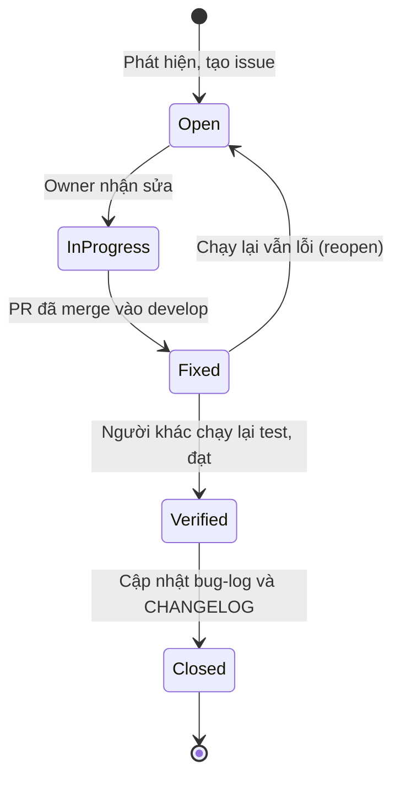

# Mẫu báo cáo lỗi (bug report)

> **Cách dùng:** mỗi lỗi là **một issue GitHub** gắn label `bug` (và label mức độ), đồng thời được ghi thành một dòng trong `docs/06-maintenance/bug-log.md` (do C quản lý). Copy mẫu ở mục 2 vào nội dung issue.
> **Quy ước ID:** `BUG-xxx` (số thứ tự 3 chữ số, tăng dần: `BUG-001`, `BUG-002`, …). Nhánh sửa lỗi: `fix/BUG-xxx` (PLAN §16.1).

---

## 1. Mức độ nghiêm trọng (PLAN §14.4)

| Mức độ | Định nghĩa | Ví dụ |
|---|---|---|
| **Critical** | Crash, mất dữ liệu, không đăng nhập / thanh toán / học được | App văng khi mở Home; thanh toán thành công nhưng không ghi danh |
| **Major** | Chức năng chính sai, không có cách vòng | Phần trăm hoàn thành khóa tính sai; tìm kiếm trả kết quả không liên quan |
| **Minor** | Sai lệch UI hoặc lỗi nhỏ, có cách vòng | Sai màu chip so với design; toast hiện chậm |
| **Trivial** | Chính tả, căn lề 1–2 px | Lệch 2 px giữa icon và chữ |

**Tiêu chí ra kiểm thử (M5):** 0 bug Critical/Major đang mở; Minor sửa nếu kịp (PLAN §14.3, W7).

## 2. Mẫu báo cáo

Các trường theo đúng PLAN §14.4:

`BUG-xxx | Tiêu đề | Bước tái hiện | Mong đợi | Thực tế | Mức độ | Thiết bị | Ảnh/Video | Người phát hiện | Người sửa | Trạng thái | Commit fix`

### BUG-_(xxx)_ — _(Tiêu đề ngắn, mô tả hiện tượng)_

| Trường | Nội dung |
|---|---|
| ID | BUG-_(xxx)_ |
| Tiêu đề | _(điền)_ |
| Module / Màn hình | _(điền)_ (ví dụ: learning / SC-15) |
| Liên quan yêu cầu / Test case | _(điền)_ (ví dụ: FR-16, TC-LRN-01) |
| Bước tái hiện | 1. _(điền)_ 2. _(điền)_ 3. _(điền)_ |
| Kết quả mong đợi | _(điền)_ |
| Kết quả thực tế | _(điền)_ |
| Mức độ | _(Critical / Major / Minor / Trivial)_ |
| Tần suất tái hiện | _(Luôn luôn / Thỉnh thoảng / Hiếm khi)_ |
| Thiết bị / môi trường | _(điền)_ (model, Android/iOS version, Expo Go SDK, bản app, server local hay Render, mạng Wi-Fi/4G/offline) |
| Ảnh / Video | _(điền)_ (đính kèm vào issue; nêu đường dẫn) |
| Log / thông báo lỗi | _(điền)_ (log pino, console Metro; **không** dán token/mật khẩu) |
| Người phát hiện | _(điền)_ |
| Ngày phát hiện | _(điền)_ |
| Người sửa | _(điền)_ (owner của module theo PLAN §3.2) |
| Trạng thái | _(Open / In progress / Fixed / Verified / Closed)_ |
| Commit / PR sửa lỗi | _(điền)_ (ví dụ: `fix(mobile): resume video from saved position` — PR #_(số)_) |
| Người xác minh | _(điền)_ (khác người sửa) |
| Ghi chú | _(điền)_ (nguyên nhân gốc, cách phòng tránh, test hồi quy đã thêm) |

## 3. Vòng đời trạng thái

| Trạng thái | Ý nghĩa | Ai chuyển |
|---|---|---|
| Open | Mới ghi nhận, chưa ai nhận | Người phát hiện |
| In progress | Đang sửa, đã có nhánh `fix/BUG-xxx` | Người sửa |
| Fixed | Đã merge PR sửa lỗi vào `develop` (hoặc `main` nếu hotfix) | Người sửa |
| Verified | Người khác (không phải người sửa) xác nhận lỗi không còn, test hồi quy đạt | Người xác minh |
| Closed | Đã ghi vào `bug-log.md` và `CHANGELOG.md` | C (QA Lead) |

## 4. Quy trình xử lý (PLAN §16.1)

1. Phát hiện → tạo issue `bug` theo mẫu trên.
2. Phân loại mức độ (mục 1) và gán owner theo module.
3. Tạo nhánh `fix/BUG-xxx` (từ `develop`; từ `main` nếu là hotfix sau release).
4. Viết **test tái hiện** (unit/integration nếu có thể) → sửa → PR ghi rõ `BUG-xxx`, có review.
5. Merge → chuyển `Fixed` → người khác kiểm chứng → `Verified`.
6. Cập nhật `docs/06-maintenance/bug-log.md` và `CHANGELOG.md`; hotfix thì gắn tag `v1.0.x`.

## 5. Ví dụ minh họa (không phải lỗi thật)

### BUG-000 — Video luôn bắt đầu từ 0:00 khi mở lại bài học đã xem dở

| Trường | Nội dung |
|---|---|
| ID | BUG-000 (ví dụ minh họa) |
| Tiêu đề | Video luôn bắt đầu từ 0:00 khi mở lại bài học đã xem dở |
| Module / Màn hình | learning / SC-15 |
| Liên quan yêu cầu / Test case | FR-16, TC-LRN-01 |
| Bước tái hiện | 1. Đăng nhập tài khoản demo, mở khóa đã ghi danh. 2. Phát bài 01 đến khoảng 0:20. 3. Thoát về My Courses. 4. Vào lại bài 01. |
| Kết quả mong đợi | Video bắt đầu ở khoảng 0:20 |
| Kết quả thực tế | Video bắt đầu từ 0:00 |
| Mức độ | Major |
| Tần suất tái hiện | Luôn luôn |
| Thiết bị / môi trường | Android 13, Expo Go SDK _(phiên bản đang dùng)_, server local, Wi-Fi |
| Ảnh / Video | `bug-000-resume.mp4` |
| Người phát hiện | B |
| Người sửa | C |
| Trạng thái | Open |
| Commit / PR sửa lỗi | _(chưa có)_ |
| Ghi chú | Nghi ngờ app không gọi `seek` sau khi nạp nguồn video hoặc không gửi `positionSec` khi rời màn |

## 6. Cấu trúc bảng trong `bug-log.md`

| BUG | Tiêu đề | Mức độ | Trạng thái | Người phát hiện | Người sửa | Ngày phát hiện | Ngày đóng | Commit fix |
|---|---|---|---|---|---|---|---|---|
| BUG-_(xxx)_ | _(điền)_ | _(điền)_ | _(điền)_ | _(điền)_ | _(điền)_ | _(điền)_ | _(điền)_ | _(điền)_ |
