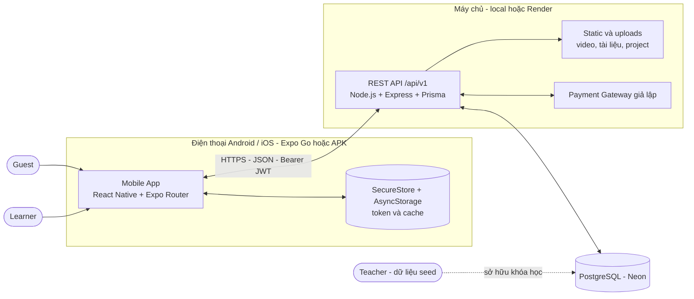
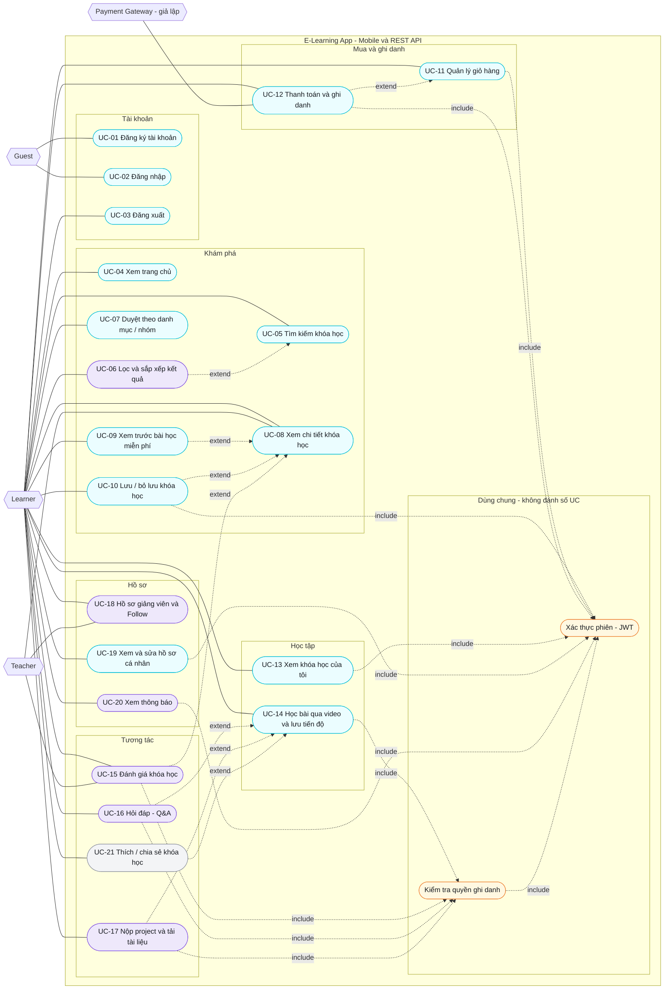

# Đặc tả yêu cầu phần mềm (SRS) — E-Learning App

| Mục | Nội dung |
|---|---|
| Dự án | E-Learning App — Đề tài số 5, môn **Lập trình thiết bị di động** (React Native + Expo + TypeScript; backend Node.js/Express + PostgreSQL) |
| Tài liệu | Software Requirements Specification (SRS) — theo IEEE 830 rút gọn |
| Giai đoạn SDLC | 1. Requirement Analysis (task R-04, R-05) |
| Phiên bản | **1.1** — đồng bộ PLAN.md v1.3; bản đề xuất, chờ review chéo và chốt tại buổi họp Chủ nhật 11/10/2026 (task R-06) |
| Ngày soạn | 30/09/2026 (bám PLAN.md v1.3) |
| Người phụ trách | A — tổng hợp SRS (R-05). Đặc tả UC theo feature: A (UC-02, UC-12) · B (UC-01, UC-05, UC-08, UC-17) · C (UC-14, UC-15, UC-16) (R-04) |
| Tài liệu liên quan | [interviews.md](interviews.md) · [user-stories.md](user-stories.md) · [diagrams/use-case.puml](diagrams/use-case.puml) · [PLAN.md](../../PLAN.md) · [CLAUDE.md](../../CLAUDE.md) |

### Lịch sử thay đổi

| Phiên bản | Ngày | Nội dung | Người cập nhật |
|---|---|---|---|
| 1.0 | 30/09/2026 | Bản đầy đủ đầu tiên: 21 UC, đặc tả chi tiết 9 UC, FR-01…FR-24, NFR-01…NFR-10, BR-01…BR-17, ma trận truy vết | Nhóm (A tổng hợp) |
| 1.1 | 30/09/2026 | Đồng bộ PLAN.md v1.3: lọc nhiều danh mục (FR-06); Follow thuộc FR-20 (FR-08); mô phỏng thanh toán thất bại 402 `PAYMENT_FAILED` (BR-07, UC-12); `GET /notifications/unread-count` (FR-04, FR-23); GET Q&A/Project yêu cầu ghi danh (UC-16, UC-17); rate limit chỉ `login`/`register` (NFR-05); ngoại lệ lưu tiến độ offline (FR-24, FR-16, UC-14); ẩn "View more" Student Projects (FR-18, UC-17); gán mã HTTP cho mã lỗi; thêm BR-18; cập nhật Phụ lục C | Nhóm (A tổng hợp) |

## Mục lục

1. [Giới thiệu](#1-giới-thiệu)
2. [Mô tả tổng quan](#2-mô-tả-tổng-quan)
3. [Actor và Use case](#3-actor-và-use-case)
4. [Đặc tả chi tiết 9 Use case](#4-đặc-tả-chi-tiết-9-use-case)
5. [Yêu cầu chức năng (FR-01 … FR-24)](#5-yêu-cầu-chức-năng-fr-01--fr-24)
6. [Yêu cầu phi chức năng (NFR-01 … NFR-10)](#6-yêu-cầu-phi-chức-năng-nfr-01--nfr-10)
7. [Quy tắc nghiệp vụ (BR-01 … BR-18)](#7-quy-tắc-nghiệp-vụ-br-01--br-18)
8. [Yêu cầu giao diện](#8-yêu-cầu-giao-diện)
9. [Ma trận truy vết](#9-ma-trận-truy-vết)
10. [Phụ lục](#10-phụ-lục)

---

## 1. Giới thiệu

### 1.1 Mục đích

Tài liệu này đặc tả đầy đủ các yêu cầu của ứng dụng **E-Learning App**: các actor, use case, yêu cầu chức năng (FR), yêu cầu phi chức năng (NFR), quy tắc nghiệp vụ (BR) và yêu cầu giao diện. SRS là đầu vào cho giai đoạn thiết kế (SDS, ERD, API spec, sơ đồ UML), cài đặt và kiểm thử; mỗi test case ở giai đoạn Testing phải truy vết được về một `FR-xx` hoặc `NFR-xx` trong tài liệu này (CLAUDE.md §9).

Đối tượng đọc:

| Đối tượng | Mục đích đọc |
|---|---|
| Thành viên nhóm (A, B, C) | Làm rõ phạm vi, tiêu chí chấp nhận và quy tắc nghiệp vụ trước khi thiết kế và code |
| Giảng viên chấm đồ án | Đánh giá giai đoạn Requirement Analysis theo `MotaDetai_SDLC.txt` |
| Người kiểm thử (C là QA Lead) | Xây dựng test case bám FR/NFR/BR |

### 1.2 Phạm vi

**Sản phẩm:** ứng dụng học trực tuyến trên điện thoại cho phép người dùng duyệt và tìm khóa học, mua và ghi danh, học qua video, hỏi đáp, nộp project, đánh giá khóa học, xem hồ sơ giảng viên và quản lý hồ sơ cá nhân. Hệ thống gồm:

- **Mobile app** (Expo managed workflow, React Native, TypeScript) chạy trên Android và iOS, bám 12 màn hình thiết kế gốc và các màn hình bổ sung.
- **Backend REST API** (Node.js, Express, TypeScript, Prisma) và cơ sở dữ liệu **PostgreSQL** (Neon).

**Mục tiêu** (PLAN §2.1): (1) sản phẩm chạy được trên Android/iOS bám sát design; (2) đi đủ 6 giai đoạn SDLC có tài liệu và minh chứng; (3) điểm nhấn kỹ thuật về cache nhiều tầng, xem offline, tối ưu hiệu năng, optimistic UI, tiếp tục video từ vị trí cũ.

**Trong phạm vi** (phân loại MoSCoW theo PLAN §2.2):

| Mức | Nội dung |
|---|---|
| **Must (MVP)** | Đăng ký, đăng nhập, duy trì phiên, đăng xuất · Home (banner, categories, Popular, Recommended, Course that inspires, Top teachers) · Tìm kiếm theo từ khóa + hot topics, kết quả cuộn vô hạn · Xem khóa theo danh mục / "View more" · Chi tiết khóa học (Overview, Lessons, Review xem) · Bookmark · Giỏ hàng + thanh toán giả lập → ghi danh; ghi danh khóa miễn phí · My Courses (All / On going / Completed) · Học bài (phát video, chuyển bài, lưu và tiếp tục vị trí, tự hoàn thành, cập nhật %) · User profile (thống kê + danh sách đã lưu) |
| **Should** | Bộ lọc và sắp xếp · Viết/sửa đánh giá, xem tất cả đánh giá có lọc theo sao · Q&A (đặt câu hỏi, trả lời, like, chi tiết câu hỏi) · Projects (mô tả, tải tài liệu, nộp project, xem project học viên khác) · Teacher profile + Follow · Chỉnh sửa hồ sơ + đổi avatar · Thông báo trong app · Cache offline + banner mất kết nối |
| **Could** | Like/Share khóa học · Recent searches · Danh sách tất cả giảng viên · Tự động phát bài tiếp theo, tốc độ phát · E2E Maestro · Swagger UI · Dark mode. Với nhóm 3 người, các mục Could **mặc định không làm**; chỉ làm ở tuần W9 nếu Must + Should đã xong và ổn định |

**Ngoài phạm vi (Won't)** — không hiện thực, chuyển thành đề xuất cải tiến (PLAN §2.2, §16.3):

- Thanh toán thật, hoàn tiền, coupon.
- Web admin; giảng viên tạo khóa học trong app.
- Tải video xem offline, livestream, chứng chỉ PDF.
- Push notification thật (expo-notifications), chat realtime.
- Đa ngôn ngữ (i18n).

### 1.3 Định nghĩa, từ viết tắt

| Thuật ngữ | Giải thích |
|---|---|
| SRS / SDS / SDLC | Software Requirements Specification / Software Design Specification / Software Development Life Cycle |
| UC / FR / NFR / BR | Use case / Functional Requirement / Non-Functional Requirement / Business Rule |
| SC / US / TC / BUG | Screen (màn hình) / User Story / Test Case / Bug — mã định danh theo PLAN §0 |
| MoSCoW | Phân loại ưu tiên: Must, Should, Could, Won't |
| MVP | Minimum Viable Product — bản tối thiểu chạy được luồng lõi (milestone M3, 08/11/2026) |
| Actor | Đối tượng bên ngoài tương tác với hệ thống: Guest, Learner, Teacher, Payment Gateway (giả lập) |
| Guest | Người dùng chưa đăng nhập |
| Learner (Học viên) | Người dùng đã đăng nhập, dùng ứng dụng để học |
| Teacher (Giảng viên) | Actor phụ: sở hữu khóa học, được follow và đánh giá; dữ liệu do seed |
| Ghi danh (Enrollment) | Quan hệ Learner được quyền học một khóa (sau khi thanh toán thành công hoặc ghi danh khóa miễn phí) |
| Curriculum | Cấu trúc nội dung khóa: chương (Section) chứa các bài học (Lesson) |
| Bài xem thử (Preview) | Bài học có `isPreview = true`, xem được khi chưa ghi danh |
| Tiến độ (Progress) | Vị trí xem (`positionSec`) và trạng thái hoàn thành của từng bài; % hoàn thành của khóa |
| Bookmark (Lưu) | Đánh dấu khóa học để xem lại sau |
| Cart / Order / Checkout | Giỏ hàng / Đơn hàng / Bước thanh toán giỏ hàng |
| Mock payment (thanh toán giả lập) | Cổng thanh toán mô phỏng, không xử lý dữ liệu thẻ thật (ADR-10) |
| JWT / Bearer | JSON Web Token gửi trong header `Authorization: Bearer <token>`; hết hạn sau 7 ngày (ADR-07) |
| REST / API / DTO | Kiến trúc dịch vụ web / giao diện lập trình ứng dụng / Data Transfer Object (kiểu dữ liệu trao đổi) |
| Pagination / Infinite scroll | Phân trang `?page&limit` / cuộn tải thêm trang kế tiếp |
| Debounce / Throttle | Trì hoãn xử lý cho tới khi ngừng thao tác / giới hạn tần suất gọi |
| Optimistic update | Cập nhật giao diện ngay trước khi server xác nhận, hoàn tác (rollback) nếu lỗi |
| Skeleton / Toast | Khung xám chờ tải dữ liệu / thông báo ngắn tự tắt |
| Cache / Persist | Bộ nhớ đệm trong RAM / lưu bộ nhớ đệm vào AsyncStorage để dùng lại sau khi mở app |
| Seed | Dữ liệu mẫu nạp vào DB bằng script (`prisma/seed.ts`) |
| Expo / Expo Go / EAS | Bộ công cụ React Native / ứng dụng chạy thử trên điện thoại / dịch vụ build APK |
| Neon / Render | PostgreSQL trên cloud (free tier) / dịch vụ chạy web service (free tier) |
| SecureStore / AsyncStorage | Kho lưu trữ mã hóa cho token / kho khóa–giá trị cho cache và dữ liệu cục bộ |
| `priceCents` | Giá lưu bằng đơn vị cent (số nguyên); UI hiển thị USD (ADR-11) |
| dp / pt | Đơn vị kích thước trên Android / iOS |
| p95 | Bách phân vị 95 của thời gian phản hồi |
| FPS | Số khung hình mỗi giây (đo bằng Perf Monitor) |

### 1.4 Tài liệu tham chiếu

| # | Tài liệu | Vai trò |
|---|---|---|
| [1] | `PLAN.md` v1.3 | Nguồn sự thật về phạm vi, phân công, đặc tả màn hình/DB/API, kế hoạch |
| [2] | `CLAUDE.md` | Quy tắc, tech stack, quy ước code/Git/test |
| [3] | `MotaDetai_SDLC.txt` | Yêu cầu quy trình SDLC và deliverable của môn học |
| [4] | `yeucau.txt` | Yêu cầu slide và video |
| [5] | `design/E-Learning App.pdf`, `design/screens/*.png` | Thiết kế UI gốc (12 màn hình) |
| [6] | IEEE Std 830-1998 | Khuôn mẫu cấu trúc SRS (bản rút gọn) |
| [7] | [interviews.md](interviews.md) | Persona và phỏng vấn giả định |
| [8] | [user-stories.md](user-stories.md) | 37 user story và acceptance criteria |
| [9] | [diagrams/use-case.puml](diagrams/use-case.puml) | Use case diagram (PlantUML) |

### 1.5 Quy ước trình bày

- **Mã định danh:** `UC-xx` use case · `FR-xx` chức năng · `NFR-xx` phi chức năng · `BR-xx` quy tắc nghiệp vụ · `SC-xx` màn hình · `US-xx` user story · `TC-<MODULE>-xx` test case. Các mã này khớp với PLAN.md và **không được đổi** nếu chưa cập nhật PLAN.
- **Từ khóa yêu cầu:** "phải" — bắt buộc; "nên" — khuyến nghị; "có thể" — tùy chọn.
- **Ưu tiên** theo MoSCoW (mục 1.2). Ưu tiên của UC/FR lấy đúng theo PLAN §6.2, §6.3.
- **Văn bản giao diện:** tiếng Anh, đặt trong dấu ngoặc kép (ví dụ "Add to cart"); tài liệu viết bằng tiếng Việt (CLAUDE.md §2).
- **Mã lỗi:** dạng `UPPER_SNAKE_CASE` theo PLAN §9.4; trạng thái HTTP theo CLAUDE.md §8 (400 validation, 401 chưa đăng nhập, 403 không có quyền, 404, 409 trùng, 422 nghiệp vụ, 500).

### 1.6 Bố cục tài liệu

Mục 2 mô tả tổng quan sản phẩm; mục 3 liệt kê actor, use case và sơ đồ; mục 4 đặc tả chi tiết 9 UC bắt buộc; mục 5–7 liệt kê FR, NFR, BR; mục 8 nêu yêu cầu giao diện; mục 9 là ma trận truy vết FR ↔ UC ↔ SC ↔ US; mục 10 là phụ lục danh sách màn hình và thông điệp giao diện.

---

## 2. Mô tả tổng quan

### 2.1 Bối cảnh sản phẩm

E-Learning App là sản phẩm độc lập theo mô hình **client–server**: ứng dụng di động gọi backend qua REST/JSON, backend truy cập PostgreSQL. Hệ thống chỉ có một hệ thống ngoài mô phỏng là **Payment Gateway (giả lập)**, được cài đặt bên trong backend để xác nhận thanh toán mà không xử lý dữ liệu thẻ thật và có thể **mô phỏng thanh toán thất bại** khi demo/kiểm thử (cờ `simulateFailure`, BR-07) (G5, ADR-10). Không có web admin; toàn bộ dữ liệu khóa học, giảng viên, bài học do seed tạo ra (G6).

**Giao diện với môi trường ngoài** (chi tiết ở mục 8): điện thoại (màn hình cảm ứng, thư viện ảnh, bộ nhớ, mạng), backend REST, dịch vụ PostgreSQL (Neon), dịch vụ lưu trữ ảnh mẫu (liên kết trực tiếp tới ảnh Unsplash trong seed) và Payment Gateway giả lập.

### 2.2 Chức năng chính

| Nhóm | Chức năng | FR | UC |
|---|---|---|---|
| Tài khoản | Đăng ký · Đăng nhập (và khôi phục phiên) · Đăng xuất | FR-01, FR-02, FR-03 | UC-01, 02, 03 |
| Khám phá | Trang chủ · Tìm kiếm · Lọc và sắp xếp · Duyệt theo danh mục / nhóm | FR-04, FR-05, FR-06, FR-07 | UC-04, 05, 06, 07 |
| Chi tiết khóa học | Overview · Lessons (trạng thái, xem thử) · Review · Lưu khóa học | FR-08, FR-09, FR-10, FR-12 | UC-08, 09, 10 |
| Mua và ghi danh | Giỏ hàng · Thanh toán giả lập · Ghi danh khóa miễn phí | FR-13, FR-14 | UC-11, 12 |
| Học tập | My Courses · Học video, lưu tiến độ · Thích/chia sẻ (Could) | FR-15, FR-16, FR-17 | UC-13, 14, 21 |
| Tương tác | Viết/sửa đánh giá · Q&A · Projects (tài liệu, nộp bài) | FR-11, FR-19, FR-18 | UC-15, 16, 17 |
| Giảng viên | Hồ sơ giảng viên · Follow | FR-20 | UC-18 |
| Hồ sơ cá nhân | Xem/sửa hồ sơ · Thống kê · Thông báo | FR-21, FR-22, FR-23 | UC-19, 20 |
| Xuyên suốt | Xem lại dữ liệu khi mất mạng, banner offline | FR-24 | (áp dụng cho các UC đọc dữ liệu) |

### 2.3 Đặc điểm người dùng

| Đối tượng | Mô tả | Trình độ công nghệ | Tần suất dùng | Thiết bị điển hình |
|---|---|---|---|---|
| **Guest** | Chưa có phiên đăng nhập; chỉ đăng ký/đăng nhập | Bất kỳ | Một lần trước khi vào app | Android/iOS |
| **Learner** — Sinh viên CNTT muốn học thêm (P1) | 20–22 tuổi, học ngắn (15–30 phút) giữa giờ, ngân sách thấp, mạng chập chờn | Cao | Hằng ngày | Android tầm trung |
| **Learner** — Người đi làm chuyển sang Design (P2) | 25–35 tuổi, học buổi tối/cuối tuần, sẵn sàng trả tiền cho khóa chất lượng, mua nhiều khóa | Trung bình – khá | 3–5 buổi/tuần | iPhone / Android |
| **Teacher** (P3) | Giảng viên sở hữu khóa học; **không có giao diện riêng**, chỉ được hiển thị (hồ sơ, đánh giá, số theo dõi) | Cao | Không tương tác trực tiếp với app | — |
| **Payment Gateway (giả lập)** | Hệ thống ngoài mô phỏng, xác nhận thanh toán khi Learner bấm Pay | — | Mỗi lần checkout | — |

Chi tiết persona xem [interviews.md](interviews.md). Đây là **người dùng giả định** theo yêu cầu đề bài.

### 2.4 Môi trường vận hành

| Thành phần | Yêu cầu / môi trường |
|---|---|
| Thiết bị di động | Android 10+ (Expo Go), iOS 16+ (Expo Go); màn hình rộng 360–430 dp (NFR-08). Thiết bị test chính: Android thật + Expo Go (G3) |
| Ứng dụng | Expo managed workflow: chạy bằng **Expo Go** (cùng SDK với dự án) trong giai đoạn phát triển; bản nộp là **APK** build bằng EAS (`preview`). iOS chạy qua Expo Go (không build IPA) |
| Mạng | Wi-Fi hoặc 4G; khi phát triển, điện thoại và máy chạy server cùng mạng LAN, gọi API bằng **IP LAN** (không dùng `localhost`) qua cổng 4000 |
| Server | Node.js LTS, Express, Prisma; chạy local bằng `npm run dev` hoặc triển khai trên Render (free) |
| Cơ sở dữ liệu | PostgreSQL trên Neon (free tier); DB kiểm thử riêng (Neon branch `test`) |
| Máy phát triển | Windows 11, Node.js, Git; không có Docker/Java/Android SDK (G4) |

### 2.5 Ràng buộc thiết kế và triển khai

**Ràng buộc công nghệ** (CLAUDE.md §3 — đã chốt, không tự ý thay):

- Mobile: Expo (managed workflow), React Native, TypeScript `strict`, Expo Router, TanStack Query v5 (+ persist AsyncStorage), Zustand, react-hook-form + zod, axios (một instance duy nhất), expo-image, expo-video, FlashList, SecureStore (token), AsyncStorage (cache).
- Backend: Node.js, Express, TypeScript, Prisma, zod, JWT, bcryptjs (cost 10), multer, helmet, cors, compression, express-rate-limit, pino.
- Database: PostgreSQL. Thay đổi DB chỉ qua `prisma migrate dev`.
- API: REST `/api/v1`; thành công `{ data, meta? }`; lỗi `{ error: { code, message, details? } }`; phân trang `?page&limit` (tối đa 50); tiền lưu `priceCents` (Int); thời lượng `durationSec` (Int); ID `cuid()`; thời gian ISO 8601 UTC.
- Không dùng thư viện UI kit ngoài; styling bằng `StyleSheet` + design tokens.

**Ràng buộc về sản phẩm và thiết kế:**

- UI phải **bám design gốc** (`design/screens/*.png`) và tokens (màu, font, spacing, radius); màn hình không có trong design (Login, Register, Filter, Cart, Checkout, Notifications, Edit profile) theo cùng tokens và phong cách.
- Sai khác có chủ đích so với design: các màn chi tiết (Course details, Teacher profile, Learning) đẩy lên root Stack nên **ẩn bottom tab**.
- Văn bản hiển thị trong app: tiếng Anh, gom trong `strings.ts`; tiền tệ hiển thị USD.
- Dữ liệu khóa học, giảng viên, bài học do seed; ảnh dùng liên kết Unsplash; video là 3–5 clip MP4 H.264 ngắn (≤ 30 s, tổng ≤ 20 MB) phục vụ từ `/static`.

**Ràng buộc về quy trình:**

- Nhóm 3 thành viên (G1); thời gian 30/09/2026 – 06/12/2026 (G2); feature freeze 15/11/2026 (M4); mọi công việc bám PLAN.md.
- Tài liệu SDLC bằng tiếng Việt; code/commit bằng tiếng Anh; Conventional Commits; PR có ≥ 1 review.

**Ràng buộc về bảo mật và triển khai:**

- Không xử lý dữ liệu thẻ thật; không commit secret (`.env*`, `JWT_SECRET`, `DATABASE_URL`).
- Gói free của Render ngủ sau ~15 phút không dùng (lần gọi đầu chậm) và ổ đĩa không bền (file upload mất khi redeploy) — chấp nhận cho demo, ghi vào Known issues.

### 2.6 Giả định và phụ thuộc

**Giả định** (PLAN §1; nhóm xác nhận tại P-01):

| # | Giả định | Ảnh hưởng nếu sai |
|---|---|---|
| G1 | Nhóm có 3 thành viên | Nếu có thêm người → phân công lại (PLAN §3.3) |
| G2 | Thời gian 30/09 → 06/12/2026 (~10 tuần) | Co/giãn số sprint, tối thiểu 3 sprint |
| G3 | Thiết bị test chính: Android thật + Expo Go; iOS (Expo Go) nếu có | Điều chỉnh kế hoạch kiểm thử |
| G4 | Máy dev không có Docker/Java/Android SDK | DB dùng Neon; có thể thêm Docker Compose sau |
| G5 | Không tích hợp thanh toán thật, dùng thanh toán giả lập | Mở rộng phạm vi FR-14 |
| G6 | Không làm web admin; dữ liệu do seed | Teacher không có giao diện |
| G7 | Có backend riêng (Express + PostgreSQL) | Nếu dùng BaaS phải cập nhật §5, §8, §9 của PLAN |
| G8 | UI tiếng Anh như design, tài liệu tiếng Việt | Ảnh hưởng chuỗi hiển thị |

**Phụ thuộc:**

| Phụ thuộc | Mô tả | Rủi ro liên quan |
|---|---|---|
| Expo SDK và Expo Go | Mọi thành viên dùng cùng SDK và Expo Go tương thích | R1 |
| Mạng LAN / Wi-Fi | Điện thoại gọi được API trên máy dev (IP LAN, firewall cổng 4000) | R2 |
| Neon, Render | Dịch vụ cloud miễn phí có thể ngủ/giới hạn | R3, R8 |
| Ảnh Unsplash, video Pexels/Pixabay | Nguồn ảnh/video mẫu bản quyền mở | — |
| expo-video | Thư viện phát video; hỗ trợ `timeUpdate` để lưu tiến độ | R6 |
| Dữ liệu seed | Tài khoản demo, khóa học, tiến độ mẫu phải có để demo và test | — |

### 2.7 Phân bổ yêu cầu theo mức ưu tiên

| Mức | UC | FR |
|---|---|---|
| Must | UC-01, 02, 03, 04, 05, 07, 08, 09, 10, 11, 12, 13, 14, 19 (phần xem hồ sơ) | FR-01, FR-02, FR-03, FR-04, FR-05, FR-07, FR-08, FR-09, FR-10 (xem), FR-12, FR-13, FR-14, FR-15, FR-16, FR-21 |
| Should | UC-06, 15, 16, 17, 18, 19 (phần chỉnh sửa), 20 | FR-06, FR-11, FR-18, FR-19, FR-20, FR-22, FR-23, FR-24 |
| Could | UC-21 | FR-17 |
| Won't | — (xem mục 1.2) | — |

---

## 3. Actor và Use case

### 3.1 Actor

| Actor | Loại | Mô tả | Use case tham gia |
|---|---|---|---|
| **Guest** | Chính | Người chưa đăng nhập — chỉ đăng ký/đăng nhập. Sau khi đăng nhập thành công trở thành Learner | UC-01, UC-02 |
| **Learner (Học viên)** | Chính | Người dùng chính: duyệt, tìm, mua, học, hỏi đáp, đánh giá, quản lý hồ sơ | UC-03 đến UC-21 |
| **Teacher (Giảng viên)** | Phụ | Sở hữu khóa học, được follow và đánh giá; dữ liệu do seed, **không có giao diện riêng** | UC-08, UC-15, UC-18 (là đối tượng được hiển thị/đánh giá/theo dõi) |
| **Payment Gateway (giả lập)** | Hệ thống ngoài (phụ) | Xác nhận thanh toán mô phỏng khi checkout; có thể trả kết quả thất bại khi được yêu cầu mô phỏng (402 `PAYMENT_FAILED`) | UC-12 |

### 3.2 Danh sách use case

| UC | Tên | Actor | FR | SC chính | Ưu tiên | Đặc tả chi tiết |
|---|---|---|---|---|---|---|
| UC-01 | Đăng ký tài khoản | Guest | FR-01 | SC-03 | Must | [§4.1](#41-uc-01--đăng-ký-tài-khoản) |
| UC-02 | Đăng nhập | Guest | FR-02 | SC-01, SC-02 | Must | [§4.2](#42-uc-02--đăng-nhập) |
| UC-03 | Đăng xuất | Learner | FR-03 | SC-20 | Must | — |
| UC-04 | Xem trang chủ | Learner | FR-04 | SC-04 | Must | — |
| UC-05 | Tìm kiếm khóa học | Learner | FR-05 | SC-05, SC-06 | Must | [§4.3](#43-uc-05--tìm-kiếm-khóa-học) |
| UC-06 | Lọc và sắp xếp kết quả | Learner | FR-06 | SC-07 | Should | — |
| UC-07 | Duyệt khóa học theo danh mục / nhóm | Learner | FR-07 | SC-08 | Must | — |
| UC-08 | Xem chi tiết khóa học | Learner | FR-08, FR-09, FR-10 | SC-09, SC-10 | Must | [§4.4](#44-uc-08--xem-chi-tiết-khóa-học) |
| UC-09 | Xem trước bài học miễn phí (preview) | Learner | FR-09 | SC-09 | Must | — |
| UC-10 | Lưu / bỏ lưu khóa học | Learner | FR-12 | Nhiều màn | Must | — |
| UC-11 | Quản lý giỏ hàng | Learner | FR-13 | SC-09, SC-12 | Must | — |
| UC-12 | Thanh toán và ghi danh | Learner, Payment Gateway | FR-14 | SC-12, SC-13 | Must | [§4.5](#45-uc-12--thanh-toán-và-ghi-danh) |
| UC-13 | Xem khóa học của tôi | Learner | FR-15 | SC-14 | Must | — |
| UC-14 | Học bài qua video và lưu tiến độ | Learner | FR-16 | SC-15 | Must | [§4.6](#46-uc-14--học-bài-qua-video-và-lưu-tiến-độ) |
| UC-15 | Đánh giá khóa học | Learner | FR-11 | SC-11 | Should | [§4.7](#47-uc-15--đánh-giá-khóa-học) |
| UC-16 | Hỏi đáp (Q&A) | Learner | FR-19 | SC-15, SC-16 | Should | [§4.8](#48-uc-16--hỏi-đáp-qa) |
| UC-17 | Nộp project và tải tài liệu | Learner | FR-18 | SC-15, SC-17 | Should | [§4.9](#49-uc-17--nộp-project-và-tải-tài-liệu) |
| UC-18 | Xem hồ sơ giảng viên và theo dõi | Learner | FR-20 | SC-18 | Should | — |
| UC-19 | Xem và chỉnh sửa hồ sơ cá nhân | Learner | FR-21, FR-22 | SC-20, SC-21 | Must / Should | — |
| UC-20 | Xem thông báo | Learner | FR-23 | SC-22 | Should | — |
| UC-21 | Thích / chia sẻ khóa học | Learner | FR-17 | SC-15 | Could | — |

Ghi chú: UC-19 gồm hai phần — xem hồ sơ (FR-21, Must) và chỉnh sửa hồ sơ (FR-22, Should). FR-24 (offline) là yêu cầu xuyên suốt, không gắn với một UC riêng.

### 3.3 Sơ đồ use case

Sơ đồ nguồn (PlantUML) nằm ở [diagrams/use-case.puml](diagrams/use-case.puml) (gồm sơ đồ tổng quan và 3 sơ đồ theo nhóm chức năng; hướng dẫn xuất PNG trong [diagrams/README.md](diagrams/README.md)). Bản dưới đây là sơ đồ actor–UC bằng Mermaid để xem trực tiếp trên GitHub; màu nền thể hiện ưu tiên (xanh = Must, tím = Should, xám = Could, cam = chức năng dùng chung). Hai khối "dùng chung" (Xác thực phiên, Kiểm tra quyền ghi danh) không phải UC đánh số mà là chức năng được nhiều UC `include`.

### 3.4 Quan hệ include / extend

| Quan hệ | Loại | Ý nghĩa |
|---|---|---|
| UC-10, UC-11, UC-12, UC-13, UC-19, UC-20 → Xác thực phiên | `include` | Các UC này yêu cầu phiên hợp lệ (JWT Bearer); nếu token hết hạn hoặc sai → 401, app xóa phiên và về SC-02 |
| Kiểm tra quyền ghi danh → Xác thực phiên | `include` | Kiểm tra ghi danh chỉ thực hiện sau khi đã xác định người dùng |
| UC-14, UC-15, UC-16, UC-17 → Kiểm tra quyền ghi danh | `include` | Server kiểm tra ghi danh ở tầng API (BR-01, BR-08, BR-09, NFR-06); ngoại lệ duy nhất là bài xem thử (`isPreview`) của UC-14/UC-09 |
| UC-06 → UC-05 | `extend` | Lọc/sắp xếp là mở rộng tùy chọn của tìm kiếm (nút Filter ở SC-05/SC-06) |
| UC-09 → UC-08 | `extend` | Xem trước bài miễn phí phát sinh khi Learner bấm ▶ hoặc bài Preview ở chi tiết khóa |
| UC-10 → UC-08 | `extend` | Bookmark là thao tác tùy chọn trên trang chi tiết (đồng thời có trên mọi card khóa học) |
| UC-15 → UC-08 | `extend` | Viết/sửa đánh giá bắt đầu từ tab Review của chi tiết khóa ("Write a review") |
| UC-12 → UC-11 | `extend` | Thanh toán mở rộng giỏ hàng tại điểm "Checkout"; luồng khóa miễn phí đi thẳng từ UC-08 ("Enroll for free") |
| UC-16, UC-17, UC-21 → UC-14 | `extend` | Q&A, Projects và Like/Share là các tab/chức năng tùy chọn trong màn Learning (SC-15) |
| UC-01 → UC-02 | (ghi chú) | Đăng ký thành công thì tự đăng nhập (trả token ngay), không đi lại màn Login |

---

## 4. Đặc tả chi tiết 9 Use case

Chín UC dưới đây được đặc tả đầy đủ (yêu cầu ≥ 8 UC — PLAN §6.2): **UC-01, UC-02, UC-05, UC-08, UC-12, UC-14, UC-15, UC-16, UC-17**. Mỗi UC gồm: mô tả, actor, tiền điều kiện, hậu điều kiện, luồng chính (đánh số), luồng thay thế (`A`), luồng ngoại lệ (`E`), quy tắc nghiệp vụ, màn hình và yêu cầu liên quan.

**Quy ước chung cho luồng ngoại lệ** (áp dụng cho mọi UC có gọi API):

| Tình huống | Hành vi chuẩn của ứng dụng |
|---|---|
| **Lỗi mạng / hết thời gian chờ** | Hiển thị thông báo lỗi kết nối dễ hiểu và nút **Retry**; giữ nguyên dữ liệu người dùng đã nhập; với màn có dữ liệu đã cache thì hiển thị dữ liệu cache kèm banner offline (FR-24, NFR-04, NFR-07) |
| **401 `UNAUTHORIZED`** (token thiếu, sai hoặc hết hạn) | Interceptor của `apiClient` xóa token và cache, chuyển về SC-02 Login |
| **403 `NOT_ENROLLED` / `FORBIDDEN`** | Hành động (đọc hoặc ghi) yêu cầu ghi danh nhưng Learner chưa ghi danh: hiển thị toast, điều hướng về SC-09 (BR-01, NFR-06) |
| **409** (`EMAIL_TAKEN`, `ALREADY_ENROLLED`, `ALREADY_IN_CART`) | Hiển thị thông điệp theo mã lỗi và đồng bộ lại trạng thái giao diện (invalidate query liên quan) |
| **400 `VALIDATION_ERROR`** | Hiển thị lỗi dưới từng trường theo `details` |
| **429 `RATE_LIMITED`** | Thông báo "thử lại sau ít phút" (chỉ áp dụng cho `POST /auth/login` và `POST /auth/register`, NFR-05) |
| **500 `INTERNAL_ERROR`** | Thông báo lỗi chung, cho phép Retry; server không trả stack trace (NFR-05) |
| **Thiết bị đang offline khi thực hiện thao tác ghi** | Chặn thao tác và hiển thị toast "You're offline" (FR-24). **Ngoại lệ duy nhất:** lưu tiến độ video (UC-14) được lưu tạm trên máy và tự đồng bộ khi có mạng lại |

Trong các bảng ngoại lệ dưới đây, các tình huống chuẩn ở trên chỉ được nhắc lại khi có xử lý riêng cho UC đó.

### 4.1 UC-01 — Đăng ký tài khoản

| Thuộc tính | Nội dung |
|---|---|
| Mã / Tên | UC-01 — Đăng ký tài khoản |
| Mô tả | Guest tạo tài khoản mới bằng họ tên, email và mật khẩu; sau khi tạo thành công được tự động đăng nhập và vào Home |
| Actor | Guest |
| Ưu tiên | Must |
| Người viết đặc tả | B (R-04) |
| Tiền điều kiện | (1) Ứng dụng đang mở ở SC-02 hoặc SC-03, chưa có phiên hợp lệ. (2) Thiết bị có kết nối mạng tới server |
| Hậu điều kiện (thành công) | Bản ghi `User` mới (role `STUDENT`, mật khẩu băm bcrypt cost 10) được tạo; token JWT (hết hạn 7 ngày) được lưu ở SecureStore; người dùng ở Home với lời chào "Hello, {firstName}!" |
| Hậu điều kiện (thất bại) | Không có tài khoản nào được tạo; Guest vẫn ở SC-03 với dữ liệu đã nhập được giữ lại (trừ mật khẩu có thể được xóa); không có token nào được lưu |
| Màn hình | SC-03 Register (SC-02 Login là điểm vào; SC-04 Home là đích) |
| Yêu cầu liên quan | FR-01 · NFR-05, NFR-07 |
| Business rules | Không có BR-xx riêng; quy tắc dữ liệu (mật khẩu ≥ 8 ký tự gồm chữ và số, email duy nhất) nằm trong FR-01; băm mật khẩu; rate limit `POST /auth/register` 10 req/phút/IP theo NFR-05 |
| API | `POST /auth/register` |
| User story / Test case | US-01 · TC-AUTH-01, TC-AUTH-02 |

**Luồng chính**

1. Guest ở SC-02 Login chọn liên kết "Sign up"; ứng dụng mở SC-03 Register.
2. Guest nhập **Full name**, **Email**, **Password**, **Confirm password**.
3. Guest bấm nút **Create account**.
4. Ứng dụng kiểm tra dữ liệu bằng zod: họ tên không rỗng; email đúng định dạng; mật khẩu ≥ 8 ký tự, có chữ và số; Confirm password khớp Password.
5. Ứng dụng vô hiệu hóa nút, hiển thị spinner và gửi `POST /auth/register` với `{ fullName, email, password }`.
6. Server kiểm tra lại dữ liệu bằng zod và kiểm tra email chưa thuộc tài khoản nào.
7. Server băm mật khẩu bằng bcryptjs (cost 10), tạo `User` (role `STUDENT`), sinh JWT (hết hạn 7 ngày) và trả về `{ token, user }` (không chứa `passwordHash`).
8. Ứng dụng lưu token vào SecureStore, lưu thông tin user vào `authStore` và cache `['me']`.
9. Ứng dụng điều hướng tới Home (SC-04), hiển thị "Hello, {firstName}!".

**Luồng thay thế**

| Mã | Điều kiện | Xử lý |
|---|---|---|
| A1 | Ở bước 1, Guest mở trực tiếp SC-03 (ví dụ từ liên kết trên SC-02) | Bắt đầu từ bước 2 |
| A2 | Ở bước 2, Guest bấm biểu tượng hiện/ẩn mật khẩu | Trường Password (và Confirm password) chuyển giữa dạng ẩn và dạng hiển thị; không ảnh hưởng luồng chính |
| A3 | Ở bất kỳ bước nào trước bước 5, Guest chọn liên kết "Log in" | Ứng dụng quay lại SC-02; UC kết thúc, không tạo tài khoản |

**Luồng ngoại lệ**

| Mã | Điều kiện | Xử lý của hệ thống |
|---|---|---|
| E1 | Bước 4: dữ liệu không hợp lệ (mật khẩu ngắn, thiếu chữ/số, email sai định dạng, confirm không khớp) | Hiển thị lỗi dưới từng trường; **không** gửi yêu cầu lên server; quay lại bước 2 |
| E2 | Bước 6: email đã tồn tại → server trả **409 `EMAIL_TAKEN`** | Hiển thị "Email already in use" dưới trường email; không tạo tài khoản; Guest ở lại SC-03 (TC-AUTH-02) |
| E3 | Bước 6: server phát hiện dữ liệu sai → **400 `VALIDATION_ERROR`** (client bị bỏ qua hoặc sai lệch quy tắc) | Ánh xạ `details` vào lỗi từng trường |
| E4 | Bước 5: **lỗi mạng / hết thời gian chờ** | Hiển thị thông báo lỗi kết nối; mở lại nút Create account; giữ dữ liệu đã nhập; Guest có thể thử lại |
| E5 | Vượt 10 yêu cầu `POST /auth/register`/phút từ cùng IP → **429 `RATE_LIMITED`** | Hiển thị thông báo thử lại sau |
| E6 | **500 `INTERNAL_ERROR`** | Hiển thị lỗi chung, cho phép thử lại; không tạo tài khoản dở dang |
| E7 | Bước 8: lưu SecureStore thất bại | Hiển thị lỗi, đưa Guest về SC-02 để đăng nhập thủ công (tài khoản đã được tạo ở server) |

> 401 và 403 không áp dụng cho UC này (endpoint công khai, không yêu cầu ghi danh).

### 4.2 UC-02 — Đăng nhập

| Thuộc tính | Nội dung |
|---|---|
| Mã / Tên | UC-02 — Đăng nhập |
| Mô tả | Guest đăng nhập bằng email và mật khẩu; ngoài ra ứng dụng tự khôi phục phiên khi mở lại nếu token còn hạn (màn khởi động SC-01) |
| Actor | Guest |
| Ưu tiên | Must |
| Người viết đặc tả | A (R-04) |
| Tiền điều kiện | (1) Guest đã có tài khoản. (2) Chưa có phiên hợp lệ (chưa đăng nhập, đã đăng xuất hoặc token hết hạn). (3) Có kết nối mạng (trừ luồng A2) |
| Hậu điều kiện (thành công) | Token JWT (7 ngày) lưu ở SecureStore; `authStore` có thông tin user; ứng dụng ở nhóm màn `(tabs)` (Home) |
| Hậu điều kiện (thất bại) | Không có token nào được lưu (hoặc token cũ bị xóa); Guest ở SC-02 |
| Màn hình | SC-01 Khởi động (bootstrap), SC-02 Login; đích SC-04 Home |
| Yêu cầu liên quan | FR-02 · NFR-05, NFR-07 |
| Business rules | Không có BR-xx riêng; token hết hạn sau 7 ngày (ADR-07); mật khẩu so sánh bằng bcrypt; rate limit `POST /auth/login` 10 req/phút/IP (NFR-05); `GET /auth/me` (khôi phục phiên mỗi lần mở app) **không** bị giới hạn |
| API | `POST /auth/login`, `GET /auth/me` |
| User story / Test case | US-02, US-03 · TC-AUTH-03, TC-AUTH-04 |

**Luồng chính (đăng nhập thủ công)**

1. Ứng dụng khởi động: SC-01 giữ splash, tải font, đọc token từ SecureStore, khôi phục cache; không có token → hiển thị SC-02 Login.
2. Guest nhập **Email** và **Password** (có thể hiện/ẩn mật khẩu).
3. Guest bấm nút **Log in**.
4. Ứng dụng kiểm tra bằng zod: email đúng định dạng, mật khẩu không rỗng.
5. Ứng dụng vô hiệu hóa nút, hiển thị spinner, gửi `POST /auth/login` với `{ email, password }`.
6. Server tìm user theo email, so sánh mật khẩu với `passwordHash` bằng bcrypt, sinh JWT (7 ngày) và trả `{ token, user }`.
7. Ứng dụng lưu token vào SecureStore, cập nhật `authStore` và cache `['me']`.
8. Ứng dụng chuyển tới Home (SC-04).

**Luồng thay thế**

| Mã | Điều kiện | Xử lý |
|---|---|---|
| A1 | **Khôi phục phiên** — ở bước 1 có token trong SecureStore | Ứng dụng gọi `GET /auth/me`: thành công → vào `(tabs)` ngay, **không** hiển thị SC-02 (TC-AUTH-04); lỗi 401 → xem E3 |
| A2 | **Khởi động offline** — bước 1 có token và có cache user nhưng không có mạng | Ứng dụng vào `(tabs)` ở chế độ offline, hiển thị dữ liệu cache và banner mất kết nối (FR-24) |
| A3 | Guest chọn liên kết "Sign up" ở SC-02 | Chuyển sang UC-01 |
| A4 | Guest bấm biểu tượng hiện/ẩn mật khẩu | Chuyển đổi hiển thị mật khẩu |

**Luồng ngoại lệ**

| Mã | Điều kiện | Xử lý của hệ thống |
|---|---|---|
| E1 | Bước 4: email sai định dạng hoặc mật khẩu rỗng | Hiển thị lỗi dưới từng trường; không gọi API |
| E2 | Bước 6: sai email hoặc mật khẩu → **401 `INVALID_CREDENTIALS`** | Hiển thị thông báo lỗi đăng nhập chung (không tiết lộ email hay mật khẩu sai); giữ email đã nhập; Guest ở lại SC-02 (TC-AUTH-03) |
| E3 | Luồng A1: `GET /auth/me` trả **401** (token hết hạn hoặc không hợp lệ) | Xóa token và cache; hiển thị SC-02 Login |
| E4 | Bước 5: **lỗi mạng / hết thời gian chờ** | Thông báo lỗi kết nối, cho phép thử lại. Ở luồng A1 không có mạng và **không có** cache user: hiển thị ErrorState kèm nút Retry (NFR-07) |
| E5 | Vượt 10 yêu cầu `POST /auth/login`/phút từ cùng IP → **429 `RATE_LIMITED`** | Thông báo thử lại sau. Khôi phục phiên (`GET /auth/me`) không thuộc diện giới hạn này |
| E6 | **400 `VALIDATION_ERROR`** từ server | Hiển thị lỗi theo `details` |
| E7 | **500 `INTERNAL_ERROR`** | Thông báo lỗi chung, cho phép thử lại |

> 403 và 409 không áp dụng cho UC này.

### 4.3 UC-05 — Tìm kiếm khóa học

| Thuộc tính | Nội dung |
|---|---|
| Mã / Tên | UC-05 — Tìm kiếm khóa học |
| Mô tả | Learner tìm khóa học theo từ khóa (tên khóa, phụ đề, tag, tên giảng viên) hoặc bằng cách bấm chủ đề nóng; xem danh sách kết quả có số lượng và cuộn vô hạn |
| Actor | Learner |
| Ưu tiên | Must |
| Người viết đặc tả | B (R-04) |
| Tiền điều kiện | (1) Learner đã đăng nhập, đang ở tab Search. (2) Có kết nối mạng (danh sách kết quả tìm kiếm không được lưu offline) |
| Hậu điều kiện (thành công) | Danh sách khóa khớp từ khóa hiển thị cùng "{total} Results"; từ khóa và bộ lọc hiện tại được giữ trong `searchFilterStore` cho tới khi xóa |
| Hậu điều kiện (thất bại) | Kết quả trước đó (nếu có) được giữ; hiển thị trạng thái lỗi có nút Retry |
| Màn hình | SC-05 Search — khám phá, SC-06 Search — kết quả; liên quan SC-07 Filter, SC-08 Course list, SC-09 Course Details |
| Yêu cầu liên quan | FR-05 (mở rộng bởi FR-06, FR-07) · NFR-01, NFR-03, NFR-07 |
| Business rules | **BR-13** (tìm không phân biệt hoa thường, khớp `title`, `subtitle`, tên tag, tên giảng viên, chỉ khóa `isPublished`); BR-10 (badge trên card); BR-12 (mục Recommended ở chế độ khám phá) |
| API | `GET /tags/hot`, `GET /categories`, `GET /courses?q=&page=&limit=` |
| User story / Test case | US-06, US-07 (US-36 Could) · TC-SRCH-01 |

**Luồng chính**

1. Learner chọn tab **Search**; ứng dụng hiển thị SC-05 ở chế độ khám phá: Hot topics (chip), Categories (danh sách), Recommended for you (danh sách ngang).
2. Learner nhập từ khóa vào ô tìm kiếm (ví dụ "design").
3. Ứng dụng chờ 400 ms sau lần gõ cuối (debounce) — hoặc tìm ngay khi Learner bấm submit trên bàn phím.
4. Ứng dụng gửi `GET /courses?q=design&page=1&limit=20`.
5. Server tìm theo BR-13 (không phân biệt hoa thường; khớp tên khóa, phụ đề, tag, tên giảng viên; chỉ khóa đã xuất bản) và trả `CourseSummary[]` cùng `meta { page, limit, total, totalPages }`.
6. Ứng dụng chuyển sang chế độ kết quả (SC-06): hiển thị "{total} Results" và danh sách `CourseCardHorizontal` (ảnh, tiêu đề, giảng viên, giá, ★ điểm (số review), số bài, bookmark, badge theo BR-10) bằng FlashList.
7. Learner cuộn xuống; khi gần cuối danh sách, ứng dụng tải trang kế tiếp (`useInfiniteQuery`, 20 mục/trang) cho tới khi hết `totalPages`.
8. Learner bấm một card; ứng dụng mở SC-09 Course Details (UC-08).

**Luồng thay thế**

| Mã | Điều kiện | Xử lý |
|---|---|---|
| A1 | Bước 2: Learner bấm một chip Hot topic (ví dụ "Python") | Ứng dụng điền từ khóa vào ô tìm kiếm và tìm ngay (bỏ qua debounce), tiếp tục từ bước 4 |
| A2 | Bước 2: Learner bấm một Category ở SC-05 | Chuyển sang UC-07 (SC-08 Course list theo `categoryId`) |
| A3 | Sau bước 6: Learner bấm nút **Filter** | Mở SC-07; thực hiện UC-06 (lọc và sắp xếp); kết quả tải lại với tham số lọc; nút Filter hiển thị số bộ lọc đang bật |
| A4 | Sau bước 6: Learner xóa từ khóa (nút xóa) và không còn bộ lọc | Ứng dụng quay lại chế độ khám phá (SC-05) |
| A5 | Bước 6: Learner bấm biểu tượng bookmark trên card | Thực hiện UC-10 (optimistic) |
| A6 | Learner kéo xuống để làm mới (pull-to-refresh) | Tải lại trang đầu của kết quả hiện tại |
| A7 | Learner bấm "View more" ở Recommended for you | Chuyển sang UC-07 (`section=recommended`) |

**Luồng ngoại lệ**

| Mã | Điều kiện | Xử lý của hệ thống |
|---|---|---|
| E1 | Bước 5: không có khóa nào khớp (`total = 0`) | Hiển thị EmptyState "No courses found" kèm gợi ý các hot topics |
| E2 | Bước 4: **lỗi mạng / hết thời gian chờ** hoặc **500** | Hiển thị ErrorState + Retry; nếu đã có kết quả trước đó thì giữ nguyên và báo lỗi bằng toast |
| E3 | Bước 7: tải trang kế tiếp thất bại | Giữ nguyên danh sách đã có; hiển thị nút thử lại ở cuối danh sách |
| E4 | Thiết bị **offline** | Danh sách kết quả tìm kiếm không được lưu offline (NFR-04 chỉ áp dụng cho Home, My Courses, chi tiết khóa đã xem): hiển thị banner mất kết nối và ErrorState + Retry |
| E5 | **401** (token sai hoặc hết hạn) | Xóa phiên, chuyển về SC-02 |
| E6 | **400 `VALIDATION_ERROR`** (tham số `limit` > 50 hoặc `page` không hợp lệ) | Ứng dụng luôn gửi tham số hợp lệ; nếu xảy ra, hiển thị lỗi chung và cho phép Retry |

> 403 và 409 không áp dụng cho UC này.

### 4.4 UC-08 — Xem chi tiết khóa học

| Thuộc tính | Nội dung |
|---|---|
| Mã / Tên | UC-08 — Xem chi tiết khóa học |
| Mô tả | Learner xem thông tin đầy đủ của một khóa học qua ba tab **OVERVIEW / LESSONS / REVIEW** và thanh hành động cố định phía dưới (giá + nút theo trạng thái) |
| Actor | Learner (Teacher là đối tượng được hiển thị) |
| Ưu tiên | Must |
| Người viết đặc tả | B (R-04) — khung và Overview; phần Lessons và Review thuộc component của C theo phân công module |
| Tiền điều kiện | (1) Learner đã đăng nhập. (2) Khóa học tồn tại và đã xuất bản. (3) Có mạng, hoặc chi tiết khóa này đã được xem/cached trong 24 giờ (NFR-04) |
| Hậu điều kiện (thành công) | Chi tiết khóa hiển thị đúng trạng thái của Learner (đã ghi danh, đã trong giỏ, đã lưu, đã follow); dữ liệu được cache `['course', id]`, `['course', id, 'curriculum']`, `['course', id, 'reviews', filter]` |
| Hậu điều kiện (thất bại) | Hiển thị trạng thái lỗi cục bộ; không thay đổi dữ liệu nào ở server |
| Màn hình | SC-09 Course Details (Overview / Lessons / Review); SC-10 All reviews; điểm vào từ SC-04, SC-05, SC-06, SC-08, SC-18, SC-20, SC-22 |
| Yêu cầu liên quan | FR-08, FR-09, FR-10 (liên quan FR-12, FR-13, FR-14, FR-20) · NFR-04, NFR-06, NFR-07 |
| Business rules | **BR-02** (trạng thái bài), **BR-10** (badge, phần trăm giảm giá), **BR-17** (nút hành động), **BR-18** (nhãn giảm giá luôn tính theo BR-10; Benefits không có "Certificate"), BR-01 (quyền xem bài), BR-16 (giờ địa phương giảng viên khi mở hồ sơ) |
| API | `GET /courses/:id`, `GET /courses/:id/similar`, `GET /courses/:id/curriculum`, `GET /courses/:id/reviews` |
| User story / Test case | US-10, US-11, US-13, US-14 · TC-CRS-01, TC-CART-01 |

**Luồng chính**

1. Learner bấm một card khóa học; ứng dụng đẩy SC-09 lên root Stack (ẩn bottom tab).
2. Ứng dụng gọi `GET /courses/:id` (`CourseDetail`) và `GET /courses/:id/similar`, hiển thị skeleton trong lúc chờ.
3. Ứng dụng hiển thị: header (back · "Course details" · bookmark · menu ⋮), hero (banner nền `secondary` + nút ▶), tiêu đề đầy đủ, ★ điểm (số review) · số bài.
4. Tab **OVERVIEW** (mặc định) hiển thị: hàng giảng viên (avatar, tên, chức danh; nút Follow/Following thuộc FR-20), Description (4 dòng + "See more"), Benefits, Similar courses (tối đa 3 card).
5. Thanh dưới hiển thị giá (màu primary), "{x}% Disc." (x tính theo BR-10) và giá gốc gạch ngang (nếu có giá gốc) cùng nút hành động theo **BR-17**: đã ghi danh → "Continue learning"; giá 0 → "Enroll for free"; đã trong giỏ → "Go to cart"; còn lại → "Add to cart".
6. Learner chuyển sang tab **LESSONS**: ứng dụng gọi `GET /courses/:id/curriculum` và hiển thị accordion theo chương; mỗi bài có số thứ tự, tiêu đề, thời lượng "mm:ss mins" và biểu tượng trạng thái theo **BR-02** (✓ COMPLETED · ▶ IN_PROGRESS nền `primaryLight` viền primary · ▷ UNLOCKED · khóa LOCKED).
7. Learner chuyển sang tab **REVIEW**: ứng dụng gọi `GET /courses/:id/reviews`, hiển thị "★ 4.5/5 (n+ reviews)", liên kết "View all", chip lọc All/5/4/3/2/1 và 3–5 `ReviewCard`.
8. Khi Learner đổi tab, ứng dụng dùng dữ liệu đã có trong cache, không gọi lại API đã có.

**Luồng thay thế**

| Mã | Điều kiện | Xử lý |
|---|---|---|
| A1 | Learner bấm ▶ trên hero hoặc bấm một bài Preview (`isPreview`) | Thực hiện UC-09: phát bài xem thử đầu tiên / bài được chọn trong player modal |
| A2 | Learner bấm biểu tượng bookmark ở header | Thực hiện UC-10 (optimistic) |
| A3 | Learner bấm hàng giảng viên | Chuyển sang UC-18 (SC-18); nút Follow/Following ở hàng giảng viên thuộc FR-20 và thao tác ngay trên SC-09 theo UC-18 |
| A4 | Learner bấm "Add to cart" | Thực hiện UC-11; thành công thì nút đổi thành "Go to cart" và huy hiệu giỏ hàng tăng |
| A5 | Learner bấm "Enroll for free" (khóa giá 0) | Thực hiện luồng khóa miễn phí của UC-12; nút đổi thành "Continue learning" |
| A6 | Learner bấm "Continue learning" | Mở SC-15 Learning (UC-14) |
| A7 | Learner bấm "Go to cart" | Mở SC-12 Cart (UC-11) |
| A8 | Ở tab REVIEW, bấm "View all" | Mở SC-10 All reviews |
| A9 | Đã ghi danh, ở tab REVIEW bấm "Write a review" | Chuyển sang UC-15 (SC-11) |
| A10 | Learner bấm "See more" ở Description | Mở rộng toàn bộ mô tả |
| A11 | Learner bấm một Similar course | Mở SC-09 của khóa đó |
| A12 | Learner bấm menu ⋮ → Share | Thực hiện UC-21 (Could) nếu được làm |

**Luồng ngoại lệ**

| Mã | Điều kiện | Xử lý của hệ thống |
|---|---|---|
| E1 | Bước 2: khóa không tồn tại hoặc bị gỡ → **404 `COURSE_NOT_FOUND`** | Hiển thị trạng thái "không tìm thấy" và nút quay lại |
| E2 | Bước 2: **lỗi mạng / hết thời gian chờ** | Nếu có cache `['course', id]` → hiển thị dữ liệu cache và banner offline; nếu không → ErrorState + Retry |
| E3 | Bước 6 hoặc 7: lỗi khi tải curriculum hoặc reviews | Hiển thị ErrorState + Retry **cục bộ trong tab** đó; các tab và phần còn lại vẫn dùng được |
| E4 | Learner **chưa ghi danh** bấm bài LOCKED | Hiển thị toast "Enroll to unlock this lesson"; không phát video (TC-CRS-01) |
| E5 | Server trả **403 `NOT_ENROLLED`** khi mở video một bài không phải preview (ví dụ trạng thái ghi danh đã thay đổi) | Hiển thị toast; tải lại curriculum; không lộ `videoUrl` (BR-01, NFR-06) |
| E6 | Bước 5: thao tác giỏ hàng trả **409 `ALREADY_IN_CART`** hoặc **`ALREADY_ENROLLED`** | Làm mới `['course', id]`; nút đổi thành "Go to cart" hoặc "Continue learning" tương ứng |
| E7 | Thao tác giỏ hàng trên khóa miễn phí trả **422 `FREE_COURSE`** | Làm mới `['course', id]`; nút đổi thành "Enroll for free" |
| E8 | **401** | Xóa phiên, chuyển về SC-02 |
| E9 | Thiết bị offline khi bấm bookmark / follow / thêm giỏ | Chặn và hiển thị toast "You're offline" |

### 4.5 UC-12 — Thanh toán và ghi danh

| Thuộc tính | Nội dung |
|---|---|
| Mã / Tên | UC-12 — Thanh toán và ghi danh |
| Mô tả | Learner thanh toán các khóa trong giỏ bằng cổng thanh toán giả lập để được ghi danh; hoặc ghi danh trực tiếp vào khóa miễn phí |
| Actor | Learner (chính); Payment Gateway giả lập (phụ) |
| Ưu tiên | Must |
| Người viết đặc tả | A (R-04) |
| Tiền điều kiện | (1) Learner đã đăng nhập, có mạng. (2) **Luồng có phí:** giỏ hàng có ≥ 1 khóa. (3) **Luồng miễn phí:** khóa có giá 0 và Learner chưa ghi danh |
| Hậu điều kiện (thành công, có phí) | Trong **một transaction**: `Order` tạo với tổng = Σ giá hiện tại của các khóa, trạng thái `PAID` (có `paidAt`); `OrderItem` cho từng khóa; `Enrollment` (tiến độ 0 %) cho từng khóa; `enrollmentCount` của từng khóa tăng 1; giỏ hàng bị xóa; `Notification` loại `ORDER_PAID` được tạo. Các khóa xuất hiện ở My Courses (0 %) |
| Hậu điều kiện (thành công, miễn phí) | `Enrollment` được tạo; `enrollmentCount` tăng 1; nút hành động ở SC-09 đổi thành "Continue learning" |
| Hậu điều kiện (thất bại) | Không có `Enrollment` nào được tạo một phần; giỏ hàng được giữ nguyên; khi thất bại do mô phỏng thanh toán thì `Order` được lưu ở trạng thái `FAILED` (BR-07); không mất dữ liệu (NFR-10) |
| Màn hình | SC-12 Cart, SC-13 Checkout + kết quả thanh toán, SC-09 (luồng miễn phí); đích SC-15 hoặc SC-14 |
| Yêu cầu liên quan | FR-14 (liên quan FR-13, FR-15, FR-23) · NFR-05, NFR-10 |
| Business rules | **BR-06** (điều kiện giỏ hàng), **BR-07** (checkout trong 1 transaction), **BR-17** (nút hành động), BR-01 (quyền xem bài sau ghi danh) |
| API | `GET /cart`, `POST /orders/checkout` (body: `paymentMethod`, `simulateFailure?`), `POST /courses/:id/enroll` |
| User story / Test case | US-18, US-19 · TC-PAY-01, TC-CART-01 |

**Luồng chính (khóa có phí, qua giỏ hàng)**

1. Learner ở SC-12 Cart xem danh sách khóa (ảnh, tiêu đề, giảng viên, giá) và tổng tiền, bấm **Checkout**; ứng dụng mở SC-13.
2. SC-13 hiển thị tóm tắt đơn (danh sách khóa và tổng tiền) và các phương thức **Mock Card** / **Mock E-wallet** (radio) kèm ghi chú "Demo payment — no real card needed".
3. Learner chọn phương thức thanh toán và bấm **Pay $X**; nút chuyển sang trạng thái đang xử lý (khoảng 1,5 giây).
4. Ứng dụng gửi `POST /orders/checkout` với `{ paymentMethod: MOCK_CARD | MOCK_EWALLET }` (kèm `simulateFailure: true` chỉ khi mô phỏng thất bại — xem E3).
5. Server (yêu cầu đăng nhập) mở một transaction: kiểm tra giỏ không rỗng; tạo `Order` (trạng thái `PENDING`, tổng = Σ giá hiện tại) và các `OrderItem`.
6. Server gửi yêu cầu thanh toán tới **Payment Gateway giả lập**; cổng trả kết quả **thành công** (luồng thất bại mô phỏng: xem E3).
7. Server cập nhật `Order` thành `PAID`, tạo `Enrollment` cho từng khóa, tăng `enrollmentCount`, xóa giỏ hàng, tạo `Notification` `ORDER_PAID`, xóa cache server liên quan (ví dụ `/home`), rồi commit transaction.
8. Server trả `{ order, enrolledCourseIds }`.
9. Ứng dụng hiển thị màn kết quả: dấu ✓ "Payment successful" cùng nút **Start learning** (mở SC-15 của khóa đầu tiên trong đơn) và **Go to My Courses**.
10. Ứng dụng làm mới cache: `['cart']`, `['me','courses']`, `['me','stats']`, `['course', *]`, `['home']`, `['notifications']`.

**Luồng thay thế**

| Mã | Điều kiện | Xử lý |
|---|---|---|
| A1 | **Luồng khóa miễn phí** — ở SC-09, khóa giá 0, Learner bấm "Enroll for free" (BR-17) | Ứng dụng gửi `POST /courses/:id/enroll`; server tạo `Enrollment`, tăng `enrollmentCount`; nút đổi thành "Continue learning"; làm mới `['course', id]`, `['me','courses']`. Không tạo `Order` và không gọi Payment Gateway |
| A2 | Trước bước 3, Learner xóa một khóa khỏi giỏ (có xác nhận) hoặc quay lại thêm khóa | Thực hiện UC-11; tổng tiền cập nhật |
| A3 | Sau bước 9, Learner bấm "Go to My Courses" | Chuyển sang UC-13 (SC-14) |
| A4 | Giỏ rỗng khi mở SC-12 | Hiển thị EmptyState "Your cart is empty" kèm nút "Explore courses"; nút Checkout bị vô hiệu hóa |
| A5 | Learner bấm quay lại ở SC-13 | Trở về SC-12; không tạo đơn hàng |

**Luồng ngoại lệ**

| Mã | Điều kiện | Xử lý của hệ thống |
|---|---|---|
| E1 | Bước 5: giỏ rỗng (ví dụ đã bị làm trống từ thiết bị khác) → **422 `CART_EMPTY`** | Không tạo `Order`; ứng dụng hiển thị toast và quay về SC-12 (EmptyState) |
| E2 | Bước 5: một khóa trong giỏ đã được ghi danh trước đó (ví dụ mua ở thiết bị khác) → **409 `ALREADY_ENROLLED`** | Transaction rollback, không tạo `Order`; ứng dụng làm mới giỏ hàng và thông báo. Chi tiết xử lý (loại khóa khỏi giỏ hay từ chối toàn bộ) được chốt ở SDS |
| E3 | Bước 6: **thanh toán giả lập thất bại** — yêu cầu có `simulateFailure: true` → server trả **402 `PAYMENT_FAILED`** | `Order` được lưu ở trạng thái `FAILED`; **không** tạo `Enrollment`, không tăng `enrollmentCount`, không xóa giỏ và không tạo thông báo `ORDER_PAID` (BR-07); ứng dụng ở lại SC-13, hiển thị thông báo thanh toán thất bại và cho phép bấm Pay lại (giỏ hàng vẫn còn). Cờ `simulateFailure` chỉ dùng để demo/kiểm thử; cách kích hoạt trên giao diện được chốt ở `ui-design.md` |
| E4 | Bước 4: **lỗi mạng / hết thời gian chờ** | Ứng dụng ở lại SC-13, hiển thị lỗi kết nối, giữ phương thức đã chọn và cho thử lại; ràng buộc `unique(userId, courseId)` của `Enrollment` và transaction bảo đảm thử lại không tạo bản ghi trùng |
| E5 | Bước 5–7: lỗi bất ngờ trong transaction → **500 `INTERNAL_ERROR`** | Rollback toàn bộ; không có trạng thái "đã trả tiền nhưng chưa ghi danh" (NFR-10); ứng dụng hiển thị lỗi chung và cho thử lại |
| E6 | Luồng A1: khóa có phí nhưng gọi ghi danh trực tiếp → **422 `PAID_COURSE`** | Từ chối; ứng dụng làm mới `['course', id]` để hiển thị nút đúng (BR-17) |
| E7 | Luồng A1: Learner đã ghi danh khóa này → **409 `ALREADY_ENROLLED`** | Không tạo bản ghi trùng; nút đổi thành "Continue learning" |
| E8 | Khóa không tồn tại → **404 `COURSE_NOT_FOUND`** | Hiển thị lỗi và quay lại |
| E9 | **401** | Xóa phiên, chuyển về SC-02 (giỏ hàng ở server được giữ) |
| E10 | Thiết bị **offline** | Chặn thao tác Pay / Enroll, hiển thị toast "You're offline" |

> 403 không áp dụng: các endpoint của UC này chỉ yêu cầu đăng nhập, không yêu cầu đã ghi danh.

### 4.6 UC-14 — Học bài qua video và lưu tiến độ

| Thuộc tính | Nội dung |
|---|---|
| Mã / Tên | UC-14 — Học bài qua video và lưu tiến độ |
| Mô tả | Learner đã ghi danh phát video bài học, chuyển bài, tiếp tục từ vị trí đã lưu; hệ thống lưu vị trí xem, tự đánh dấu hoàn thành khi xem ≥ 90 % và cập nhật % hoàn thành của khóa |
| Actor | Learner |
| Ưu tiên | Must |
| Người viết đặc tả | C (R-04) |
| Tiền điều kiện | (1) Learner đã đăng nhập và **đã ghi danh** khóa học. (2) Bài có `videoUrl` phục vụ được từ server. (3) Có mạng để phát video (tải video xem offline là Won't) |
| Hậu điều kiện (thành công) | `LessonProgress` (vị trí `positionSec`, `isCompleted`) được lưu; `Enrollment.progressPercent`, `lastLessonId`, `lastAccessedAt` được cập nhật; nếu đạt 100 % thì `completedAt` được đặt và `Notification` `COURSE_COMPLETED` được tạo |
| Hậu điều kiện (thất bại) | Nếu không lưu được lên server (offline hoặc lỗi mạng), vị trí xem và trạng thái hoàn thành được **lưu tạm trên máy (AsyncStorage)** và tự đồng bộ khi có mạng lại; vị trí đã lưu gần nhất trên server được giữ; mất tối đa khoảng một chu kỳ lưu (10 giây) nếu ứng dụng bị thoát đột ngột |
| Màn hình | SC-15 Learning (tab LESSONS; cùng khung với tab Projects và Q&A); điểm vào từ SC-14, SC-13, SC-09, SC-22 |
| Yêu cầu liên quan | FR-16 (liên quan FR-09, FR-15, FR-23) · NFR-06, NFR-10 |
| Business rules | **BR-01** (quyền xem bài), **BR-02** (trạng thái bài), **BR-03** (hoàn thành bài ≥ 90 %), **BR-04** (% khóa, hoàn thành 100 %), BR-05 (phân loại My Courses) |
| API | `GET /courses/:id/curriculum`, `GET /lessons/:id`, `PUT /lessons/:id/progress` |
| User story / Test case | US-21, US-22 · TC-LRN-01, TC-LRN-02, TC-SEC-01 |

**Luồng chính**

1. Learner mở SC-15 từ My Courses, từ nút "Start learning"/"Continue learning".
2. Ứng dụng gọi `GET /courses/:id/curriculum` và hiển thị `CurriculumList`; chọn bài mặc định là `lastLessonId` của `Enrollment` hoặc bài đầu tiên nếu chưa học.
3. Ứng dụng gọi `GET /lessons/:id`. Server kiểm tra quyền xem (BR-01) và trả `LessonDetail` gồm `videoUrl`, `positionSec`, `isCompleted`, `nextLessonId`.
4. Trình phát (`expo-video`) nạp video, **tua tới `positionSec` đã lưu** rồi phát; Learner có thể dùng bộ điều khiển gốc và chế độ toàn màn hình.
5. Khi video đang phát, sự kiện `timeUpdate` được nhận mỗi giây; ứng dụng gửi `PUT /lessons/:id/progress` với `{ positionSec }` **mỗi 10 giây** (throttle).
6. Ứng dụng cũng gửi ngay vị trí hiện tại khi Learner **tạm dừng**, **chuyển bài**, **rời màn hình** hoặc khi ứng dụng **xuống nền**.
7. Khi vị trí xem ≥ 90 % thời lượng hoặc video phát hết, ứng dụng gửi `{ positionSec, isCompleted: true }` (BR-03).
8. Server ghi `LessonProgress` (không bỏ trạng thái hoàn thành đã có), tính lại % khóa = làm tròn(số bài hoàn thành / tổng số bài × 100) (BR-04), cập nhật `lastLessonId` và `lastAccessedAt`, và trả `{ lessonProgress, courseProgressPercent }`.
9. Ứng dụng cập nhật biểu tượng ✓ của bài, % khóa và làm mới `['course', id, 'curriculum']`, `['me','courses']`; khi đạt 100 % làm mới thêm `['me','stats']`.
10. Learner chọn bài khác trong `CurriculumList` (hoặc dùng bài kế tiếp `nextLessonId`); quay lại bước 3.

**Luồng thay thế**

| Mã | Điều kiện | Xử lý |
|---|---|---|
| A1 | Learner mở lại bài đã xem dở | Video bắt đầu ở vị trí đã lưu (ví dụ ~0:20 — TC-LRN-01) |
| A2 | Khóa đạt 100 % ở bước 8 | Server đặt `completedAt`, tạo `Notification` `COURSE_COMPLETED`; khóa xuất hiện ở tab COMPLETED của My Courses (BR-05) |
| A3 | Learner chưa ghi danh phát **bài xem thử** (`isPreview`) — UC-09 | Video phát được (BR-01) nhưng `PUT /lessons/:id/progress` yêu cầu đã ghi danh nên **tiến độ không được lưu**; ứng dụng không gửi hoặc bỏ qua lỗi lưu tiến độ |
| A4 | Learner mở tab PROJECTS hoặc Q&A | Chuyển sang UC-17 / UC-16 trong cùng màn Learning |
| A5 | Learner bấm tim / Share | Thực hiện UC-21 (Could) |
| A6 | Learner bấm bookmark ở header | Thực hiện UC-10 |
| A7 | Learner xem lại bài đã hoàn thành | Bài giữ trạng thái hoàn thành; không bị bỏ hoàn thành (BR-03) |
| A8 | **Đồng bộ tiến độ lưu tạm** — thiết bị có mạng trở lại (hoặc ứng dụng được mở lại) khi còn tiến độ lưu tạm trên máy | Ứng dụng tự gửi tiến độ đã lưu tạm lên server (`PUT /lessons/:id/progress`) và xóa bản lưu tạm sau khi thành công; Learner không phải thao tác; cache curriculum của khóa và danh sách My Courses được làm mới |

**Luồng ngoại lệ**

| Mã | Điều kiện | Xử lý của hệ thống |
|---|---|---|
| E1 | Bước 3: Learner **chưa ghi danh** và bài không phải preview → **403 `NOT_ENROLLED`** | Server **không** trả `videoUrl`; ứng dụng điều hướng về SC-09 và hiển thị toast (TC-SEC-01, NFR-06) |
| E2 | Bước 5–6: lưu tiến độ thất bại do **lỗi mạng** hoặc thiết bị **offline** | **Ngoại lệ của FR-24:** thao tác lưu tiến độ không bị chặn và không hiện lỗi chặn việc xem; ứng dụng lưu tạm vị trí xem và trạng thái hoàn thành trên máy (AsyncStorage), hiển thị banner mất kết nối nếu offline, rồi tự đồng bộ khi có mạng lại (A8) |
| E3 | **401** trong khi học | Xóa phiên, chuyển về SC-02 |
| E4 | Bài không tồn tại → **404 `LESSON_NOT_FOUND`** | Hiển thị lỗi và quay về danh sách bài |
| E5 | Video không phát được (URL hỏng, codec không hỗ trợ, mạng chập chờn) | Player hiển thị lỗi cục bộ kèm Retry; ứng dụng không crash (rủi ro R6) |
| E6 | Bước 3: **lỗi mạng** khi lấy `LessonDetail` | ErrorState + Retry trong khung video; danh sách bài vẫn hiển thị nếu có cache |
| E7 | **400 `VALIDATION_ERROR`** (vị trí xem âm hoặc không phải số) | Server từ chối; ứng dụng chỉ gửi số nguyên ≥ 0 nên đây là lỗi lập trình cần ghi log |
| E8 | Ứng dụng bị thoát đột ngột giữa chừng | Vị trí mất tối đa một chu kỳ 10 giây; lần vào sau vẫn tiếp tục gần đúng vị trí cũ (NFR-10) |

> 409 không áp dụng cho UC này.

### 4.7 UC-15 — Đánh giá khóa học

| Thuộc tính | Nội dung |
|---|---|
| Mã / Tên | UC-15 — Đánh giá khóa học |
| Mô tả | Learner đã ghi danh viết hoặc sửa đánh giá 1–5 sao kèm nội dung cho khóa học; mỗi người chỉ có một đánh giá cho mỗi khóa |
| Actor | Learner (Teacher là đối tượng được đánh giá) |
| Ưu tiên | Should |
| Người viết đặc tả | C (R-04) |
| Tiền điều kiện | (1) Learner đã đăng nhập và **đã ghi danh** khóa. (2) Có mạng. (3) Ở tab REVIEW của SC-09 thấy nút "Write a review" (chỉ hiển thị khi đã ghi danh) |
| Hậu điều kiện (thành công) | `Review` được tạo hoặc cập nhật (upsert theo `unique(userId, courseId)`); `ratingAvg` và `ratingCount` của khóa được cập nhật **trong cùng transaction**; danh sách review và chi tiết khóa hiển thị số liệu mới |
| Hậu điều kiện (thất bại) | Không có review nào bị thay đổi; nội dung form được giữ lại |
| Màn hình | SC-09 (tab Review), SC-11 Write review (modal), SC-10 All reviews |
| Yêu cầu liên quan | FR-11 (liên quan FR-10) · NFR-06 |
| Business rules | **BR-08** (chỉ người đã ghi danh; 1 review/khóa; rating nguyên 1–5; nội dung 10–1000 ký tự; cập nhật `ratingAvg`/`ratingCount` cùng transaction) |
| API | `GET /courses/:id/reviews/me`, `PUT /courses/:id/reviews/me` |
| User story / Test case | US-15 (US-13, US-14 cho phần xem) · chưa có TC mẫu trong PLAN §14.5; sẽ bổ sung ở `test-cases.md` |

**Luồng chính**

1. Learner ở SC-09, tab REVIEW, bấm nút **Write a review**.
2. Ứng dụng mở modal SC-11 và gọi `GET /courses/:id/reviews/me`; kết quả `null` → form trống.
3. Learner chọn số sao (1–5) bằng `StarRating` lớn.
4. Learner nhập nội dung (10–1000 ký tự); bộ đếm ký tự hiển thị số đã nhập.
5. Learner bấm **Submit**; ứng dụng kiểm tra zod (đã chọn sao, độ dài nội dung).
6. Ứng dụng gửi `PUT /courses/:id/reviews/me` với `{ rating, content }`.
7. Server kiểm tra đã ghi danh (BR-08), kiểm tra dữ liệu, tạo review mới; cập nhật `ratingAvg`, `ratingCount` của khóa trong cùng transaction; trả review.
8. Ứng dụng hiển thị toast thành công, đóng modal, làm mới `['course', id, 'reviews', *]` và `['course', id]`; review mới xuất hiện trong danh sách.

**Luồng thay thế**

| Mã | Điều kiện | Xử lý |
|---|---|---|
| A1 | Ở bước 2, Learner đã có review cho khóa | Form được điền sẵn sao và nội dung; ở bước 7 server **cập nhật** review, `ratingCount` **không tăng**, `ratingAvg` được tính lại |
| A2 | Learner bấm "View all" ở tab REVIEW | Mở SC-10: tóm tắt điểm, phân bố 5→1 sao, chip lọc, danh sách cuộn vô hạn (UC-08) |
| A3 | Learner lọc theo số sao (chip 5/4/3/2/1) | Danh sách chỉ hiển thị review có số sao tương ứng |
| A4 | Learner đóng modal mà không bấm Submit | Không lưu gì; quay lại tab REVIEW |

**Luồng ngoại lệ**

| Mã | Điều kiện | Xử lý của hệ thống |
|---|---|---|
| E1 | Bước 5: chưa chọn sao, hoặc nội dung < 10 hay > 1000 ký tự | Hiển thị lỗi dưới trường tương ứng; không gọi API |
| E2 | Bước 7: Learner **chưa ghi danh** (gọi API trực tiếp hoặc ghi danh không còn hiệu lực) → **403 `NOT_ENROLLED`** | Không lưu review; ứng dụng đóng modal, hiển thị toast; ẩn nút "Write a review" sau khi làm mới `['course', id]` (NFR-06) |
| E3 | Bước 7: server phát hiện `rating` ngoài 1–5 hoặc nội dung sai độ dài → **400 `VALIDATION_ERROR`** | Hiển thị lỗi theo `details`; giữ nguyên form |
| E4 | Bước 6: **lỗi mạng / hết thời gian chờ** | Giữ nội dung form, hiển thị lỗi kết nối và cho phép thử lại (Retry) |
| E5 | Khóa không tồn tại → **404 `COURSE_NOT_FOUND`** | Hiển thị lỗi và đóng modal |
| E6 | **401** | Xóa phiên, chuyển về SC-02 |
| E7 | Thiết bị **offline** | Chặn thao tác, hiển thị toast "You're offline" |
| E8 | **500 `INTERNAL_ERROR`** | Transaction rollback, `ratingAvg`/`ratingCount` không bị lệch; hiển thị lỗi chung, cho thử lại |

> 409 không áp dụng: `PUT` là thao tác tạo-hoặc-sửa (upsert) nên không phát sinh xung đột trùng.

### 4.8 UC-16 — Hỏi đáp (Q&A)

| Thuộc tính | Nội dung |
|---|---|
| Mã / Tên | UC-16 — Hỏi đáp (Q&A) |
| Mô tả | Learner đã ghi danh xem danh sách câu hỏi của khóa, đặt câu hỏi (có thể chèn emoji nhanh), thích câu hỏi, xem chi tiết câu hỏi và gửi trả lời |
| Actor | Learner |
| Ưu tiên | Should |
| Người viết đặc tả | C (R-04) |
| Tiền điều kiện | (1) Learner đã đăng nhập và **đã ghi danh** khóa. (2) Đang ở SC-15, tab Q&A (hoặc SC-16 cho phần trả lời). (3) Có mạng. (4) Mọi endpoint Q&A — kể cả `GET` danh sách, chi tiết và trả lời — yêu cầu đã ghi danh |
| Hậu điều kiện (thành công) | `Question` hoặc `Answer` được tạo (nội dung 1–1000 ký tự); `answerCount` của câu hỏi tăng khi có trả lời; `QuestionLike` được thêm/xóa và `likeCount` cập nhật; nếu người trả lời khác người hỏi, `Notification` loại `NEW_ANSWER` được tạo cho người hỏi |
| Hậu điều kiện (thất bại) | Không có dữ liệu nào thay đổi; nội dung đã gõ trong composer được giữ lại |
| Màn hình | SC-15 (tab Q&A), SC-16 Question detail; thông báo NEW_ANSWER (SC-22) dẫn tới SC-16 |
| Yêu cầu liên quan | FR-19 (liên quan FR-23) · NFR-06 |
| Business rules | **BR-09** (chỉ người đã ghi danh đăng câu hỏi/trả lời; nội dung 1–1000 ký tự; thông báo `NEW_ANSWER` khi có người khác trả lời) |
| API | `GET /courses/:id/questions`, `POST /courses/:id/questions`, `GET /questions/:id`, `GET /questions/:id/answers`, `POST /questions/:id/answers`, `PUT`/`DELETE /questions/:id/like` |
| User story / Test case | US-23, US-24 · TC-QA-01 |

**Luồng chính (đặt câu hỏi)**

1. Learner ở SC-15 chọn tab **Q&A**; ứng dụng gọi `GET /courses/:id/questions` (mới nhất trước, phân trang) và hiển thị các `QuestionCard` (avatar, tên, thời gian tương đối, nội dung, ♡ số thích, 💬 "{n} Comment").
2. Composer cố định ở đáy hiển thị avatar người dùng, hàng emoji nhanh (🙌 😍 💖 👏 😱 😂 🔥) và ô "Write a Q&A...".
3. Learner bấm một hoặc nhiều emoji để chèn vào ô nhập (tùy chọn) và gõ nội dung câu hỏi (1–1000 ký tự).
4. Learner bấm nút gửi.
5. Ứng dụng gửi `POST /courses/:id/questions` với `{ content }`.
6. Server kiểm tra đã ghi danh và độ dài nội dung, tạo `Question`, trả về 201.
7. Ứng dụng chèn câu hỏi mới lên **đầu danh sách** (kèm emoji — TC-QA-01), xóa ô nhập và làm mới `['course', id, 'questions']`.

**Luồng thay thế**

| Mã | Điều kiện | Xử lý |
|---|---|---|
| A1 | **Thích / bỏ thích** — Learner bấm ♡ trên một câu hỏi | Ứng dụng cập nhật ngay (tim đỏ, số thích thay đổi — optimistic) rồi gọi `PUT` / `DELETE /questions/:id/like`; thành công trả `{ likeCount, isLiked }`; lỗi → rollback và toast |
| A2 | **Trả lời** — Learner bấm "{n} Comment" | Mở SC-16: ứng dụng gọi `GET /questions/:id` và `GET /questions/:id/answers`; hiển thị câu hỏi ở đầu, danh sách trả lời và composer "Write a reply..." |
| A3 | Ở SC-16, Learner nhập trả lời (1–1000 ký tự) và gửi | `POST /questions/:id/answers`; server tạo `Answer`, tăng `answerCount`; nếu người trả lời ≠ người hỏi thì tạo `Notification` `NEW_ANSWER` (kèm `questionId`); ứng dụng chèn trả lời vào danh sách |
| A4 | Learner kéo xuống để làm mới hoặc cuộn tới cuối danh sách | Tải lại / tải trang kế tiếp |
| A5 | Learner bấm thông báo NEW_ANSWER (UC-20) | Mở trực tiếp SC-16 của câu hỏi tương ứng |

**Luồng ngoại lệ**

| Mã | Điều kiện | Xử lý của hệ thống |
|---|---|---|
| E1 | Bất kỳ yêu cầu Q&A nào (`GET` danh sách/chi tiết/trả lời ở bước 1 và A2, `POST` ở bước 6 và A3, `PUT`/`DELETE` like ở A1) khi Learner **chưa ghi danh** → **403 `NOT_ENROLLED`** | Không trả và không tạo dữ liệu; ứng dụng hiển thị toast và điều hướng về SC-09 (NFR-06, BR-09). Khi chưa ghi danh mà vào route SC-15, API trả 403 và ứng dụng quay về SC-09 |
| E2 | Nội dung rỗng hoặc > 1000 ký tự → **400 `VALIDATION_ERROR`** | Vô hiệu hóa/không gửi ở client; nếu server từ chối, hiển thị lỗi cạnh composer |
| E3 | Câu hỏi không tồn tại → **404 `QUESTION_NOT_FOUND`** | Hiển thị trạng thái "không tìm thấy" và nút quay lại (SC-16) |
| E4 | **Lỗi mạng / hết thời gian chờ** khi gửi | Giữ nguyên nội dung trong composer, hiển thị lỗi và cho thử lại; với thao tác thích → rollback + toast |
| E5 | Thiết bị **offline** | Chặn gửi/thích, hiển thị toast "You're offline" (FR-24) |
| E6 | **401** | Xóa phiên, chuyển về SC-02 |
| E7 | **500 `INTERNAL_ERROR`** | Thông báo lỗi chung, cho thử lại |

> 409 không áp dụng: `PUT`/`DELETE` like là thao tác idempotent. Trả lời của Teacher trong ứng dụng **không** thuộc phạm vi (Teacher không có giao diện — G6); các câu trả lời đến từ học viên đã ghi danh.

### 4.9 UC-17 — Nộp project và tải tài liệu

| Thuộc tính | Nội dung |
|---|---|
| Mã / Tên | UC-17 — Nộp project và tải tài liệu |
| Mô tả | Learner đã ghi danh xem mô tả project, tải tài liệu (resources) của khóa, nộp project của mình (ảnh/pdf/zip ≤ 10 MB) và xem danh sách project của học viên khác |
| Actor | Learner |
| Ưu tiên | Should |
| Người viết đặc tả | B (R-04) |
| Tiền điều kiện | (1) Learner đã đăng nhập và **đã ghi danh** khóa. (2) Đang ở SC-15, tab PROJECTS. (3) Có mạng. (4) Nếu chọn ảnh bìa: đã cấp quyền truy cập thư viện ảnh. (5) Mọi endpoint project — kể cả `GET /courses/:id/project` và `GET /courses/:id/submissions` — yêu cầu đã ghi danh |
| Hậu điều kiện (thành công, nộp bài) | `ProjectSubmission` được tạo; file được lưu ở thư mục upload của server; danh sách "Student Projects" và số lượng cập nhật |
| Hậu điều kiện (thành công, tải tài liệu) | Tài liệu được tải về bộ nhớ tạm của ứng dụng bằng `expo-file-system` và mở bằng `expo-sharing` |
| Hậu điều kiện (thất bại) | Không có `ProjectSubmission` nào được tạo; nội dung form (Title, Description) được giữ lại |
| Màn hình | SC-15 (tab PROJECTS), SC-17 Submit project (modal) |
| Yêu cầu liên quan | FR-18 · NFR-05 (whitelist MIME, ≤ 10 MB), NFR-06 |
| Business rules | **BR-09** (chỉ người đã ghi danh được nộp project); giới hạn file theo FR-18 và NFR-05 (png/jpg/pdf/zip ≤ 10 MB ở client; server whitelist MIME và ≤ 10 MB) |
| API | `GET /courses/:id/project`, `GET /courses/:id/submissions`, `POST /courses/:id/submissions` (multipart), `GET /static/*` / `GET /uploads/*` (tải file) |
| User story / Test case | US-25, US-26, US-27 · TC-PRJ-01 |

**Luồng chính (nộp project)**

1. Learner ở SC-15 chọn tab **PROJECTS**; ứng dụng gọi `GET /courses/:id/project` và `GET /courses/:id/submissions`, hiển thị: ô nét đứt "Upload your project here", "{n} Student Projects" (danh sách ngang tối đa 10 card mới nhất: ảnh, tiêu đề, tác giả; **không có** nút "View more"), Project Description (See more), Resources (n).
2. Learner bấm ô "Upload your project here"; ứng dụng mở SC-17 (modal).
3. Learner nhập **Title** (bắt buộc), **Description** (tùy chọn).
4. Learner chọn file bằng `expo-document-picker` (png/jpg/pdf/zip); ứng dụng **kiểm tra ngay ở client** loại file và dung lượng ≤ 10 MB.
5. (Tùy chọn) Learner chọn ảnh bìa bằng `expo-image-picker`.
6. Learner bấm **Submit**; nút hiển thị trạng thái đang tải lên.
7. Ứng dụng gửi `POST /courses/:id/submissions` dạng multipart (`title`, `description?`, `file`, `image?`).
8. Server (multer) kiểm tra whitelist MIME và giới hạn 10 MB, kiểm tra đã ghi danh, lưu file, tạo `ProjectSubmission` và trả 201.
9. Ứng dụng đóng modal và làm mới `['course', id, 'submissions']`; project mới xuất hiện trong danh sách Student Projects.

**Luồng thay thế**

| Mã | Điều kiện | Xử lý |
|---|---|---|
| A1 | **Tải tài liệu** — Learner bấm ⬇ ở một mục Resources | Ứng dụng tải file bằng `expo-file-system` (hiển thị tiến trình/đang tải), sau đó mở bằng `expo-sharing` |
| A2 | Learner bấm "See more" ở Project Description | Mở rộng toàn bộ mô tả |
| A3 | **Xem project của học viên khác** — Learner cuộn ngang danh sách Student Projects | Danh sách gồm tối đa 10 project mới nhất; mỗi card hiển thị ảnh, tiêu đề và tác giả; nút "View more" trong design được **ẩn** (danh sách đầy đủ là Could) |
| A4 | Learner đóng modal SC-17 mà không Submit | Không lưu gì; quay lại tab PROJECTS |
| A5 | Khóa chưa có project nào hoặc chưa có tài liệu | Hiển thị EmptyState cho phần tương ứng |

**Luồng ngoại lệ**

| Mã | Điều kiện | Xử lý của hệ thống |
|---|---|---|
| E1 | Bước 4: file > 10 MB | Chặn ở client và hiển thị "File must be ≤ 10 MB"; không gửi yêu cầu (TC-PRJ-01). Nếu vẫn tới server → lỗi `FILE_TOO_LARGE` (413) |
| E2 | Bước 8: loại file không thuộc whitelist → lỗi `UNSUPPORTED_FILE_TYPE` (415) | Từ chối, không lưu file; ứng dụng hiển thị lỗi tại form |
| E3 | Bước 1 hoặc bước 8: Learner **chưa ghi danh** → **403 `NOT_ENROLLED`** (áp dụng cả `GET` project/submissions lẫn `POST` nộp bài) | Không trả và không tạo dữ liệu; hiển thị toast và điều hướng về SC-09 (NFR-06, BR-09) |
| E4 | Thiếu Title hoặc chưa chọn file → **400 `VALIDATION_ERROR`** | Hiển thị lỗi tại form; không gửi (client) hoặc từ chối (server) |
| E5 | Bước 7: **lỗi mạng / hết thời gian chờ** khi upload | Giữ modal và dữ liệu đã nhập; hiển thị lỗi và cho thử lại |
| E6 | Luồng A1: tải tài liệu thất bại (mất mạng, không ghi được file) hoặc thiết bị không có ứng dụng mở loại file | Hiển thị toast lỗi và cho thử lại; không làm hỏng màn hình |
| E7 | Thiết bị **offline** | Chặn Submit và tải tài liệu, hiển thị toast "You're offline" |
| E8 | **401** | Xóa phiên, chuyển về SC-02 |
| E9 | **500 `INTERNAL_ERROR`** | Thông báo lỗi chung, cho thử lại; không để file "mồ côi" gắn vào bản ghi dở dang |

> 409 không áp dụng cho UC này. Nút "View more" của "Student Projects" trong design được ẩn theo PLAN v1.3 (danh sách đầy đủ là Could); SRS chỉ đặc tả danh sách ngang tối đa 10 project mới nhất (A3).

---

## 5. Yêu cầu chức năng (FR-01 … FR-24)

Mỗi yêu cầu gồm: mô tả chi tiết, ưu tiên (theo PLAN §6.3), đầu vào, đầu ra, tiêu chí chấp nhận (kiểm chứng được) và các liên kết truy vết. Cột "Owner" theo PLAN §6.3 (mobile / server). Bảng tóm tắt:

| FR | Tên | Ưu tiên | Màn hình | API chính | Owner |
|---|---|---|---|---|---|
| FR-01 | Đăng ký tài khoản | Must | SC-03 | `POST /auth/register` | B / A |
| FR-02 | Đăng nhập và duy trì phiên | Must | SC-01, SC-02 | `POST /auth/login`, `GET /auth/me` | B / A |
| FR-03 | Đăng xuất | Must | SC-20 | — | B |
| FR-04 | Trang chủ | Must | SC-04 | `GET /home` | B / A |
| FR-05 | Tìm kiếm khóa học | Must | SC-05, SC-06 | `GET /courses?q=`, `GET /tags/hot` | B / A |
| FR-06 | Lọc và sắp xếp | Should | SC-07 | `GET /courses?...` | B / A |
| FR-07 | Xem theo danh mục / nhóm | Must | SC-08 | `GET /courses?categoryId=` / `?section=` | B / A |
| FR-08 | Chi tiết khóa — Overview | Must | SC-09 | `GET /courses/:id`, `/similar` | B / A |
| FR-09 | Chi tiết khóa — Lessons | Must | SC-09, SC-15 | `GET /courses/:id/curriculum` | C |
| FR-10 | Chi tiết khóa — Review | Must (xem) | SC-09, SC-10 | `GET /courses/:id/reviews` | C |
| FR-11 | Viết / sửa đánh giá | Should | SC-11 | `PUT /courses/:id/reviews/me` | C |
| FR-12 | Lưu / bỏ lưu khóa học | Must | Nhiều màn | `PUT/DELETE /courses/:id/bookmark` | C |
| FR-13 | Giỏ hàng | Must | SC-09, SC-12 | `/cart` | B / A |
| FR-14 | Thanh toán giả lập và ghi danh | Must | SC-13 | `POST /orders/checkout`, `POST /courses/:id/enroll` | B / A |
| FR-15 | My Courses | Must | SC-14 | `GET /me/courses` | C |
| FR-16 | Học video và lưu tiến độ | Must | SC-15 | `GET /lessons/:id`, `PUT /lessons/:id/progress` | C |
| FR-17 | Thích / chia sẻ khóa học | Could | SC-15 | `PUT/DELETE /courses/:id/like`, `POST /courses/:id/share` | C |
| FR-18 | Projects | Should | SC-15, SC-17 | `/courses/:id/project`, `/submissions` | B / A |
| FR-19 | Q&A | Should | SC-15, SC-16 | `/courses/:id/questions`, `/questions/:id/*` | C |
| FR-20 | Hồ sơ giảng viên và Follow | Should | SC-18 | `/teachers/:id*` | A |
| FR-21 | Hồ sơ cá nhân | Must | SC-20 | `GET /me/stats`, `GET /me/bookmarks` | B / A |
| FR-22 | Chỉnh sửa hồ sơ | Should | SC-21 | `PATCH /me`, `POST /me/avatar` | A |
| FR-23 | Thông báo | Should | SC-22 | `/notifications`, `/notifications/unread-count` | A |
| FR-24 | Xem lại dữ liệu khi offline | Should | Toàn app | — | C |

### 5.1 Nhóm Tài khoản

#### FR-01 — Đăng ký tài khoản

| Thuộc tính | Nội dung |
|---|---|
| Mô tả | Cho phép Guest đăng ký bằng họ tên, email và mật khẩu (≥ 8 ký tự, có chữ và số). Email phải duy nhất. Sau khi tạo tài khoản, hệ thống tự đăng nhập và đưa người dùng vào Home. Mật khẩu chỉ được lưu dưới dạng băm bcrypt |
| Ưu tiên | Must |
| Đầu vào | `fullName` (bắt buộc), `email` (đúng định dạng, duy nhất), `password` (≥ 8 ký tự, có chữ và số), `confirmPassword` (chỉ kiểm tra ở client, phải khớp `password`) |
| Đầu ra | Thành công: `{ token, user }` (JWT 7 ngày; `user` không chứa `passwordHash`), ứng dụng vào Home. Lỗi: 409 `EMAIL_TAKEN`, 400 `VALIDATION_ERROR`, 429 `RATE_LIMITED` |
| Tiêu chí chấp nhận | (1) Đăng ký hợp lệ tạo tài khoản, tự đăng nhập và Home hiển thị "Hello, {firstName}!" (TC-AUTH-01). (2) Email đã tồn tại → "Email already in use", không tạo tài khoản (TC-AUTH-02). (3) Mật khẩu < 8 ký tự hoặc thiếu chữ/số bị chặn ở client và server. (4) Nút bị vô hiệu hóa và có spinner khi đang gửi. (5) Phản hồi API không chứa mật khẩu hay `passwordHash` |
| Liên kết | UC-01 · SC-03 · `POST /auth/register` · NFR-05 · US-01 |

#### FR-02 — Đăng nhập và duy trì phiên

| Thuộc tính | Nội dung |
|---|---|
| Mô tả | Đăng nhập bằng email và mật khẩu. Khi mở lại ứng dụng, nếu token trong SecureStore còn hạn thì tự đăng nhập (không hiện màn Login). Không có mạng nhưng có token và cache user thì vào ứng dụng ở chế độ offline |
| Ưu tiên | Must |
| Đầu vào | `email`, `password`; ở luồng khôi phục phiên: token lưu trong SecureStore |
| Đầu ra | Thành công: `{ token, user }` (7 ngày) hoặc `user` hiện tại từ `GET /auth/me`; ứng dụng vào `(tabs)`. Lỗi: 401 `INVALID_CREDENTIALS`, 401 `UNAUTHORIZED` (token hết hạn) |
| Tiêu chí chấp nhận | (1) Đăng nhập đúng → vào Home. (2) Sai mật khẩu → hiển thị lỗi và ở lại Login (TC-AUTH-03). (3) Mở lại app khi token còn hạn → vào thẳng Home (TC-AUTH-04). (4) Token hết hạn → xóa token, về Login. (5) `POST /auth/login` và `POST /auth/register` giới hạn 10 req/phút/IP; `GET /auth/me` không bị giới hạn (mỗi lần mở app đều gọi). (6) Splash được giữ đến khi font, token, cache sẵn sàng |
| Liên kết | UC-02 · SC-01, SC-02 · `POST /auth/login`, `GET /auth/me` · NFR-05 · US-02, US-03 |

#### FR-03 — Đăng xuất

| Thuộc tính | Nội dung |
|---|---|
| Mô tả | Đăng xuất từ menu ⋮ ở User profile, có bước xác nhận. Xóa token trong SecureStore, xóa toàn bộ cache truy vấn và cache persisted, rồi chuyển về Login để không lộ dữ liệu của người dùng trước |
| Ưu tiên | Must |
| Đầu vào | Thao tác "Log out" và xác nhận của người dùng |
| Đầu ra | Phiên bị xóa; ứng dụng ở SC-02 Login |
| Tiêu chí chấp nhận | (1) Sau đăng xuất, mở lại ứng dụng → hiện Login. (2) Nút Back không quay lại được màn yêu cầu đăng nhập. (3) Người dùng khác đăng nhập trên cùng máy không thấy dữ liệu của người trước. (4) Hủy ở hộp xác nhận thì giữ nguyên phiên |
| Liên kết | UC-03 · SC-20 · (không có API riêng) · NFR-05 · US-04 |

### 5.2 Nhóm Khám phá

#### FR-04 — Trang chủ

| Thuộc tính | Nội dung |
|---|---|
| Mô tả | Home hiển thị lời chào theo tên, banner khuyến mãi (carousel nếu > 1), 6 danh mục, Popular, Recommended for you, Course that inspires, Top teachers; biểu tượng giỏ hàng và chuông có huy hiệu số lượng. Dữ liệu các section lấy bằng **một** yêu cầu `GET /home` |
| Ưu tiên | Must |
| Đầu vào | Token (tùy chọn `opt` để ghép `isBookmarked`); thao tác kéo để làm mới |
| Đầu ra | `HomeResponse { banners, categories, popular, recommended, inspires, topTeachers }`; huy hiệu giỏ hàng lấy từ `['cart']`, huy hiệu thông báo lấy từ `GET /notifications/unread-count` (query key `['notifications','unread-count']`, trả `{ count }`) |
| Tiêu chí chấp nhận | (1) Đúng thứ tự section như design (TC-HOME-01). (2) Card có badge theo BR-10, Popular theo BR-11, Recommended theo BR-12. (3) Bấm bookmark đổi biểu tượng ngay (optimistic). (4) Kéo xuống làm mới được. (5) Mở lại app: Home hiển thị từ cache < 1 s (NFR-01). (6) Có skeleton, ErrorState + Retry, EmptyState |
| Liên kết | UC-04 · SC-04 · `GET /home`, `GET /notifications/unread-count` · BR-10, BR-11, BR-12 · NFR-01, NFR-04 · US-05 |

#### FR-05 — Tìm kiếm khóa học

| Thuộc tính | Nội dung |
|---|---|
| Mô tả | Tìm khóa học theo từ khóa (tên khóa, phụ đề, tag, tên giảng viên; không phân biệt hoa thường; chỉ khóa đã xuất bản), có gợi ý hot topics, hiển thị số kết quả và cuộn vô hạn. Debounce 400 ms khi gõ; submit bàn phím tìm ngay |
| Ưu tiên | Must |
| Đầu vào | `q` (từ khóa), `page` (mặc định 1), `limit` (mặc định 20, tối đa 50); danh sách hot topics từ `GET /tags/hot` |
| Đầu ra | `CourseSummary[]` cùng `meta { page, limit, total, totalPages }`; giao diện hiển thị "{total} Results" |
| Tiêu chí chấp nhận | (1) Tìm "design" → hiện "{n} Results", mọi kết quả có liên quan (TC-SRCH-01). (2) Bấm chip hot topic → điền từ khóa và tìm. (3) Gõ "javascript" gây 1–2 yêu cầu thay vì 10. (4) Cuộn gần cuối → tải trang kế. (5) Không có kết quả → "No courses found" kèm gợi ý. (6) Xóa từ khóa và bộ lọc → quay lại chế độ khám phá |
| Liên kết | UC-05 · SC-05, SC-06 · `GET /courses`, `GET /tags/hot` · BR-13 · NFR-03 · US-06, US-07 |

#### FR-06 — Lọc và sắp xếp kết quả

| Thuộc tính | Nội dung |
|---|---|
| Mô tả | Modal Filter cho phép lọc theo **một hoặc nhiều danh mục** (chọn nhiều chip; kết quả gồm khóa thuộc bất kỳ danh mục nào đã chọn), giá (All / Free / Paid và khoảng min–max), điểm đánh giá tối thiểu (≥ 4.5, ≥ 4.0, ≥ 3.5, ≥ 3.0) và sắp xếp (Most popular, Highest rated, Newest, Price: low → high, Price: high → low). Có nút Reset và "Apply (n results)"; nút Filter hiển thị số bộ lọc đang bật. Trạng thái bộ lọc lưu trong `searchFilterStore` |
| Ưu tiên | Should |
| Đầu vào | `categoryId` (**một hoặc nhiều id, phân cách bằng dấu phẩy**), `isFree`, `minPrice`, `maxPrice`, `minRating`, `sort` (`popular` \| `rating` \| `newest` \| `price_asc` \| `price_desc`) |
| Đầu ra | Danh sách kết quả đã lọc và sắp xếp cùng số lượng kết quả tương ứng |
| Tiêu chí chấp nhận | (1) Lọc rating ≥ 4.5 + sort giá tăng → mọi kết quả ≥ 4.5 và giá tăng dần (TC-SRCH-02). (2) Chọn nhiều danh mục (ví dụ Design và Code) → kết quả gồm khóa thuộc một trong các danh mục đã chọn. (3) Reset đưa mọi lựa chọn về mặc định. (4) Nút "Apply (n results)" hiển thị đúng n. (5) Nút Filter hiển thị số bộ lọc đang bật. (6) Khoảng giá là mục cắt giảm thứ 6 khi trễ tiến độ (PLAN §3.4) |
| Liên kết | UC-06 · SC-07 · `GET /courses?...` · NFR-03 · US-09 |

#### FR-07 — Xem theo danh mục / nhóm

| Thuộc tính | Nội dung |
|---|---|
| Mô tả | Course list (SC-08) hiển thị khóa theo danh mục, theo nhóm "View more" (Popular, Recommended, Course that inspires) hoặc theo giảng viên + danh mục (từ "View all" ở SC-18). Dùng lại bố cục kết quả tìm kiếm (FlashList, cuộn vô hạn, bookmark) |
| Ưu tiên | Must |
| Đầu vào | `categoryId` hoặc `section` (`popular` \| `recommended` \| `inspires`) hoặc `teacherId` (+ danh mục); `page`, `limit` |
| Đầu ra | Danh sách `CourseSummary[]` có phân trang; tiêu đề header là tên danh mục / "Popular courses" / "Recommended for you" / "Course that inspires" |
| Tiêu chí chấp nhận | (1) Bấm danh mục → chỉ khóa thuộc danh mục đó. (2) "View more" của Popular sắp theo số học viên giảm dần (BR-11). (3) Course that inspires chỉ gồm khóa nổi bật (BR-11). (4) Recommended theo BR-12. (5) Danh sách dài cuộn vô hạn |
| Liên kết | UC-07 · SC-08 · `GET /courses?categoryId=` / `?section=` · BR-11, BR-12 · US-08 |

### 5.3 Nhóm Chi tiết khóa học

#### FR-08 — Chi tiết khóa học: Overview

| Thuộc tính | Nội dung |
|---|---|
| Mô tả | SC-09 tab OVERVIEW: hero (banner + nút ▶ phát preview), tiêu đề, ★ điểm (số review) · số bài, hàng giảng viên (avatar, tên, chức danh; nút Follow/Following **thuộc FR-20**, xem FR-20), Description (4 dòng + "See more"), Benefits (video hours, native teacher, document, lifetime access, 24/7 support — từ `course.benefits` và `totalDurationSec`; không có dòng "Certificate" vì chứng chỉ là Won't — BR-18), Similar courses (≤ 3). Thanh dưới cố định: giá + "{x}% Disc." (x tính theo BR-10, không chép số cố định từ design — BR-18) + giá gốc + nút hành động theo BR-17 |
| Ưu tiên | Must |
| Đầu vào | `courseId`; token (tùy chọn) để trả `isBookmarked`, `isLiked`, `isInCart`, `enrollment`, `isFollowed`, `previewLessonId` |
| Đầu ra | `CourseDetail` và `CourseSummary[]` (similar) |
| Tiêu chí chấp nhận | (1) Hiển thị đủ các phần như design. (2) Nút hành động đúng BR-17 và đổi đúng sau khi thêm giỏ / thanh toán / ghi danh. (3) Đổi tab không gọi lại API đã có. (4) Khóa không tồn tại → 404 `COURSE_NOT_FOUND`. (5) Chi tiết khóa đã xem mở được khi offline (NFR-04). (6) Nhãn giảm giá luôn tính theo BR-10; danh sách Benefits không có dòng "Certificate" (BR-18). (7) Nút Follow/Following ở hàng giảng viên hoạt động theo FR-20 |
| Liên kết | UC-08 · SC-09 · `GET /courses/:id`, `/similar` · BR-10, BR-17, BR-18 · NFR-04 · US-10 |

#### FR-09 — Chi tiết khóa học: Lessons

| Thuộc tính | Nội dung |
|---|---|
| Mô tả | Danh sách chương (accordion) và bài; mỗi bài có trạng thái **COMPLETED / IN_PROGRESS / UNLOCKED / LOCKED** theo BR-02 và biểu tượng tương ứng. Bấm bài LOCKED → toast "Enroll to unlock this lesson"; bấm bài Preview hoặc nút ▶ → phát preview. Component `CurriculumList` dùng ở SC-09 và SC-15 |
| Ưu tiên | Must |
| Đầu vào | `courseId`; token (tùy chọn) để tính trạng thái theo người dùng |
| Đầu ra | `CurriculumSection[]` (mỗi bài: `id`, `number`, `title`, `durationSec`, `isPreview`, `status`) |
| Tiêu chí chấp nhận | (1) Bài bị khóa khi chưa ghi danh có biểu tượng khóa; bấm → toast "Enroll to unlock" (TC-CRS-01). (2) Sau khi ghi danh không còn bài LOCKED. (3) Bài xem thử phát được khi chưa ghi danh (BR-01). (4) Bài đang học được làm nổi bật |
| Liên kết | UC-08, UC-09 · SC-09, SC-15 · `GET /courses/:id/curriculum` · BR-01, BR-02 · NFR-06 · US-11, US-12 |

#### FR-10 — Chi tiết khóa học: Review (xem)

| Thuộc tính | Nội dung |
|---|---|
| Mô tả | Tab REVIEW hiển thị điểm trung bình, tổng số review, chip lọc theo số sao (All/5/4/3/2/1) và 3–5 `ReviewCard`. "View all" mở SC-10: tóm tắt với phân bố 5→1 sao, chip lọc và danh sách cuộn vô hạn. Phần xem review ở SC-09 là Must; SC-10 (All reviews) là Should |
| Ưu tiên | Must (xem) |
| Đầu vào | `courseId`, `rating` (lọc), `page`, `limit` |
| Đầu ra | `ReviewDto[]` cùng `meta.summary { avg, count, distribution }` |
| Tiêu chí chấp nhận | (1) Hiển thị "★ 4.5/5 (n+ reviews)". (2) Chip lọc chỉ hiển thị review đúng số sao. (3) `ReviewCard` có avatar, tên, thời gian tương đối, số sao, nội dung ≤ 3 dòng. (4) SC-10 có phân bố sao và cuộn vô hạn. (5) Không có review → EmptyState |
| Liên kết | UC-08 · SC-09, SC-10 · `GET /courses/:id/reviews` · US-13, US-14 |

#### FR-11 — Viết / sửa đánh giá

| Thuộc tính | Nội dung |
|---|---|
| Mô tả | Learner đã ghi danh viết hoặc sửa đánh giá 1–5 sao kèm nội dung; mỗi người một review cho mỗi khóa (PUT = tạo hoặc sửa); cập nhật `ratingAvg`, `ratingCount` của khóa trong cùng transaction |
| Ưu tiên | Should |
| Đầu vào | `rating` (nguyên 1–5), `content` (10–1000 ký tự) |
| Đầu ra | Review đã lưu; thông báo thành công; danh sách review và chi tiết khóa được làm mới |
| Tiêu chí chấp nhận | (1) Ghi danh + dữ liệu hợp lệ → lưu thành công, điểm trung bình cập nhật. (2) Sửa review không làm tăng `ratingCount`. (3) Chưa ghi danh → 403 `NOT_ENROLLED`. (4) Nội dung ngắn/dài quá hoặc thiếu sao → lỗi validate. (5) Form điền sẵn khi đã có review |
| Liên kết | UC-15 · SC-11 · `GET/PUT /courses/:id/reviews/me` · BR-08 · NFR-06 · US-15 |

#### FR-12 — Lưu / bỏ lưu khóa học

| Thuộc tính | Nội dung |
|---|---|
| Mô tả | Bookmark khóa học ở mọi card và ở trang chi tiết bằng optimistic update: đổi biểu tượng ngay, rollback và báo lỗi nếu server thất bại. Thao tác idempotent. Ở User profile, bỏ lưu làm khóa biến mất và có toast "Removed — Undo" |
| Ưu tiên | Must |
| Đầu vào | `courseId` |
| Đầu ra | 204 (lưu / bỏ lưu); `isBookmarked` của mọi cache liên quan được đồng bộ; `GET /me/bookmarks` trả `CourseSummary[]` |
| Tiêu chí chấp nhận | (1) Biểu tượng đổi ngay khi bấm và đồng bộ ở mọi nơi. (2) Lỗi → rollback + toast. (3) Gọi lặp không gây lỗi. (4) Khi offline, thao tác bị chặn kèm toast (TC-OFF-01) |
| Liên kết | UC-10 · SC-04, SC-06, SC-08, SC-09, SC-18, SC-20 · `PUT/DELETE /courses/:id/bookmark`, `GET /me/bookmarks` · BR-15 · US-16 |

### 5.4 Nhóm Mua và ghi danh

#### FR-13 — Giỏ hàng

| Thuộc tính | Nội dung |
|---|---|
| Mô tả | Thêm khóa vào giỏ từ SC-09, xem giỏ (ảnh, tiêu đề, giảng viên, giá, nút xóa có xác nhận) và tổng tiền ở SC-12. Không cho thêm khóa đã sở hữu hoặc đã có trong giỏ; khóa miễn phí không vào giỏ |
| Ưu tiên | Must |
| Đầu vào | `courseId` (thêm), `courseId` (xóa) |
| Đầu ra | `{ items: [{ course, addedAt }], totalCents }`; lỗi 409 `ALREADY_ENROLLED`, 409 `ALREADY_IN_CART`, 422 `FREE_COURSE` |
| Tiêu chí chấp nhận | (1) Thêm khóa → nút đổi "Go to cart", huy hiệu tăng (TC-CART-01). (2) Gọi thêm lần nữa → 409. (3) Khóa đã ghi danh / khóa miễn phí bị từ chối đúng mã lỗi. (4) Xóa item cập nhật tổng tiền. (5) Giỏ rỗng → "Your cart is empty" + "Explore courses" |
| Liên kết | UC-11 · SC-09, SC-12 · `GET /cart`, `POST /cart/items`, `DELETE /cart/items/:courseId` · BR-06, BR-17 · US-17 |

#### FR-14 — Thanh toán giả lập và ghi danh

| Thuộc tính | Nội dung |
|---|---|
| Mô tả | Checkout tạo Order `PAID` qua Payment Gateway giả lập, ghi danh tất cả khóa trong giỏ trong **một transaction**, xóa giỏ, tăng `enrollmentCount` và tạo thông báo `ORDER_PAID`. Khóa miễn phí ghi danh trực tiếp không qua giỏ. Có thể mô phỏng thanh toán thất bại (BR-07): order chuyển `FAILED`, giỏ giữ nguyên, không ghi danh |
| Ưu tiên | Must |
| Đầu vào | `paymentMethod` (`MOCK_CARD` \| `MOCK_EWALLET`) cho checkout, kèm `simulateFailure` (boolean, tùy chọn — `true` để mô phỏng thanh toán thất bại khi demo/kiểm thử); `courseId` cho ghi danh miễn phí |
| Đầu ra | `{ order, enrolledCourseIds }` (checkout); `Enrollment` (miễn phí). Lỗi: 402 `PAYMENT_FAILED` (mô phỏng thất bại), 422 `CART_EMPTY`, 422 `PAID_COURSE`, 409 `ALREADY_ENROLLED`, 404 `COURSE_NOT_FOUND` |
| Tiêu chí chấp nhận | (1) Checkout thành công → giỏ rỗng, khóa ở My Courses 0 %, có thông báo ORDER_PAID (TC-PAY-01). (2) Giỏ rỗng → 422 `CART_EMPTY`. (3) Giao dịch nguyên tử: lỗi giữa chừng không tạo ghi danh một phần. (4) Màn Checkout ghi rõ "Demo payment — no real card needed" và không nhận số thẻ thật. (5) Ghi danh miễn phí đổi nút thành "Continue learning". (6) Checkout với `simulateFailure: true` → order `FAILED`, trả 402 `PAYMENT_FAILED`, giỏ hàng giữ nguyên và không có `Enrollment` nào được tạo |
| Liên kết | UC-12 · SC-09 (miễn phí), SC-12, SC-13 · `POST /orders/checkout`, `POST /courses/:id/enroll` · BR-06, BR-07, BR-17 · NFR-10 · US-18, US-19 |

### 5.5 Nhóm Học tập

#### FR-15 — My Courses

| Thuộc tính | Nội dung |
|---|---|
| Mô tả | Danh sách khóa đã ghi danh với ba tab ALL / ON GOING / COMPLETED, mỗi khóa hiển thị ảnh, tiêu đề, tổng thời lượng, "{n}% Complete" và thanh tiến độ; banner "Courses that boost your career!" dẫn tới tab Search. Tự làm mới khi màn được focus |
| Ưu tiên | Must |
| Đầu vào | `status` (`all` \| `ongoing` \| `completed`) |
| Đầu ra | `MyCourseItem[]` (course, `totalDurationSec`, `progressPercent`, `lastLessonId`, `lastAccessedAt`) |
| Tiêu chí chấp nhận | (1) On going: % < 100; Completed: % = 100; All: tất cả, sắp theo lần học gần nhất (BR-05). (2) Thanh tiến độ khớp %. (3) EmptyState theo từng tab. (4) Mở được khi offline nếu đã có cache (NFR-04). (5) Bấm khóa → SC-15 |
| Liên kết | UC-13 · SC-14 · `GET /me/courses` · BR-04, BR-05 · NFR-04 · US-20 |

#### FR-16 — Học video và lưu tiến độ

| Thuộc tính | Nội dung |
|---|---|
| Mô tả | Phát video bài học bằng `expo-video`, chuyển bài, **lưu vị trí xem mỗi 10 giây** và khi tạm dừng / chuyển bài / rời màn / xuống nền; **tiếp tục từ vị trí đã lưu**; **tự hoàn thành khi xem ≥ 90 %** hoặc phát hết; cập nhật % hoàn thành của khóa; khi lưu lên server thất bại hoặc thiết bị offline, vị trí xem và trạng thái hoàn thành được **lưu tạm trên máy (AsyncStorage)** và **tự đồng bộ khi có mạng lại** (ngoại lệ của FR-24, NFR-10); khóa đạt 100 % thì có `completedAt` và thông báo `COURSE_COMPLETED` |
| Ưu tiên | Must |
| Đầu vào | `lessonId`; `positionSec` (nguyên ≥ 0), `isCompleted` (tùy chọn) |
| Đầu ra | `LessonDetail { videoUrl, positionSec, isCompleted, nextLessonId }`; `{ lessonProgress, courseProgressPercent }`. Lỗi: 403 `NOT_ENROLLED`, 404 `LESSON_NOT_FOUND` |
| Tiêu chí chấp nhận | (1) Xem tới 0:20, thoát, vào lại → bắt đầu ~0:20 (TC-LRN-01). (2) Xem ≥ 90 % → ✓ và % khóa tăng đúng BR-04 (TC-LRN-02). (3) Bài không preview khi chưa ghi danh → 403, không có `videoUrl` (TC-SEC-01). (4) Bài đã hoàn thành không bị bỏ hoàn thành. (5) Tiến độ không mất khi thoát đột ngột quá một chu kỳ lưu (NFR-10). (6) Xem bài khi offline: tiến độ được lưu tạm trên máy và tự gửi lên server khi có mạng lại, không bị chặn bởi cơ chế "chặn thao tác ghi khi offline" |
| Liên kết | UC-14 · SC-15 · `GET /lessons/:id`, `PUT /lessons/:id/progress` · BR-01, BR-02, BR-03, BR-04, BR-05 · NFR-06, NFR-10 · US-21, US-22 |

#### FR-17 — Thích / chia sẻ khóa học

| Thuộc tính | Nội dung |
|---|---|
| Mô tả | Like/Unlike khóa học (tim đỏ khi đã thích) và chia sẻ qua share sheet của hệ điều hành, hiển thị "{n} Like" và "{n} Share" ở SC-15. **Ưu tiên Could — mặc định không làm** với nhóm 3 người |
| Ưu tiên | Could |
| Đầu vào | `courseId`; thao tác like/unlike; thao tác share |
| Đầu ra | `{ likeCount, isLiked }`; `{ shareCount }` |
| Tiêu chí chấp nhận | (1) Bấm tim đổi trạng thái ngay (optimistic) và đếm đúng. (2) Share sheet mở được và `shareCount` tăng sau khi chia sẻ. (3) Lỗi → rollback + toast |
| Liên kết | UC-21 · SC-15 · `PUT/DELETE /courses/:id/like`, `POST /courses/:id/share` · US-35 |

### 5.6 Nhóm Tương tác

#### FR-18 — Projects

| Thuộc tính | Nội dung |
|---|---|
| Mô tả | Trong tab PROJECTS của SC-15: xem mô tả project, tải tài liệu (Resources) bằng `expo-file-system` + `expo-sharing`, nộp project (ảnh/pdf/zip ≤ 10 MB, có ảnh bìa tùy chọn) và xem project của học viên khác dạng danh sách ngang (tối đa 10 bài mới nhất, **ẩn nút "View more"**; danh sách đầy đủ là Could). Mọi endpoint của project (cả `GET`) yêu cầu đã ghi danh |
| Ưu tiên | Should |
| Đầu vào | `title` (bắt buộc), `description` (tùy chọn), `file` (png/jpg/pdf/zip ≤ 10 MB), `image` (tùy chọn) — multipart |
| Đầu ra | `{ description, resources, submissionCount }`; `ProjectSubmission[]` + meta; 201 khi nộp. Lỗi: 403 `NOT_ENROLLED` (cả khi đọc), 413 `FILE_TOO_LARGE`, 415 `UNSUPPORTED_FILE_TYPE` |
| Tiêu chí chấp nhận | (1) Upload file 15 MB bị chặn ở client với "File must be ≤ 10 MB" (TC-PRJ-01). (2) Loại file ngoài whitelist bị server từ chối. (3) Chưa ghi danh → 403 (kể cả `GET /courses/:id/project` và `GET /courses/:id/submissions`). (4) Nộp thành công → project xuất hiện trong danh sách. (5) Tải tài liệu có tiến trình và mở được file. (6) Danh sách Student Projects hiển thị tối đa 10 bài mới nhất và không có nút "View more" |
| Liên kết | UC-17 · SC-15, SC-17 · `/courses/:id/project`, `/courses/:id/submissions` · BR-09 · NFR-05, NFR-06 · US-25, US-26, US-27 |

#### FR-19 — Q&A

| Thuộc tính | Nội dung |
|---|---|
| Mô tả | Xem danh sách câu hỏi của khóa (mới nhất trước), đặt câu hỏi (có hàng emoji nhanh), like, xem chi tiết câu hỏi và gửi trả lời. Chỉ người đã ghi danh được đăng; có thông báo `NEW_ANSWER` khi người khác trả lời. Mọi endpoint Q&A (kể cả `GET` danh sách, chi tiết, trả lời và like) yêu cầu đã ghi danh |
| Ưu tiên | Should |
| Đầu vào | `content` (1–1000 ký tự) cho câu hỏi / trả lời; thao tác like |
| Đầu ra | `QuestionDto[]` + meta; `Answer[]` + meta; `{ likeCount, isLiked }`. Lỗi: 403 `NOT_ENROLLED` (cả khi đọc), 404 `QUESTION_NOT_FOUND` |
| Tiêu chí chấp nhận | (1) Đặt câu hỏi kèm emoji → xuất hiện đầu danh sách (TC-QA-01). (2) Trả lời tăng số bình luận và tạo thông báo cho người hỏi nếu khác người. (3) Like đổi ngay và rollback khi lỗi. (4) Chưa ghi danh → 403 với cả yêu cầu đọc (`GET`) lẫn ghi (`POST`/`PUT`/`DELETE`). (5) Nội dung rỗng hoặc > 1000 ký tự bị chặn |
| Liên kết | UC-16 · SC-15, SC-16 · `/courses/:id/questions`, `/questions/:id/*` · BR-09 · NFR-06 · US-23, US-24 |

### 5.7 Nhóm Giảng viên và Hồ sơ

#### FR-20 — Hồ sơ giảng viên và Follow

| Thuộc tính | Nội dung |
|---|---|
| Mô tả | SC-18: ảnh bìa, avatar, tên + nhãn "Teacher", chức danh, địa điểm và giờ địa phương (BR-16); ba tab OVERVIEW (bio, thống kê Courses/Students/Rating/Followers, nút Follow/Following), COURSES (nhóm theo danh mục, nhãn "Top-rated" khi rating TB nhóm ≥ 4.5, "View all"), REVIEW (review tổng hợp từ các khóa, có tên khóa). Nút Follow/Following hiển thị ở tab Overview của SC-18 và ở hàng giảng viên tab Overview của SC-09. Follow dùng optimistic update; mỗi cặp (user, teacher) một lần; không tự follow chính mình |
| Ưu tiên | Should |
| Đầu vào | `teacherId`; thao tác follow / unfollow |
| Đầu ra | `TeacherDetail`; nhóm khóa `[{ category, isTopRated, courses }]`; review + meta; `{ followerCount, isFollowed }`. Lỗi: 404 `TEACHER_NOT_FOUND`, 422 `CANNOT_FOLLOW_SELF` |
| Tiêu chí chấp nhận | (1) Hồ sơ hiển thị đủ thông tin và giờ địa phương dạng "New York - 09:30 AM". (2) Follow đổi "Following" ngay và số follower thay đổi đúng. (3) Trạng thái Follow nhất quán giữa SC-09 và SC-18. (4) Tự follow → 422 |
| Liên kết | UC-18 · SC-18 (SC-09, SC-19) · `/teachers/:id*` · BR-11, BR-14, BR-16 · US-28, US-29, US-30 |

> Ghi chú (PLAN v1.3): nút Follow/Following ở hàng giảng viên của SC-09 thuộc phạm vi FR-20 (Should), không thuộc FR-08 (Must). Vì vậy việc cắt FR-20 không làm thiếu chức năng của FR-08.

#### FR-21 — Hồ sơ cá nhân

| Thuộc tính | Nội dung |
|---|---|
| Mô tả | SC-20: ảnh bìa, avatar, tên, headline; thống kê 3 cột **Save · On Going · Completed** (bấm On Going/Completed → tab tương ứng ở My Courses); danh sách "Saved courses" với bookmark đang bật; menu ⋮ (Edit profile, Notifications, Log out) |
| Ưu tiên | Must |
| Đầu vào | Phiên đăng nhập |
| Đầu ra | `{ savedCount, ongoingCount, completedCount }`; `CourseSummary[]` đã lưu + meta |
| Tiêu chí chấp nhận | (1) Thống kê khớp BR-15 và BR-05. (2) Bỏ lưu → khóa biến mất + toast "Removed — Undo". (3) Bấm thống kê dẫn đúng tab của My Courses. (4) Có EmptyState khi chưa lưu khóa nào |
| Liên kết | UC-19 · SC-20 · `GET /me/stats`, `GET /me/bookmarks` · BR-05, BR-15 · US-31 |

#### FR-22 — Chỉnh sửa hồ sơ

| Thuộc tính | Nội dung |
|---|---|
| Mô tả | SC-21: sửa Full name và Headline, đổi avatar (chọn ảnh, cắt vuông, tải lên); email chỉ đọc. Thành công thì làm mới `['me']` và hiển thị toast |
| Ưu tiên | Should |
| Đầu vào | `fullName?`, `headline?`; `file` ảnh png/jpg ≤ 5 MB |
| Đầu ra | `UserDto` đã cập nhật; `{ avatarUrl }` |
| Tiêu chí chấp nhận | (1) Lưu tên/headline hợp lệ cập nhật ở SC-20 và lời chào Home. (2) Đổi avatar thành công. (3) Ảnh sai định dạng / quá dung lượng bị từ chối, avatar cũ giữ nguyên. (4) Tên rỗng bị chặn. (5) Đổi avatar là mục cắt giảm thứ 4 (PLAN §3.4) |
| Liên kết | UC-19 · SC-21 · `PATCH /me`, `POST /me/avatar` · NFR-05 · US-32 |

#### FR-23 — Thông báo

| Thuộc tính | Nội dung |
|---|---|
| Mô tả | Danh sách thông báo, đánh dấu đã đọc từng cái hoặc tất cả, huy hiệu chưa đọc ở biểu tượng chuông (số chưa đọc lấy từ endpoint đếm riêng `GET /notifications/unread-count`). Hệ thống sinh thông báo khi thanh toán thành công (`ORDER_PAID`), khi có người trả lời câu hỏi (`NEW_ANSWER`) và khi hoàn thành khóa (`COURSE_COMPLETED`). Bấm thông báo → đánh dấu đã đọc và điều hướng theo `data` (courseId → SC-09/SC-15, questionId → SC-16) |
| Ưu tiên | Should |
| Đầu vào | `notificationId`; thao tác "Mark all as read" |
| Đầu ra | `NotificationDto[]` + `meta.unreadCount`; `{ count }` từ `GET /notifications/unread-count` (huy hiệu chuông ở Home); 204 khi đánh dấu đã đọc |
| Tiêu chí chấp nhận | (1) Ba loại thông báo được sinh đúng lúc. (2) Chấm chưa đọc và huy hiệu giảm khi đọc. (3) "Mark all as read" xóa huy hiệu. Huy hiệu chuông ở Home hiển thị đúng số lấy từ `GET /notifications/unread-count` và cập nhật sau khi đọc thông báo hoặc có câu trả lời mới. (4) Điều hướng đúng đích. (5) SC-22 là mục cắt giảm thứ 2 (giữ API + huy hiệu) |
| Liên kết | UC-20 · SC-22 (SC-04) · `/notifications`, `GET /notifications/unread-count` · BR-04, BR-07, BR-09 · US-33 |

### 5.8 Yêu cầu xuyên suốt

#### FR-24 — Xem lại dữ liệu khi offline

| Thuộc tính | Nội dung |
|---|---|
| Mô tả | Khi mất mạng, ứng dụng vẫn hiển thị dữ liệu đã tải (cache ≤ 24 giờ) cho Home, My Courses và chi tiết khóa đã xem; hiển thị banner "mất kết nối" (`OfflineBanner`); chặn thao tác ghi kèm toast "You're offline" — **ngoại lệ:** tiến độ video (`PUT /lessons/:id/progress`) không bị chặn mà được lưu tạm trên máy (AsyncStorage) và tự đồng bộ khi có mạng lại (NFR-10). Dùng NetInfo nối với `onlineManager` của TanStack Query |
| Ưu tiên | Should |
| Đầu vào | Trạng thái kết nối mạng của thiết bị |
| Đầu ra | Dữ liệu cache, banner offline, toast chặn thao tác ghi; tự làm mới khi có mạng trở lại |
| Tiêu chí chấp nhận | (1) Tắt mạng rồi mở app → Home và My Courses hiện dữ liệu cũ + banner offline; bookmark bị chặn kèm toast (TC-OFF-01). (2) Có mạng lại → banner biến mất, dữ liệu làm mới. (3) Xem video khi offline: vị trí xem được lưu tạm trên máy và tự đồng bộ khi có mạng lại. (4) Màn không có cache → ErrorState + Retry, không trắng màn hình |
| Liên kết | Xuyên suốt (UC-02 luồng A2, UC-04, UC-08, UC-13) · Toàn app · NFR-04 · US-34 |

---

## 6. Yêu cầu phi chức năng (NFR-01 … NFR-10)

Các chỉ tiêu dưới đây **đo được** và được kiểm chứng ở giai đoạn Testing (PLAN §14, §17). Số liệu đo thật ghi vào `docs/04-testing/performance.md` để đưa lên slide.

| NFR | Nhóm | Yêu cầu đo được | Biện pháp thực hiện | Cách kiểm chứng | FR liên quan |
|---|---|---|---|---|---|
| **NFR-01** | Hiệu năng | Mở lại app: Home hiển thị nội dung từ cache **< 1 s**; lần đầu (mạng Wi-Fi) **< 3 s** | Cache 2 tầng (TanStack Query + persist AsyncStorage 24 h, stale-while-revalidate); gom 6 section vào 1 request `GET /home`; cache server 60 s cho phần công khai; ảnh `expo-image` `memory-disk` | Đo bằng `performance.now()` log trong `__DEV__`, trung bình 5 lần, so lần đầu với mở lại (kỳ vọng giảm ≥ 70 %) | FR-04, FR-24 |
| **NFR-02** | Hiệu năng | API p95 **< 500 ms** với dữ liệu seed | Index DB theo truy vấn phổ biến; trường denormalize (`ratingAvg`, `ratingCount`, `enrollmentCount`, `likeCount`); Prisma `select` chỉ lấy cột cần; gzip (`compression`) | Đo bằng log pino-http, 20 lần mỗi endpoint chính | Mọi API |
| **NFR-03** | Hiệu năng | Danh sách 100+ item cuộn mượt (**JS FPS ≥ 55** trên Perf Monitor) | FlashList + `estimatedItemSize`, `React.memo` cho item, `useCallback`, `keyExtractor` ổn định, phân trang cuộn vô hạn | Perf Monitor trên Android thật, so FlatList với FlashList khi cuộn 100+ kết quả | FR-05, FR-06, FR-07 |
| **NFR-04** | Offline | Home, My Courses, chi tiết khóa đã xem **mở được khi mất mạng** (cache ≤ 24 h) | Persist các query đánh dấu ✓ (PLAN §10), `gcTime` ≥ 24 h, `buster` theo phiên bản app; `onlineManager` nối NetInfo; banner offline | Tắt Wi-Fi/dữ liệu rồi mở app (TC-OFF-01) | FR-24, FR-04, FR-15, FR-08 |
| **NFR-05** | Bảo mật | Mật khẩu bcrypt; JWT; token trong SecureStore; validate mọi input; rate limit `POST /auth/login` và `POST /auth/register` **10 req/phút/IP** (không áp cho `GET /auth/me`); helmet; upload whitelist MIME + ≤ 10 MB; không lộ stack trace | bcryptjs cost 10; JWT hết hạn 7 ngày; SecureStore (không dùng AsyncStorage cho token); zod trên body/query/params; `express-rate-limit`; `helmet`; multer whitelist; `errorHandler` tập trung; không log password/token | Integration test (đăng ký trùng, sai mật khẩu, token sai/hết hạn, upload sai loại/quá lớn); kiểm tra bằng Postman; rà soát code | FR-01, FR-02, FR-18, FR-22 |
| **NFR-06** | Phân quyền | Video bài không-preview, Q&A, nộp project, review chỉ cho người **đã ghi danh** — **server kiểm tra**, không chỉ ẩn UI | Middleware/service kiểm tra `Enrollment` ở mọi endpoint đánh dấu ✓E (gồm cả `GET` của Q&A và Project) và endpoint lấy video; `GET /lessons/:id` không trả `videoUrl` nếu không đủ quyền (BR-01) | Integration test phân quyền; TC-SEC-01 (gọi `GET /lessons/:id` khi chưa ghi danh → 403 `NOT_ENROLLED`, không có `videoUrl`) | FR-09, FR-11, FR-16, FR-18, FR-19 |
| **NFR-07** | Khả dụng | Bám design; mọi màn có loading skeleton / empty / error + Retry; **touch target ≥ 48 dp (Android) / 44 pt (iOS)**; safe area; chữ scale theo cỡ chữ hệ thống; thông báo lỗi dễ hiểu | UI kit dùng chung; `hitSlop` cho icon nhỏ; `accessibilityLabel` cho nút chỉ có icon; `react-native-safe-area-context`; không tắt `allowFontScaling`; `KeyboardAvoidingView` | `/impeccable audit` (bản native) ≥ 8 màn chính; so sánh với `design/screens/*.png`; kiểm tra TalkBack/VoiceOver, cỡ chữ lớn | Toàn bộ FR có giao diện |
| **NFR-08** | Tương thích | **Android 10+** (Expo Go), **iOS 16+** (Expo Go); màn hình rộng **360–430 dp** | Expo SDK thống nhất; layout linh hoạt (không kích thước cố định theo màn) | Chạy test case thủ công trên ≥ 2 thiết bị (Android; iOS nếu có) | Toàn app |
| **NFR-09** | Bảo trì | TypeScript `strict`, ESLint/Prettier, cấu trúc module; **coverage services server ≥ 70 %**, **utils/hooks mobile ≥ 60 %** | Kiến trúc feature-module (mobile) và module (server); cấm `any`; CI cục bộ `typecheck` + `lint` + `test` | `npm test -- --coverage`; ảnh chụp coverage trong test report | Toàn hệ thống |
| **NFR-10** | Tin cậy | Lưu tiến độ **không mất** khi thoát app giữa chừng (lưu định kỳ + khi unmount/background); checkout trong **1 transaction** | Lưu vị trí mỗi 10 giây (throttle), khi pause, chuyển bài, unmount và `AppState` background; `prisma.$transaction` cho checkout; khi lưu tiến độ lên server thất bại hoặc offline thì lưu tạm vào AsyncStorage và tự đồng bộ khi có mạng lại | Thoát app giữa lúc xem video rồi vào lại; xem video khi offline rồi bật mạng lại và kiểm tra tiến độ đã được đồng bộ; integration test checkout (giỏ rỗng, rollback, thành công tạo đủ enrollment + notification) | FR-16, FR-14 |

---

## 7. Quy tắc nghiệp vụ (BR-01 … BR-18)

Các quy tắc được thực thi ở **service** phía server (chỉ service được dùng Prisma) và phản ánh trên giao diện. Cột "Quy tắc" giữ nguyên nội dung PLAN §6.5; cột "Diễn giải / ví dụ" bổ sung để dễ kiểm thử.

| BR | Quy tắc | Diễn giải / ví dụ | Áp dụng | Mã lỗi liên quan |
|---|---|---|---|---|
| **BR-01** | **Quyền xem bài học:** được xem nếu **đã ghi danh** HOẶC `lesson.isPreview = true`. Ngược lại API không trả `videoUrl` và `GET /lessons/:id` trả **403 `NOT_ENROLLED`** | Learner chưa ghi danh xem được 2 bài đầu (preview) nhưng gọi bài 03 sẽ nhận 403 và không có `videoUrl` | FR-09, FR-16 · UC-09, UC-14 | `NOT_ENROLLED` (403) |
| **BR-02** | **Trạng thái bài (curriculum):** `COMPLETED` (có progress hoàn thành) · `IN_PROGRESS` (là `enrollment.lastLessonId`, chưa hoàn thành) · `UNLOCKED` (đã ghi danh hoặc preview) · `LOCKED` (còn lại) | Xét theo thứ tự ưu tiên: COMPLETED → IN_PROGRESS → UNLOCKED → LOCKED. Biểu tượng: ✓ / ▶ (nền `primaryLight`, viền primary) / ▷ / khóa | FR-09 · UC-08, UC-14 | — |
| **BR-03** | **Hoàn thành bài:** khi vị trí xem ≥ 90 % thời lượng hoặc video phát hết (client gửi `isCompleted: true`). Đã hoàn thành thì không bị bỏ hoàn thành | Bài 30 s: vị trí ≥ 27 s là hoàn thành. Xem lại từ đầu hoặc tua ngược không xóa trạng thái ✓ | FR-16 · UC-14 | — |
| **BR-04** | **% khóa học** = round(số bài hoàn thành / tổng số bài × 100). Đạt 100 % → set `completedAt` + tạo thông báo `COURSE_COMPLETED` | 12 bài, hoàn thành 4 → 33 %; hoàn thành 12 → 100 %, khóa sang tab COMPLETED | FR-15, FR-16, FR-23 · UC-13, UC-14, UC-20 | — |
| **BR-05** | **My Courses:** On going = đã ghi danh & % < 100; Completed = % = 100; All = tất cả, sắp xếp theo lần học gần nhất | Khóa 0 % (vừa mua) thuộc On going. Sắp xếp All theo `lastAccessedAt` giảm dần | FR-15, FR-21 · UC-13 | — |
| **BR-06** | **Giỏ hàng:** không thêm khóa đã ghi danh (409 `ALREADY_ENROLLED`), đã có trong giỏ (409 `ALREADY_IN_CART`), khóa miễn phí (422 `FREE_COURSE` — dùng enroll trực tiếp) | Nút ở SC-09 đổi theo BR-17 nên thường tránh được các lỗi này; server vẫn kiểm tra để bảo vệ dữ liệu | FR-13, FR-14 · UC-11, UC-12 | `ALREADY_ENROLLED`, `ALREADY_IN_CART`, `FREE_COURSE` |
| **BR-07** | **Checkout (1 transaction):** giỏ rỗng → 422 `CART_EMPTY`; tạo `Order` với tổng = Σ giá hiện tại; thanh toán giả lập thành công → `PAID`, tạo `Enrollment` cho từng khóa, tăng `enrollmentCount`, xóa giỏ, tạo thông báo `ORDER_PAID`. **Mô phỏng thất bại:** body có `simulateFailure: true` → order `FAILED`, trả 402 `PAYMENT_FAILED`, giữ nguyên giỏ, không ghi danh | Giá trên `OrderItem` là giá tại thời điểm thanh toán. Lỗi ngoài dự kiến giữa chừng thì rollback toàn bộ. Cờ `simulateFailure` chỉ dùng để demo/kiểm thử luồng thất bại | FR-14 · UC-12 | `CART_EMPTY` (422), `PAYMENT_FAILED` (402) |
| **BR-08** | **Review:** chỉ người đã ghi danh (403); mỗi người 1 review/khóa (PUT = tạo hoặc sửa); rating nguyên 1–5; nội dung 10–1000 ký tự; cập nhật `ratingAvg`, `ratingCount` của khóa trong cùng transaction | Sửa review không tăng `ratingCount`; `ratingAvg` được tính lại | FR-11 · UC-15 | `NOT_ENROLLED`, `VALIDATION_ERROR` |
| **BR-09** | **Q&A và Project:** chỉ người đã ghi danh được đăng câu hỏi / trả lời / nộp project; nội dung câu hỏi / trả lời 1–1000 ký tự; khi có người khác trả lời → thông báo `NEW_ANSWER` cho người hỏi | Tự trả lời câu hỏi của chính mình không sinh thông báo cho mình | FR-18, FR-19, FR-23 · UC-16, UC-17 | `NOT_ENROLLED`, `VALIDATION_ERROR` |
| **BR-10** | **Badge trên card:** `isBestSeller` → "Best-seller"; ngược lại nếu `originalPrice > price` → "{x}% Off" với x = round((1 − price/original) × 100); ưu tiên Best-seller | Giá 5900 cent, giá gốc 10000 cent, không Best-seller → "41% Off". Khóa vừa Best-seller vừa giảm giá → chỉ hiện "Best-seller". `CourseSummary` trả `badge` và `discountPercent` | FR-04, FR-05, FR-07, FR-08 · UC-04, UC-05, UC-08 | — |
| **BR-11** | **Popular** = sắp xếp `enrollmentCount` giảm dần. **Course that inspires** = `isFeatured`. **Top teachers** = rating TB các khóa giảm dần (tối thiểu 1 khóa) | Giảng viên chưa có khóa nào không xuất hiện ở Top teachers | FR-04, FR-07, FR-20 · UC-04, UC-07 | — |
| **BR-12** | **Recommended for you:** khóa thuộc các danh mục người dùng đã ghi danh/lưu, loại khóa đã ghi danh, sắp theo `ratingAvg`; nếu không đủ 10 → bổ sung khóa rating cao nhất | Người dùng mới (chưa ghi danh/lưu) nhận 10 khóa rating cao nhất | FR-04, FR-05, FR-07 · UC-04, UC-05, UC-07 | — |
| **BR-13** | **Tìm kiếm:** không phân biệt hoa thường, khớp `title`, `subtitle`, tên tag, tên giảng viên; chỉ khóa `isPublished` | Tìm "DESIGN" và "design" cho cùng kết quả; khóa chưa xuất bản không bao giờ xuất hiện | FR-05 · UC-05 | — |
| **BR-14** | **Follow:** mỗi cặp (user, teacher) một lần; không tự follow chính mình (422) | Khóa chính ghép `(userId, teacherId)` bảo đảm idempotent; tự follow → 422 `CANNOT_FOLLOW_SELF` | FR-20 · UC-18 | `CANNOT_FOLLOW_SELF` (422) |
| **BR-15** | **Thống kê hồ sơ:** Save = số bookmark; On going / Completed theo BR-05 | Hồ sơ hiển thị ba số Save · On Going · Completed | FR-21 · UC-19 | — |
| **BR-16** | **Giờ địa phương giảng viên:** hiển thị giờ hiện tại theo `timezone` của giảng viên, định dạng `hh:mm A` (vd "New York - 09:30 AM") | Dòng địa điểm gồm `location` + giờ theo `timezone`; nếu thiếu `timezone` thì chỉ hiển thị địa điểm | FR-20 · UC-18 | — |
| **BR-17** | **Nút hành động trang chi tiết:** đã ghi danh → "Continue learning"; giá 0 → "Enroll for free"; đã trong giỏ → "Go to cart"; còn lại → "Add to cart" | Đánh giá theo đúng thứ tự trên (điều kiện đầu tiên thỏa thì dừng) | FR-08, FR-13, FR-14 · UC-08, UC-11, UC-12 | — |
| **BR-18** | **Dữ liệu design ≠ quy tắc:** nhãn giảm giá luôn tính theo BR-10 (không chép "80% Disc." của design); benefits không ghi "Certificate" vì chứng chỉ là Won't | Các con số và dòng chữ trong ảnh design chỉ là dữ liệu minh họa. Giá $59 với giá gốc $73.75 hiển thị "20% Disc.", không phải "80% Disc." như ảnh. Seed không đưa "Certificate" vào `course.benefits` | FR-08, FR-04, FR-05, FR-07 · UC-08, UC-04, UC-05 | — |

---

## 8. Yêu cầu giao diện

### 8.1 Giao diện người dùng

#### 8.1.1 Nguyên tắc chung

- **Design gốc là nguồn chân lý về UI:** 12 màn hình trong `design/screens/*.png` (ảnh rộng 375 px ⇒ 1 px ≈ 1 dp). Màn hình bổ sung tuân theo cùng tokens và phong cách. Khi mâu thuẫn, ưu tiên: design gốc + tokens → PLAN.md → CLAUDE.md → skill (CLAUDE.md §12).
- **Design tokens** (lấy từ design gốc — CLAUDE.md §7):

| Token | Giá trị | Dùng cho |
|---|---|---|
| `primary` | `#00BDD6` | Nút chính, tab active, giá, link "View more" |
| `primaryLight` | `#EBFDFF` | Nền bài đang học, chip nhạt |
| `primaryTrack` | `#A6F5FF` | Nền thanh tiến độ |
| `secondary` | `#8353E2` | Banner, badge "20% Off", header khóa học |
| `secondaryLight` | `#D9CBF6` | Nền avatar |
| `textPrimary` / `textSecondary` / `textMuted` | `#171A1F` / `#565E6C` / `#9095A0` | Tiêu đề / text phụ / tên giảng viên, số review, thời lượng |
| `border` / `surface` / `background` | `#DEE1E6` / `#F3F4F6` / `#FFFFFF`, `#F8F9FA` | Viền card / ô search, nền input / nền màn hình, nền card review |
| `star` / `danger` | `#F3C63F` / `#E05858` | Sao đánh giá / lỗi, tim đã like |
| `orange` / `blue` | `#ED7D2D` / `#4069E5` | Category Language / Writing |

- **Font:** heading Epilogue (600/700), body Inter (400/500/600). **Spacing** theo bội số 4 (4, 8, 12, 16, 20, 24, 32). **Radius:** card 8, button 6, chip 999 (pill).
- **Ngôn ngữ giao diện:** tiếng Anh, dữ liệu mẫu tiếng Anh; tiền tệ hiển thị USD ($).
- **Bốn trạng thái bắt buộc** cho mọi màn có dữ liệu: loading (skeleton) · error (có nút Retry) · empty · success; danh sách có pull-to-refresh.
- **Bảo đảm hệ thống:** touch target ≥ 48 dp / 44 pt (dùng `hitSlop` cho icon nhỏ), `accessibilityLabel` cho nút chỉ có icon, nội dung nằm trong safe area, nút/cử chỉ Back hệ thống luôn hoạt động, bàn phím không che input, chữ scale theo cỡ chữ hệ thống mà layout không vỡ.
- **Điều hướng:** bottom tab 4 mục — Home · Search · My Courses · Profile (mục active màu primary). Các màn chi tiết (Course details, Teacher profile, Learning…) đẩy lên root Stack nên **ẩn bottom tab** — sai khác có chủ đích so với design (PLAN §7.1).

#### 8.1.2 Ánh xạ 12 màn hình design sang màn hình hệ thống

| # | Ảnh design (`design/screens/`) | Màn hình | Nội dung chính |
|---|---|---|---|
| 1 | `Home - Course Listing.png` | SC-04 Home | Header "Hello, {name}!", giỏ hàng + chuông có huy hiệu, banner tím "20% OFF" + "JOIN NOW", lưới 6 danh mục, Popular courses, Recommended for you, Course that inspires, Top teachers |
| 2 | `Course Searching.png` | SC-05 Search — khám phá | Ô search + nút Filter, Hot topics (chip viền primary), Categories, Recommended for you |
| 3 | `Course Listing - Search Results.png` | SC-06 Search — kết quả | "{n} Results", danh sách card ngang có badge và bookmark |
| 4 | `Course Details - Overview.png` | SC-09 tab OVERVIEW | Hero tím có nút ▶, giảng viên + Follow, Description, Benefits, Similar courses, thanh dưới giá + "Add to cart" |
| 5 | `Course Details - Lessons.png` | SC-09 tab LESSONS | Accordion chương, bài với ✓ / ▶ / khóa, thanh giá |
| 6 | `Course Details - Review.png` | SC-09 tab REVIEW | "★ 4.5/5 (1233+ reviews)", "View all", chip lọc sao, ReviewCard |
| 7 | `My Courses - Course Listing.png` | SC-14 My Courses | Banner "Courses that boost your career!", tab ALL / ON GOING / COMPLETED, thẻ tiến độ |
| 8 | `Learning - Lessons.png` | SC-15 tab LESSONS | Video, tiêu đề, ♡ Like · Share, tab LESSONS / PROJECTS / Q&A, danh sách bài |
| 9 | `Learning - Projects.png` | SC-15 tab PROJECTS | "Upload your project here", Student Projects, Project Description, Resources |
| 10 | `Learning - Q&A.png` | SC-15 tab Q&A | Danh sách câu hỏi, composer đáy với hàng emoji |
| 11 | `Teacher Profile.png` | SC-18 Teacher profile | Ảnh bìa, avatar, nhãn "Teacher", tab OVERVIEW / COURSES / REVIEW, nhóm khóa "Top-rated" |
| 12 | `User Profile.png` | SC-20 User profile | Thống kê Save · On Going · Completed, Saved courses |

#### 8.1.3 Màn hình bổ sung (không có trong design, tự thiết kế theo tokens)

| Màn hình | Nội dung tóm tắt |
|---|---|
| SC-01 Khởi động | Splash giữ đến khi tải font, đọc token, khôi phục cache; kiểm tra `GET /auth/me` |
| SC-02 Login | "Welcome back!", Email, Password (ẩn/hiện), nút "Log in", liên kết "Sign up" |
| SC-03 Register | Full name, Email, Password, Confirm password, nút "Create account" |
| SC-07 Filter (modal) | Category, Price, Rating, Sort by; nút Reset và "Apply (n results)" |
| SC-08 Course list | Header back + tiêu đề, dùng lại bố cục kết quả SC-06 |
| SC-10 All reviews | Tóm tắt điểm, phân bố 5→1 sao, chip lọc, danh sách cuộn vô hạn |
| SC-11 Write review (modal) | Chọn sao, nội dung 10–1000 ký tự có bộ đếm, nút Submit |
| SC-12 Cart | "My cart", danh sách item, tổng tiền, nút Checkout, EmptyState |
| SC-13 Checkout + kết quả | Tóm tắt đơn, Mock Card / Mock E-wallet, "Pay $X", màn "Payment successful" |
| SC-16 Question detail | Câu hỏi, danh sách trả lời, composer "Write a reply..." |
| SC-17 Submit project (modal) | Title, Description, chọn file, ảnh bìa, nút Submit |
| SC-19 Top teachers (Could) | Lưới 2 cột thẻ giảng viên |
| SC-21 Edit profile | Avatar, Full name, Headline, email (chỉ đọc), nút Save |
| SC-22 Notifications | Danh sách thông báo, "Mark all as read", chấm chưa đọc |

Đặc tả chi tiết từng màn hình nằm ở PLAN §7.3 và sẽ được phát triển thành wireframe trong `docs/02-design/ui-design.md`.

### 8.2 Giao diện phần mềm

#### 8.2.1 REST API (mobile ↔ server)

| Hạng mục | Quy ước |
|---|---|
| Base URL | `/api/v1` (dev: `http://<IP-LAN>:4000/api/v1`; release: URL Render) |
| Định dạng | JSON; thời gian ISO 8601 UTC; ID `cuid()`; tiền bằng `priceCents` (Int); thời lượng `durationSec` (Int) |
| Thành công | `{ "data": ..., "meta"?: { page, limit, total, totalPages } }` |
| Lỗi | `{ "error": { "code": "COURSE_NOT_FOUND", "message": "...", "details"?: ... } }` — không trả stack trace |
| Xác thực | Header `Authorization: Bearer <token>` (JWT, 7 ngày). Cột Auth: `—` công khai · `opt` token tùy chọn · `✓` bắt buộc · `✓E` bắt buộc + đã ghi danh |
| Phân trang | `?page=1&limit=20` (limit tối đa 50) |
| Trạng thái HTTP | 200/201/204 thành công · 400 validation · 401 chưa đăng nhập · 402 thanh toán giả lập thất bại · 403 không có quyền (vd chưa ghi danh) · 404 · 409 trùng · 413 file quá lớn · 415 loại file không hỗ trợ · 422 nghiệp vụ · 429 vượt giới hạn yêu cầu · 500 |
| Tệp tĩnh | `GET /static/*` (video, tài liệu mẫu), `GET /uploads/*` (file người dùng tải lên) |

**Nhóm endpoint** (chi tiết request/response ở `docs/02-design/api-spec.md`):

| Nhóm | Endpoint | Auth |
|---|---|---|
| Health | `GET /health` | — |
| Auth | `POST /auth/register` · `POST /auth/login` · `GET /auth/me` | — · — · ✓ |
| Home | `GET /home` | opt |
| Catalog | `GET /categories` · `GET /tags/hot` · `GET /courses` (`q, categoryId` — 1 hoặc nhiều id phân cách dấu phẩy`, teacherId, isFree, minPrice, maxPrice, minRating, sort, section, page, limit`) · `GET /courses/:id` · `GET /courses/:id/curriculum` · `GET /courses/:id/similar` | — / opt |
| Bookmark | `PUT` / `DELETE /courses/:id/bookmark` · `GET /me/bookmarks` | ✓ |
| Like / Share (Could) | `PUT` / `DELETE /courses/:id/like` · `POST /courses/:id/share` | ✓ |
| Review | `GET /courses/:id/reviews` · `GET` / `PUT /courses/:id/reviews/me` | opt · ✓ / ✓E |
| Teacher | `GET /teachers` · `GET /teachers/:id` · `GET /teachers/:id/courses` · `GET /teachers/:id/reviews` · `PUT` / `DELETE /teachers/:id/follow` | — / opt / ✓ |
| Cart | `GET /cart` · `POST /cart/items` · `DELETE /cart/items/:courseId` | ✓ |
| Order | `POST /orders/checkout` (`paymentMethod`, `simulateFailure?` — BR-07) · `GET /orders` (Could) · `POST /courses/:id/enroll` | ✓ |
| Learning | `GET /me/courses` · `GET /lessons/:id` · `PUT /lessons/:id/progress` | ✓ · ✓ · ✓E |
| Q&A | `GET` / `POST /courses/:id/questions` · `GET /questions/:id` · `GET` / `POST /questions/:id/answers` · `PUT` / `DELETE /questions/:id/like` | ✓E (gồm cả `GET`) |
| Project | `GET /courses/:id/project` · `GET` / `POST /courses/:id/submissions` (multipart) | ✓E (gồm cả `GET`) |
| Me | `GET /me/stats` · `PATCH /me` · `POST /me/avatar` (multipart, png/jpg ≤ 5 MB) | ✓ |
| Notification | `GET /notifications` · `GET /notifications/unread-count` (`{ count }` — huy hiệu chuông ở Home) · `PATCH /notifications/:id/read` · `PATCH /notifications/read-all` | ✓ |

**Mã lỗi nghiệp vụ** (PLAN §9.4, đã gán trạng thái HTTP ở PLAN v1.3):

| Mã lỗi | HTTP | Ý nghĩa |
|---|---|---|
| `VALIDATION_ERROR` | 400 | Dữ liệu đầu vào không hợp lệ (kèm `details`) |
| `UNAUTHORIZED` | 401 | Thiếu/sai/hết hạn token |
| `INVALID_CREDENTIALS` | 401 | Sai email hoặc mật khẩu |
| `FORBIDDEN` | 403 | Không có quyền thực hiện |
| `NOT_ENROLLED` | 403 | Chưa ghi danh khóa học (BR-01, BR-08, BR-09) |
| `COURSE_NOT_FOUND`, `LESSON_NOT_FOUND`, `TEACHER_NOT_FOUND`, `QUESTION_NOT_FOUND` | 404 | Đối tượng không tồn tại |
| `EMAIL_TAKEN` | 409 | Email đã đăng ký |
| `ALREADY_ENROLLED`, `ALREADY_IN_CART` | 409 | Đã ghi danh / đã có trong giỏ (BR-06) |
| `FREE_COURSE`, `PAID_COURSE` | 422 | Khóa miễn phí không vào giỏ / khóa có phí không ghi danh trực tiếp |
| `CART_EMPTY` | 422 | Giỏ rỗng khi checkout (BR-07) |
| `CANNOT_FOLLOW_SELF` | 422 | Tự follow chính mình (BR-14) |
| `PAYMENT_FAILED` | 402 | Thanh toán giả lập thất bại khi `simulateFailure: true` (BR-07) |
| `FILE_TOO_LARGE` | 413 | File > 10 MB |
| `UNSUPPORTED_FILE_TYPE` | 415 | Loại file không thuộc whitelist |
| `RATE_LIMITED` | 429 | Vượt giới hạn yêu cầu (`POST /auth/login`, `POST /auth/register`) |
| `INTERNAL_ERROR` | 500 | Lỗi máy chủ |

#### 8.2.2 Giao diện với thành phần và dịch vụ khác

| Thành phần | Giao diện / mục đích |
|---|---|
| PostgreSQL (Neon) | Truy cập qua Prisma ORM; thay đổi schema chỉ bằng `prisma migrate`; kết nối `DATABASE_URL` (`sslmode=require`) |
| Payment Gateway giả lập | Module bên trong server nhận yêu cầu thanh toán và trả kết quả; không xử lý dữ liệu thẻ thật |
| Kho token và cache trên thiết bị | `expo-secure-store` (JWT), `@react-native-async-storage/async-storage` (cache truy vấn persist, lịch sử tìm kiếm) |
| Phát video | `expo-video` (`VideoView`, sự kiện `timeUpdate`, `playToEnd`), nguồn `GET /static/videos/*.mp4` |
| Tệp và ảnh | `expo-document-picker`, `expo-image-picker`, `expo-file-system`, `expo-sharing`, `expo-image` (`cachePolicy="memory-disk"`) |
| Trạng thái mạng | `@react-native-community/netinfo` nối với `onlineManager` của TanStack Query |
| Font | `@expo-google-fonts/epilogue`, `@expo-google-fonts/inter` |
| Biến môi trường | `EXPO_PUBLIC_API_URL` (mobile); `DATABASE_URL`, `JWT_SECRET`, `JWT_EXPIRES_IN`, `PUBLIC_BASE_URL`, `CORS_ORIGIN`, `UPLOAD_DIR`, `PORT`, `NODE_ENV` (server) |

### 8.3 Giao diện phần cứng

Ứng dụng không điều khiển phần cứng chuyên dụng; chỉ dùng các tài nguyên chuẩn của điện thoại thông minh:

| Tài nguyên | Yêu cầu / sử dụng |
|---|---|
| Thiết bị | Điện thoại **Android 10+** hoặc **iPhone iOS 16+** (chạy qua Expo Go / APK); màn hình rộng 360–430 dp |
| Màn hình cảm ứng | Điều khiển bằng chạm, cuộn, kéo để làm mới; touch target ≥ 48 dp / 44 pt |
| Loa và màn hình | Phát video bài học, hỗ trợ chế độ toàn màn hình |
| Bộ nhớ và ổ lưu trữ | Lưu cache truy vấn (AsyncStorage), token (SecureStore), tệp tải về tạm thời (tài liệu, `expo-file-system`) |
| Thư viện ảnh | Chọn ảnh đại diện và ảnh bìa project (cần cấp quyền truy cập ảnh) |
| Kết nối mạng | Wi-Fi hoặc mạng di động; cùng mạng LAN với máy chạy server khi phát triển |
| Nút Back / cử chỉ hệ thống | Luôn hoạt động; nội dung nằm trong safe area (tai thỏ, thanh điều hướng) |

### 8.4 Giao diện truyền thông

| Hạng mục | Yêu cầu |
|---|---|
| Giao thức | HTTPS cho môi trường release (Render); HTTP trong mạng LAN khi phát triển |
| Định dạng dữ liệu | JSON cho API; `multipart/form-data` cho upload (project, avatar) |
| Xác thực | JWT Bearer trong header `Authorization`; CORS cấu hình theo `CORS_ORIGIN` |
| Bảo vệ | helmet, giới hạn kích thước body, rate limit `POST /auth/login` và `POST /auth/register` 10 req/phút/IP (không áp cho `GET /auth/me`), nén gzip |
| Truy cập từ điện thoại | Dùng IP LAN (không dùng `localhost`); Android Emulator dùng `10.0.2.2`; có thể dùng `npx expo start --tunnel` khi không kết nối được |

---

## 9. Ma trận truy vết

Ma trận bảo đảm mỗi yêu cầu có use case, màn hình và user story tương ứng, và ngược lại (PLAN §6.3, §7.1; [user-stories.md](user-stories.md) mục 4).

### 9.1 FR ↔ UC ↔ SC ↔ US

| FR | Ưu tiên | UC | SC | US | BR | NFR |
|---|---|---|---|---|---|---|
| FR-01 | Must | UC-01 | SC-03 (SC-02) | US-01 | — | NFR-05 |
| FR-02 | Must | UC-02 | SC-01, SC-02 | US-02, US-03 | — | NFR-05 |
| FR-03 | Must | UC-03 | SC-20 | US-04 | — | NFR-05 |
| FR-04 | Must | UC-04 | SC-04 | US-05 | BR-10, BR-11, BR-12, BR-18 | NFR-01, NFR-04 |
| FR-05 | Must | UC-05 | SC-05, SC-06 | US-06, US-07 (US-36) | BR-13, BR-10, BR-18 | NFR-03 |
| FR-06 | Should | UC-06 | SC-07 | US-09 | — | NFR-03 |
| FR-07 | Must | UC-07 | SC-08 | US-08 | BR-11, BR-12, BR-18 | NFR-03 |
| FR-08 | Must | UC-08 | SC-09 | US-10 | BR-10, BR-17, BR-18 | NFR-04 |
| FR-09 | Must | UC-08, UC-09 | SC-09, SC-15 | US-11, US-12 | BR-01, BR-02 | NFR-06 |
| FR-10 | Must (xem) | UC-08 | SC-09, SC-10 | US-13, US-14 | — | — |
| FR-11 | Should | UC-15 | SC-11 | US-15 | BR-08 | NFR-06 |
| FR-12 | Must | UC-10 | SC-04, SC-06, SC-08, SC-09, SC-18, SC-20 | US-16 | BR-15 | — |
| FR-13 | Must | UC-11 | SC-09, SC-12 | US-17 | BR-06, BR-17 | — |
| FR-14 | Must | UC-12 | SC-09 (miễn phí), SC-12, SC-13 | US-18, US-19 | BR-06, BR-07, BR-17 | NFR-05, NFR-10 |
| FR-15 | Must | UC-13 | SC-14 | US-20 | BR-04, BR-05 | NFR-04 |
| FR-16 | Must | UC-14 | SC-15 | US-21, US-22 | BR-01, BR-02, BR-03, BR-04, BR-05 | NFR-06, NFR-10 |
| FR-17 | Could | UC-21 | SC-15 | US-35 | — | — |
| FR-18 | Should | UC-17 | SC-15, SC-17 | US-25, US-26, US-27 | BR-09 | NFR-05, NFR-06 |
| FR-19 | Should | UC-16 | SC-15, SC-16 | US-23, US-24 | BR-09 | NFR-06 |
| FR-20 | Should | UC-18 | SC-18, SC-09 (nút Follow), SC-19 | US-28, US-29, US-30 (US-37) | BR-11, BR-14, BR-16 | — |
| FR-21 | Must | UC-19 | SC-20 | US-31 | BR-05, BR-15 | — |
| FR-22 | Should | UC-19 | SC-21 | US-32 | — | NFR-05 |
| FR-23 | Should | UC-20 | SC-22 (SC-04) | US-33 | BR-04, BR-07, BR-09 | — |
| FR-24 | Should | (xuyên suốt: UC-02, 04, 08, 13, 14) | Toàn app | US-34 | — | NFR-04, NFR-10 |

### 9.2 UC ↔ FR ↔ SC ↔ US

| UC | Tên | FR | SC | US | BR | Đặc tả chi tiết |
|---|---|---|---|---|---|---|
| UC-01 | Đăng ký tài khoản | FR-01 | SC-03 | US-01 | — | §4.1 |
| UC-02 | Đăng nhập | FR-02 | SC-01, SC-02 | US-02, US-03 | — | §4.2 |
| UC-03 | Đăng xuất | FR-03 | SC-20 | US-04 | — | — |
| UC-04 | Xem trang chủ | FR-04 | SC-04 | US-05 | BR-10, BR-11, BR-12, BR-18 | — |
| UC-05 | Tìm kiếm khóa học | FR-05 | SC-05, SC-06 | US-06, US-07, US-36 | BR-13, BR-10, BR-18 | §4.3 |
| UC-06 | Lọc và sắp xếp kết quả | FR-06 | SC-07 | US-09 | — | — |
| UC-07 | Duyệt theo danh mục / nhóm | FR-07 | SC-08 | US-08 | BR-11, BR-12, BR-18 | — |
| UC-08 | Xem chi tiết khóa học | FR-08, FR-09, FR-10 | SC-09, SC-10 | US-10, US-11, US-13, US-14 | BR-02, BR-10, BR-17, BR-18 | §4.4 |
| UC-09 | Xem trước bài học miễn phí | FR-09 | SC-09 | US-12 | BR-01 | — |
| UC-10 | Lưu / bỏ lưu khóa học | FR-12 | SC-04, 06, 08, 09, 18, 20 | US-16 | BR-15 | — |
| UC-11 | Quản lý giỏ hàng | FR-13 | SC-09, SC-12 | US-17 | BR-06, BR-17 | — |
| UC-12 | Thanh toán và ghi danh | FR-14 | SC-09, SC-12, SC-13 | US-18, US-19 | BR-06, BR-07, BR-17 | §4.5 |
| UC-13 | Xem khóa học của tôi | FR-15 | SC-14 | US-20 | BR-04, BR-05 | — |
| UC-14 | Học bài qua video và lưu tiến độ | FR-16 | SC-15 | US-21, US-22 | BR-01, BR-02, BR-03, BR-04, BR-05 | §4.6 |
| UC-15 | Đánh giá khóa học | FR-11 | SC-09, SC-11 | US-15 | BR-08 | §4.7 |
| UC-16 | Hỏi đáp (Q&A) | FR-19 | SC-15, SC-16 | US-23, US-24 | BR-09 | §4.8 |
| UC-17 | Nộp project và tải tài liệu | FR-18 | SC-15, SC-17 | US-25, US-26, US-27 | BR-09 | §4.9 |
| UC-18 | Xem hồ sơ giảng viên và theo dõi | FR-20 | SC-18, SC-19 | US-28, US-29, US-30, US-37 | BR-11, BR-14, BR-16 | — |
| UC-19 | Xem và chỉnh sửa hồ sơ cá nhân | FR-21, FR-22 | SC-20, SC-21 | US-31, US-32 | BR-05, BR-15 | — |
| UC-20 | Xem thông báo | FR-23 | SC-22 | US-33 | BR-04, BR-07, BR-09 | — |
| UC-21 | Thích / chia sẻ khóa học | FR-17 | SC-15 | US-35 | — | — |

### 9.3 Kiểm tra độ phủ

| Kiểm tra | Kết quả |
|---|---|
| Mỗi FR (24) có ít nhất một UC | 23/24 — FR-24 (offline) là yêu cầu xuyên suốt, không có UC riêng trong PLAN §6.2 |
| Mỗi FR có ít nhất một màn hình | 24/24 |
| Mỗi FR có ít nhất một user story | 24/24 (xem [user-stories.md §4.4](user-stories.md#44-phủ-fr)) |
| Mỗi UC (21) có ít nhất một FR | 21/21 |
| Mỗi UC có ít nhất một user story | 21/21 |
| Mỗi BR (18) được áp dụng bởi ít nhất một FR | 18/18 |
| Mỗi màn hình (22) có ít nhất một UC | 22/22 |
| Mỗi màn hình có ít nhất một FR | 21/22 — SC-19 (Top teachers, Could) chưa có FR riêng; được ghi nhận qua UC-18 và US-37 |
| UC đặc tả chi tiết | 9 UC (yêu cầu ≥ 8) |

---

## 10. Phụ lục

### Phụ lục A — Danh sách màn hình SC-01 … SC-22

Nguồn: PLAN §7.1.

| SC | Màn hình | Route (Expo Router) | Design gốc | Owner | Ưu tiên | Sprint | UC | FR |
|---|---|---|---|---|---|---|---|---|
| SC-01 | Khởi động (bootstrap) | `app/_layout.tsx`, `app/index.tsx` | — | B | Must | S1 | UC-02 | FR-02 |
| SC-02 | Login | `(auth)/login.tsx` | — (tự thiết kế) | B | Must | S1 | UC-02 | FR-02 |
| SC-03 | Register | `(auth)/register.tsx` | — | B | Must | S1 | UC-01 | FR-01 |
| SC-04 | Home | `(tabs)/index.tsx` | `Home - Course Listing.png` | B | Must | S1 | UC-04, UC-10 | FR-04, FR-12 |
| SC-05 | Search — khám phá | `(tabs)/search.tsx` | `Course Searching.png` | B | Must | S2 | UC-05, UC-07 | FR-05 |
| SC-06 | Search — kết quả | `(tabs)/search.tsx` (chế độ results) | `Course Listing - Search Results.png` | B | Must | S2 | UC-05, UC-10 | FR-05, FR-12 |
| SC-07 | Filter | `search-filter.tsx` (modal) | — | B | Should | S2 | UC-06 | FR-06 |
| SC-08 | Course list (danh mục / View more) | `course-list.tsx` | — (dùng layout SC-06) | B | Must | S2 | UC-07, UC-10 | FR-07, FR-12 |
| SC-09 | Course Details (Overview / Lessons / Review) | `course/[id]/index.tsx` | `Course Details - *.png` (3) | B (khung, Overview) · C (Lessons, Review) | Must | S2 | UC-08, UC-09, UC-10, UC-11, UC-12, UC-15, UC-18 | FR-08, FR-09, FR-10, FR-12, FR-13, FR-14 |
| SC-10 | All reviews | `course/[id]/reviews.tsx` | — | C | Should | S4 | UC-08 | FR-10 |
| SC-11 | Write review | `course/[id]/write-review.tsx` (modal) | — | C | Should | S4 | UC-15 | FR-11 |
| SC-12 | Cart | `cart.tsx` | — | B | Must | S3 | UC-11, UC-12 | FR-13 |
| SC-13 | Checkout + Kết quả thanh toán | `checkout.tsx` | — | B | Must | S3 | UC-12 | FR-14 |
| SC-14 | My Courses | `(tabs)/my-courses.tsx` | `My Courses - Course Listing.png` | C | Must | S3 | UC-13 | FR-15 |
| SC-15 | Learning (Lessons / Projects / Q&A) | `learn/[courseId]/index.tsx` | `Learning - *.png` (3) | C (Lessons, Q&A) · B (Projects) | Must (Lessons) · Should (Projects, Q&A) | S3–S4 | UC-14, UC-16, UC-17, UC-21 | FR-09, FR-16, FR-17, FR-18, FR-19 |
| SC-16 | Question detail | `question/[id].tsx` | — | C | Should | S4 | UC-16 | FR-19 |
| SC-17 | Submit project | `learn/[courseId]/submit-project.tsx` (modal) | — | B | Should | S4 | UC-17 | FR-18 |
| SC-18 | Teacher profile (Overview / Courses / Review) | `teacher/[id].tsx` | `Teacher Profile.png` | A | Should | S4 | UC-18, UC-10 | FR-20, FR-12 |
| SC-19 | Top teachers | `teachers.tsx` | — | A | Could | S4 | UC-18 | (mở rộng FR-20) |
| SC-20 | User profile | `(tabs)/profile.tsx` | `User Profile.png` | B | Must | S3 | UC-03, UC-10, UC-19 | FR-03, FR-12, FR-21 |
| SC-21 | Edit profile | `profile/edit.tsx` | — | A | Should | S3 | UC-19 | FR-22 |
| SC-22 | Notifications | `notifications.tsx` | — | A | Should | S4 | UC-20 | FR-23 |

### Phụ lục B — Thông điệp giao diện chuẩn

Các chuỗi hiển thị lấy từ PLAN §7.3 và §14.5; toàn bộ chuỗi dùng chung đặt trong `mobile/src/constants/strings.ts`.

| Tình huống | Thông điệp | Màn hình / UC |
|---|---|---|
| Đăng ký trùng email | "Email already in use" | SC-03 · UC-01 |
| Lời chào | "Hello, {firstName}!" · "What do you want to learn today?" | SC-04 |
| Không có kết quả tìm kiếm | "No courses found" | SC-06 · UC-05 |
| Số kết quả | "{total} Results" | SC-06 |
| Bài bị khóa | "Enroll to unlock this lesson" | SC-09 · UC-08 |
| Nút hành động trang chi tiết | "Continue learning" · "Enroll for free" · "Go to cart" · "Add to cart" | SC-09 · BR-17 |
| Giỏ hàng trống | "Your cart is empty" · "Explore courses" | SC-12 |
| Ghi chú thanh toán | "Demo payment — no real card needed" | SC-13 |
| Thanh toán thành công | "Payment successful" · "Start learning" · "Go to My Courses" | SC-13 · UC-12 |
| My Courses trống | "You haven't started any course yet" · "Explore courses" | SC-14 |
| Bỏ lưu khóa | "Removed — Undo" | SC-20 |
| File quá lớn | "File must be ≤ 10 MB" | SC-17 · UC-17 |
| Đang offline | "You're offline" | Toàn app · FR-24 (không áp dụng cho lưu tiến độ video) |

### Phụ lục C — Điểm chưa nhất quán đã phát hiện và trạng thái xử lý

Trong quá trình biên soạn SRS v1.0, nhóm phát hiện 13 điểm PLAN.md chưa quy định hoặc chưa đồng nhất. Người điều phối đã xử lý trong **PLAN.md v1.3** (xem dòng 1.3 ở PLAN §22). Bảng dưới ghi quyết định cho từng điểm và cho biết SRS v1.1 đã cập nhật ở đâu; các điểm PLAN v1.3 không thay đổi được ghi "Giữ nguyên" kèm lý do.

| # | Vấn đề (SRS v1.0) | Trạng thái | Quyết định | SRS v1.1 cập nhật ở |
|---|---|---|---|---|
| 1 | Payment Gateway giả lập: có trạng thái `FAILED` nhưng chưa nêu cách mô phỏng thất bại và chưa có mã lỗi | **Đã giải quyết ở PLAN v1.3** | BR-07: body checkout có `simulateFailure: true` → order `FAILED`, trả **402 `PAYMENT_FAILED`**, giữ nguyên giỏ, không ghi danh. PLAN §9.4 thêm mã `PAYMENT_FAILED` (402) | UC-12 (E3, hậu điều kiện, API), FR-14, BR-07, §8.2, §3.1, [user-stories.md](user-stories.md) US-18 |
| 2 | Quyền đọc Q&A và Project: NFR-06/SC-15 nói chỉ người đã ghi danh nhưng các `GET` chỉ yêu cầu đăng nhập | **Đã giải quyết ở PLAN v1.3** | PLAN §9.2 đổi mọi endpoint Q&A và Project (kể cả `GET` và like) sang **`✓E`** — chưa ghi danh → 403 `NOT_ENROLLED` | UC-16 (tiền điều kiện, E1), UC-17 (tiền điều kiện, E3), FR-18, FR-19, NFR-06, §8.2, US-23, US-25 |
| 3 | Nút Follow ở SC-09 (FR-08, Must) nhưng Follow thuộc FR-20 (Should) | **Đã giải quyết ở PLAN v1.3** | FR-08 ghi "nút Follow thuộc FR-20"; nút Follow ở SC-09 và SC-18 đều thuộc FR-20, cắt FR-20 không làm thiếu FR-08 | FR-08, FR-20 (ghi chú), UC-08 (A3), ma trận §9.1 |
| 4 | FR-06: Filter chọn nhiều danh mục nhưng `GET /courses` chỉ nhận một `categoryId` | **Đã giải quyết ở PLAN v1.3** | FR-06: lọc theo một hoặc nhiều danh mục; `GET /courses` nhận `categoryId` là **1 hoặc nhiều id phân cách dấu phẩy** | FR-06, §8.2 (`GET /courses`), US-09 |
| 5 | Huy hiệu thông báo trên Home: `HomeResponse` không có số chưa đọc | **Đã giải quyết ở PLAN v1.3** | Thêm endpoint `GET /notifications/unread-count` → `{ count }` (query key `['notifications','unread-count']`); PLAN §7.3 SC-04 lấy huy hiệu chuông từ đây | FR-04, FR-23, §8.2 (nhóm Notification), US-33 |
| 6 | "View more" của Student Projects (design) chưa có màn hình đích | **Đã giải quyết ở PLAN v1.3** | SC-15 tab Projects: hiển thị tối đa 10 bài mới nhất và **ẩn nút "View more"**; danh sách đầy đủ là Could | UC-17 (bước 1, A3, chú thích), FR-18, US-27 |
| 7 | Lưu tiến độ khi offline: FR-24 chặn mọi thao tác ghi, còn NFR-10 yêu cầu không mất tiến độ | **Đã giải quyết ở PLAN v1.3** | FR-24: **ngoại lệ** — tiến độ video được lưu tạm trên máy (AsyncStorage) và tự đồng bộ khi có mạng lại | FR-24, FR-16, UC-14 (hậu điều kiện, A8, E2), quy ước chung mục 4, NFR-10, US-21, US-34 |
| 8 | Rate limit `/auth/*` 10 req/phút/IP áp dụng cả `GET /auth/me` | **Đã giải quyết ở PLAN v1.3** | NFR-05: rate limit chỉ cho **`POST /auth/login` và `POST /auth/register`** (10 req/phút/IP), không áp cho `GET /auth/me` | NFR-05, FR-02, UC-01, UC-02, §8.4, quy ước chung mục 4, US-02, US-03 |
| 9 | FR-24 (offline) không có UC tương ứng; SC-19 và Recent searches (Could) chưa có FR riêng | **Giữ nguyên** | PLAN v1.3 không thêm UC/FR mới. FR-24 là yêu cầu xuyên suốt nên không cần UC riêng; SC-19 và Recent searches là Could (mặc định không làm với nhóm 3 người) nên chưa cần FR riêng. SRS tiếp tục ghi nhận qua US-34, US-36, US-37 | §3.2 (ghi chú), §9.3 |
| 10 | Nhãn "80% Disc." trong design không khớp công thức BR-10 (dữ liệu minh họa) | **Đã giải quyết ở PLAN v1.3** | **BR-18:** nhãn giảm giá luôn tính theo BR-10, không chép "80% Disc." của design | BR-18 (§7), FR-08, UC-08, US-10 |
| 11 | Benefits có dòng "Certificate of complete" nhưng chứng chỉ là Won't | **Đã giải quyết ở PLAN v1.3** | **BR-18:** benefits không ghi "Certificate" vì chứng chỉ là Won't | BR-18 (§7), FR-08, [interviews.md](interviews.md) OOS-05 |
| 12 | Mã HTTP của `FILE_TOO_LARGE`, `UNSUPPORTED_FILE_TYPE`, `RATE_LIMITED` chưa xác định | **Đã giải quyết ở PLAN v1.3** | PLAN §9.4 gán: `FILE_TOO_LARGE` **413**, `UNSUPPORTED_FILE_TYPE` **415**, `RATE_LIMITED` **429**, `PAYMENT_FAILED` **402**, `INTERNAL_ERROR` 500 | §8.2 (bảng mã lỗi), UC-17 (E1, E2), FR-18 |
| 13 | Ghi danh trùng khi checkout (một khóa trong giỏ đã được ghi danh) chưa được quy định | **Giữ nguyên** | PLAN v1.3 không quy định thêm nên SRS giữ cách hiểu ở UC-12 E2: từ chối bằng 409 `ALREADY_ENROLLED`, rollback; cách xử lý chi tiết (loại khóa khỏi giỏ hay từ chối toàn bộ) tiếp tục chốt ở SDS/`api-spec.md` vì không ảnh hưởng phạm vi yêu cầu | UC-12 (E2) |
