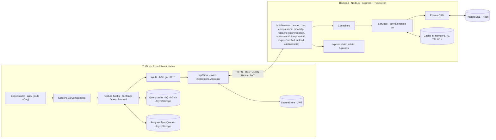
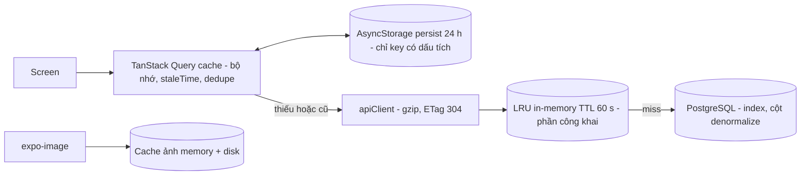
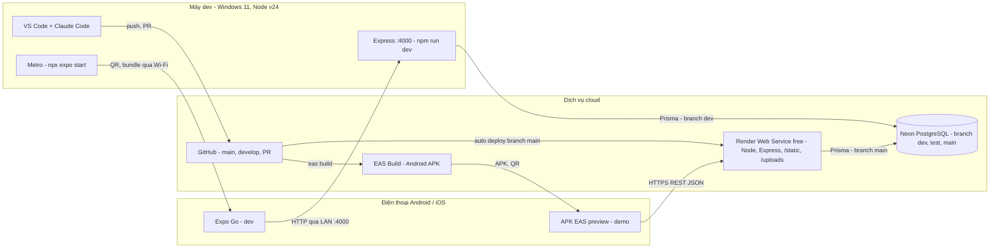

# Software Design Specification — SDS (D-01 + D-07)

> **Tài liệu:** `docs/02-design/SDS.md` · **Task:** D-01 (kiến trúc, ADR) + D-07 (tổng hợp) · **Owner:** A (Lê Hoàng Khang) · **Phiên bản:** 1.0 (bám PLAN.md v1.3)
> **Nguồn sự thật:** [PLAN.md](../../PLAN.md) (§5 kiến trúc, §6 yêu cầu, §7 màn hình, §8 DB, §9 API, §10 cache, §15 triển khai, §17 hiệu năng) và [CLAUDE.md](../../CLAUDE.md). Nếu tài liệu này mâu thuẫn với PLAN, PLAN thắng và tài liệu phải được sửa.
> Tài liệu **tổng hợp**: chi tiết dữ liệu ở [database.md](database.md), chi tiết API ở [api-spec.md](api-spec.md), UML ở [class-diagram.md](class-diagram.md) và [sequence-diagrams.md](sequence-diagrams.md), UI ở [ui-design.md](ui-design.md), quy ước code ở [coding-standard.md](../03-implementation/coding-standard.md).

## Mục lục

1. [Giới thiệu](#1-giới-thiệu)
2. [Kiến trúc tổng thể](#2-kiến-trúc-tổng-thể)
3. [Quyết định kiến trúc (ADR)](#3-quyết-định-kiến-trúc-adr)
4. [Kiến trúc mobile](#4-kiến-trúc-mobile)
5. [Kiến trúc server](#5-kiến-trúc-server)
6. [Thiết kế dữ liệu](#6-thiết-kế-dữ-liệu)
7. [Thiết kế API](#7-thiết-kế-api)
8. [Bảo mật](#8-bảo-mật)
9. [Hiệu năng và cache](#9-hiệu-năng-và-cache)
10. [Triển khai](#10-triển-khai)
11. [Môi trường và cấu hình](#11-môi-trường-và-cấu-hình)
12. [Ma trận FR → module / màn hình / API](#12-ma-trận-fr--module--màn-hình--api)
- [Phụ lục A — Rủi ro kỹ thuật và spike expo-video](#phụ-lục-a--rủi-ro-kỹ-thuật-và-spike-expo-video-m-20a)
- [Phụ lục B — Điểm chưa nhất quán / đề xuất cập nhật PLAN](#phụ-lục-b--điểm-chưa-nhất-quán--đề-xuất-cập-nhật-plan)

---

## 1. Giới thiệu

### 1.1 Mục đích

SDS mô tả **cách** hệ thống E-Learning App được thiết kế để đáp ứng SRS (FR/NFR/BR): kiến trúc tổng thể, các quyết định kỹ thuật và lý do, cấu trúc mobile/server, thiết kế dữ liệu và API, bảo mật, hiệu năng, triển khai. Đây là **đặc tả để code bám theo** — người triển khai không tự ý đổi kiến trúc mà không cập nhật tài liệu (CLAUDE.md §11).

### 1.2 Phạm vi

App học trực tuyến cho Android/iOS (Expo) và backend REST (Node.js + PostgreSQL): đăng ký/đăng nhập, duyệt và tìm khóa học, giỏ hàng và thanh toán **giả lập**, học qua video có lưu tiến độ, Q&A, nộp project, đánh giá, hồ sơ giảng viên/học viên, thông báo trong app, xem lại dữ liệu khi mất mạng. Ngoài phạm vi (Won't): thanh toán thật, web admin, push notification thật, tải video offline, chứng chỉ, đa ngôn ngữ (PLAN §2.2).

### 1.3 Đối tượng đọc

| Đối tượng | Dùng tài liệu để |
|---|---|
| Thành viên nhóm (A, B, C) | Biết đặt code ở đâu, gọi tầng nào, quy ước nào trước khi làm task |
| Người review PR | Đối chiếu code với thiết kế |
| Giảng viên | Chấm phần System Design của SDLC |
| Người viết test | Suy ra hành vi cần kiểm tra (phân quyền, transaction, cache) |

### 1.4 Ràng buộc thiết kế

| Ràng buộc | Nội dung | Nguồn |
|---|---|---|
| Nhân sự | 3 thành viên, ~10 tuần (30/09 → 06/12/2026) | PLAN §1, §4 |
| Công nghệ đã chốt | Expo + React Native + TypeScript strict + Expo Router · TanStack Query · Zustand · Express + Prisma + PostgreSQL | CLAUDE.md §3 |
| Môi trường dev | Node v24, npm 11, Git 2.53, Windows 11; **không** có Docker/Java/Android SDK → chạy bằng Expo Go trên điện thoại thật | CLAUDE.md §3, PLAN G3–G4 |
| Thanh toán | Chỉ giả lập (ADR-10) | PLAN G5 |
| Dữ liệu | Seed thay cho màn admin; ảnh Unsplash, video MP4 ngắn đặt ở `server/static/` | PLAN G6, §11 |
| Ngôn ngữ | UI tiếng Anh (như design); tài liệu tiếng Việt; code/commit tiếng Anh | CLAUDE.md §2 |
| Design | UI bám `design/screens/*.png`; design gốc luôn thắng skill | CLAUDE.md §7, §12 |

### 1.5 Thuật ngữ

| Thuật ngữ | Nghĩa |
|---|---|
| DTO | Data Transfer Object — hình dạng JSON trả qua API (PLAN §9.3) |
| Enrollment / ghi danh | Việc học viên sở hữu một khóa học (mua hoặc ghi danh miễn phí) |
| Preview | Bài học `isPreview = true`, xem được khi chưa ghi danh (BR-01) |
| `✓E` | Ký hiệu Auth: cần token **và** đã ghi danh khóa liên quan |
| Stale-while-revalidate | Hiện dữ liệu cache ngay rồi tải lại nền |
| Optimistic update | Cập nhật UI trước khi server phản hồi, hoàn tác nếu lỗi |
| ADR | Architecture Decision Record |
| Feature module | Thư mục gói gọn một tính năng (`features/<x>`, `modules/<x>`) |

### 1.6 Quy ước mã tham chiếu

`UC-xx` use case · `FR-xx` chức năng · `NFR-xx` phi chức năng · `BR-xx` quy tắc nghiệp vụ · `SC-xx` màn hình · `Exx` endpoint (đánh số trong api-spec.md) · `ADR-xx` quyết định kiến trúc.

---

## 2. Kiến trúc tổng thể

### 2.1 Sơ đồ kiến trúc



### 2.2 Mô tả các tầng

| Tầng | Vị trí | Trách nhiệm | Không được làm |
|---|---|---|---|
| **Route (mobile)** | `mobile/app/**` | Khai báo đường dẫn, lấy params, render `<XxxScreen />`; layout, providers, auth guard | Chứa logic, gọi API |
| **Screen / Component** | `features/<x>/screens`, `components`, `components/ui` | Hiển thị, xử lý sự kiện UI, đủ 4 trạng thái (loading/error/empty/success) | Gọi axios trực tiếp; chứa quy tắc nghiệp vụ |
| **Hook** | `features/<x>/hooks.ts` | Bọc `useQuery`/`useMutation`, đặt `staleTime`, optimistic update, invalidate | Lưu dữ liệu API vào Zustand |
| **API function** | `features/<x>/api.ts` | Một hàm cho một endpoint, có kiểu DTO | Xử lý UI, cache |
| **HTTP client** | `lib/apiClient.ts` | Một instance axios: base URL, token, chuẩn hóa lỗi, 401 → đăng xuất | Biết về màn hình |
| **Client state** | `stores/*` (Zustand) | Phiên đăng nhập, bộ lọc tìm kiếm tạm | Chứa server state |
| **Middleware (server)** | `middlewares/*` | Bảo mật, xác thực, phân quyền ghi danh, upload, validate, lỗi | Logic nghiệp vụ |
| **Route (server)** | `modules/<x>/<x>.routes.ts` | Khai báo path + chuỗi middleware + controller | Logic nghiệp vụ |
| **Controller** | `modules/<x>/<x>.controller.ts` | Đọc `req`, gọi service, gói `res` (`{ data, meta }`) | Truy cập Prisma, quy tắc nghiệp vụ |
| **Service** | `modules/<x>/<x>.service.ts` | Quy tắc nghiệp vụ, transaction, cache, ném `ApiError` | Biết về Express (`req/res`) |
| **Data access** | `lib/prisma.ts` (Prisma Client) | Truy vấn PostgreSQL | Được gọi ngoài service |
| **Lib** | `lib/*` | `ApiError`, `jwt`, `password`, `pagination`, `cache`, `mappers`, `logger` | — |

### 2.3 Luồng dữ liệu điển hình

| Loại | Luồng |
|---|---|
| **Đọc** (Home) | Screen → `useHome()` → nếu cache tươi trả ngay, nếu cũ trả cache rồi refetch → `GET /home` → `optionalAuth` → `HomeService` (cache server 60 s cho phần công khai) → Prisma → JSON `{data}` → `setQueryData` → render |
| **Ghi có toggle** (bookmark) | Bấm → `onMutate` cập nhật mọi cache liên quan → `PUT /courses/:id/bookmark` → `BookmarkService` (idempotent) → `204` → `onSettled` invalidate; lỗi → rollback từ snapshot + toast |
| **Ghi giao dịch** (checkout) | `POST /orders/checkout` → service mở `prisma.$transaction` (đơn, ghi danh, đếm, xóa giỏ, thông báo) → commit → xóa cache server → client invalidate 6 nhóm key |
| **Ghi định kỳ** (tiến độ) | `timeUpdate` mỗi 1 s chỉ ghi `ref`; throttle 10 s + pause/đổi bài/rời màn/nền → `PUT /lessons/:id/progress`; offline → hàng đợi AsyncStorage rồi đồng bộ |
| **Lỗi** | Service `throw ApiError` → `errorHandler` → `{ error }` → `apiClient` → `AppError` → hook `onError` → Screen (ErrorState/toast/lỗi field) |

Chi tiết từng luồng có sơ đồ tuần tự ở [sequence-diagrams.md](sequence-diagrams.md).

### 2.4 Yêu cầu chất lượng và giải pháp kiến trúc

| NFR | Yêu cầu | Giải pháp trong thiết kế | Mục |
|---|---|---|---|
| NFR-01 | Mở lại app: Home từ cache < 1 s; lần đầu < 3 s | Persist Query cache 24 h (stale-while-revalidate); `/home` gom 6 section trong 1 request; cache server 60 s; ảnh `expo-image` `memory-disk` | 4.5, 9 |
| NFR-02 | API p95 < 500 ms | Index đúng truy vấn, `select` chỉ cột cần, denormalize counters, gzip, cache in-memory | 5.8, 6, 9 |
| NFR-03 | Danh sách 100+ item mượt (≥ 55 FPS) | `FlashList`, `React.memo`, `useCallback`, phân trang cuộn vô hạn | 4.10, 9 |
| NFR-04 | Home, My Courses, chi tiết khóa đã xem mở được offline (≤ 24 h) | Persist các key đánh dấu ✓ (bảng 4.5), NetInfo → `onlineManager`, `OfflineBanner` | 4.5, 4.7 |
| NFR-05 | bcrypt, JWT, SecureStore, validate, rate limit login/register 10 req/phút/IP, helmet, upload whitelist ≤ 10 MB, không lộ stack | Xem mục 8 | 8 |
| NFR-06 | Video không-preview, Q&A, nộp project, review chỉ cho người đã ghi danh — server kiểm tra | Middleware `requireEnrolled` + kiểm tra trong service (`assertEnrolled`); `videoUrl` không có trong curriculum | 5.4, 8 |
| NFR-07 | Bám design; 4 trạng thái; touch target ≥ 48 dp; safe area; cỡ chữ hệ thống | UI kit + tokens; [ui-design.md](ui-design.md) | 4, ui-design |
| NFR-08 | Android 10+, iOS 16+, 360–430 dp | Expo Go tương thích SDK; layout linh hoạt (flex) | 4 |
| NFR-09 | TS strict, ESLint/Prettier, cấu trúc module, coverage services ≥ 70 % | [coding-standard.md](../03-implementation/coding-standard.md); feature/module structure | 4, 5 |
| NFR-10 | Không mất tiến độ; checkout 1 transaction | Lưu định kỳ + flush khi rời; hàng đợi offline; `prisma.$transaction` | 4.7, 5.10 |

---

## 3. Quyết định kiến trúc (ADR)

Mỗi ADR gồm **Bối cảnh · Quyết định · Hệ quả · Phương án đã loại**. ADR-01…12 mở rộng PLAN §5.2; ADR-13…16 là **bổ sung** (đề xuất, chưa có trong PLAN §5.2 — cần nhóm xác nhận).

### ADR-01 — Expo managed workflow

- **Bối cảnh:** máy dev không có Android SDK/Java/Xcode; nhóm 3 người cần chạy thử nhanh trên điện thoại thật; deadline ~10 tuần.
- **Quyết định:** dùng **Expo managed workflow** — chạy dev bằng Expo Go, build APK bằng EAS Build.
- **Hệ quả:** (+) không cần cài toolchain native, cả nhóm cùng môi trường; (+) build APK trên cloud. (−) chỉ dùng thư viện có trong Expo SDK/Expo Go, không viết module native tùy biến; (−) mọi thành viên phải dùng **cùng Expo SDK** và Expo Go tương thích (rủi ro R1); (−) hàng đợi build EAS free có thể chậm.
- **Đã loại:** React Native CLI (cần Android Studio/SDK, setup nặng); Expo dev client/prebuild (thêm phức tạp không cần thiết cho phạm vi đồ án).

### ADR-02 — Expo Router

- **Bối cảnh:** cần điều hướng nhiều màn (tab, stack, modal), deep link cho thông báo, và cấu trúc dễ trình bày.
- **Quyết định:** **Expo Router** (file-based routing); file trong `app/` là route mỏng, màn hình thật nằm ở `src/features/*/screens`. Auth guard bằng `Stack.Protected`.
- **Hệ quả:** (+) cấu trúc route = cấu trúc thư mục, deep link sẵn, là mặc định của Expo. (−) API thay đổi theo phiên bản (`Stack.Protected` cần SDK đủ mới — dự phòng `<Redirect>`); (−) file route bắt buộc `default export` (ngoại lệ duy nhất của quy tắc named export).
- **Đã loại:** React Navigation cấu hình tay (nhiều boilerplate, deep link tự khai báo).

### ADR-03 — TanStack Query cho server state + persist AsyncStorage

- **Bối cảnh:** phần lớn state của app là dữ liệu từ server cần cache, dedupe, phân trang, optimistic update và xem lại khi offline — đúng "nội dung đặc biệt" của đồ án.
- **Quyết định:** **TanStack Query v5** quản lý toàn bộ server state; `PersistQueryClientProvider` + `createAsyncStoragePersister` (`maxAge` 24 h, `buster` = phiên bản app) chỉ persist các key đánh dấu ✓; `onlineManager` nối NetInfo.
- **Hệ quả:** (+) cache/refetch/retry/infinite/optimistic có sẵn; (+) offline đọc được. (−) phải quản lý bảng query key + invalidate cẩn thận (prefix matching); (−) phải xóa cache khi đăng xuất để không lộ dữ liệu.
- **Đã loại:** Redux Toolkit Query (nặng hơn, kéo theo Redux); tự viết `useEffect` + `fetch` (thiếu cache/dedupe/retry, nhiều bug).

### ADR-04 — Zustand cho client state

- **Bối cảnh:** chỉ còn ít client state: phiên đăng nhập (`token`, `user`, `status`) và bộ lọc tìm kiếm tạm.
- **Quyết định:** **Zustand** (`authStore`, `searchFilterStore`); không copy dữ liệu API vào store.
- **Hệ quả:** (+) rất nhẹ, ít boilerplate, dễ đọc ngoài React (`getState()` trong interceptor). (−) không có devtools chuẩn như Redux (chấp nhận được).
- **Đã loại:** Redux Toolkit (thừa cho quy mô này); React Context (render lại rộng, khó dùng ngoài component).

### ADR-05 — Backend riêng Express + Prisma + PostgreSQL

- **Bối cảnh:** đề tài yêu cầu tài liệu Backend/DB/API/ERD và integration test; cần thể hiện quy tắc nghiệp vụ (phân quyền ghi danh, transaction checkout).
- **Quyết định:** backend **Node.js + Express + TypeScript + Prisma + PostgreSQL**, kiến trúc lớp routes → controller → service → Prisma.
- **Hệ quả:** (+) thấy rõ thiết kế API, ERD, business rules, test tích hợp; (+) Prisma sinh type an toàn. (−) nhóm phải tự viết và deploy backend (thêm khối lượng cho A/C); (−) cần quản lý migration/seed.
- **Đã loại:** Firebase/Supabase (ít code backend để trình bày, khó thể hiện quy tắc nghiệp vụ); json-server (không có nghiệp vụ, không có DB thật).

### ADR-06 — Neon làm PostgreSQL

- **Bối cảnh:** không có Docker; cần DB dùng chung giữa dev, test và deploy.
- **Quyết định:** **Neon** (PostgreSQL cloud free tier) với branch `dev`, `test`, `main`.
- **Hệ quả:** (+) không cài đặt, branch tiện cho test; (+) dùng chung cho Render. (−) free tier có thể "ngủ" và giới hạn dung lượng (rủi ro R8) — dự phòng PostgreSQL local.
- **Đã loại:** PostgreSQL local (mỗi máy một cấu hình); Docker Compose (máy không có Docker).

### ADR-07 — JWT access token 7 ngày lưu ở SecureStore

- **Bối cảnh:** cần duy trì phiên (FR-02) nhưng phạm vi đồ án không cần cơ chế phức tạp.
- **Quyết định:** một **JWT access token** (HS256, hạn 7 ngày), gửi qua `Authorization: Bearer`; lưu ở **expo-secure-store** (không dùng AsyncStorage). Không có refresh token.
- **Hệ quả:** (+) đơn giản, stateless (`requireAuth` không cần truy vấn DB). (−) không thu hồi được token trước hạn; token bị lộ có giá trị đến khi hết hạn. Cải tiến sau: refresh token rotation (PLAN §16.3).
- **Đã loại:** refresh token rotation (thêm bảng, endpoint và logic client phức tạp); session cookie (không tự nhiên cho app mobile).

### ADR-08 — expo-video để phát bài học

- **Bối cảnh:** cần phát MP4, tua (seek) tới vị trí đã lưu và biết vị trí hiện tại để lưu tiến độ.
- **Quyết định:** **expo-video** (`VideoView` + `useVideoPlayer`), dùng sự kiện `timeUpdate`, `playToEnd`, `statusChange`; video phục vụ từ `/static` qua `express.static` (hỗ trợ Range).
- **Hệ quả:** (+) thư viện chính thức hiện tại của Expo (expo-av đã bị thay thế), chạy trong Expo Go, có native controls và fullscreen. (−) API còn mới, có rủi ro R6 → làm **spike M-20a** ở W2 (Phụ lục A).
- **Đã loại:** react-native-video (cần native build, không chạy trong Expo Go); expo-av (bị thay thế).

### ADR-09 — StyleSheet + design tokens

- **Bối cảnh:** UI phải bám chính xác design gốc; quy mô nhỏ.
- **Quyết định:** `StyleSheet.create` + tokens ở `src/theme`; tự viết UI kit; **không** dùng thư viện UI ngoài.
- **Hệ quả:** (+) không phụ thuộc, kiểm soát pixel, bundle nhỏ. (−) tự viết mọi component cơ bản (đã chia cho B/C).
- **Đã loại:** NativeWind, UI Kitten, React Native Paper (áp phong cách riêng, khó khớp design).

### ADR-10 — Thanh toán giả lập

- **Bối cảnh:** thanh toán thật ngoài phạm vi môn học và kéo theo xử lý dữ liệu thẻ.
- **Quyết định:** checkout **giả lập**: phương thức `MOCK_CARD`/`MOCK_EWALLET`, không nhận số thẻ; luôn thành công trừ khi client gửi `simulateFailure: true` (kết quả `FAILED`, `402 PAYMENT_FAILED`, giữ giỏ) để demo luồng lỗi.
- **Hệ quả:** (+) demo trọn luồng mua → học; không rủi ro tài chính/PCI. (−) không có cổng thanh toán thật; `simulateFailure` chỉ dành cho demo/kiểm thử.
- **Đã loại:** Stripe test mode (thêm SDK, webhook, khóa bí mật).

### ADR-11 — Lưu giá bằng cent (Int)

- **Bối cảnh:** tiền cần tính chính xác; design hiển thị USD.
- **Quyết định:** mọi giá lưu và truyền dạng **số nguyên cent** (`priceCents`, `totalCents`); client định dạng bằng `formatPrice`.
- **Hệ quả:** (+) không sai số số thực, so sánh/cộng đơn giản. (−) phải nhớ chia 100 khi hiển thị; bộ lọc giá của API cũng tính bằng cent.
- **Đã loại:** `Decimal` (Prisma cần xử lý thêm ở JSON/JS, phức tạp không cần thiết); `Float` (sai số).

### ADR-12 — Mermaid và PlantUML cho sơ đồ

- **Bối cảnh:** sơ đồ cần versioning, review qua PR và xem được trên GitHub.
- **Quyết định:** **Mermaid** cho Class/Sequence/ERD/Flow; **PlantUML** cho Use Case (Mermaid không có use case diagram tốt).
- **Hệ quả:** (+) sơ đồ là code, diff được, render sẵn trên GitHub. (−) bố cục ít tinh chỉnh; khi cần đẹp cho slide sẽ vẽ lại bằng draw.io.
- **Đã loại:** draw.io làm nguồn chính (file nhị phân/XML khó review).

### ADR-13 *(bổ sung)* — Cache in-memory LRU phía server

- **Bối cảnh:** `GET /home` và `categories`/`tags/hot` được gọi rất nhiều, dữ liệu công khai đổi ít.
- **Quyết định:** dùng `lru-cache` trong tiến trình Node, **TTL 60 s**, khóa `home:public`, `categories`, `tags:hot`; service xóa khóa liên quan **sau khi commit** thao tác làm đổi dữ liệu (checkout/enroll/review). Phần cá nhân hóa (`isBookmarked`, `recommended`) ghép sau cache.
- **Hệ quả:** (+) giảm truy vấn DB, đo được trước/sau cho slide. (−) chỉ hiệu lực trong 1 instance (Render free chỉ có 1); dữ liệu có thể cũ tối đa 60 s. Cải tiến: Redis (PLAN §16.3).
- **Đã loại:** Redis (thêm dịch vụ); không cache (chậm hơn, mất điểm "Performance").

### ADR-14 *(bổ sung)* — Denormalize bộ đếm cập nhật trong transaction

- **Bối cảnh:** card khóa học hiện ở mọi màn hình; `COUNT/AVG` mỗi lần hiển thị tốn kém.
- **Quyết định:** lưu `ratingAvg`, `ratingCount`, `enrollmentCount`, `likeCount`, `lessonCount`, `totalDurationSec`, `answerCount`… và cập nhật bằng phép tăng nguyên tử **trong cùng transaction** với thao tác gốc; seed tính lại toàn bộ ([database.md §6](database.md#6-chiến-lược-denormalize)).
- **Hệ quả:** (+) đọc nhanh, sắp xếp Popular/Rating bằng index. (−) phải cẩn thận để bộ đếm không lệch (ghi ở service, có test).
- **Đã loại:** tính khi đọc (`COUNT/AVG`, chậm); materialized view (thêm phức tạp).

### ADR-15 *(bổ sung)* — Phân quyền ghi danh thực thi ở server

- **Bối cảnh:** NFR-06 — nội dung trả phí phải được bảo vệ thật, không chỉ ẩn UI.
- **Quyết định:** một điểm kiểm tra duy nhất `EnrollmentService.assertEnrolled`, dùng qua middleware `requireEnrolled` cho mọi endpoint `✓E` (Q&A, Project, tiến độ, viết review) và trong `LessonService.getLesson` (BR-01, cho phép preview). `videoUrl` không có trong curriculum.
- **Hệ quả:** (+) nhất quán, dễ test (TC-SEC-01). (−) file tĩnh `/static/videos/*` không kiểm tra ghi danh (giới hạn đã biết — ai biết URL đều tải được); chấp nhận cho đồ án, cải tiến bằng signed URL.
- **Đã loại:** kiểm tra rải rác trong từng controller (dễ sót); bảo vệ file tĩnh bằng token (phức tạp cho `expo-video`).

### ADR-16 *(bổ sung)* — Ngoại lệ offline cho tiến độ video

- **Bối cảnh:** FR-24 chặn thao tác ghi khi offline, nhưng NFR-10 yêu cầu không mất tiến độ học.
- **Quyết định:** riêng `PUT /lessons/:id/progress` khi offline được ghi vào **hàng đợi AsyncStorage** (giữ bản mới nhất mỗi bài) và tự gửi lại khi có mạng; mọi mutation khác vẫn bị chặn kèm toast. Server nhận theo thứ tự đến (last write wins) và không bao giờ hạ `isCompleted`.
- **Hệ quả:** (+) học liên tục không mất vị trí. (−) thêm một thành phần client (`ProgressSyncQueue`) cần test; có thể có cập nhật đến muộn.
- **Đã loại:** chặn hẳn khi offline (mất tiến độ); hàng đợi cho mọi mutation (phức tạp, xung đột dữ liệu).

---
## 4. Kiến trúc mobile

### 4.1 Cấu trúc thư mục

```
mobile/
├── app/                                  # Expo Router - CHỈ route (file mỏng, default export)
│   ├── _layout.tsx                       # Providers (Query, SafeArea, GestureHandler), font, splash, Stack + auth guard
│   ├── index.tsx                         # Redirect theo trạng thái đăng nhập
│   ├── (auth)/_layout.tsx · login.tsx · register.tsx
│   ├── (tabs)/_layout.tsx                # Bottom tabs: Home · Search · My Courses · Profile
│   ├── (tabs)/index.tsx · search.tsx · my-courses.tsx · profile.tsx
│   ├── search-filter.tsx                 # modal
│   ├── course-list.tsx                   # ?categoryId= | ?section=popular|recommended|inspires
│   ├── course/[id]/index.tsx · reviews.tsx · write-review.tsx (modal)
│   ├── learn/[courseId]/index.tsx · submit-project.tsx (modal)
│   ├── question/[id].tsx
│   ├── teacher/[id].tsx · teachers.tsx
│   ├── cart.tsx · checkout.tsx
│   ├── notifications.tsx
│   └── profile/edit.tsx
├── assets/                               # icon, splash, ảnh tĩnh
└── src/
    ├── components/ui/                    # UI kit: AppText, Button, IconButton, TextField, Chip, Badge, SegmentedTabs,
    │                                     # SectionHeader, RatingInline, StarRating, ProgressBar, Skeleton, EmptyState,
    │                                     # ErrorState, Avatar, Accordion, Toast, OfflineBanner, ScreenHeader
    ├── features/
    │   ├── auth/  home/  search/  category/  course/  cart/  my-courses/
    │   ├── learning/  qa/  project/  review/  teacher/  profile/  notification/
    │   └── <feature>/{api.ts, hooks.ts, types.ts, components/, screens/, *.test.ts(x)}
    ├── lib/          # apiClient.ts, queryClient.ts, queryKeys.ts, persister.ts, secureStorage.ts
    ├── stores/       # authStore.ts, searchFilterStore.ts
    ├── theme/        # colors.ts, typography.ts, spacing.ts, radius.ts, shadows.ts, index.ts
    ├── constants/    # strings.ts, config.ts
    ├── utils/        # formatPrice.ts, formatDuration.ts, formatRelativeTime.ts, discount.ts
    └── types/        # api.ts (DTO dùng chung, khớp api-spec.md)
```

Alias import `@/` → `mobile/src/`. Sơ đồ phụ thuộc giữa các tầng và các feature: [class-diagram.md §3](class-diagram.md#3-sơ-đồ-module-mobile).

### 4.2 Feature module

Mỗi feature là một gói tự chứa; **luồng dữ liệu một chiều**: `screens → hooks → api → apiClient`.

| File | Vai trò | Quy tắc |
|---|---|---|
| `api.ts` | Mỗi endpoint một hàm thuần, trả `Promise<Dto>` đã bóc `data` | Không hook, không UI; dùng kiểu từ `@/types/api` |
| `hooks.ts` | `useXxx` (query), `useXxxMutation`; đặt `staleTime`, `meta.persist`, optimistic, invalidate | Key lấy từ `queryKeys.ts`; không gọi axios |
| `types.ts` | Kiểu riêng của feature (props, form values) | DTO dùng chung thì để ở `src/types/api.ts` |
| `components/` | Thành phần riêng của feature | Tái dùng `components/ui` trước khi viết mới |
| `screens/` | `XxxScreen` — ghép hook + component, xử lý 4 trạng thái | Route trong `app/` chỉ render screen này |
| `*.test.ts(x)` | Test cạnh file nguồn | Mock tầng `api.ts` |

Ví dụ rút gọn (feature `course`):

```ts
// features/course/api.ts
import { apiClient } from '@/lib/apiClient';
import type { CourseDetail } from '@/types/api';

export async function fetchCourseDetail(id: string): Promise<CourseDetail> {
  const res = await apiClient.get<{ data: CourseDetail }>(`/courses/${id}`);
  return res.data.data;
}

// features/course/hooks.ts
import { useQuery } from '@tanstack/react-query';
import { queryKeys } from '@/lib/queryKeys';
import { fetchCourseDetail } from './api';

export function useCourseDetail(id: string) {
  return useQuery({
    queryKey: queryKeys.course(id),
    queryFn: () => fetchCourseDetail(id),
    staleTime: 5 * 60 * 1000,
    meta: { persist: true },
  });
}
```

### 4.3 Điều hướng: Expo Router và auth guard

- **Nhóm route:** `(auth)` (Stack: login, register) · `(tabs)` (Bottom Tabs: `index`, `search`, `my-courses`, `profile`) · các màn chi tiết push lên **root Stack nên ẩn tab bar** (khác design `Teacher Profile.png` — sai khác có chủ đích, [ui-design.md §8](ui-design.md#8-sai-khác-có-chủ-đích-so-với-design)) · modal: `search-filter`, `course/[id]/write-review`, `learn/[courseId]/submit-project`.
- **Bootstrap (SC-01):** giữ Splash cho đến khi font Epilogue/Inter tải xong, đọc token từ SecureStore và restore cache persist; sau đó `authStore.bootstrap()` xác định `status`.
- **Auth guard** bằng `Stack.Protected` (nếu API khác theo phiên bản Expo thì dùng `<Redirect>` trong layout):

```tsx
// app/_layout.tsx (rút gọn)
export default function RootLayout() {
  const [fontsLoaded] = useFonts({ Epilogue_600SemiBold, Epilogue_700Bold, Inter_400Regular, Inter_500Medium, Inter_600SemiBold });
  const status = useAuthStore((s) => s.status); // 'loading' | 'authenticated' | 'unauthenticated'

  useEffect(() => { void useAuthStore.getState().bootstrap(); }, []);
  useEffect(() => {
    if (fontsLoaded && status !== 'loading') void SplashScreen.hideAsync();
  }, [fontsLoaded, status]);

  if (!fontsLoaded || status === 'loading') return null;
  const isLoggedIn = status === 'authenticated';

  return (
    <PersistQueryClientProvider client={queryClient} persistOptions={persistOptions}>
      <SafeAreaProvider>
        <GestureHandlerRootView style={{ flex: 1 }}>
          <Stack screenOptions={{ headerShown: false }}>
            <Stack.Protected guard={!isLoggedIn}>
              <Stack.Screen name="(auth)" />
            </Stack.Protected>
            <Stack.Protected guard={isLoggedIn}>
              <Stack.Screen name="(tabs)" />
              <Stack.Screen name="search-filter" options={{ presentation: 'modal' }} />
              <Stack.Screen name="course-list" />
              <Stack.Screen name="course/[id]/index" />
              <Stack.Screen name="course/[id]/reviews" />
              <Stack.Screen name="course/[id]/write-review" options={{ presentation: 'modal' }} />
              <Stack.Screen name="learn/[courseId]/index" />
              <Stack.Screen name="learn/[courseId]/submit-project" options={{ presentation: 'modal' }} />
              <Stack.Screen name="question/[id]" />
              <Stack.Screen name="teacher/[id]" />
              <Stack.Screen name="teachers" />
              <Stack.Screen name="cart" />
              <Stack.Screen name="checkout" />
              <Stack.Screen name="notifications" />
              <Stack.Screen name="profile/edit" />
            </Stack.Protected>
          </Stack>
          <Toast />
        </GestureHandlerRootView>
      </SafeAreaProvider>
    </PersistQueryClientProvider>
  );
}
```

- **Đăng xuất / 401:** `authStore.logout()` xóa token, `queryClient.clear()`, xóa persisted cache; đổi `status` làm guard tự chuyển về `(auth)/login`.
- **Tab bar:** 4 tab "Home / Search / My Courses / Profile", icon Feather `home / search / book-open / user`, active `primary`; `backBehavior: 'initialRoute'`.
- Bản đồ điều hướng đầy đủ và quy tắc Back: [ui-design.md §5](ui-design.md#5-sơ-đồ-điều-hướng).

### 4.4 apiClient

Một instance axios duy nhất (`lib/apiClient.ts`):

| Hạng mục | Hành vi |
|---|---|
| `baseURL` | `process.env.EXPO_PUBLIC_API_URL` (IP LAN, không dùng `localhost` trên điện thoại; Android Emulator dùng `10.0.2.2`) |
| `timeout` | 15 s → lỗi `TIMEOUT` |
| Request interceptor | Gắn `Authorization: Bearer <token>` lấy từ `authStore` (bộ nhớ, nạp từ SecureStore khi bootstrap) |
| Response interceptor | Chuẩn hóa mọi lỗi thành `AppError { code, status, message, details }`: có body `{ error }` → dùng nguyên; mất mạng → `NETWORK_ERROR`; quá hạn → `TIMEOUT`; còn lại → `UNKNOWN` |
| Xử lý 401 | Nếu request **đã gắn token** và nhận 401 → `authStore.logout()`. Request đăng nhập/đăng ký (không gắn token) có 401 `INVALID_CREDENTIALS` là lỗi bình thường, **không** đăng xuất |
| Truyền `signal` | Hook truyền `AbortSignal` của TanStack Query để hủy request cũ khi key đổi (tìm kiếm) |
| Upload | `multipart/form-data`; Content-Type do axios sinh boundary; kiểm tra dung lượng ở client trước |
| Logging | Chỉ log trong `__DEV__`; không log token/mật khẩu |

### 4.5 State và cache

**Phân vai:** *server state* (dữ liệu API) chỉ nằm trong TanStack Query; *client state* (phiên, bộ lọc tạm) nằm trong Zustand; token nằm ở SecureStore. Không copy dữ liệu API vào Zustand.

**Bảng query key** (PLAN §10; khai báo tập trung trong `lib/queryKeys.ts`):

| Query key | Endpoint | `staleTime` | Persist offline | Invalidate / cập nhật khi |
|---|---|---|---|---|
| `['me']` | `GET /auth/me` | 5 phút | ✓ | Edit profile, đổi avatar |
| `['home']` | `GET /home` | 5 phút | ✓ | checkout, bookmark (`setQueryData`) |
| `['categories']`, `['tags','hot']` | `GET /categories`, `GET /tags/hot` | 24 giờ | ✓ | — |
| `['courses','list',params]` (infinite) | `GET /courses` | 2 phút | ✗ | bookmark (`setQueryData`) |
| `['course',id]` | `GET /courses/:id` | 5 phút | ✓ | bookmark, like, follow, cart, checkout, enroll, review |
| `['course',id,'curriculum']` | `GET /courses/:id/curriculum` | 1 phút | ✓ | progress, checkout |
| `['course',id,'reviews',filter]` | `GET /courses/:id/reviews` | 5 phút | ✗ | write review |
| `['me','courses',status]` | `GET /me/courses` | 0 (refetch khi focus) | ✓ | checkout, enroll, progress |
| `['me','stats']`, `['me','bookmarks']` | `GET /me/stats`, `GET /me/bookmarks` | 0 / 1 phút | ✓ | bookmark, checkout, progress 100 % |
| `['cart']` | `GET /cart` | 0 | ✗ | add / remove / checkout |
| `['lesson',id]` | `GET /lessons/:id` | 0 | ✗ | — |
| `['course',id,'questions']`, `['question',id,'answers']` | Q&A | 30 giây | ✗ | post question / answer, like |
| `['course',id,'project']`, `['course',id,'submissions']` | Project | 5 phút / 30 giây | ✗ | submit project |
| `['teacher',id]`, `['teacher',id,'courses']`, `['teacher',id,'reviews']` | Teacher | 5 phút | ✓ | follow |
| `['notifications']`, `['notifications','unread-count']` | `GET /notifications`, `GET /notifications/unread-count` | 30 giây | ✗ | read, read-all, checkout, câu trả lời mới |

```ts
// lib/queryKeys.ts (rút gọn)
export const queryKeys = {
  me: () => ['me'] as const,
  meCourses: (status: 'all' | 'ongoing' | 'completed') => ['me', 'courses', status] as const,
  meStats: () => ['me', 'stats'] as const,
  meBookmarks: () => ['me', 'bookmarks'] as const,
  home: () => ['home'] as const,
  categories: () => ['categories'] as const,
  hotTags: () => ['tags', 'hot'] as const,
  coursesList: (params: CourseListParams) => ['courses', 'list', params] as const,
  course: (id: string) => ['course', id] as const,
  courseCurriculum: (id: string) => ['course', id, 'curriculum'] as const,
  courseReviews: (id: string, filter: ReviewFilter) => ['course', id, 'reviews', filter] as const,
  courseQuestions: (id: string) => ['course', id, 'questions'] as const,
  courseProject: (id: string) => ['course', id, 'project'] as const,
  courseSubmissions: (id: string) => ['course', id, 'submissions'] as const,
  question: (id: string) => ['question', id] as const,
  questionAnswers: (id: string) => ['question', id, 'answers'] as const,
  lesson: (id: string) => ['lesson', id] as const,
  cart: () => ['cart'] as const,
  teacher: (id: string) => ['teacher', id] as const,
  teacherCourses: (id: string) => ['teacher', id, 'courses'] as const,
  teacherReviews: (id: string) => ['teacher', id, 'reviews'] as const,
  notifications: () => ['notifications'] as const,
  unreadCount: () => ['notifications', 'unread-count'] as const,
};
```

**Lưu ý invalidate:** TanStack Query khớp key theo **tiền tố**. `invalidateQueries({ queryKey: ['notifications'] })` cũng làm mới `['notifications','unread-count']` (mong muốn); còn `['me']` sẽ làm mới cả `['me','courses',…]`, `['me','stats']`… nên khi chỉ muốn đổi hồ sơ dùng `{ queryKey: ['me'], exact: true }`.

**Cấu hình persist** (`lib/queryClient.ts`, `lib/persister.ts`):

- `PersistQueryClientProvider` + `createAsyncStoragePersister`, `maxAge = 24 h`, `buster = phiên bản app` (đổi phiên bản thì bỏ cache cũ); query được persist có `gcTime ≥ 24 h`.
- Chỉ dehydrate query có ✓: hook đặt `meta: { persist: true }` và `shouldDehydrateQuery` chỉ nhận `meta.persist === true && status === 'success'`. Không persist: danh sách tìm kiếm, review, giỏ, bài học, Q&A, project, thông báo.
- Mặc định: `retry: 2` (không retry khi lỗi 4xx), `refetchOnReconnect: true`, `refetchOnWindowFocus` được nối với `AppState`.
- **Mutation toggle** (bookmark/like/follow/question like): `onMutate` → `cancelQueries` + snapshot + `setQueryData` trên mọi cache chứa khóa đó; `onError` → rollback + toast; `onSettled` → invalidate (ví dụ trong [coding-standard.md](../03-implementation/coding-standard.md)).
- **Đăng xuất:** `queryClient.clear()` + xóa persisted cache + xóa token — không để lộ dữ liệu người trước.

### 4.6 Xử lý lỗi

| Lớp | Cơ chế |
|---|---|
| Chuẩn hóa | `apiClient` biến lỗi thành `AppError`; hook/screen rẽ nhánh theo `error.code`, không theo `message` |
| Truy vấn (query) | Màn có dữ liệu dùng `ErrorState` + nút **Retry** (`refetch`) — hiển thị thông điệp thân thiện theo `code` |
| Ghi (mutation) | `onError` hiện `Toast` (lỗi chung) hoặc lỗi dưới field (form: đọc `details[].field` của `VALIDATION_ERROR` để `setError` của react-hook-form) |
| Toàn app | `ErrorBoundary` ở root bắt lỗi render (M-30) → màn "Something went wrong" + nút thử lại |
| 401 | Đăng xuất + về Login (mục 4.4) |
| `NOT_ENROLLED` | Điều hướng về SC-09 + toast "Enroll to unlock this lesson" (khi vào Learning) |

Thông điệp chuẩn hiển thị (tiếng Anh, tập trung ở `constants/strings.ts`):

| `AppError.code` | Thông điệp |
|---|---|
| `NETWORK_ERROR` | "Can't reach the server. Check your connection" |
| `TIMEOUT` | "The request took too long. Please try again" |
| `UNAUTHORIZED` | (đăng xuất, không hiện thông điệp) |
| `INVALID_CREDENTIALS` | "Incorrect email or password" |
| `EMAIL_TAKEN` | "Email already in use" |
| `NOT_ENROLLED` | "Enroll to access this content" |
| `PAYMENT_FAILED` | "Payment failed. You were not charged" |
| `FILE_TOO_LARGE` | "File must be ≤ 10 MB" |
| `UNSUPPORTED_FILE_TYPE` | "This file type isn't supported" |
| `RATE_LIMITED` | "Too many attempts. Please try again later" |
| `INTERNAL_ERROR`, `UNKNOWN` | "Something went wrong. Please try again" |
| Mã còn lại | Dùng `message` server trả về |

### 4.7 Offline

| Khía cạnh | Thiết kế |
|---|---|
| Phát hiện | `@react-native-community/netinfo` nối vào `onlineManager` của TanStack Query; `OfflineBanner` hiện khi mất mạng |
| Đọc | Query đang tạm dừng vẫn trả dữ liệu cache; các key ✓ đã persist nên Home, My Courses, chi tiết khóa đã xem, hồ sơ… mở được ≤ 24 h (NFR-04, TC-OFF-01) |
| Ghi | Mutation ghi bị **chặn** kèm toast "You're offline" (bookmark, giỏ, checkout, review, Q&A…) |
| **Ngoại lệ** | Tiến độ video: `ProgressSyncQueue` lưu **bản mới nhất mỗi bài** vào AsyncStorage và tự gửi `PUT /lessons/:id/progress` khi có mạng/mở lại app (FR-24, NFR-10, ADR-16) |
| Bootstrap offline | Có token + user trong cache → vào `(tabs)` chế độ offline; chưa có cache → `ErrorState` |
| Tìm kiếm offline | Danh sách kết quả không persist → hiện `ErrorState` "You're offline" (khám phá dùng cache của categories/hot tags) |
| Đồng bộ khi có mạng | `refetchOnReconnect` làm mới query đang mount; queue tiến độ flush |

### 4.8 Media và tệp

- **Ảnh:** luôn `expo-image` với `cachePolicy="memory-disk"`, `placeholder`, `transition`; prefetch ảnh card đầu danh sách.
- **Video:** `expo-video` — `useVideoPlayer(videoUrl)`; seek tới `positionSec` khi `readyToPlay`; `timeUpdate` (mỗi 1 s) chỉ cập nhật `ref`; lưu tiến độ theo throttle 10 s / pause / đổi bài / rời màn / `AppState` nền; ≥ 90 % hoặc `playToEnd` → `isCompleted: true`. Xem [sequence-diagrams.md §4](sequence-diagrams.md#4-học-video-resume-lưu-tiến-độ-hoàn-thành).
- **Tệp:** `expo-document-picker` (png/jpg/pdf/zip ≤ 10 MB, kiểm tra ở client), `expo-image-picker` (avatar, ảnh bìa project), `expo-file-system` + `expo-sharing` (tải và mở tài liệu).

### 4.9 Form

react-hook-form + zod (`@hookform/resolvers`): schema zod ở file cùng feature; lỗi hiển thị dưới từng field; nút disable + spinner khi đang gửi; lỗi server (`VALIDATION_ERROR`, `EMAIL_TAKEN`, `INVALID_CREDENTIALS`) ánh xạ vào field/form. Mật khẩu: ≥ 8 ký tự, có chữ và số (FR-01); `Confirm password` khớp.

### 4.10 Hiệu năng giao diện

`FlashList` (`estimatedItemSize`, `keyExtractor` ổn định) cho danh sách > 20 item · item bọc `React.memo`, callback `useCallback` · phân trang cuộn vô hạn (`useInfiniteQuery`, limit 20) · debounce tìm kiếm 400 ms · `timeUpdate` không `setState` · skeleton cùng hình dạng nội dung · ảnh cache `memory-disk`. Số liệu đo ở mục 9.

---
## 5. Kiến trúc server

### 5.1 Cấu trúc thư mục và phân lớp

```
server/
├── prisma/
│   ├── schema.prisma · migrations/
│   ├── seed.ts                    # idempotent: xóa rồi tạo lại, tính lại các cột denormalize
│   └── seed-data/                 # categories.ts, tags.ts, teachers.ts, courses.ts, lessons.ts, users.ts, reviews.ts, questions.ts, resources.ts, submissions.ts, banners.ts
├── src/
│   ├── app.ts                     # createApp(): middlewares, routes, errorHandler (dùng cho test, KHÔNG listen)
│   ├── server.ts                  # app.listen
│   ├── config/env.ts              # zod parse process.env
│   ├── lib/                       # prisma, jwt, password, ApiError, pagination, cache, mappers, logger
│   ├── middlewares/               # requireAuth, optionalAuth, requireEnrolled, validate, upload, errorHandler, notFound, rateLimit
│   ├── modules/<module>/          # <module>.routes.ts · .controller.ts · .service.ts · .schema.ts · .service.test.ts
│   └── routes.ts                  # gom router các module vào /api/v1
├── tests/
│   ├── integration/               # auth, courses, cart, checkout, learning, reviews, qa, project, notifications (mỗi cái một *.test.ts)
│   └── helpers/                   # testApp.ts, factories.ts, resetDb.ts, authHelper.ts
├── static/                        # videos/*.mp4, resources/*.pdf|txt, images/
└── uploads/                       # file người dùng upload (gitignored)
```

Quy tắc phân lớp (CLAUDE.md §8): **routes → controller → service → Prisma**. Controller chỉ xử lý `req/res`; **chỉ service dùng Prisma**; không có logic nghiệp vụ trong routes. Alias `@/` → `server/src/`. UML: [class-diagram.md §2](class-diagram.md#2-class-diagram-tầng-server).

### 5.2 Pipeline middleware

`createApp()` lắp theo thứ tự (thứ tự **có ý nghĩa**):

| # | Middleware | Mục đích |
|---|---|---|
| 1 | `app.set('trust proxy', 1)` | Render đứng sau proxy → đọc đúng IP client cho `rateLimit` |
| 2 | `helmet({ crossOriginResourcePolicy: { policy: 'cross-origin' } })` | Header bảo mật; cho phép ảnh/video tải cross-origin |
| 3 | `cors({ origin: CORS_ORIGIN })` | `*` khi dev; chỉ định origin khi production |
| 4 | `compression()` | gzip response (đo ở mục 9) |
| 5 | `pino-http` | Log mỗi request kèm thời gian; `redact` header `authorization` |
| 6 | `express.json({ limit: '100kb' })` | Giới hạn body JSON (lỗi → `413 PAYLOAD_TOO_LARGE`) |
| 7 | `express.static` cho `/static` (`maxAge 7d`) và `/uploads` (`maxAge 1h`) | Video (hỗ trợ Range), tài liệu, tệp upload — **ngoài** `/api/v1` |
| 8 | `/api/v1` → `routes.ts` → router từng module | Xem chuỗi bên dưới |
| 9 | `notFound` | Route không tồn tại → `404 NOT_FOUND` |
| 10 | `errorHandler` | Luôn cuối cùng; định dạng `{ error }` |

Chuỗi middleware trong một route (không phải route nào cũng có đủ):

`rateLimit` (chỉ `POST /auth/login`, `POST /auth/register`) → `optionalAuth` **hoặc** `requireAuth` → `requireEnrolled` (cho `✓E`) → `upload` (multipart) → `validate(schema)` → controller.

`requireEnrolled` đứng **trước** `upload` để người chưa ghi danh không tốn băng thông tải tệp lên.

### 5.3 Module

16 module (CLAUDE.md §4); ID endpoint theo [api-spec.md §2](api-spec.md#2-bảng-tổng-hợp-endpoint). `health` không phải module nghiệp vụ (đặt trong `routes.ts`).

| Module | Owner | Endpoint | Service chính |
|---|---|---|---|
| `auth` | A | E02, E03, E04 | `register`, `login`, `getMe` |
| `user` (`/me/*`) | A | E46, E47, E48 | `getStats`, `updateProfile`, `updateAvatar` |
| `category` | A | E06 | `list` (có `courseCount`, cache) |
| `tag` | A | E07 | `listHot` (cache) |
| `course` | A | E08, E09, E11, E15, E16, E17 | `list` (tìm kiếm/lọc/section), `getDetail`, `similar`, `like`, `unlike`, `share` (like/share: C viết trong module này) |
| `home` | A | E05 | `getHome` (gom 6 section, cache 60 s) |
| `cart` | A | E27, E28, E29 | `get`, `add`, `remove` |
| `order` | A | E30, E31, E32 | `checkout`, `listMine`, `enrollFree` |
| `teacher` | A | E21, E22, E23, E24, E25, E26 | `list`, `getDetail`, `coursesByCategory`, `reviews`, `follow`, `unfollow` |
| `project` | A | E43, E44, E45 | `getProject`, `listSubmissions`, `submit` |
| `notification` | A | E49, E50, E51, E52 | `notify` (dùng chung), `list`, `unreadCount`, `markRead`, `markAllRead` |
| `lesson` | C | E10, E34, E35 | `getCurriculum`, `getLesson`, `saveProgress` |
| `enrollment` | C | E33 | `listMine`, `isEnrolled`, `assertEnrolled` |
| `bookmark` | C | E12, E13, E14 | `add`, `remove`, `listMine` |
| `review` | C | E18, E19, E20 | `list`, `getMine`, `upsertMine` |
| `question` | C | E36–E42 | `list`, `create`, `get`, `listAnswers`, `answer`, `like`, `unlike` |

Tổng: 51 endpoint trong các module + `GET /health` = **52 endpoint REST**, cộng 2 route file tĩnh.

### 5.4 Xác thực và phân quyền

**JWT:** ký HS256 bằng `JWT_SECRET` (≥ 32 ký tự), payload `{ sub: userId, role, iat, exp }`, hạn `JWT_EXPIRES_IN=7d`; xác thực với `algorithms: ['HS256']`.

| Middleware | Hành vi |
|---|---|
| `optionalAuth` | Không có header → khách (`req.user = undefined`). Có header nhưng token sai/hết hạn → `401 UNAUTHORIZED` (để mobile đăng xuất đúng lúc) |
| `requireAuth` | Bắt buộc `Authorization: Bearer <token>`; verify JWT, gán `req.user = { id, role }`. **Không truy vấn DB** (stateless); thiếu/sai → `401 UNAUTHORIZED` |
| `requireEnrolled` | Sau `requireAuth`: xác định `courseId` (từ `:id` của khóa, hoặc tra từ `lessonId`/`questionId`), gọi `EnrollmentService.assertEnrolled` → `403 NOT_ENROLLED` nếu chưa ghi danh |

Mật khẩu: `bcryptjs` cost 10; so sánh bằng `compare` (khi email không tồn tại vẫn so với hash giả để thời gian ổn định); mật khẩu ≤ 72 ký tự (giới hạn bcrypt). Không log mật khẩu/token.

**Quyền xem bài học (BR-01)** nằm trong `LessonService.getLesson` (không dùng `requireEnrolled` vì bài preview cho phép người chưa ghi danh): cho phép nếu đã ghi danh **hoặc** `isPreview = true`, ngược lại `403 NOT_ENROLLED`.

### 5.5 Validate bằng zod

Mọi input (body, query, params) qua `validate(schema)`; schema đặt trong `<module>.schema.ts`. Query dạng chuỗi dùng `z.coerce`. Kết quả đã parse được gán vào `req.validated` (không ghi đè `req.query` vì Express 5 để nó chỉ đọc).

```ts
export const validate =
  (schemas: { params?: ZodTypeAny; query?: ZodTypeAny; body?: ZodTypeAny }): RequestHandler =>
  (req, _res, next) => {
    const issues: ValidationIssue[] = [];
    req.validated = {};
    for (const source of ['params', 'query', 'body'] as const) {
      const schema = schemas[source];
      if (!schema) continue;
      const result = schema.safeParse(req[source]);
      if (result.success) req.validated[source] = result.data;
      else result.error.issues.forEach((i) => issues.push({ source, field: i.path.join('.'), message: i.message }));
    }
    if (issues.length > 0) return next(new ApiError(400, 'VALIDATION_ERROR', 'Invalid request data', issues));
    next();
  };
```

Kiểu request suy từ schema: `type RegisterInput = z.infer<typeof registerSchema>`.

### 5.6 Xử lý lỗi

`ApiError(status, code, message, details?)` được **ném** từ service/middleware; `errorHandler` (tập trung) trả `{ error: { code, message, details } }` và **không** trả stack trace.

| Nguồn lỗi | Kết quả |
|---|---|
| `ApiError` | Dùng nguyên `status`/`code`/`message`/`details` |
| `ZodError` (nếu lọt ra ngoài `validate`) | `400 VALIDATION_ERROR` |
| Lỗi body-parser: JSON hỏng | `400 VALIDATION_ERROR` |
| Lỗi body-parser: quá lớn (`entity.too.large`) | `413 PAYLOAD_TOO_LARGE` |
| `MulterError` `LIMIT_FILE_SIZE` | `413 FILE_TOO_LARGE` |
| Lỗi `fileFilter` (loại tệp không được phép) | `415 UNSUPPORTED_FILE_TYPE` |
| Vượt `rateLimit` | `429 RATE_LIMITED` (+ `Retry-After`) |
| `PrismaClientKnownRequestError` không lường trước | `500 INTERNAL_ERROR` (service phải tự bắt `P2002` ở nơi có thể xảy ra: `EMAIL_TAKEN`, `ALREADY_IN_CART`) |
| Mọi lỗi khác | Log đầy đủ bằng `logger.error` (kèm `req.id`), trả `500 INTERNAL_ERROR` với thông điệp chung |

Bảng mã lỗi: [api-spec.md §5](api-spec.md#5-mã-lỗi).

### 5.7 Upload

`multer` + `diskStorage`, lưu vào `UPLOAD_DIR/<loại>/`, tên tệp ngẫu nhiên (`cuid + đuôi`); kiểm tra **cả MIME lẫn đuôi tệp**; xóa tệp đã lưu nếu validate hoặc ghi DB thất bại.

| Endpoint | Trường | MIME cho phép | Giới hạn | Thư mục |
|---|---|---|---|---|
| E45 `POST /courses/:id/submissions` | `file` (bắt buộc), `image` (tùy chọn) | `file`: png, jpg, pdf, zip, txt · `image`: png, jpg | 10 MB / tệp | `uploads/submissions/` |
| E48 `POST /me/avatar` | `file` | png, jpg | 5 MB | `uploads/avatars/` |

Tệp được phục vụ qua `/uploads/*` (`express.static`, `maxAge 1h`). Ổ đĩa của Render free **không bền** — tệp mất khi redeploy (giới hạn đã biết; cải tiến: Cloudinary/S3).

### 5.8 Cache in-memory phía server

`lib/cache.ts` bọc `lru-cache` (`max` ~ 100 mục, TTL mặc định 60 s) với API `get`, `set`, `del`, `delByPrefix`.

| Khóa cache | Nội dung | Endpoint | Xóa khi |
|---|---|---|---|
| `home:public` | banners, categories, popular, inspires, topTeachers | E05 | checkout, enroll (`enrollmentCount` đổi), review (`ratingAvg` đổi), seed |
| `home:recommended:guest` | recommended cho khách | E05 | như trên |
| `categories` | 6 danh mục kèm `courseCount` | E06 | seed |
| `tags:hot` | tag hot | E07 | seed |

Quy tắc: chỉ cache phần **công khai**; `isBookmarked`, `recommended` (người dùng) và mọi thứ cá nhân được ghép *sau* cache; xóa cache **sau khi commit** transaction. Express bật ETag yếu mặc định → `304 Not Modified` khi nội dung không đổi. Hiệu quả được đo ở mục 9.

### 5.9 Logging

`pino` (JSON ở production, `pino-pretty` khi dev) + `pino-http`: mỗi request ghi `req.id`, method, URL, status, thời gian phản hồi (dùng để đo p95 — NFR-02). `redact`: `req.headers.authorization`. Lỗi 5xx ghi mức `error` kèm stack; 4xx mức `warn`/`info`. **Không** log password/token/body đăng nhập.

### 5.10 Transaction

Mọi thao tác ghi nhiều bảng dùng `prisma.$transaction` để nguyên tử (NFR-10, ADR-14):

| Thao tác | Nội dung transaction |
|---|---|
| `OrderService.checkout` | Đọc giỏ → tạo `Order` + `OrderItem` → `PAID` (hoặc `FAILED` khi `simulateFailure`) → `Enrollment` + `enrollmentCount` → xóa `CartItem` → `notify(ORDER_PAID)` |
| `OrderService.enrollFree` | Tạo `Enrollment` + `enrollmentCount + 1` |
| `LessonService.saveProgress` | `upsert LessonProgress` → cập nhật `Enrollment` (`lastLessonId`, `lastAccessedAt`, và khi bài vừa xong: `progressPercent`, `completedAt` + `notify(COURSE_COMPLETED)`) |
| `ReviewService.upsertMine` | `upsert Review` → tính lại và ghi `ratingAvg`/`ratingCount` |
| `QuestionService.answer` | Tạo `Answer` → `answerCount + 1` → `notify(NEW_ANSWER)` (nếu khác người hỏi) |
| Like/Follow toggle | Tạo/xóa dòng quan hệ + bộ đếm (chỉ khi dòng thực sự đổi) |

`NotificationService.notify(tx, …)` nhận client transaction để thông báo nằm cùng transaction với thao tác gốc.

### 5.11 Phân trang và mapper

- `lib/pagination.ts`: `paginationQuery` (zod), `toSkipTake(page, limit)`, `buildMeta(page, limit, total)`; `limit` tối đa 50. Sắp xếp luôn có khóa phụ `id` để phân trang ổn định.
- `lib/mappers.ts`: `toCourseSummary`, `toTeacherSummary`, `toAbsoluteUrl`… — nơi duy nhất tính `badge`/`discountPercent` (BR-10) và ghép `PUBLIC_BASE_URL` cho đường dẫn tương đối.
- Truy vấn dùng `select` chỉ những cột cần; `isBookmarked`/`isLiked` ghép bằng **một** truy vấn `findMany({ courseId: { in: ids } })` cho cả trang (tránh N+1).

### 5.12 Kiểm thử phía server

Jest + Supertest chạy trên `createApp()` (không mở cổng); DB test riêng (`.env.test`, Neon branch `test`), `globalSetup` chạy `prisma migrate reset --force --skip-seed`, dữ liệu dựng bằng factory, `jest --runInBand`. Mỗi service có unit test; mỗi endpoint chính có integration test (happy path + ≥ 1 lỗi). Chỉ tiêu: coverage services ≥ 70 %, ≥ 30 test server (PLAN §14).

---

## 6. Thiết kế dữ liệu

Chi tiết đầy đủ (ERD, data dictionary 24 bảng, index, quy tắc xóa) ở **[database.md](database.md)**. Tóm tắt:

| Hạng mục | Nội dung |
|---|---|
| CSDL | PostgreSQL trên Neon; Prisma ORM; thay đổi chỉ qua `prisma migrate dev` (1 migration / PR) |
| Quy mô | **24 model**, 4 enum (`Role`, `OrderStatus`, `NotificationType`, `BannerTarget`) |
| Khóa | `cuid()` cho thực thể; khóa chính ghép cho bảng n-n (`Bookmark`, `CourseLike`, `CartItem`, `Follow`, `QuestionLike`, `LessonProgress`, `CourseTag`) → toggle idempotent |
| Tiền / thời lượng | `Int` cent / `Int` giây (ADR-11) |
| Nhóm bảng | Tài khoản (`User`, `TeacherProfile`, `Follow`) · Nội dung (`Category`, `Tag`, `CourseTag`, `Course`, `Section`, `Lesson`, `Resource`, `Banner`) · Học tập và thương mại (`Enrollment`, `LessonProgress`, `Bookmark`, `CourseLike`, `CartItem`, `Order`, `OrderItem`) · Cộng đồng (`Review`, `Question`, `Answer`, `QuestionLike`, `ProjectSubmission`) · Hệ thống (`Notification`) |
| Denormalize | `ratingAvg`, `ratingCount`, `enrollmentCount`, `likeCount`, `shareCount`, `lessonCount`, `totalDurationSec`, `Question.likeCount/answerCount`, `Enrollment.progressPercent` — cập nhật trong cùng transaction ([database.md §6](database.md#6-chiến-lược-denormalize)) |
| Index | `Course(categoryId, teacherId, enrollmentCount, ratingAvg, createdAt)`, `Enrollment(userId, lastAccessedAt)`, `Review(courseId, rating)`, `Question(courseId, createdAt)`, `Notification(userId, isRead, createdAt)`… ([database.md §5](database.md#5-index-và-lý-do)); đề xuất index FK bổ sung ở §5.2 của tài liệu đó |
| Xóa | Phần lớn `Cascade`; `Course→OrderItem`, `Category→Course`, `TeacherProfile→Course` là `Restrict` để bảo toàn lịch sử ([database.md §7](database.md#7-quy-tắc-xóa-cascade)) |
| Tham chiếu mềm | `Enrollment.lastLessonId`, `Banner.targetId`, `Notification.data` (không có FK) |
| Seed | Idempotent (xóa rồi tạo lại đúng thứ tự phụ thuộc), 6 category, ~15 tag, 8–10 giảng viên, 25–30 khóa, tài khoản demo có tiến độ 30 / 70 / 100 / 50 % |

---

## 7. Thiết kế API

Đặc tả từng endpoint (tham số, ràng buộc zod, JSON mẫu, lỗi, business rule) ở **[api-spec.md](api-spec.md)**. Tóm tắt:

| Hạng mục | Nội dung |
|---|---|
| Kiểu | REST JSON, base `/api/v1`, tài nguyên số nhiều kebab-case |
| Thành công | `{ data, meta? }` — `meta` = `PaginationMeta` hoặc thông tin bổ sung (`summary`, `unreadCount`) |
| Lỗi | `{ error: { code, message, details? } }`; client rẽ nhánh theo `code` |
| Xác thực | `Authorization: Bearer <JWT>`; ký hiệu `—` / `opt` / `✓` / `✓E` |
| Phân trang | `?page=1&limit=20`, `limit` ≤ 50 |
| Tiền / thời lượng / thời gian | cent / giây / ISO 8601 UTC |

**Số lượng endpoint: 52 REST + 2 route file tĩnh.**

| Nhóm | Endpoint | Số lượng |
|---|---|---|
| Health | E01 | 1 |
| Auth | E02–E04 | 3 |
| Home | E05 | 1 |
| Catalog | E06–E11 | 6 |
| Bookmark | E12–E14 | 3 |
| Like / Share | E15–E17 | 3 |
| Review | E18–E20 | 3 |
| Teacher | E21–E26 | 6 |
| Cart | E27–E29 | 3 |
| Order & Enroll | E30–E32 | 3 |
| Learning | E33–E35 | 3 |
| Q&A | E36–E42 | 7 |
| Project | E43–E45 | 3 |
| Me | E46–E48 | 3 |
| Notification | E49–E52 | 4 |

**Phân bố mức xác thực:** `—` 7 (E01, E02, E03, E06, E07, E21, E24) · `opt` 8 (E05, E08–E11, E18, E22, E23) · `✓` 25 · `✓E` 12 (E20, E35, E36–E45).

**Mã lỗi:** 21 mã theo PLAN §9.4 (kèm HTTP status: `PAYMENT_FAILED` 402, `FILE_TOO_LARGE` 413, `UNSUPPORTED_FILE_TYPE` 415, `RATE_LIMITED` 429, `INTERNAL_ERROR` 500) và 2 mã bổ sung `NOT_FOUND`, `PAYLOAD_TOO_LARGE` ([api-spec.md §5, §7](api-spec.md#5-mã-lỗi)).

**DTO** dùng chung ở `mobile/src/types/api.ts` (`UserDto`, `CourseSummary`, `CourseDetail`, `CurriculumSection`, `LessonDetail`, `MyCourseItem`, `TeacherSummary/Detail`, `ReviewDto`, `QuestionDto`, `AnswerDto`, `ResourceDto`, `ProjectSubmissionDto`, `CartDto`, `OrderDto`, `MeStatsDto`, `NotificationDto`, `HomeResponse`, `PaginationMeta`…) — [api-spec.md §3](api-spec.md#3-dto).

**Quy tắc bảo trì tài liệu:** owner endpoint cập nhật `api-spec.md` trong cùng PR khi thêm/sửa endpoint (CLAUDE.md §8, §13).

---
## 8. Bảo mật

### 8.1 Đối chiếu NFR-05 / NFR-06

| Biện pháp | Yêu cầu | Hiện thực | Vị trí |
|---|---|---|---|
| Băm mật khẩu | NFR-05 | `bcryptjs` cost 10; so sánh bằng `compare`; `passwordHash` không bao giờ nằm trong `select` trả API | `lib/password.ts`, `AuthService` |
| JWT | NFR-05 | HS256, hạn 7 ngày, `JWT_SECRET` ≥ 32 ký tự lấy từ env; verify chỉ chấp nhận `HS256` | `lib/jwt.ts`, `requireAuth` |
| Lưu token an toàn | NFR-05 | Mobile lưu ở `expo-secure-store` (Keystore/Keychain), không dùng AsyncStorage | `lib/secureStorage.ts` |
| Validate mọi input | NFR-05 | zod cho body/query/params qua `validate(schema)`; chuẩn hóa chuỗi (`trim`, `toLowerCase` email) | `middlewares/validate.ts`, `*.schema.ts` |
| Rate limit | NFR-05 | `express-rate-limit`: **10 request/phút/IP** chỉ cho `POST /auth/login` và `POST /auth/register` (không áp cho `GET /auth/me`); lưu trong bộ nhớ; `trust proxy` để đúng IP sau proxy | `middlewares/rateLimit.ts` |
| Header bảo mật | NFR-05 | `helmet` (CORP `cross-origin` để media tải được) | `app.ts` |
| CORS | NFR-05 | `CORS_ORIGIN` (`*` khi dev, chỉ định khi production) | `app.ts`, `config/env.ts` |
| Upload | NFR-05 | Whitelist MIME + đuôi tệp; ≤ 10 MB (avatar ≤ 5 MB); tên tệp ngẫu nhiên; xóa tệp khi lỗi | `middlewares/upload.ts` |
| Không lộ stack trace | NFR-05 | `errorHandler` chỉ trả `{ code, message, details }`; stack chỉ ở log server | `middlewares/errorHandler.ts` |
| Không log bí mật | NFR-05 | `pino` `redact` header `authorization`; không log body đăng nhập/đăng ký | `lib/logger.ts` |
| Phân quyền ghi danh | NFR-06 | `EnrollmentService.assertEnrolled` qua `requireEnrolled` cho mọi endpoint `✓E`; `LessonService.getLesson` áp BR-01; `videoUrl` không có trong curriculum; server kiểm tra thật, không chỉ ẩn UI | `middlewares/requireEnrolled.ts`, `LessonService` |

### 8.2 Ma trận phân quyền theo nhóm endpoint

| Nhóm | Khách (chưa đăng nhập) | Đã đăng nhập, chưa ghi danh | Đã ghi danh khóa đó |
|---|---|---|---|
| Đăng ký, đăng nhập, health | Được | — | — |
| Home, danh mục, tag hot, tìm kiếm, chi tiết khóa, curriculum, similar, review, giảng viên | Được (dữ liệu chung; không cá nhân hóa) | Được (kèm `isBookmarked`, `enrollment`…) | Được |
| Bookmark, like/share khóa, follow, giỏ hàng, checkout, ghi danh miễn phí, hồ sơ, thông báo | Không (401) | Được | Được |
| Xem bài học **preview** (`GET /lessons/:id`) | Không (401; cần đăng nhập) | Được | Được |
| Xem bài học **không preview** | Không | Không (403 `NOT_ENROLLED`) | Được |
| Lưu tiến độ, viết review, Q&A (đọc và ghi), Project (đọc và ghi), thích câu hỏi | Không | Không (403 `NOT_ENROLLED`) | Được |

Quy tắc bổ sung: thông báo và giỏ hàng luôn được lọc theo `req.user.id`; thông báo của người khác trả `404` (không lộ sự tồn tại).

### 8.3 Mô hình mối đe dọa rút gọn

| Đe dọa | Tình huống | Biện pháp |
|---|---|---|
| Giả mạo danh tính | Dùng token giả/hết hạn | Verify chữ ký + hạn; `401`; mobile đăng xuất khi nhận 401 |
| Đoán mật khẩu / dò email | Thử hàng loạt ở login | Rate limit 10/phút/IP; cùng thông điệp `INVALID_CREDENTIALS` cho sai email lẫn sai mật khẩu; bcrypt chậm có chủ đích |
| Truy cập trái phép nội dung trả phí | Gọi thẳng `GET /lessons/:id`, API Q&A, nộp project | `requireEnrolled` / BR-01 ở server (TC-SEC-01) |
| Tiêm dữ liệu | Body/query độc hại | zod validate; Prisma tham số hóa (không nối chuỗi SQL) |
| Tải tệp độc hại / quá lớn | Upload `.exe`, tệp 1 GB | Whitelist MIME + đuôi, giới hạn dung lượng, tên ngẫu nhiên, thư mục upload không thực thi |
| Từ chối dịch vụ đơn giản | Body khổng lồ, spam đăng nhập | `express.json` 100 KB, `multer` limits, rate limit login/register |
| Lộ dữ liệu qua lỗi | Stack trace, thông điệp DB | `errorHandler` chung; `500` chỉ trả `INTERNAL_ERROR` |
| Lộ dữ liệu người dùng trước trên máy | Đổi tài khoản trên cùng máy | Đăng xuất: xóa token + `queryClient.clear()` + xóa persisted cache |
| Lộ bí mật vào Git | `JWT_SECRET`, `DATABASE_URL` | `.gitignore` cho `.env*` (trừ `.env.example`), review PR; nếu lộ thì đổi ngay (R9) |
| Dữ liệu thẻ thanh toán | Người dùng nhập thẻ thật | Không có ô nhập thẻ; chỉ `MOCK_CARD`/`MOCK_EWALLET` (ADR-10) |

### 8.4 Quản lý bí mật

- `server/.env` (không commit): `JWT_SECRET` (mỗi môi trường một giá trị; production khác dev), `DATABASE_URL`.
- `mobile/.env`: chỉ `EXPO_PUBLIC_API_URL`. **Mọi biến `EXPO_PUBLIC_*` được đóng gói vào app nên không bao giờ chứa bí mật.**
- Mỗi thư mục có `.env.example` (không chứa giá trị thật). Trên Render đặt biến qua dashboard; EAS dùng `env` trong `eas.json` cho phần công khai.

### 8.5 Giới hạn đã biết và rủi ro chấp nhận

| # | Giới hạn | Lý do chấp nhận / cải tiến |
|---|---|---|
| 1 | File tĩnh `/static/videos/*` không kiểm tra ghi danh — ai biết URL đều tải được | Đồ án: BR-01 được thực thi ở API; cải tiến: signed URL / streaming có xác thực |
| 2 | JWT 7 ngày không thu hồi được; không có refresh token | ADR-07; cải tiến: refresh token rotation |
| 3 | Rate limit lưu trong bộ nhớ, theo từng instance | Render free chỉ có 1 instance; cải tiến: Redis |
| 4 | `simulateFailure` có sẵn ở mọi môi trường | Chỉ giả lập thanh toán, không có tiền thật; dùng cho demo/kiểm thử |
| 5 | Dev dùng HTTP trong LAN (không TLS) | Chỉ môi trường dev; bản demo dùng HTTPS của Render |
| 6 | Tệp upload trên ổ đĩa Render không bền | Ghi vào Known issues; cải tiến: Cloudinary/S3 |
| 7 | Không có đổi/quên mật khẩu, khóa tài khoản | Ngoài phạm vi (PLAN §2.2) |
| 8 | Màu thương hiệu `primary` có độ tương phản thấp (2,27 : 1) | Giữ theo design; giảm rủi ro ở [ui-design.md §2.1](ui-design.md#21-màu) |

### 8.6 Kiểm thử bảo mật (A phụ trách)

Integration test: token thiếu/sai/hết hạn → 401 · sai mật khẩu và email lạ cho cùng thông điệp · gọi API `✓E` khi chưa ghi danh → 403 (gồm `GET /lessons/:id` bài không preview — TC-SEC-01, `videoUrl` không có trong body) · thông báo của người khác → 404 · upload sai loại/quá lớn → 415/413 · vượt rate limit login → 429 · response lỗi không chứa `stack`.

---

## 9. Hiệu năng và cache

Đây là phần "Nội dung đặc biệt" trên slide (PLAN §17); **mọi tuyên bố phải có số liệu đo** ghi ở `docs/04-testing/performance.md` (M-29).

### 9.1 Các lớp cache



### 9.2 Kỹ thuật đã thiết kế

| # | Kỹ thuật | Hiện thực | Mục |
|---|---|---|---|
| 1 | **Cache 2 tầng phía client** | TanStack Query (bộ nhớ, `staleTime` theo bảng 4.5, dedupe) + persist AsyncStorage 24 h → mở lại app hiện dữ liệu ngay rồi refetch nền (stale-while-revalidate) | 4.5 |
| 2 | **Offline mode** | NetInfo + `onlineManager`, `OfflineBanner`, đọc từ cache, chặn ghi (ngoại lệ hàng đợi tiến độ) | 4.7 |
| 3 | **Cache ảnh** | `expo-image` `cachePolicy="memory-disk"`, `transition`, `placeholder`; prefetch ảnh card đầu danh sách | 4.8 |
| 4 | **Cache phía server** | LRU in-memory TTL 60 s cho `home:public`, `categories`, `tags:hot`; xóa sau khi dữ liệu đổi; ETag → `304` | 5.8 |
| 5 | **Tối ưu danh sách** | `FlashList` + `estimatedItemSize`, `React.memo` item, `useCallback`, `keyExtractor` ổn định, phân trang cuộn vô hạn | 4.10 |
| 6 | **Giảm round-trip** | 1 request `/home` gom 6 section; debounce tìm kiếm 400 ms; huỷ request cũ bằng `AbortSignal` | 4.4, 4.10 |
| 7 | **Optimistic UI** | Bookmark/like/follow phản hồi tức thì, rollback khi lỗi | 4.5 |
| 8 | **Video** | Resume vị trí; lưu tiến độ throttle 10 s (không spam API); lưu khi nền/rời màn; `timeUpdate` chỉ ghi `ref` | 4.8 |
| 9 | **DB** | Index cho truy vấn phổ biến, cột denormalize, Prisma `select` chỉ cột cần, ghép `isBookmarked` bằng 1 truy vấn cho cả trang, gzip `compression` | 5.11, 6 |
| 10 | **Endpoint nhẹ** | `GET /notifications/unread-count` cho badge chuông thay vì tải cả danh sách | api-spec E52 |

### 9.3 Chỉ số cần đo (M-29)

| Chỉ số | Cách đo | Kỳ vọng |
|---|---|---|
| Thời gian Home có nội dung: lần đầu vs mở lại (có cache) | `performance.now()` log trong `__DEV__`, trung bình 5 lần | giảm ≥ 70 % |
| Số request khi gõ "javascript" | Log interceptor, có/không debounce | 10 → 1–2 |
| Thời gian phản hồi `GET /home`: không cache vs có cache server | Log `pino-http`, 20 lần | giảm rõ rệt (ms) |
| Kích thước payload `/courses?limit=20`: có/không gzip | DevTools / `curl --compressed` | giảm ≥ 60 % |
| JS FPS khi cuộn 100+ kết quả: FlatList vs FlashList | Perf Monitor trên Android thật | FlashList ổn định ≥ 55 |
| Số request khi xem 5 phút video | Log | ~30 (throttle 10 s) thay vì ~300 (mỗi giây) |

### 9.4 Ngân sách hiệu năng

| Chỉ tiêu | Ngân sách | Cách bảo đảm |
|---|---|---|
| NFR-01 mở lại app | Home < 1 s từ cache; lần đầu (Wi-Fi) < 3 s | Persist cache + `/home` gom + cache server |
| NFR-02 API | p95 < 500 ms với dữ liệu seed | Index, `select`, denormalize; đo bằng log `pino-http` |
| NFR-03 cuộn danh sách | JS FPS ≥ 55 với 100+ item | FlashList, memo, ảnh cache |
| Kích thước tải video | Tổng video mẫu ≤ 20 MB (3–5 clip ≤ 30 s) | Tái sử dụng clip cho nhiều bài (PLAN §11) |

---

## 10. Triển khai

### 10.1 Môi trường

| Môi trường | Server | Database | Mobile |
|---|---|---|---|
| **Dev** | Local `npm run dev` (IP LAN, cổng 4000) | Neon branch `dev` (mỗi người 1 branch nếu cần) | Expo Go (`npx expo start`) |
| **Test** | Local (Supertest trên `createApp()`) | Neon branch `test` (reset mỗi lần chạy test) | — |
| **Staging / Demo** | Render Web Service (free) | Neon branch `main` | APK (EAS preview) + Expo Go |

### 10.2 Sơ đồ triển khai



### 10.3 Deploy server (Render + Neon)

1. **Neon:** tạo project, lấy connection string (pooled, `sslmode=require`) cho branch `main`; tạo thêm branch `dev` và `test`.
2. **Render → New Web Service:** repo GitHub, root directory `server/`.
   - Build: `npm ci && npx prisma generate && npm run build`
   - Start: `npx prisma migrate deploy && node dist/server.js`
   - Health check path: `/api/v1/health`
   - Biến môi trường: `DATABASE_URL`, `JWT_SECRET` (mới, khác dev), `NODE_ENV=production`, `PUBLIC_BASE_URL=https://<app>.onrender.com`, `CORS_ORIGIN`, `JWT_EXPIRES_IN=7d`, `UPLOAD_DIR=uploads`.
3. **Seed một lần:** chạy `npx prisma db seed` với `DATABASE_URL` production từ máy local.
4. **Kiểm tra sau deploy (smoke):** `GET /api/v1/health` → `{status:"ok",db:"up"}` · đăng nhập tài khoản demo · `GET /home` có dữ liệu · phát video từ `/static/videos/...` (Range hoạt động) · checkout thử tạo được ghi danh.
5. **Giới hạn gói free:** ngủ sau ~15 phút không dùng (lần gọi đầu chậm) và ổ đĩa không bền → gọi `/health` trước buổi demo 5 phút; tệp upload mất khi redeploy (ghi Known issues).

### 10.4 Build mobile (EAS)

1. `npm i -g eas-cli` → `eas login` → `eas build:configure`.
2. `eas.json` profile `preview`: `"android": { "buildType": "apk" }`, `"env": { "EXPO_PUBLIC_API_URL": "https://<app>.onrender.com/api/v1" }`.
3. `eas build -p android --profile preview` → tải APK, cài thử trên ≥ 2 máy Android, đính kèm GitHub Release. iOS chạy qua Expo Go (build IPA cần tài khoản Apple Developer — ngoài phạm vi).

### 10.5 Phát hành và phiên bản

Nhánh `main` (ổn định/nộp) ← `develop` ← `feature/<task-id>-…`; SemVer: `v0.1.0` (M2), `v0.3.0` (MVP), `v0.4.0` (feature complete), `v1.0.0` (release), `v1.0.x` (hotfix). Migration đi cùng code; `prisma migrate deploy` chạy mỗi lần khởi động ở Render. Quy trình chi tiết: [PLAN.md §15–16](../../PLAN.md).

---

## 11. Môi trường và cấu hình

### 11.1 Biến môi trường

| File | Biến | Ví dụ / ghi chú |
|---|---|---|
| `server/.env` | `NODE_ENV` | `development` |
| | `PORT` | `4000` |
| | `DATABASE_URL` | Chuỗi kết nối Neon (có `sslmode=require`) |
| | `JWT_SECRET` | Chuỗi ngẫu nhiên ≥ 32 ký tự (mỗi người tự tạo, không commit) |
| | `JWT_EXPIRES_IN` | `7d` |
| | `CORS_ORIGIN` | `*` (dev) |
| | `PUBLIC_BASE_URL` | `http://<IP-LAN>:4000` — dùng tạo URL tuyệt đối cho tệp static/upload |
| | `UPLOAD_DIR` | `uploads` |
| `server/.env.test` | `DATABASE_URL` | **DB riêng cho test** (Neon branch `test` hoặc DB local `elearning_test`) |
| `mobile/.env` | `EXPO_PUBLIC_API_URL` | `http://<IP-LAN>:4000/api/v1` (dev) · URL Render (release). Không dùng `localhost` trên điện thoại; Android Emulator dùng `10.0.2.2` |

### 11.2 Validate cấu hình khi khởi động

`config/env.ts` parse `process.env` bằng zod; thiếu/sai biến thì server **dừng ngay** với thông báo rõ (fail fast) — không chạy với cấu hình sai.

```ts
const envSchema = z.object({
  NODE_ENV: z.enum(['development', 'test', 'production']).default('development'),
  PORT: z.coerce.number().int().default(4000),
  DATABASE_URL: z.string().min(1),
  JWT_SECRET: z.string().min(32),
  JWT_EXPIRES_IN: z.string().default('7d'),
  CORS_ORIGIN: z.string().default('*'),
  PUBLIC_BASE_URL: z.string().url(),
  UPLOAD_DIR: z.string().default('uploads'),
});
export const env = envSchema.parse(process.env);
```

### 11.3 Công cụ và phiên bản

| Thành phần | Phiên bản / cấu hình |
|---|---|
| Node.js / npm / Git | Node v24, npm 11, Git 2.53 (máy dev hiện tại) |
| Expo SDK / React Native | **Chốt ở M-01** rồi ghi vào CLAUDE.md §3; cả nhóm dùng cùng SDK và Expo Go tương thích (rủi ro R1); cài thư viện Expo bằng `npx expo install` |
| TypeScript | `strict: true` cho cả mobile và server; alias `@/` → `src/` |
| Prisma | Theo phiên bản cài lúc khởi tạo (generator/datasource theo docs chính thức); migration commit vào repo |
| Test | Jest (+ jest-expo, React Native Testing Library, Supertest); Maestro là tùy chọn |
| Lint/format | ESLint + Prettier (2 spaces, single quote, semicolon, `printWidth` 100, trailing comma `all`, LF) — [coding-standard.md](../03-implementation/coding-standard.md) |

### 11.4 Cấu hình app và build

- `app.json`: tên app, `scheme` (deep link), icon/splash, màu nền splash; plugin `expo-router`, `expo-secure-store`…
- `eas.json`: profile `development`, `preview` (APK + `EXPO_PUBLIC_API_URL` production), `production`.
- Lệnh thường dùng: mobile — `npx expo start [-c]`, `npm run typecheck|lint|test`; server — `npm run dev`, `npx prisma migrate dev --name <ten>`, `npx prisma db seed`, `npm run typecheck|lint|test` (CLAUDE.md §5).

---

## 12. Ma trận FR → module / màn hình / API

ID endpoint `Exx` xem [api-spec.md §2](api-spec.md#2-bảng-tổng-hợp-endpoint); TC xem PLAN §14.5.

| FR | Chức năng | Module server | Feature mobile | Màn hình | Endpoint | BR / TC mẫu |
|---|---|---|---|---|---|---|
| FR-01 | Đăng ký | `auth` | `auth` | SC-03 | E02 | TC-AUTH-01, 02 |
| FR-02 | Đăng nhập, tự đăng nhập lại | `auth` | `auth` | SC-01, SC-02 | E03, E04 | TC-AUTH-03, 04 |
| FR-03 | Đăng xuất (xóa token, cache) | — | `auth`, `profile` | SC-20 | — | — |
| FR-04 | Home + badge giỏ và chuông | `home`, `category`, `cart`, `notification` | `home` | SC-04 | E05, E06, E27, E52 | BR-10/11/12 · TC-HOME-01 |
| FR-05 | Tìm kiếm, hot topics, cuộn vô hạn | `course`, `tag`, `category` | `search`, `category` | SC-05, SC-06 | E08, E07, E06 | BR-13 · TC-SRCH-01 |
| FR-06 | Lọc, sắp xếp (nhiều danh mục) | `course` | `search` | SC-07 | E08, E06 | BR-10 · TC-SRCH-02 |
| FR-07 | Duyệt theo danh mục / nhóm | `course` | `category`, `home`, `search` | SC-08 | E08 | BR-11/12 |
| FR-08 | Chi tiết khóa (Overview, similar, thanh giá) | `course` | `course` | SC-09 | E09, E11 | BR-10/17/18 |
| FR-09 | Lessons, trạng thái bài, preview | `lesson` | `course`, `learning` | SC-09, SC-15 | E10, E34 | BR-01/02 · TC-CRS-01 |
| FR-10 | Xem review | `review` | `review` | SC-09, SC-10 | E18 | — |
| FR-11 | Viết/sửa review | `review` | `review` | SC-11 | E19, E20 | BR-08 |
| FR-12 | Bookmark | `bookmark` | `course` (hook + `BookmarkButton`) | Nhiều màn | E12, E13, E14 | TC-OFF-01 |
| FR-13 | Giỏ hàng | `cart` | `cart` | SC-09, SC-12 | E27, E28, E29 | BR-06 · TC-CART-01 |
| FR-14 | Thanh toán giả lập, ghi danh (kể cả mô phỏng thất bại) | `order` | `cart` | SC-13 | E30, E32 | BR-07 · TC-PAY-01 |
| FR-15 | My Courses | `enrollment` | `my-courses` | SC-14 | E33 | BR-05 |
| FR-16 | Học video, tiến độ, resume, hoàn thành | `lesson`, `enrollment`, `notification` | `learning` | SC-15 | E34, E35 | BR-01/03/04 · TC-LRN-01, 02 |
| FR-17 | Like/Share khóa (Could) | `course` | `learning` | SC-15 | E15, E16, E17 | — |
| FR-18 | Projects: mô tả, tài liệu, nộp, xem | `project` | `project` | SC-15, SC-17 | E43, E44, E45 | BR-09 · TC-PRJ-01 |
| FR-19 | Q&A | `question`, `notification` | `qa` | SC-15, SC-16 | E36–E42 | BR-09 · TC-QA-01 |
| FR-20 | Hồ sơ giảng viên, Follow (kể cả nút ở SC-09) | `teacher` | `teacher`, `course` | SC-18, SC-09 | E21–E26 | BR-14/16 |
| FR-21 | Hồ sơ cá nhân, thống kê, đã lưu | `user`, `bookmark` | `profile` | SC-20 | E46, E14, E04 | BR-15 |
| FR-22 | Sửa tên, headline, avatar | `user` | `profile` | SC-21 | E47, E48 | — |
| FR-23 | Thông báo, badge chưa đọc | `notification` | `notification` | SC-22, SC-04 | E49, E50, E51, E52 | BR-04/07/09 |
| FR-24 | Offline: đọc cache, banner, chặn ghi (ngoại lệ tiến độ video) | — | `lib` (queryClient, persister, NetInfo), `learning` (`ProgressSyncQueue`) | Toàn app | — (E35 gửi bù) | NFR-04 · TC-OFF-01 |

**NFR:** NFR-01/02/03 → mục 9 · NFR-04 → 4.7 · NFR-05/06 → mục 8 (TC-SEC-01) · NFR-07 → [ui-design.md](ui-design.md) · NFR-08 → 1.4, 11.3 · NFR-09 → [coding-standard.md](../03-implementation/coding-standard.md) · NFR-10 → 4.7, 5.10.

---

## Phụ lục A — Rủi ro kỹ thuật và spike expo-video (M-20a)

### A.1 Spike M-20a

**Owner:** C · **Hạn:** W2 (18/10/2026) · **Mục tiêu:** xác nhận `expo-video` đáp ứng luồng học trước khi xây SC-15 (rủi ro R6). Kết quả ghi vào cột cuối của bảng khi hoàn thành.

| # | Hạng mục kiểm tra | Cách kiểm tra | Kỳ vọng | Trạng thái |
|---|---|---|---|---|
| 1 | Phát MP4 H.264 từ server | `useVideoPlayer('http://<IP-LAN>:4000/static/videos/clip-01.mp4')` trên Android thật (Expo Go) | Phát mượt, có âm thanh | Chưa thực hiện |
| 2 | Seek tới vị trí lưu | Đặt `player.currentTime = n` khi `statusChange` = `readyToPlay` | Bắt đầu đúng ±1 s | Chưa thực hiện |
| 3 | Sự kiện `timeUpdate` | `player.timeUpdateEventInterval = 1`; lắng nghe `timeUpdate` | Nhận mỗi ~1 s khi đang phát | Chưa thực hiện |
| 4 | Sự kiện `playToEnd` | Phát hết clip | Sự kiện phát ra đúng 1 lần | Chưa thực hiện |
| 5 | Fullscreen + native controls | `VideoView` `nativeControls`, `allowsFullscreen` | Vào/ra fullscreen, xoay màn hình ổn | Chưa thực hiện |
| 6 | Range request | `curl -I -H "Range: bytes=0-1023" .../clip-01.mp4` | `206 Partial Content`, tua không tải lại từ đầu | Chưa thực hiện |
| 7 | Đổi bài / dọn tài nguyên | `player.replace(url)` khi đổi bài; rời màn thì giải phóng | Không rò rỉ, không phát chồng | Chưa thực hiện |
| 8 | App xuống nền | Chuyển sang app khác khi đang phát | Dừng phát; sự kiện `pause` để flush tiến độ | Chưa thực hiện |
| 9 | iOS (nếu có máy) | Cùng các mục trên trên Expo Go iOS | Tương đương Android | Chưa thực hiện |

Phương án dự phòng nếu `timeUpdate` không ổn định: dùng `setInterval` 1 s đọc `player.currentTime`.

### A.2 Rủi ro kỹ thuật khác liên quan thiết kế

| Rủi ro | Ảnh hưởng | Giảm thiểu |
|---|---|---|
| R1 Lệch Expo SDK / Expo Go | App không chạy trên máy một số thành viên | Chốt SDK ở M-01, `npx expo install --check` |
| R2 Điện thoại không gọi được API trên LAN | Không dev/test được | IP LAN + mở cổng 4000 trong Windows Firewall, `--tunnel`, deploy sớm ở W5 |
| R3 Render ngủ / mạng hội trường yếu | Demo chậm/hỏng | Gọi `/health` trước 5 phút; phương án chạy local + hotspot; video dự phòng |
| `Stack.Protected` khác API theo phiên bản Expo Router | Guard không chạy | Dự phòng `<Redirect>` trong layout |
| Quá nhiều cache key gây invalidate sai (khớp tiền tố) | Dữ liệu cũ hoặc refetch thừa | Bảng key + `queryKeys.ts` + `exact: true` khi cần; test hook |
| R8 Neon free ngủ / giới hạn | DB chậm lúc demo | Đánh thức trước; PostgreSQL local dự phòng |

---

## Phụ lục B — Điểm chưa nhất quán / đề xuất cập nhật PLAN

Các điểm phát hiện khi viết bộ tài liệu thiết kế (PLAN v1.3). Mỗi điểm đã chọn phương án hợp lý và ghi trong tài liệu liên quan; đề nghị người điều phối cập nhật PLAN cho khớp (và ghi §22).

| # | Vị trí PLAN | Vấn đề | Cách xử lý trong tài liệu thiết kế |
|---|---|---|---|
| 1 | §7.3 SC-09 | Liệt kê benefit "certificate" trong khi BR-18 nói bỏ (chứng chỉ là Won't) | Bỏ "Certificate": 5 benefits |
| 2 | §7.3 SC-04 / design | "Hello, {firstName}!" nhưng design là "Hello, Rosie!" cho "Martha Rosie" | Dùng **từ cuối** của `fullName` (`getGivenName`) — khớp design và tên Việt |
| 3 | §7.3 SC-18 | Nhóm "UI/UX Design", "Graphic Design" trong khi chỉ có 6 category | Nhóm theo `Category.name` (6 giá trị) |
| 4 | §9.3 | Thiếu `CategoryDto`, `TagDto`, `AnswerDto`, `ResourceDto`, `ProjectSubmissionDto`, `CartDto`, `OrderDto`, `MeStatsDto`; `TeacherDetail` thiếu `localTime` (nhưng §9.2 nhắc); `QuestionDto` thiếu `courseId` | Bổ sung ở api-spec §3 |
| 5 | §9.4 | Chưa có mã cho route/thông báo không tồn tại và body JSON quá lớn | Thêm `NOT_FOUND` (404), `PAYLOAD_TOO_LARGE` (413) |
| 6 | §9.2 | `POST /cart/items`, `POST /courses/:id/enroll`, `PUT reviews/me` chưa nêu body/status trả về | Trả `CartDto` (201), `EnrollmentDto` (201), review 201/200 |
| 7 | §9.2 / §7.3 | `optionalAuth` khi token sai chưa nêu | 401 (để mobile đăng xuất) |
| 8 | §7.3 SC-13 / BR-07 | Có `simulateFailure` nhưng chưa nói UI kích hoạt bằng cách nào | Đề xuất `Switch` "Simulate payment failure" trên SC-13 |
| 9 | §7.4 | `AppText` chỉ 6 variant; design cần thêm cỡ 12/20 (review, Q&A) và cỡ 10–11 (nhãn tab, badge); `Button`/`Chip` chưa có kích thước `xs`/`sm` | Thêm `bodySm` + token `button`, `link`, `tab`, `badge`, `micro`; `Button` `xs`, `Chip` `sm` |
| 10 | §7.4, CLAUDE.md §3 | Feather không có glyph sao đặc (design dùng sao vàng đặc trong review) | Dùng `Ionicons` (cùng `@expo/vector-icons`) chỉ cho sao |
| 11 | §7.3 SC-22 | Icon thông báo là emoji | Dùng Feather trong vòng tròn `primaryLight` |
| 12 | §8.1 | ERD không vẽ `Banner`; thiếu index cho nhiều FK (`CourseTag.tagId`, `Enrollment.courseId`…) | Ghi trong database.md §5.2, §10 |
| 13 | §8.2 | `TeacherDetail.coverUrl` không có cột trong `TeacherProfile`; rating/student/follower giảng viên không có cột lưu | Lấy `User.coverUrl`; tính khi truy vấn (BR-11 cần nêu công thức) |
| 14 | §5.3 | Cấu trúc `features/learning` chưa nhắc `ProgressSyncQueue` (FR-24 ngoại lệ offline) | Thêm vào SDS §4.7 và class-diagram |
| 15 | §5.3–5.4 | Nêu `.eslintrc.*` nhưng ESLint ≥ 9 dùng flat config `eslint.config.js`; CLAUDE.md §6 yêu cầu ESLint tự sắp xếp import nhưng chưa có plugin trong danh sách thư viện | coding-standard.md dùng flat config + `eslint-plugin-simple-import-sort` (dev dependency) |
| 16 | S-21 | Rate limit sau proxy Render cần `trust proxy` | Ghi ở SDS §5.2 |
| 17 | §17.1 | Cache server dùng `lru-cache` nhưng §5.2 không có ADR | ADR-13…16 bổ sung (đề xuất) |
| 18 | NFR-07 / tokens | Độ tương phản `primary` trên trắng 2,27 : 1 và `textMuted` 3,00 : 1 thấp hơn WCAG AA | Giữ theo design; nêu giảm thiểu ở ui-design §2.1; cần nhóm quyết định nếu muốn đổi |
| 19 | §9.2 `GET /health` | Chưa nêu hành vi khi DB lỗi | `503` với body `{status:"error", db:"down"}` |
| 20 | §7.3 SC-15 | "N Student Projects" hiển thị tổng, nhưng chỉ có tối đa 10 card | Tổng lấy từ `submissionCount` (E43), card lấy `limit=10` (E44) |
