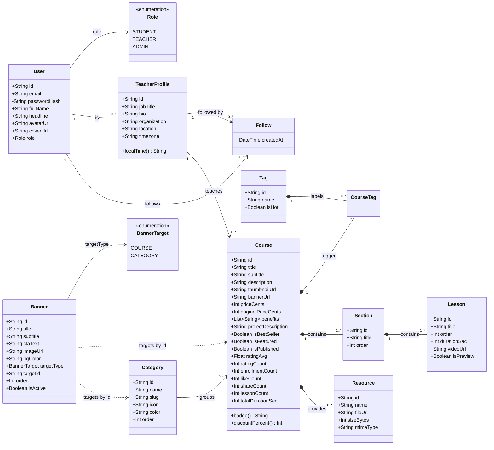
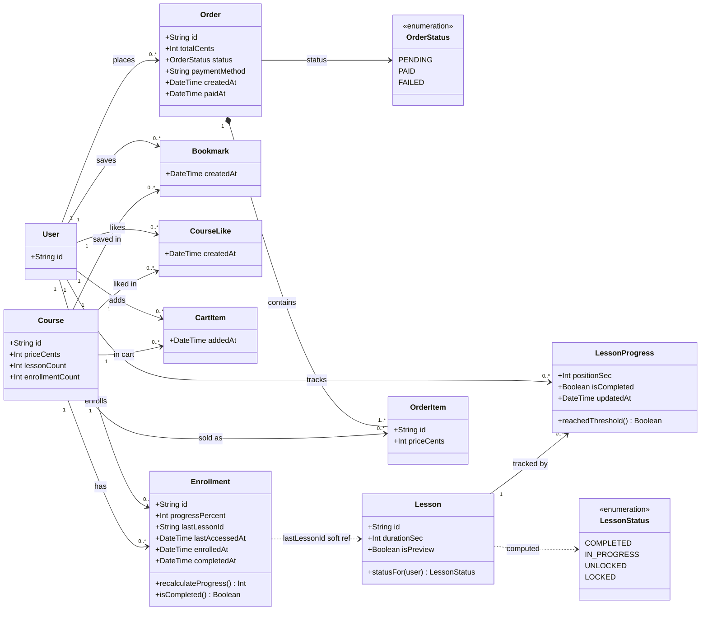
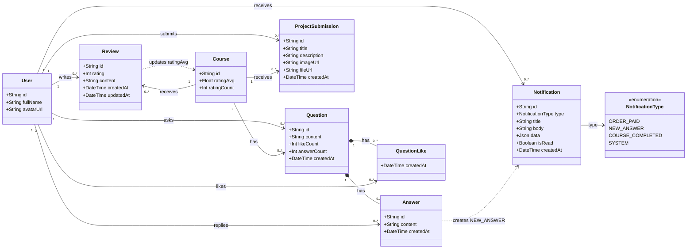
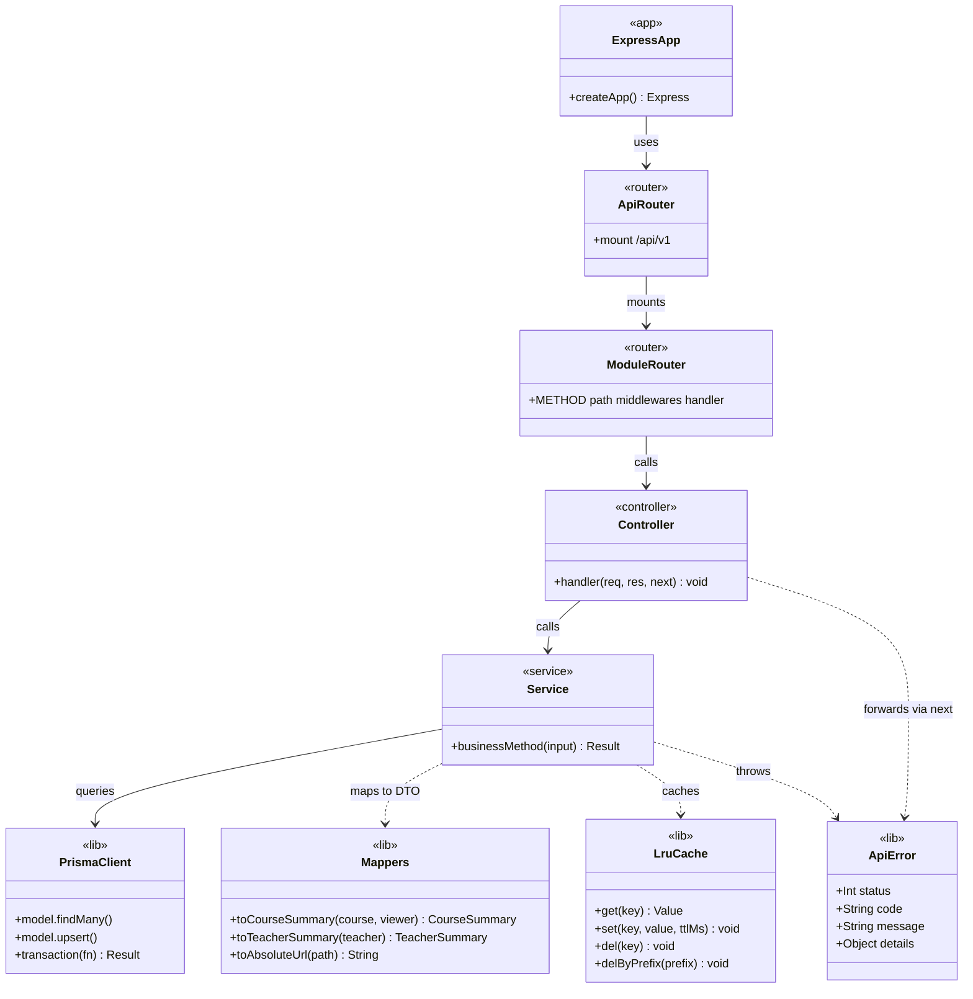
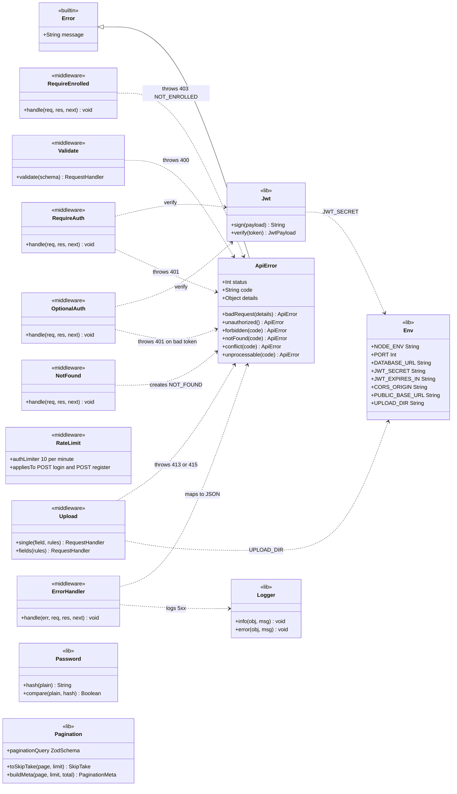
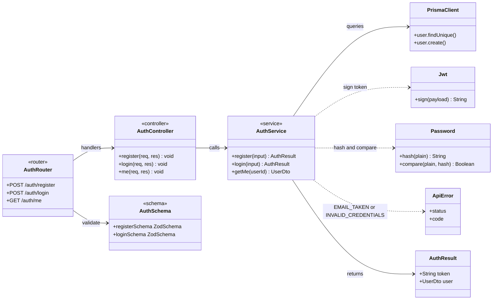
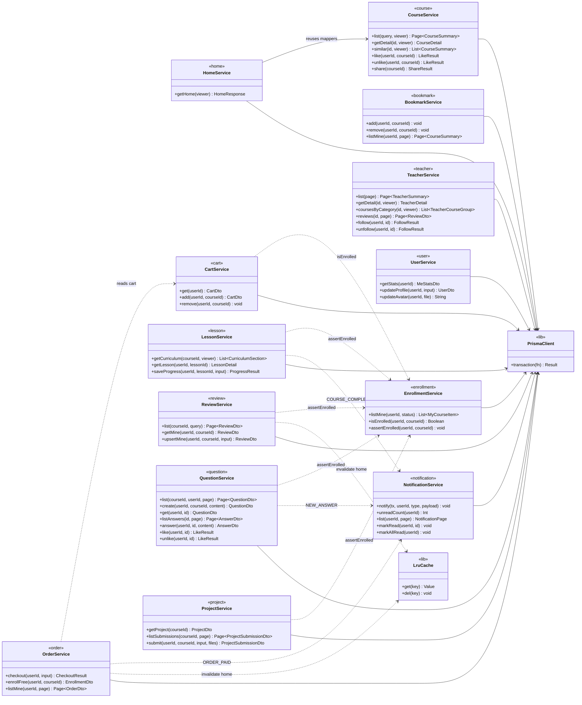
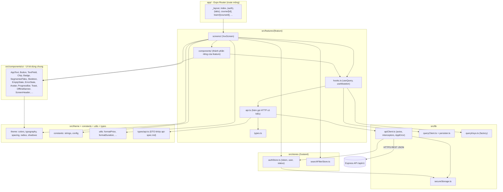
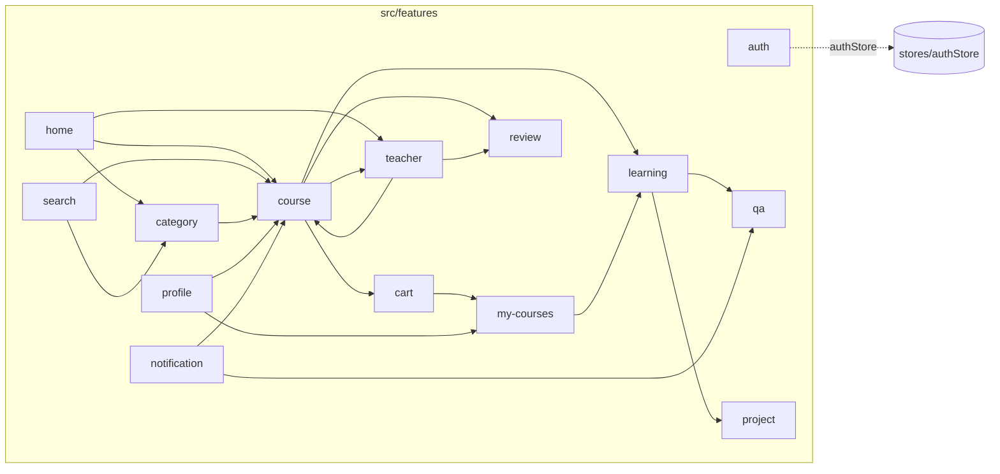
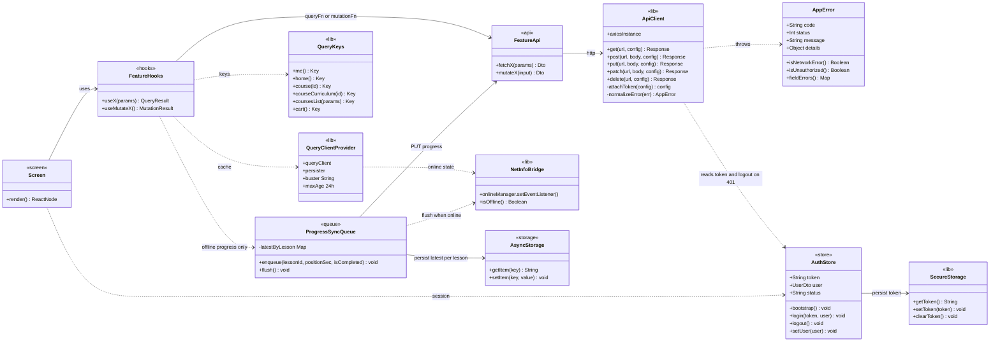

# Class diagram (D-03)

> **Tài liệu:** `docs/02-design/class-diagram.md` · **Task:** D-03 · **Owner:** C (Hoàng Ngọc Hải)
> **Nguồn:** [PLAN.md §5](../../PLAN.md) (kiến trúc, cấu trúc thư mục), [§8](../../PLAN.md) (Prisma schema), [§9](../../PLAN.md) (API/DTO). Liên quan: [database.md](database.md) · [api-spec.md](api-spec.md) · [SDS.md](SDS.md).
> Sơ đồ viết bằng Mermaid (`classDiagram`, `flowchart`) — xem trực tiếp trên GitHub/VS Code.

## Mục lục

1. [Class diagram miền (domain)](#1-class-diagram-miền-domain)
2. [Class diagram tầng server](#2-class-diagram-tầng-server)
3. [Sơ đồ module mobile](#3-sơ-đồ-module-mobile)
4. [Ánh xạ giữa các tầng](#4-ánh-xạ-giữa-các-tầng)
5. [Mẫu thiết kế được áp dụng](#5-mẫu-thiết-kế-được-áp-dụng)

---

## 1. Class diagram miền (domain)

### 1.1 Cách đọc

- Mỗi lớp tương ứng **một model Prisma** ([database.md](database.md)); thuộc tính là các cột chính (bỏ bớt `createdAt/updatedAt` và cột phụ để dễ đọc — danh sách đầy đủ ở data dictionary).
- Kiểu `String?` (cột cho phép `NULL`) được ghi là `String` trong sơ đồ vì Mermaid không có ký hiệu nullable; các cột nullable được liệt kê ở database.md.
- Bội số (multiplicity): `1` đúng một · `0..1` không hoặc một · `0..*` không hoặc nhiều · `1..*` một hoặc nhiều.
- Ký hiệu quan hệ: `*--` **composition** (con không tồn tại nếu thiếu cha, xóa cha thì xóa con — `onDelete: Cascade`) · `-->` **association** có hướng (tham chiếu) · `..>` phụ thuộc/dùng.
- Các phương thức ghi trong lớp miền (`badge()`, `statusFor()`…) là **hành vi nghiệp vụ** được hiện thực trong `service`/`mappers.ts`, **không** phải method của model Prisma.
- Do có 24 lớp nên chia 3 sơ đồ theo miền; lớp `User` và `Course` xuất hiện ở nhiều sơ đồ (chỉ ghi lại thuộc tính cần thiết cho ngữ cảnh).

### 1.2 Sơ đồ A — Người dùng, giảng viên, danh mục và nội dung khóa học

**Giải thích**

- `User` và `TeacherProfile` là quan hệ 1–0..1: mọi giảng viên là một `User` có thêm hồ sơ. `Course.teacher` trỏ tới **`TeacherProfile`** (không phải `User`).
- `Follow` và `CourseTag` là *lớp liên kết* của quan hệ n–n, mỗi lớp có khóa chính ghép.
- `Course` → `Section` → `Lesson` là chuỗi **composition** 1–1..*: xóa khóa xóa luôn chương và bài. Một khóa có ít nhất một chương, một chương có ít nhất một bài.
- `Banner` không có khóa ngoại: nó tham chiếu mềm tới `Course` hoặc `Category` theo `targetType` + `targetId` (đường nét đứt).
- `Course.badge()` và `discountPercent()` là quy tắc BR-10; `TeacherProfile.localTime()` là BR-16.

### 1.3 Sơ đồ B — Học tập và thương mại

**Giải thích**

- `Enrollment` là điểm trung tâm của học tập: có nó thì người dùng "sở hữu" khóa (BR-01, BR-06, BR-08, BR-09). `progressPercent` là số liệu denormalize từ `LessonProgress` (BR-04).
- `LessonProgress` là lớp liên kết `User`–`Lesson` (khóa chính ghép). `reachedThreshold()` mô tả quy tắc ≥ 90 % (BR-03).
- `Lesson.statusFor(user)` sinh `LessonStatus` (BR-02) khi dựng curriculum; trạng thái **không được lưu**.
- `Order` gồm các `OrderItem` (composition); `OrderItem.priceCents` lưu giá tại thời điểm mua. Giỏ hàng là tập `CartItem` của một người dùng (không có lớp `Cart`).
- `Enrollment.lastLessonId` chỉ là tham chiếu mềm tới `Lesson` (không có khóa ngoại).

### 1.4 Sơ đồ C — Tương tác cộng đồng và thông báo

**Giải thích**

- `Review` bị ràng buộc `(userId, courseId)` duy nhất (BR-08); ghi/sửa review kéo theo cập nhật `Course.ratingAvg/ratingCount` cùng transaction.
- `Question` chứa `Answer` và `QuestionLike` (composition). `answerCount`/`likeCount` denormalize.
- `Answer` được tạo bởi người khác người hỏi thì sinh một `Notification` `NEW_ANSWER` (BR-09). `Notification.data` (JSON) lưu `courseId`/`questionId` để điều hướng.

---

## 2. Class diagram tầng server

### 2.1 Kiến trúc lớp chung (Router → Controller → Service → PrismaClient)

Quy tắc bắt buộc (CLAUDE.md §8): **routes → controller → service → Prisma**; controller chỉ xử lý `req/res`; **chỉ service được dùng Prisma**; không có logic nghiệp vụ trong routes.

### 2.2 Middleware và tiện ích dùng chung

**Giải thích và thứ tự middleware (trong `app.ts`)**

`helmet` → `cors` → `compression` → `pino-http` → `express.json({ limit: '100kb' })` → static (`/static`, `/uploads`) → `/api/v1` (từng route: `rateLimit` **chỉ** ở `POST /auth/login` và `POST /auth/register` → `optionalAuth`/`requireAuth` → `requireEnrolled` → `upload` → `validate(schema)` → controller) → `notFound` → `errorHandler` (luôn cuối cùng).

- `ApiError` kế thừa `Error`, mang `status` + `code` + `details`; mọi lỗi nghiệp vụ được **ném** (`throw`) từ service/middleware và `errorHandler` biến thành `{ error: { code, message, details } }`.
- `ErrorHandler` xử lý 4 nhóm: `ApiError` (dùng nguyên), `ZodError` (→ 400 `VALIDATION_ERROR`), `MulterError` (→ 413/415), lỗi body-parser (JSON hỏng → 400, quá lớn → 413), còn lại → `500 INTERNAL_ERROR` (log đầy đủ, không trả stack).
- `RequireEnrolled` là middleware dùng cho `✓E` (mọi endpoint Q&A và Project, `PUT /lessons/:id/progress`, `PUT /courses/:id/reviews/me`): đọc `courseId` từ param, hoặc suy ra từ `lessonId`/`questionId` (tra CSDL, không tin dữ liệu client), rồi kiểm tra `Enrollment`; dùng chung logic với `EnrollmentService.assertEnrolled`. Đối tượng không tồn tại → 404 trước, chưa ghi danh → `403 NOT_ENROLLED`.

### 2.3 Module Auth (chuỗi đầy đủ Router → Controller → Service → Prisma)

### 2.4 Các service nghiệp vụ chính

**Giải thích**

- **Mỗi service** đứng sau một controller cùng module (`<module>.routes.ts → .controller.ts → .service.ts + .schema.ts`, đúng CLAUDE.md §4); sơ đồ 2.3 là mẫu đầy đủ, các module khác lặp lại cấu trúc đó nên chỉ vẽ tầng service để tránh rườm rà.
- `EnrollmentService.assertEnrolled` là **điểm kiểm tra quyền duy nhất** (BR-01/08/09, NFR-06) — mọi service cần "đã ghi danh" đều gọi nó (hoặc middleware `RequireEnrolled` gọi nó).
- `NotificationService.notify(tx, …)` nhận `tx` (transaction client) để việc tạo thông báo nằm **cùng transaction** với thao tác gốc (`OrderService.checkout`, `LessonService.saveProgress`, `QuestionService.answer`).
- `OrderService.checkout` là transaction lớn nhất: tạo `Order`/`OrderItem`, `Enrollment`, tăng `enrollmentCount`, xóa `CartItem`, tạo thông báo; sau commit mới xóa cache. Nhánh `simulateFailure` chỉ lưu `Order` trạng thái `FAILED` rồi ném `ApiError 402 PAYMENT_FAILED` (giỏ giữ nguyên, không ghi danh).
- `NotificationService.unreadCount` phục vụ `GET /notifications/unread-count` (badge chuông) và `meta.unreadCount` của danh sách.
- `Page~T~` là kiểu `{ items: T[]; meta: PaginationMeta }` mà service trả cho controller; controller gói thành `{ data, meta }`.
- Phụ thuộc giữa các service được hạn chế ở chiều "đọc/kiểm tra quyền" (mũi tên nét đứt) để tránh vòng tròn.

---

## 3. Sơ đồ module mobile

### 3.1 Phân tầng mobile

Luồng dữ liệu bắt buộc (CLAUDE.md §7): **route mỏng → screen → hook → `api.ts` → `apiClient`**. Component **không** gọi axios trực tiếp; server state chỉ ở TanStack Query; Zustand chỉ giữ client state.

**Giải thích**

- **`app/`** chỉ chứa route: lấy `useLocalSearchParams()` rồi render `<XxxScreen />` (file route dùng `default export`; mọi nơi khác dùng named export).
- **`features/<feature>/`** gói gọn một tính năng: `api.ts` (hàm thuần trả `Promise<Dto>`), `hooks.ts` (bọc TanStack Query, dùng key từ `queryKeys.ts`), `components/` (thành phần riêng), `screens/`, `types.ts`, và test cạnh file nguồn.
- **`lib/apiClient.ts`** là instance axios duy nhất: gắn `Authorization` từ `authStore`, chuẩn hóa lỗi thành `AppError`, 401 → gọi `authStore.logout()`.
- **`stores/authStore.ts`** giữ `token`, `user`, `status` (`loading | authenticated | unauthenticated`); token lưu ở SecureStore. **Không** copy dữ liệu API vào Zustand.
- **`theme/`** là nguồn duy nhất của màu/chữ/khoảng cách; UI kit và màn hình chỉ đọc từ đây.

### 3.2 Các feature và phụ thuộc chéo

Ý nghĩa mũi tên: `A --> B` nghĩa là màn hình/component của A **dùng component hoặc hook** của B (không gọi ngược lại).

| Feature | Owner | Thành phần tái dùng cho feature khác |
|---|---|---|
| `course` | B (khung, Overview) | `CourseCardVertical`, `CourseCardHorizontal`, `PriceTag`, `useCourseDetail` — dùng ở Home, Search, Profile, Teacher |
| `learning` | C | `CurriculumList` (`SectionAccordion` + `LessonRow`) — nhúng vào tab Lessons của SC-09 (course) và SC-15 |
| `review` | C | `ReviewCard`, `ReviewSummary` — nhúng vào tab Review của SC-09 và tab Review của SC-18 (teacher) |
| `my-courses` | C | `CourseProgressCard`; hook bookmark `useToggleBookmark` + `BookmarkButton` (C) dùng ở mọi card |
| `project` | B | Tab Projects trong SC-15 (`ProjectCard`, `UploadBox`, `ResourceItem`) |
| `qa` | C | Tab Q&A trong SC-15, SC-16 (`QuestionCard`, `Composer`) |
| `teacher` | A | `TeacherCard` (dùng ở Home, SC-19) |
| `notification` | A | Badge chuông ở Home |
| `profile` | B (SC-20) · A (SC-21 Edit profile) | — |

### 3.3 Lớp lõi của mobile

**Giải thích**

- `ApiClient.normalizeError` chuyển mọi lỗi (mạng, timeout, phản hồi `{error}`) thành `AppError` với `code` ổn định; các hook/screen rẽ nhánh theo `code`, không theo chuỗi message.
- `AuthStore.bootstrap()` chạy ở SC-01: đọc token → `GET /auth/me` → đặt `status`; `logout()` xóa token + `queryClient.clear()` + persisted cache (FR-03).
- `QueryKeys` là *factory* tập trung — không viết mảng key rải rác (CLAUDE.md §7); bảng key/`staleTime` đầy đủ ở [SDS §4.5](SDS.md#45-state-và-cache).
- `NetInfoBridge` nối `@react-native-community/netinfo` với `onlineManager` của TanStack Query: offline thì query tạm dừng và mutation ghi bị chặn kèm toast "You're offline".
- `ProgressSyncQueue` là **ngoại lệ có chủ đích** của việc chặn ghi khi offline (FR-24, NFR-10): chỉ riêng tiến độ video được giữ tạm trong AsyncStorage (bản mới nhất mỗi bài) và tự gửi lại `PUT /lessons/:id/progress` khi có mạng; mọi mutation khác vẫn bị chặn.

---

## 4. Ánh xạ giữa các tầng

| Khái niệm | Domain (Prisma model) | Server (service) | DTO (API) | Mobile (feature) |
|---|---|---|---|---|
| Người dùng | `User` | `AuthService`, `UserService` | `UserDto`, `MeStatsDto` | `auth`, `profile` |
| Giảng viên | `TeacherProfile`, `Follow` | `TeacherService` | `TeacherSummary`, `TeacherDetail`, `TeacherCourseGroup` | `teacher` |
| Danh mục / thẻ | `Category`, `Tag`, `CourseTag` | `CourseService`, `HomeService` | `CategoryDto`, `TagDto` | `category`, `search` |
| Khóa học | `Course`, `Section`, `Lesson`, `Resource` | `CourseService`, `LessonService` | `CourseSummary`, `CourseDetail`, `CurriculumSection` | `course`, `home` |
| Ghi danh / tiến độ | `Enrollment`, `LessonProgress` | `EnrollmentService`, `LessonService` | `MyCourseItem`, `LessonDetail`, `EnrollmentDto`, `LessonProgressDto` | `my-courses`, `learning` |
| Lưu / thích | `Bookmark`, `CourseLike` | `BookmarkService`, `CourseService` | (204 / `{ likeCount, isLiked }`) | `useToggleBookmark` |
| Giỏ / đơn | `CartItem`, `Order`, `OrderItem` | `CartService`, `OrderService` | `CartDto`, `OrderDto` | `cart` |
| Đánh giá | `Review` | `ReviewService` | `ReviewDto`, `ReviewSummaryDto` | `review` |
| Hỏi đáp | `Question`, `Answer`, `QuestionLike` | `QuestionService` | `QuestionDto`, `AnswerDto` | `qa` |
| Project | `ProjectSubmission`, `Resource` | `ProjectService` | `ProjectSubmissionDto`, `ResourceDto` | `project` |
| Thông báo | `Notification` | `NotificationService` | `NotificationDto` | `notification` |
| Banner | `Banner` | `HomeService` | `BannerDto` | `home` |

---

## 5. Mẫu thiết kế được áp dụng

| Mẫu | Vị trí | Mục đích |
|---|---|---|
| **Layered architecture** | Server: router → controller → service → Prisma; mobile: screen → hook → api → apiClient | Tách trách nhiệm, dễ test (mock tầng dưới) |
| **Feature module** | `server/src/modules/*`, `mobile/src/features/*` | Gói gọn theo tính năng, giảm xung đột merge giữa 3 thành viên |
| **DTO + Mapper** | `lib/mappers.ts` (`toCourseSummary`, `toTeacherSummary`, `toAbsoluteUrl`) | Không lộ hình dạng DB, quy tắc BR-10 ở một nơi |
| **Singleton** | `lib/prisma.ts`, `lib/cache.ts`, `apiClient`, `queryClient` | Một instance dùng chung |
| **Facade** | `apiClient`, `AuthService` | Che giấu chi tiết axios/JWT/bcrypt sau giao diện đơn giản |
| **Middleware chain (Chain of Responsibility)** | Express middlewares | `auth → enrolled → upload → validate → controller` |
| **Centralized error handling** | `ApiError` + `errorHandler`; `AppError` ở mobile | Một định dạng lỗi thống nhất toàn hệ thống |
| **Unit of Work** | `prisma.$transaction` | Checkout, tiến độ, review — nguyên tử (NFR-10) |
| **Cache-aside** | `LruCache` cho `/home`, `/categories`, `/tags/hot`; TanStack Query ở client | Giảm truy vấn DB và độ trễ |
| **Observer** | Zustand store, TanStack Query subscribe | UI phản ứng khi state/cache đổi |
| **Optimistic update + rollback** | `useToggleBookmark`, like, follow | Phản hồi tức thì, quay lui khi lỗi |
| **Factory** | `queryKeys.ts`; factories dữ liệu ở `server/tests/helpers/factories.ts` | Khóa cache nhất quán; dữ liệu test dễ dựng |
