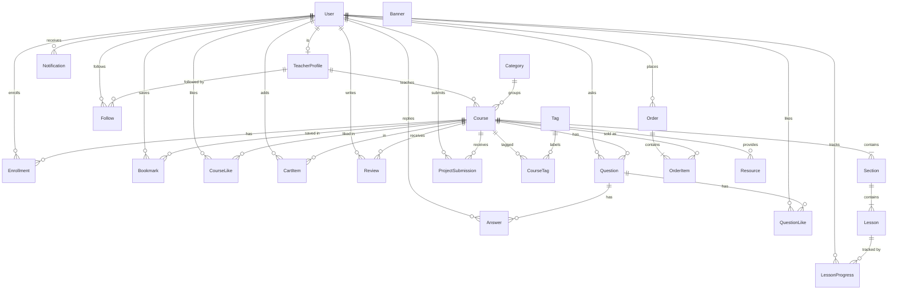
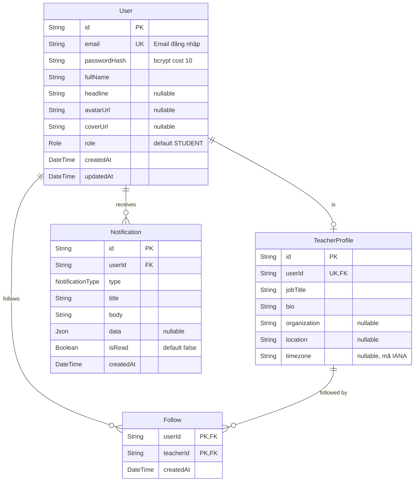
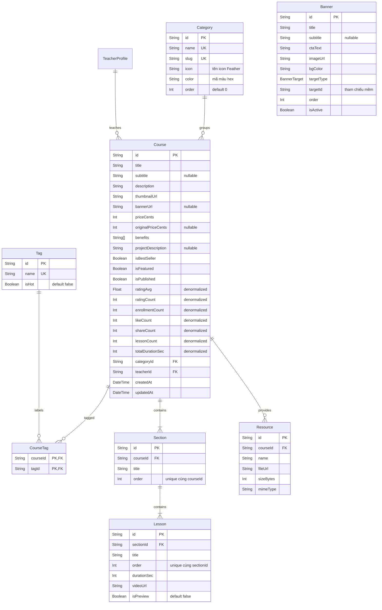
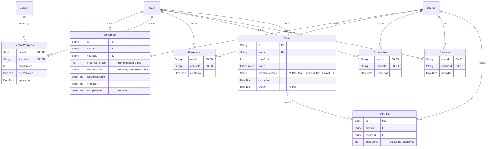
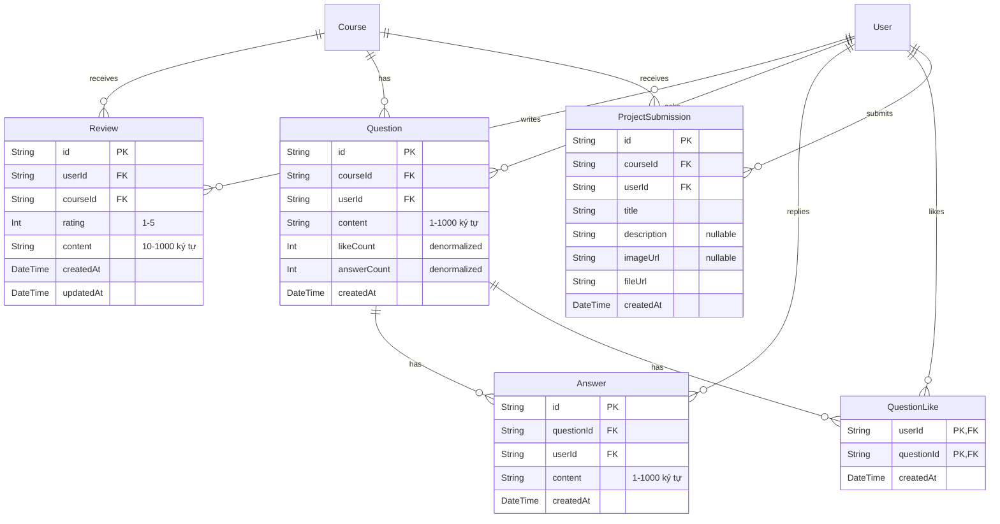

# Thiết kế cơ sở dữ liệu (D-02)

> **Tài liệu:** `docs/02-design/database.md` · **Task:** D-02 · **Owner:** A (Lê Hoàng Khang)
> **Nguồn sự thật:** [PLAN.md §8](../../PLAN.md) (Prisma schema bản nháp) và [§6.5 Business rules](../../PLAN.md). Khi S-03 hoàn thiện `schema.prisma` hoặc có migration mới, **người sửa schema phải cập nhật lại file này** (CLAUDE.md §8, §13).
> **Liên quan:** [SDS.md](SDS.md) · [api-spec.md](api-spec.md) · [class-diagram.md](class-diagram.md)

## Mục lục

1. [Tổng quan](#1-tổng-quan)
2. [ERD](#2-erd)
3. [Enum](#3-enum)
4. [Data dictionary](#4-data-dictionary)
5. [Index và lý do](#5-index-và-lý-do)
6. [Chiến lược denormalize](#6-chiến-lược-denormalize)
7. [Quy tắc xóa (cascade)](#7-quy-tắc-xóa-cascade)
8. [Quy ước dữ liệu](#8-quy-ước-dữ-liệu)
9. [Ghi chú cho seed và migration](#9-ghi-chú-cho-seed-và-migration)
10. [Điểm chưa khớp / đề xuất bổ sung so với PLAN §8](#10-điểm-chưa-khớp--đề-xuất-bổ-sung-so-với-plan-8)

---

## 1. Tổng quan

| Hạng mục | Giá trị |
|---|---|
| Hệ quản trị CSDL | PostgreSQL (Neon free tier; có thể dùng PostgreSQL cài local) |
| ORM / migration | Prisma ORM; thay đổi DB **chỉ qua** `prisma migrate dev` (CLAUDE.md §8) |
| Số bảng | **24 model** (23 model có trong ERD PLAN §8.1 + `Banner` là bảng độc lập) |
| Số enum | 4 (`Role`, `OrderStatus`, `NotificationType`, `BannerTarget`) |
| Khóa chính | `String @id @default(cuid())` cho bảng thực thể; **khóa chính ghép** cho bảng quan hệ n-n |
| Tiền | `Int` — đơn vị **cent** (`priceCents`, `totalCents`…), không dùng số thực (ADR-11) |
| Thời lượng | `Int` — đơn vị **giây** (`durationSec`, `positionSec`, `totalDurationSec`) |
| Thời gian | `DateTime` — lưu UTC (`TIMESTAMP(3)`), API trả ISO 8601 UTC |
| Denormalize | 8 cột đếm/tổng hợp cập nhật trong **cùng transaction** với thao tác gốc (mục 6) |

Nhóm bảng theo miền nghiệp vụ:

| Miền | Bảng | Module server phụ trách |
|---|---|---|
| Tài khoản & giảng viên | `User`, `TeacherProfile`, `Follow` | `auth`, `user`, `teacher` |
| Danh mục & nội dung | `Category`, `Tag`, `CourseTag`, `Course`, `Section`, `Lesson`, `Resource`, `Banner` | `category`, `tag`, `course`, `home`, `project` |
| Học tập & thương mại | `Enrollment`, `LessonProgress`, `Bookmark`, `CourseLike`, `CartItem`, `Order`, `OrderItem` | `enrollment`, `lesson`, `bookmark`, `course`, `cart`, `order` |
| Tương tác cộng đồng | `Review`, `Question`, `Answer`, `QuestionLike`, `ProjectSubmission` | `review`, `question`, `project` |
| Hệ thống | `Notification` | `notification` |

---

## 2. ERD

### 2.1 Sơ đồ tổng quan (chỉ quan hệ)

Ký hiệu: `||` đúng 1 · `o|` 0 hoặc 1 · `|{` 1 hoặc nhiều · `o{` 0 hoặc nhiều.



`Banner` không có khóa ngoại; nó tham chiếu **mềm** tới `Course`/`Category` qua cặp `targetType` + `targetId` (giá trị `targetId` không được DB kiểm tra). Tương tự `Enrollment.lastLessonId` là tham chiếu mềm tới `Lesson.id` (không khai báo `@relation`) và `Notification.data` (JSON) chứa `courseId`/`questionId`.

### 2.2 ERD chi tiết theo miền

**(a) Tài khoản, giảng viên, thông báo**



**(b) Danh mục, khóa học, nội dung, banner**



**(c) Học tập và thương mại**



**(d) Tương tác cộng đồng**



---

## 3. Enum

| Enum | Giá trị | Ý nghĩa | Dùng ở |
|---|---|---|---|
| `Role` | `STUDENT` | Học viên (mặc định khi đăng ký) | `User.role` |
| | `TEACHER` | Giảng viên (dữ liệu seed; có `TeacherProfile`) | |
| | `ADMIN` | Quản trị (dự phòng, chưa có màn hình) | |
| `OrderStatus` | `PENDING` | Đơn vừa tạo, chưa có kết quả thanh toán (trạng thái trung gian trong transaction) | `Order.status` |
| | `PAID` | Thanh toán giả lập thành công (BR-07) | |
| | `FAILED` | Thanh toán giả lập thất bại khi body checkout có `simulateFailure: true` (BR-07): đơn được lưu để làm dấu vết, **không** ghi danh, giỏ được giữ nguyên | |
| `NotificationType` | `ORDER_PAID` | Thanh toán thành công (BR-07) | `Notification.type` |
| | `NEW_ANSWER` | Có người trả lời câu hỏi của bạn (BR-09) | |
| | `COURSE_COMPLETED` | Hoàn thành 100 % khóa học (BR-04) | |
| | `SYSTEM` | Thông báo hệ thống (seed/dự phòng) | |
| `BannerTarget` | `COURSE` | Banner trỏ tới một khóa học (`targetId` = `Course.id`) | `Banner.targetType` |
| | `CATEGORY` | Banner trỏ tới một danh mục (`targetId` = `Category.id`) | |

---

## 4. Data dictionary

**Quy ước đọc bảng**

- **Kiểu PostgreSQL** là kiểu Prisma sinh ra trong migration: `String → TEXT`, `Int → INTEGER`, `Float → DOUBLE PRECISION`, `Boolean → BOOLEAN`, `DateTime → TIMESTAMP(3)`, `Json → JSONB`, `String[] → TEXT[]`, enum → kiểu `ENUM` cùng tên.
- **Mặc định `cuid()`**: do Prisma Client sinh ở tầng ứng dụng, không phải `DEFAULT` của DB. **`@updatedAt`**: Prisma Client tự gán mỗi lần `update`, DB không có `DEFAULT`. **`now()`**: `DEFAULT CURRENT_TIMESTAMP`.
- Cột **Ràng buộc** ghi `PK`, `FK → Bảng.cột (hành động khi xóa cha)`, `UQ`; các ràng buộc gắn `App:` là **quy tắc nghiệp vụ kiểm tra bằng zod/service**, DB không có `CHECK`.
- Mọi khóa ngoại NOT NULL (trừ khi ghi khác). Hành động xóa tổng hợp ở [mục 7](#7-quy-tắc-xóa-cascade).

### 4.1 `User` — người dùng

Tài khoản đăng nhập. Học viên và giảng viên đều là `User`; giảng viên có thêm 1 dòng `TeacherProfile`. Seed: 10–12 học viên + 8–10 giảng viên.

| Cột | Kiểu Prisma | Kiểu PostgreSQL | Null | Mặc định | Ràng buộc | Ý nghĩa |
|---|---|---|---|---|---|---|
| `id` | String | TEXT | Không | `cuid()` | PK | Mã người dùng |
| `email` | String | TEXT | Không | — | UQ · App: email hợp lệ, lưu chữ thường | Email đăng nhập (FR-01, FR-02); trùng → `EMAIL_TAKEN` |
| `passwordHash` | String | TEXT | Không | — | App: bcryptjs cost 10 | Mật khẩu đã băm; **không bao giờ** trả ra API/log |
| `fullName` | String | TEXT | Không | — | App: 2–60 ký tự | Họ tên hiển thị; app lấy tên gọi ở màn Home từ từ cuối của chuỗi này |
| `headline` | String | TEXT | Có | `NULL` | App: ≤ 80 ký tự | Chức danh ngắn dưới tên (vd "UX/UI Designer") |
| `avatarUrl` | String | TEXT | Có | `NULL` | — | URL ảnh đại diện (Unsplash hoặc `/uploads/...`) |
| `coverUrl` | String | TEXT | Có | `NULL` | — | URL ảnh bìa trang hồ sơ |
| `role` | Role | ENUM `Role` | Không | `STUDENT` | — | Vai trò |
| `createdAt` | DateTime | TIMESTAMP(3) | Không | `now()` | — | Thời điểm tạo |
| `updatedAt` | DateTime | TIMESTAMP(3) | Không | `@updatedAt` | — | Lần cập nhật gần nhất |

### 4.2 `TeacherProfile` — hồ sơ giảng viên

Thông tin bổ sung của `User` có vai trò giảng viên. **Khóa ngoại `Course.teacherId` trỏ tới `TeacherProfile.id`** (không phải `User.id`); tên/ảnh giảng viên lấy qua `TeacherProfile.user`.

| Cột | Kiểu Prisma | Kiểu PostgreSQL | Null | Mặc định | Ràng buộc | Ý nghĩa |
|---|---|---|---|---|---|---|
| `id` | String | TEXT | Không | `cuid()` | PK | Mã hồ sơ giảng viên — là `teacher.id` trong API (`/teachers/:id`) |
| `userId` | String | TEXT | Không | — | UQ · FK → `User.id` (CASCADE) | Quan hệ 1–1 với `User` |
| `jobTitle` | String | TEXT | Không | — | — | Chức danh (vd "UI/UX Designer") |
| `bio` | String | TEXT | Không | — | — | Giới thiệu (tab Overview SC-18) |
| `organization` | String | TEXT | Có | `NULL` | — | Tổ chức (vd "University of ...") hiển thị ở `TeacherCard` |
| `location` | String | TEXT | Có | `NULL` | — | Địa điểm (vd "New York") |
| `timezone` | String | TEXT | Có | `NULL` | App: mã IANA (vd `America/New_York`) | Múi giờ để tính giờ địa phương (BR-16) |

### 4.3 `Follow` — theo dõi giảng viên

Quan hệ n-n `User` ↔ `TeacherProfile`. Toggle idempotent nhờ khóa chính ghép.

| Cột | Kiểu Prisma | Kiểu PostgreSQL | Null | Mặc định | Ràng buộc | Ý nghĩa |
|---|---|---|---|---|---|---|
| `userId` | String | TEXT | Không | — | PK (1/2) · FK → `User.id` (CASCADE) | Người theo dõi |
| `teacherId` | String | TEXT | Không | — | PK (2/2) · FK → `TeacherProfile.id` (CASCADE) · App: không tự follow chính mình (BR-14) | Giảng viên được theo dõi |
| `createdAt` | DateTime | TIMESTAMP(3) | Không | `now()` | — | Thời điểm follow |

### 4.4 `Category` — danh mục

6 dòng seed: Business, Design, Code, Writing, Movie, Language.

| Cột | Kiểu Prisma | Kiểu PostgreSQL | Null | Mặc định | Ràng buộc | Ý nghĩa |
|---|---|---|---|---|---|---|
| `id` | String | TEXT | Không | `cuid()` | PK | Mã danh mục |
| `name` | String | TEXT | Không | — | UQ | Tên hiển thị (vd "Business") |
| `slug` | String | TEXT | Không | — | UQ | Định danh dạng URL, chữ thường (vd `business`) |
| `icon` | String | TEXT | Không | — | App: tên icon Feather | Icon danh mục (vd `trending-up`) |
| `color` | String | TEXT | Không | — | App: mã màu hex | Màu icon theo design (vd `#00BDD6`) |
| `order` | Int | INTEGER | Không | `0` | — | Thứ tự hiển thị (nhỏ trước) |

### 4.5 `Tag` — thẻ tìm kiếm

~15 dòng seed, trong đó 7 tag `isHot` (Java, SQL, Javascript, Python, Digital marketing, Photoshop, Watercolor).

| Cột | Kiểu Prisma | Kiểu PostgreSQL | Null | Mặc định | Ràng buộc | Ý nghĩa |
|---|---|---|---|---|---|---|
| `id` | String | TEXT | Không | `cuid()` | PK | Mã thẻ |
| `name` | String | TEXT | Không | — | UQ | Tên thẻ; được khớp khi tìm kiếm (BR-13) |
| `isHot` | Boolean | BOOLEAN | Không | `false` | — | Thẻ hiển thị ở "Hot topics" (`GET /tags/hot`) |

### 4.6 `CourseTag` — gắn thẻ cho khóa học

Bảng nối n-n `Course` ↔ `Tag`.

| Cột | Kiểu Prisma | Kiểu PostgreSQL | Null | Mặc định | Ràng buộc | Ý nghĩa |
|---|---|---|---|---|---|---|
| `courseId` | String | TEXT | Không | — | PK (1/2) · FK → `Course.id` (CASCADE) | Khóa học |
| `tagId` | String | TEXT | Không | — | PK (2/2) · FK → `Tag.id` (CASCADE) | Thẻ |

### 4.7 `Course` — khóa học

Thực thể trung tâm. 25–30 dòng seed. Các cột đánh dấu **(DN)** là denormalize, xem [mục 6](#6-chiến-lược-denormalize).

| Cột | Kiểu Prisma | Kiểu PostgreSQL | Null | Mặc định | Ràng buộc | Ý nghĩa |
|---|---|---|---|---|---|---|
| `id` | String | TEXT | Không | `cuid()` | PK | Mã khóa học |
| `title` | String | TEXT | Không | — | — | Tiêu đề đầy đủ (vd "UX Foundation: Introduction to User Experience Design") |
| `subtitle` | String | TEXT | Có | `NULL` | — | Tiêu đề phụ; được khớp khi tìm kiếm (BR-13) |
| `description` | String | TEXT | Không | — | — | Mô tả (tab Overview, có "See more") |
| `thumbnailUrl` | String | TEXT | Không | — | — | Ảnh đại diện trên card |
| `bannerUrl` | String | TEXT | Có | `NULL` | — | Ảnh hero ở trang chi tiết (nền `secondary`) |
| `priceCents` | Int | INTEGER | Không | — | App: ≥ 0 | Giá hiện tại (cent). `0` = khóa miễn phí |
| `originalPriceCents` | Int | INTEGER | Có | `NULL` | App: > `priceCents` nếu có | Giá gốc; dùng tính badge giảm giá (BR-10) |
| `benefits` | String[] | TEXT[] | Không | `{}` (mảng rỗng) | — | Danh sách quyền lợi (video hours, native teacher, document, lifetime access, 24/7 support). **Không** ghi "Certificate" vì chứng chỉ thuộc mục Won't (BR-18) |
| `projectDescription` | String | TEXT | Có | `NULL` | — | Mô tả project của khóa (tab Projects) |
| `isBestSeller` | Boolean | BOOLEAN | Không | `false` | — | Hiện badge "Best-seller" (ưu tiên hơn giảm giá — BR-10) |
| `isFeatured` | Boolean | BOOLEAN | Không | `false` | — | Thuộc nhóm "Course that inspires" (BR-11) |
| `isPublished` | Boolean | BOOLEAN | Không | `true` | — | `false` thì ẩn khỏi mọi API công khai (BR-13) |
| `ratingAvg` | Float | DOUBLE PRECISION | Không | `0` | App: 0–5, làm tròn 1 chữ số | **(DN)** Điểm trung bình review |
| `ratingCount` | Int | INTEGER | Không | `0` | — | **(DN)** Số review |
| `enrollmentCount` | Int | INTEGER | Không | `0` | — | **(DN)** Số học viên đã ghi danh; tiêu chí "Popular" (BR-11) |
| `likeCount` | Int | INTEGER | Không | `0` | — | **(DN)** Số lượt thích (FR-17, Could) |
| `shareCount` | Int | INTEGER | Không | `0` | — | **(DN)** Số lượt chia sẻ (FR-17, Could) |
| `lessonCount` | Int | INTEGER | Không | `0` | — | **(DN)** Tổng số bài học; mẫu số của % hoàn thành (BR-04) |
| `totalDurationSec` | Int | INTEGER | Không | `0` | — | **(DN)** Tổng thời lượng các bài (giây) |
| `categoryId` | String | TEXT | Không | — | FK → `Category.id` (RESTRICT) | Danh mục |
| `teacherId` | String | TEXT | Không | — | FK → `TeacherProfile.id` (RESTRICT) | Giảng viên sở hữu |
| `createdAt` | DateTime | TIMESTAMP(3) | Không | `now()` | — | Ngày tạo; sắp xếp "Newest" |
| `updatedAt` | DateTime | TIMESTAMP(3) | Không | `@updatedAt` | — | Cập nhật gần nhất |

### 4.8 `Section` — chương

Mỗi khóa có 3–4 chương ("I - Introduction", "II - Plan for your UX Research"…).

| Cột | Kiểu Prisma | Kiểu PostgreSQL | Null | Mặc định | Ràng buộc | Ý nghĩa |
|---|---|---|---|---|---|---|
| `id` | String | TEXT | Không | `cuid()` | PK | Mã chương |
| `courseId` | String | TEXT | Không | — | FK → `Course.id` (CASCADE) · UQ (`courseId`,`order`) | Khóa học chứa chương |
| `title` | String | TEXT | Không | — | — | Tiêu đề chương |
| `order` | Int | INTEGER | Không | — | UQ (`courseId`,`order`) | Thứ tự chương trong khóa (bắt đầu từ 1) |

### 4.9 `Lesson` — bài học

8–15 bài/khóa; 2 bài đầu `isPreview = true`.

| Cột | Kiểu Prisma | Kiểu PostgreSQL | Null | Mặc định | Ràng buộc | Ý nghĩa |
|---|---|---|---|---|---|---|
| `id` | String | TEXT | Không | `cuid()` | PK | Mã bài học |
| `sectionId` | String | TEXT | Không | — | FK → `Section.id` (CASCADE) · UQ (`sectionId`,`order`) | Chương chứa bài |
| `title` | String | TEXT | Không | — | — | Tiêu đề bài |
| `order` | Int | INTEGER | Không | — | UQ (`sectionId`,`order`) | Thứ tự bài trong chương. Số thứ tự hiển thị `number` (01, 02…) được tính theo thứ tự (chương, bài) trên toàn khóa, không lưu |
| `durationSec` | Int | INTEGER | Không | — | App: > 0; bằng thời lượng thật của clip | Thời lượng (giây) — dùng cho ngưỡng 90 % (BR-03) |
| `videoUrl` | String | TEXT | Không | — | — | Đường dẫn video (`/static/videos/...`). **Chỉ trả qua `GET /lessons/:id`** khi đủ quyền (BR-01) |
| `isPreview` | Boolean | BOOLEAN | Không | `false` | — | Cho phép xem khi chưa ghi danh (BR-01) |

### 4.10 `Enrollment` — ghi danh

Học viên ↔ khóa học đã sở hữu (mua hoặc ghi danh miễn phí). Là nguồn cho My Courses và thống kê hồ sơ.

| Cột | Kiểu Prisma | Kiểu PostgreSQL | Null | Mặc định | Ràng buộc | Ý nghĩa |
|---|---|---|---|---|---|---|
| `id` | String | TEXT | Không | `cuid()` | PK | Mã ghi danh |
| `userId` | String | TEXT | Không | — | FK → `User.id` (CASCADE) · UQ (`userId`,`courseId`) | Học viên |
| `courseId` | String | TEXT | Không | — | FK → `Course.id` (CASCADE) · UQ (`userId`,`courseId`) | Khóa học |
| `progressPercent` | Int | INTEGER | Không | `0` | App: 0–100 | **(DN)** % hoàn thành = round(bài xong / tổng bài × 100) (BR-04) |
| `lastLessonId` | String | TEXT | Có | `NULL` | Tham chiếu mềm tới `Lesson.id` (không có FK) | Bài học gần nhất → trạng thái `IN_PROGRESS` (BR-02), điểm tiếp tục học |
| `lastAccessedAt` | DateTime | TIMESTAMP(3) | Không | `now()` | — | Lần học gần nhất; sắp xếp My Courses (BR-05) |
| `enrolledAt` | DateTime | TIMESTAMP(3) | Không | `now()` | — | Thời điểm ghi danh |
| `completedAt` | DateTime | TIMESTAMP(3) | Có | `NULL` | — | Đặt khi `progressPercent` đạt 100 (BR-04) |

### 4.11 `LessonProgress` — tiến độ bài học

Mỗi (học viên, bài) một dòng; ghi bằng `upsert`. Tần suất ghi: tối đa 1 lần / 10 s / người khi xem (throttle phía client).

| Cột | Kiểu Prisma | Kiểu PostgreSQL | Null | Mặc định | Ràng buộc | Ý nghĩa |
|---|---|---|---|---|---|---|
| `userId` | String | TEXT | Không | — | PK (1/2) · FK → `User.id` (CASCADE) | Học viên |
| `lessonId` | String | TEXT | Không | — | PK (2/2) · FK → `Lesson.id` (CASCADE) | Bài học |
| `positionSec` | Int | INTEGER | Không | `0` | App: 0 ≤ giá trị ≤ `Lesson.durationSec` | Vị trí xem gần nhất (giây) — dùng để tiếp tục |
| `isCompleted` | Boolean | BOOLEAN | Không | `false` | App: đã `true` thì không bị đặt lại `false` (BR-03) | Đã hoàn thành (≥ 90 % hoặc phát hết) |
| `updatedAt` | DateTime | TIMESTAMP(3) | Không | `@updatedAt` | — | Lần lưu gần nhất |

### 4.12 `Bookmark` — khóa học đã lưu

| Cột | Kiểu Prisma | Kiểu PostgreSQL | Null | Mặc định | Ràng buộc | Ý nghĩa |
|---|---|---|---|---|---|---|
| `userId` | String | TEXT | Không | — | PK (1/2) · FK → `User.id` (CASCADE) | Người lưu |
| `courseId` | String | TEXT | Không | — | PK (2/2) · FK → `Course.id` (CASCADE) | Khóa được lưu |
| `createdAt` | DateTime | TIMESTAMP(3) | Không | `now()` | — | Thời điểm lưu; sắp xếp "Saved courses" mới nhất trước |

### 4.13 `CourseLike` — thích khóa học (Could, FR-17)

| Cột | Kiểu Prisma | Kiểu PostgreSQL | Null | Mặc định | Ràng buộc | Ý nghĩa |
|---|---|---|---|---|---|---|
| `userId` | String | TEXT | Không | — | PK (1/2) · FK → `User.id` (CASCADE) | Người thích |
| `courseId` | String | TEXT | Không | — | PK (2/2) · FK → `Course.id` (CASCADE) | Khóa được thích |
| `createdAt` | DateTime | TIMESTAMP(3) | Không | `now()` | — | Thời điểm thích |

### 4.14 `CartItem` — mục trong giỏ hàng

Giỏ hàng không có bảng cha: giỏ của người dùng = tập `CartItem` theo `userId`.

| Cột | Kiểu Prisma | Kiểu PostgreSQL | Null | Mặc định | Ràng buộc | Ý nghĩa |
|---|---|---|---|---|---|---|
| `userId` | String | TEXT | Không | — | PK (1/2) · FK → `User.id` (CASCADE) | Chủ giỏ |
| `courseId` | String | TEXT | Không | — | PK (2/2) · FK → `Course.id` (CASCADE) · App: khóa có phí, chưa ghi danh (BR-06) | Khóa trong giỏ; trùng → `ALREADY_IN_CART` |
| `addedAt` | DateTime | TIMESTAMP(3) | Không | `now()` | — | Thời điểm thêm |

### 4.15 `Order` — đơn hàng

Tạo bởi `POST /orders/checkout` (BR-07). Thanh toán giả lập nên đơn chuyển thẳng `PENDING → PAID` trong cùng transaction; nếu client gửi `simulateFailure: true` thì đơn chuyển `PENDING → FAILED` (không có `paidAt`, không có `Enrollment`, `CartItem` còn nguyên).

| Cột | Kiểu Prisma | Kiểu PostgreSQL | Null | Mặc định | Ràng buộc | Ý nghĩa |
|---|---|---|---|---|---|---|
| `id` | String | TEXT | Không | `cuid()` | PK | Mã đơn |
| `userId` | String | TEXT | Không | — | FK → `User.id` (CASCADE) | Người mua |
| `totalCents` | Int | INTEGER | Không | — | App: = Σ `OrderItem.priceCents` | Tổng tiền (cent) |
| `status` | OrderStatus | ENUM `OrderStatus` | Không | `PENDING` | — | Trạng thái đơn |
| `paymentMethod` | String | TEXT | Không | — | App: `MOCK_CARD` hoặc `MOCK_EWALLET` | Phương thức thanh toán giả lập |
| `createdAt` | DateTime | TIMESTAMP(3) | Không | `now()` | — | Thời điểm tạo đơn |
| `paidAt` | DateTime | TIMESTAMP(3) | Có | `NULL` | App: chỉ có giá trị khi `status = PAID` | Thời điểm thanh toán thành công |

### 4.16 `OrderItem` — dòng đơn hàng

Lưu **giá tại thời điểm mua** (`priceCents`) nên đổi giá khóa về sau không làm sai lịch sử đơn.

| Cột | Kiểu Prisma | Kiểu PostgreSQL | Null | Mặc định | Ràng buộc | Ý nghĩa |
|---|---|---|---|---|---|---|
| `id` | String | TEXT | Không | `cuid()` | PK | Mã dòng |
| `orderId` | String | TEXT | Không | — | FK → `Order.id` (CASCADE) · UQ (`orderId`,`courseId`) | Đơn hàng |
| `courseId` | String | TEXT | Không | — | FK → `Course.id` (RESTRICT) · UQ (`orderId`,`courseId`) | Khóa đã bán (không xóa được khóa đã có đơn) |
| `priceCents` | Int | INTEGER | Không | — | App: ≥ 0 | Giá tại thời điểm mua (cent) |

### 4.17 `Review` — đánh giá

| Cột | Kiểu Prisma | Kiểu PostgreSQL | Null | Mặc định | Ràng buộc | Ý nghĩa |
|---|---|---|---|---|---|---|
| `id` | String | TEXT | Không | `cuid()` | PK | Mã đánh giá |
| `userId` | String | TEXT | Không | — | FK → `User.id` (CASCADE) · UQ (`userId`,`courseId`) | Người đánh giá |
| `courseId` | String | TEXT | Không | — | FK → `Course.id` (CASCADE) · UQ (`userId`,`courseId`) | Khóa được đánh giá (mỗi người 1 review/khóa — BR-08) |
| `rating` | Int | INTEGER | Không | — | App: nguyên 1–5 | Số sao |
| `content` | String | TEXT | Không | — | App: 10–1000 ký tự | Nội dung |
| `createdAt` | DateTime | TIMESTAMP(3) | Không | `now()` | — | Ngày viết |
| `updatedAt` | DateTime | TIMESTAMP(3) | Không | `@updatedAt` | — | Lần sửa gần nhất |

### 4.18 `Question` — câu hỏi Q&A

| Cột | Kiểu Prisma | Kiểu PostgreSQL | Null | Mặc định | Ràng buộc | Ý nghĩa |
|---|---|---|---|---|---|---|
| `id` | String | TEXT | Không | `cuid()` | PK | Mã câu hỏi |
| `courseId` | String | TEXT | Không | — | FK → `Course.id` (CASCADE) | Khóa học |
| `userId` | String | TEXT | Không | — | FK → `User.id` (CASCADE) | Người hỏi (phải đã ghi danh — BR-09) |
| `content` | String | TEXT | Không | — | App: 1–1000 ký tự (có thể chứa emoji) | Nội dung |
| `likeCount` | Int | INTEGER | Không | `0` | — | **(DN)** Số lượt thích |
| `answerCount` | Int | INTEGER | Không | `0` | — | **(DN)** Số trả lời ("5 Comment") |
| `createdAt` | DateTime | TIMESTAMP(3) | Không | `now()` | — | Ngày đăng; danh sách sắp xếp mới nhất trước |

### 4.19 `Answer` — trả lời

| Cột | Kiểu Prisma | Kiểu PostgreSQL | Null | Mặc định | Ràng buộc | Ý nghĩa |
|---|---|---|---|---|---|---|
| `id` | String | TEXT | Không | `cuid()` | PK | Mã trả lời |
| `questionId` | String | TEXT | Không | — | FK → `Question.id` (CASCADE) | Câu hỏi |
| `userId` | String | TEXT | Không | — | FK → `User.id` (CASCADE) | Người trả lời (phải đã ghi danh khóa của câu hỏi — BR-09) |
| `content` | String | TEXT | Không | — | App: 1–1000 ký tự | Nội dung |
| `createdAt` | DateTime | TIMESTAMP(3) | Không | `now()` | — | Ngày đăng; danh sách sắp xếp cũ nhất trước |

### 4.20 `QuestionLike` — thích câu hỏi

| Cột | Kiểu Prisma | Kiểu PostgreSQL | Null | Mặc định | Ràng buộc | Ý nghĩa |
|---|---|---|---|---|---|---|
| `userId` | String | TEXT | Không | — | PK (1/2) · FK → `User.id` (CASCADE) | Người thích |
| `questionId` | String | TEXT | Không | — | PK (2/2) · FK → `Question.id` (CASCADE) | Câu hỏi được thích |
| `createdAt` | DateTime | TIMESTAMP(3) | Không | `now()` | — | Thời điểm thích |

### 4.21 `Resource` — tài liệu của khóa

2 dòng/khóa (`Document 1.txt`, `Document 2.pdf`) đặt trong `server/static/resources/`.

| Cột | Kiểu Prisma | Kiểu PostgreSQL | Null | Mặc định | Ràng buộc | Ý nghĩa |
|---|---|---|---|---|---|---|
| `id` | String | TEXT | Không | `cuid()` | PK | Mã tài liệu |
| `courseId` | String | TEXT | Không | — | FK → `Course.id` (CASCADE) | Khóa học |
| `name` | String | TEXT | Không | — | — | Tên file hiển thị (vd "Document 1.txt") |
| `fileUrl` | String | TEXT | Không | — | — | Đường dẫn file (`/static/resources/...`) |
| `sizeBytes` | Int | INTEGER | Không | — | App: ≥ 0 | Dung lượng (byte); app hiển thị "612 Kb" |
| `mimeType` | String | TEXT | Không | — | App: whitelist pdf, zip, png, jpg, txt | Kiểu MIME → chọn icon theo loại file |

### 4.22 `ProjectSubmission` — bài nộp project

| Cột | Kiểu Prisma | Kiểu PostgreSQL | Null | Mặc định | Ràng buộc | Ý nghĩa |
|---|---|---|---|---|---|---|
| `id` | String | TEXT | Không | `cuid()` | PK | Mã bài nộp |
| `courseId` | String | TEXT | Không | — | FK → `Course.id` (CASCADE) | Khóa học |
| `userId` | String | TEXT | Không | — | FK → `User.id` (CASCADE) | Người nộp (đã ghi danh — BR-09) |
| `title` | String | TEXT | Không | — | App: 1–100 ký tự | Tiêu đề bài nộp |
| `description` | String | TEXT | Có | `NULL` | App: ≤ 1000 ký tự | Mô tả |
| `imageUrl` | String | TEXT | Có | `NULL` | App: png/jpg | Ảnh bìa hiển thị trên `ProjectCard` |
| `fileUrl` | String | TEXT | Không | — | App: png/jpg/pdf/zip/txt, ≤ 10 MB | File bài nộp (`/uploads/...` hoặc URL seed) |
| `createdAt` | DateTime | TIMESTAMP(3) | Không | `now()` | — | Ngày nộp |

### 4.23 `Banner` — banner trang chủ

Bảng độc lập, 2–3 dòng seed. Không có FK; `targetId` là tham chiếu mềm.

| Cột | Kiểu Prisma | Kiểu PostgreSQL | Null | Mặc định | Ràng buộc | Ý nghĩa |
|---|---|---|---|---|---|---|
| `id` | String | TEXT | Không | `cuid()` | PK | Mã banner |
| `title` | String | TEXT | Không | — | — | Dòng tiêu đề (vd "PROJECT MANAGEMENT") |
| `subtitle` | String | TEXT | Có | `NULL` | — | Dòng phụ (vd "20% OFF") |
| `ctaText` | String | TEXT | Không | — | — | Chữ trên nút (vd "JOIN NOW") |
| `imageUrl` | String | TEXT | Không | — | — | Ảnh minh họa bên phải banner |
| `bgColor` | String | TEXT | Không | — | App: mã màu hex (mặc định `#8353E2`) | Màu nền |
| `targetType` | BannerTarget | ENUM `BannerTarget` | Không | — | — | Loại đích điều hướng |
| `targetId` | String | TEXT | Không | — | Tham chiếu mềm tới `Course.id` hoặc `Category.id` | Mã đích |
| `order` | Int | INTEGER | Không | `0` | — | Thứ tự trong carousel |
| `isActive` | Boolean | BOOLEAN | Không | `true` | — | Chỉ banner `true` được trả ở `GET /home` |

### 4.24 `Notification` — thông báo

| Cột | Kiểu Prisma | Kiểu PostgreSQL | Null | Mặc định | Ràng buộc | Ý nghĩa |
|---|---|---|---|---|---|---|
| `id` | String | TEXT | Không | `cuid()` | PK | Mã thông báo |
| `userId` | String | TEXT | Không | — | FK → `User.id` (CASCADE) | Người nhận |
| `type` | NotificationType | ENUM `NotificationType` | Không | — | — | Loại → icon và điều hướng |
| `title` | String | TEXT | Không | — | — | Tiêu đề (vd "Payment successful") |
| `body` | String | TEXT | Không | — | — | Nội dung |
| `data` | Json | JSONB | Có | `NULL` | App: `{ courseId?, questionId? }` | Dữ liệu điều hướng khi bấm |
| `isRead` | Boolean | BOOLEAN | Không | `false` | — | Đã đọc; `false` thì hiện chấm xanh và tính vào badge |
| `createdAt` | DateTime | TIMESTAMP(3) | Không | `now()` | — | Thời điểm tạo |

---

## 5. Index và lý do

### 5.1 Index có trong PLAN §8.2

Index sinh từ `@id`, `@unique`, `@@unique` (luôn là B-tree, có sẵn) và `@@index` khai báo tường minh.

| Bảng | Loại | Cột | Truy vấn / lý do |
|---|---|---|---|
| `User` | UNIQUE | `email` | Tra cứu khi đăng nhập/đăng ký, chống trùng email (`EMAIL_TAKEN`) |
| `TeacherProfile` | UNIQUE | `userId` | Đảm bảo quan hệ 1–1; join lấy tên/ảnh giảng viên |
| `Follow` | PK | `userId`, `teacherId` | Toggle follow idempotent; kiểm tra `isFollowed` |
| `Category` | UNIQUE | `name`; `slug` | Chống trùng; tra cứu theo slug |
| `Tag` | UNIQUE | `name` | Chống trùng; khớp tag khi tìm kiếm (BR-13) |
| `CourseTag` | PK | `courseId`, `tagId` | Lấy tag của khóa; chống gắn trùng |
| `Course` | INDEX | `categoryId` | Lọc theo danh mục (`GET /courses?categoryId=`), đếm `courseCount` của danh mục, "Similar courses" |
| `Course` | INDEX | `teacherId` | Danh sách khóa theo giảng viên (`/teachers/:id/courses`), tính thống kê giảng viên |
| `Course` | INDEX | `enrollmentCount` | Sắp xếp "Popular" (BR-11) |
| `Course` | INDEX | `ratingAvg` | Sắp xếp "Highest rated", lọc `minRating`, "Recommended" (BR-12) |
| `Course` | INDEX | `createdAt` | Sắp xếp "Newest" |
| `Section` | UNIQUE | `courseId`, `order` | Bảo đảm thứ tự chương không trùng; cũng phục vụ lấy chương theo khóa (tiền tố `courseId`) |
| `Lesson` | UNIQUE | `sectionId`, `order` | Bảo đảm thứ tự bài không trùng; lấy bài theo chương (tiền tố `sectionId`) |
| `Enrollment` | UNIQUE | `userId`, `courseId` | Mỗi người ghi danh 1 lần/khóa; kiểm tra "đã ghi danh?" ở mọi API phân quyền (BR-01, BR-06, BR-08, BR-09) |
| `Enrollment` | INDEX | `userId`, `lastAccessedAt` | My Courses sắp xếp theo lần học gần nhất (BR-05), thống kê On going/Completed |
| `LessonProgress` | PK | `userId`, `lessonId` | `upsert` tiến độ; lấy `positionSec` khi tiếp tục |
| `Bookmark`, `CourseLike`, `CartItem` | PK | `userId`, `courseId` | Toggle idempotent; `isBookmarked`/`isLiked`/`isInCart` theo lô; liệt kê theo `userId` |
| `Order` | INDEX | `userId`, `createdAt` | Lịch sử đơn của người dùng (`GET /orders`), gồm cả đơn `FAILED` |
| `OrderItem` | UNIQUE | `orderId`, `courseId` | Một khóa chỉ xuất hiện một lần trong đơn; lấy dòng theo đơn |
| `Review` | UNIQUE | `userId`, `courseId` | Mỗi người 1 review/khóa (BR-08) — cho phép `upsert` |
| `Review` | INDEX | `courseId`, `rating` | Danh sách review của khóa, lọc theo sao, tính phân bố sao (`meta.summary.distribution`) |
| `Question` | INDEX | `courseId`, `createdAt` | Danh sách câu hỏi mới nhất trước theo khóa |
| `Answer` | INDEX | `questionId`, `createdAt` | Danh sách trả lời theo câu hỏi |
| `QuestionLike` | PK | `userId`, `questionId` | Toggle like idempotent; `isLiked` |
| `ProjectSubmission` | INDEX | `courseId`, `createdAt` | "n Student Projects" mới nhất trước |
| `Notification` | INDEX | `userId`, `isRead`, `createdAt` | Danh sách thông báo mới nhất trước; đếm chưa đọc cho badge chuông (`GET /notifications/unread-count`) và `meta.unreadCount` |

### 5.2 Index đề xuất bổ sung (chưa có trong PLAN §8.2)

PostgreSQL **không** tự tạo index cho cột khóa ngoại. Với khối lượng seed (~30 khóa, vài trăm dòng) chưa cần thiết, nhưng các cột dưới đây bị quét toàn bảng khi truy vấn/xóa theo cột đó. **Đề xuất cho A quyết định ở S-03** (nếu chấp nhận thì thêm vào `schema.prisma` và cập nhật PLAN §8.2):

| Bảng | Index đề xuất | Lý do |
|---|---|---|
| `CourseTag` | `@@index([tagId])` | Tìm khóa theo tên tag (BR-13) đi từ `Tag` → `CourseTag`; khóa chính ghép chỉ hỗ trợ tra theo `courseId` |
| `Enrollment` | `@@index([courseId])` | Đếm/liệt kê người học theo khóa; xóa cascade từ `Course` |
| `Follow` | `@@index([teacherId])` | Đếm `followerCount` của giảng viên |
| `LessonProgress` | `@@index([lessonId])` | Xóa cascade từ `Lesson`; thống kê tiến độ theo bài |
| `QuestionLike` | `@@index([questionId])` | Xóa cascade, kiểm tra like theo câu hỏi |
| `Bookmark`, `CourseLike`, `CartItem` | `@@index([courseId])` | Xóa cascade từ `Course`; đếm theo khóa |
| `OrderItem` | `@@index([courseId])` | Kiểm tra khóa đã có đơn (RESTRICT) và thống kê bán |
| `Banner` | `@@index([isActive, order])` | Lấy banner đang bật theo thứ tự (bảng rất nhỏ — ưu tiên thấp) |

Ghi chú tìm kiếm: `q` dùng `contains` không phân biệt hoa thường → `ILIKE '%q%'`, **không tận dụng được B-tree**; với ~30 khóa vẫn nhanh (NFR-02). Cải tiến dài hạn: `pg_trgm`/`tsvector` (PLAN §16.3 mục 7).

---

## 6. Chiến lược denormalize

**Mục đích:** card khóa học hiện ở hầu hết màn hình (Home, Search, Profile…). Nếu mỗi lần hiển thị phải `COUNT`/`AVG` trên `Review`, `Enrollment`, `Lesson` thì chậm và tốn tài nguyên. Ta lưu sẵn kết quả tổng hợp trong `Course`/`Question`/`Enrollment` và cập nhật **trong cùng transaction** (`prisma.$transaction`) với thao tác gốc để không lệch số liệu (NFR-10). Đây là một điểm "Performance" trên slide.

| Cột denormalize | Nguồn sự thật | Công thức | Cập nhật khi (trong transaction của) | Ai cập nhật |
|---|---|---|---|---|
| `Course.ratingAvg`, `Course.ratingCount` | `Review` | `ratingCount = COUNT(*)`, `ratingAvg = round(AVG(rating), 1)` | `PUT /courses/:id/reviews/me` (tạo hoặc sửa review) | `ReviewService` |
| `Course.enrollmentCount` | `Enrollment` | `+1` mỗi ghi danh mới | `POST /orders/checkout` (mỗi khóa trong đơn `PAID`), `POST /courses/:id/enroll` | `OrderService` (`checkout`, `enrollFree`) |
| `Course.likeCount` | `CourseLike` | `+1` khi tạo mới, `−1` khi xóa (chỉ khi dòng thực sự thay đổi) | `PUT/DELETE /courses/:id/like` | `CourseService` |
| `Course.shareCount` | — (chỉ đếm) | `+1` mỗi lần gọi | `POST /courses/:id/share` | `CourseService` |
| `Course.lessonCount`, `Course.totalDurationSec` | `Lesson` | `COUNT(*)`, `SUM(durationSec)` qua các chương | Seed (không có API sửa bài học) | `seed.ts` (tính lại cuối seed) |
| `Question.likeCount` | `QuestionLike` | như `likeCount` của khóa | `PUT/DELETE /questions/:id/like` | `QuestionService` |
| `Question.answerCount` | `Answer` | `+1` mỗi trả lời | `POST /questions/:id/answers` | `QuestionService` |
| `Enrollment.progressPercent`, `completedAt` | `LessonProgress` | `round(số bài isCompleted / Course.lessonCount × 100)`; đạt 100 → `completedAt = now()` (nếu chưa có) | `PUT /lessons/:id/progress` | `LessonService` |

Quy tắc kèm theo:

- Dùng phép tăng nguyên tử `{ increment: 1 }` / `{ decrement: 1 }` thay vì đọc-rồi-ghi để tránh race condition.
- Với like/bookmark toggle: thực hiện `createMany({ skipDuplicates: true })` hoặc `deleteMany` rồi **chỉ** thay đổi bộ đếm khi `count > 0` — đảm bảo `PUT` lặp lại vẫn idempotent và bộ đếm không lệch.
- Seed phải **tính lại toàn bộ** cột denormalize từ dữ liệu gốc sau khi tạo review/enrollment/lesson (PLAN §11), để `ratingAvg`/`ratingCount`… khớp tuyệt đối.
- Điểm đánh giá và số học viên của **giảng viên** *không* lưu: `TeacherSummary.ratingAvg` = trung bình cộng `ratingAvg` của các khóa published có `ratingCount > 0` (0 nếu không có), `ratingCount` = Σ `Course.ratingCount`, `studentCount` = Σ `Course.enrollmentCount`, `followerCount` = `COUNT(Follow)`. Tính khi truy vấn (danh sách giảng viên ít, kết quả nằm trong cache server 60 s ở `/home`).
- Sau thao tác làm thay đổi cột denormalize hiển thị ở Home (`enrollmentCount`, `ratingAvg`), service phải **xóa cache in-memory** liên quan (`home:public`) — xem [SDS §5.8](SDS.md#58-cache-in-memory-phía-server).

Ví dụ transaction cập nhật review (minh họa, bám BR-08):

```ts
await prisma.$transaction(async (tx) => {
  await tx.review.upsert({
    where: { userId_courseId: { userId, courseId } },
    create: { userId, courseId, rating, content },
    update: { rating, content },
  });
  const agg = await tx.review.aggregate({
    where: { courseId },
    _avg: { rating: true },
    _count: { _all: true },
  });
  await tx.course.update({
    where: { id: courseId },
    data: {
      ratingAvg: Math.round((agg._avg.rating ?? 0) * 10) / 10,
      ratingCount: agg._count._all,
    },
  });
});
```

---

## 7. Quy tắc xóa (cascade)

Mặc định của Prisma: quan hệ **bắt buộc** là `Restrict` (chặn xóa cha khi còn con), quan hệ tùy chọn là `SetNull`. Schema khai báo `onDelete: Cascade` rõ ràng cho phần lớn quan hệ; hai nhóm còn lại giữ `Restrict` có chủ đích.

| Cha → Con | `onDelete` | Hệ quả khi xóa cha |
|---|---|---|
| `User` → `TeacherProfile` | **Cascade** | Xóa hồ sơ giảng viên |
| `User` → `Enrollment`, `LessonProgress`, `Bookmark`, `CourseLike`, `CartItem`, `Order`, `Review`, `Question`, `Answer`, `QuestionLike`, `ProjectSubmission`, `Notification`, `Follow` | **Cascade** | Xóa toàn bộ dữ liệu cá nhân của người dùng (thuận tiện cho seed và xóa tài khoản) |
| `TeacherProfile` → `Follow` | **Cascade** | Xóa các lượt follow |
| `TeacherProfile` → `Course` | **Restrict** | **Không xóa được giảng viên còn khóa học** — phải xóa/chuyển khóa trước |
| `Category` → `Course` | **Restrict** | Không xóa được danh mục còn khóa học |
| `Course` → `CourseTag`, `Section`, `Enrollment`, `Bookmark`, `CourseLike`, `CartItem`, `Review`, `Question`, `Resource`, `ProjectSubmission` | **Cascade** | Xóa toàn bộ dữ liệu phụ thuộc khóa |
| `Course` → `OrderItem` | **Restrict** | **Không xóa được khóa đã có đơn hàng** — bảo toàn lịch sử mua. Khóa không còn bán thì đặt `isPublished = false` thay vì xóa |
| `Tag` → `CourseTag` | **Cascade** | Gỡ tag khỏi các khóa |
| `Section` → `Lesson` | **Cascade** | Xóa các bài trong chương |
| `Lesson` → `LessonProgress` | **Cascade** | Xóa tiến độ của bài |
| `Order` → `OrderItem` | **Cascade** | Xóa dòng đơn |
| `Question` → `Answer`, `QuestionLike` | **Cascade** | Xóa trả lời và lượt thích |
| `Enrollment.lastLessonId`, `Banner.targetId`, `Notification.data` | — (không có FK) | Tham chiếu mềm: có thể trỏ tới bản ghi đã xóa; code phải chịu được (bỏ qua nếu không tìm thấy) |

Hệ quả cho thao tác cột denormalize: khi xóa `Review`/`Enrollment`/`Answer`… bằng cascade, các bộ đếm ở cha **không tự giảm** — hiện app không có API xóa các bản ghi này (chỉ seed và xóa dữ liệu thử), nên seed tính lại toàn bộ sau khi tạo.

---

## 8. Quy ước dữ liệu

| Chủ đề | Quy ước |
|---|---|
| ID | `cuid()` (chuỗi 25 ký tự bắt đầu bằng `c`); JSON trả về luôn là `string` |
| Tiền | `Int` cent. `$59.00` = `5900`. Hiển thị USD ở client bằng `formatPrice(cents)` |
| Thời lượng | `Int` giây. Client định dạng `mm:ss` / "2 hrs 25 mins" |
| Thời gian | `TIMESTAMP(3)` UTC; API trả ISO 8601 (`2026-11-05T09:30:00.000Z`) |
| URL file/ảnh | Cột `thumbnailUrl`, `avatarUrl`, `videoUrl`, `fileUrl`… có thể là URL tuyệt đối (ảnh Unsplash) **hoặc đường dẫn tương đối** bắt đầu bằng `/static/` hoặc `/uploads/`. Mapper `toAbsoluteUrl()` ở `server/src/lib/mappers.ts` ghép `PUBLIC_BASE_URL` vào đường dẫn tương đối trước khi trả API — nhờ vậy đổi IP LAN/domain không phải sửa dữ liệu |
| Chuỗi rỗng | Không lưu chuỗi rỗng cho cột nullable; service chuẩn hóa `""` → `NULL` |
| Chữ hoa/thường | `email` lưu chữ thường (service `toLowerCase()` trước khi lưu/tra cứu) |
| Kiểu enum ở API | Trả nguyên giá trị enum (`'STUDENT'`, `'ORDER_PAID'`…) |

---

## 9. Ghi chú cho seed và migration

- Migration: `npx prisma migrate dev --name <ten>` — **1 migration / PR**, người sửa `schema.prisma` báo A (PLAN §3.2). Không sửa DB tay. Production: `npx prisma migrate deploy`.
- Seed idempotent (`prisma/seed.ts`): xóa rồi tạo lại. **Thứ tự xóa** an toàn với các ràng buộc `Restrict`:

  `Notification → QuestionLike → Answer → Question → ProjectSubmission → Resource → Review → OrderItem → Order → CartItem → CourseLike → Bookmark → LessonProgress → Enrollment → Lesson → Section → CourseTag → Course → Tag → Follow → TeacherProfile → Category → Banner → User`

  Thứ tự **tạo** ngược lại: `User → Category/Tag/Banner → TeacherProfile → Course → CourseTag/Section/Lesson/Resource → Enrollment/LessonProgress/Bookmark → Review/Question/Answer/ProjectSubmission/Order/Notification`, sau cùng **tính lại** các cột denormalize ([mục 6](#6-chiến-lược-denormalize)).
- Dữ liệu demo: tài khoản Martha Rosie ghi danh 4 khóa với tiến độ 30 % / 70 % / 100 % / 50 %, lưu 4 khóa (khớp design My Courses và User Profile); tiến độ `Enrollment.progressPercent` phải khớp với số `LessonProgress.isCompleted` được seed.
- Test server: DB test riêng (`.env.test`), `prisma migrate reset --force --skip-seed` trong `globalSetup`, dữ liệu dựng bằng factory (PLAN §14.2).

---

## 10. Điểm chưa khớp / đề xuất bổ sung so với PLAN §8

Các điểm phát hiện khi viết tài liệu này; đã chọn phương án hợp lý nhất và ghi rõ để điều phối cập nhật PLAN.

| # | Vấn đề | Cách xử lý trong tài liệu | Đề xuất cập nhật PLAN |
|---|---|---|---|
| 1 | PLAN §8.1 (ERD) không vẽ `Banner`, chỉ nhắc trong chữ; tổng số model thực tế là 24 | ERD tổng quan ở đây vẽ `Banner` đứng riêng | Bổ sung `Banner` vào chú thích §8.1 |
| 2 | `TeacherDetail.coverUrl` (DTO) nhưng `TeacherProfile` không có cột `coverUrl` | Lấy `TeacherProfile.user.coverUrl` (cột của `User`) | Ghi chú vào §9.3 hoặc thêm cột |
| 3 | `TeacherSummary.ratingAvg/ratingCount`, `studentCount`, `followerCount` không có cột lưu | Tính khi truy vấn từ `Course`/`Follow` (mục 6) | Ghi rõ công thức ở BR-11 |
| 4 | Chưa có index cho nhiều cột khóa ngoại (mục 5.2) | Liệt kê đề xuất, không tự thêm vào schema | A quyết định ở S-03 |
| 5 | `Enrollment.lastLessonId` không có quan hệ/FK, `Banner.targetId` tham chiếu mềm | Ghi nhận là tham chiếu mềm, code phải chịu được dữ liệu mồ côi | Giữ nguyên hoặc thêm `@relation` (SetNull) cho `lastLessonId` |
| 6 | `Order.paymentMethod` là `String` thay vì enum | Giữ `String`, kiểm tra `MOCK_CARD`/`MOCK_EWALLET` bằng zod | Có thể đổi sang enum `PaymentMethod` |
| 7 | Không có `CHECK` constraint (rating 1–5, price ≥ 0, progress 0–100) | Kiểm tra ở zod/service | Tùy chọn thêm `CHECK` bằng migration SQL tay (không bắt buộc) |
