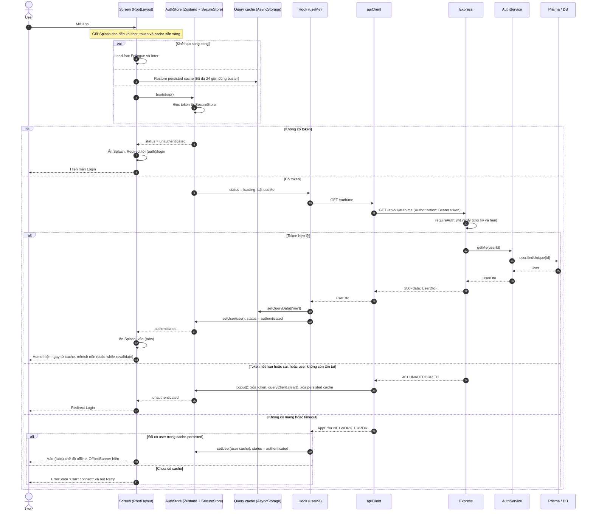
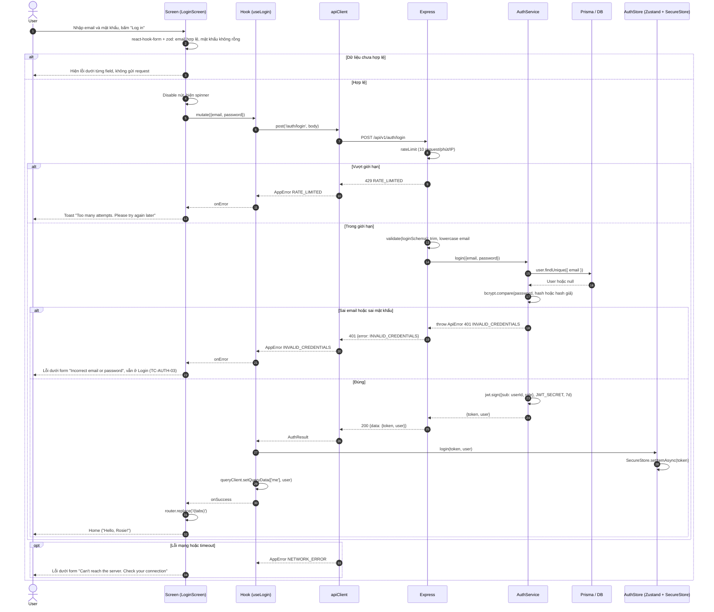
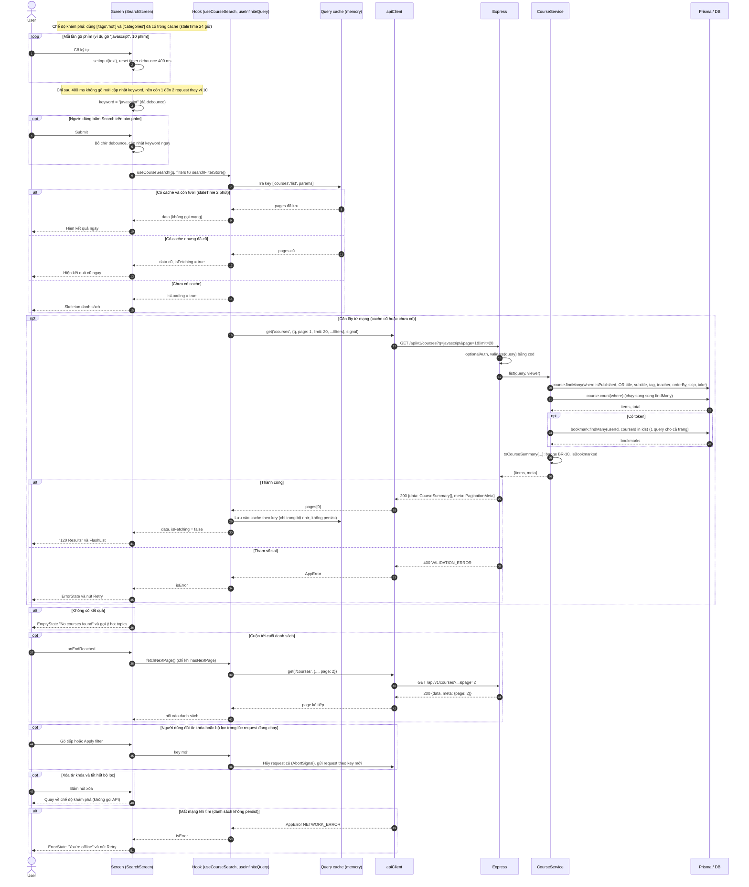
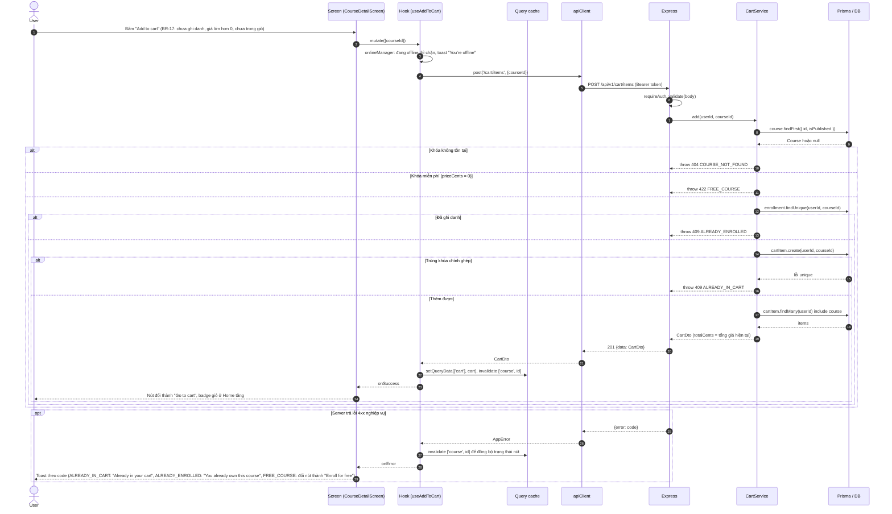
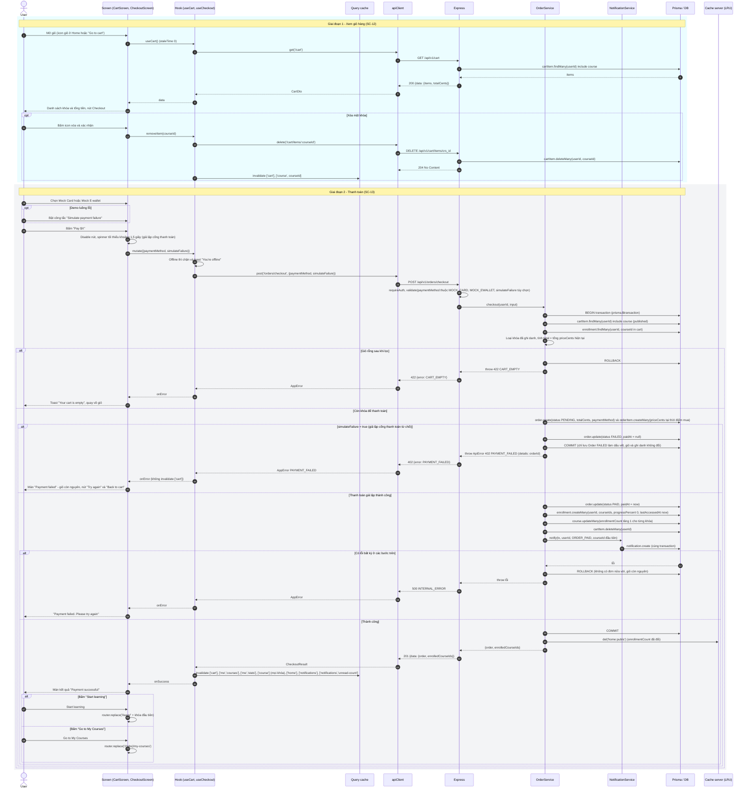
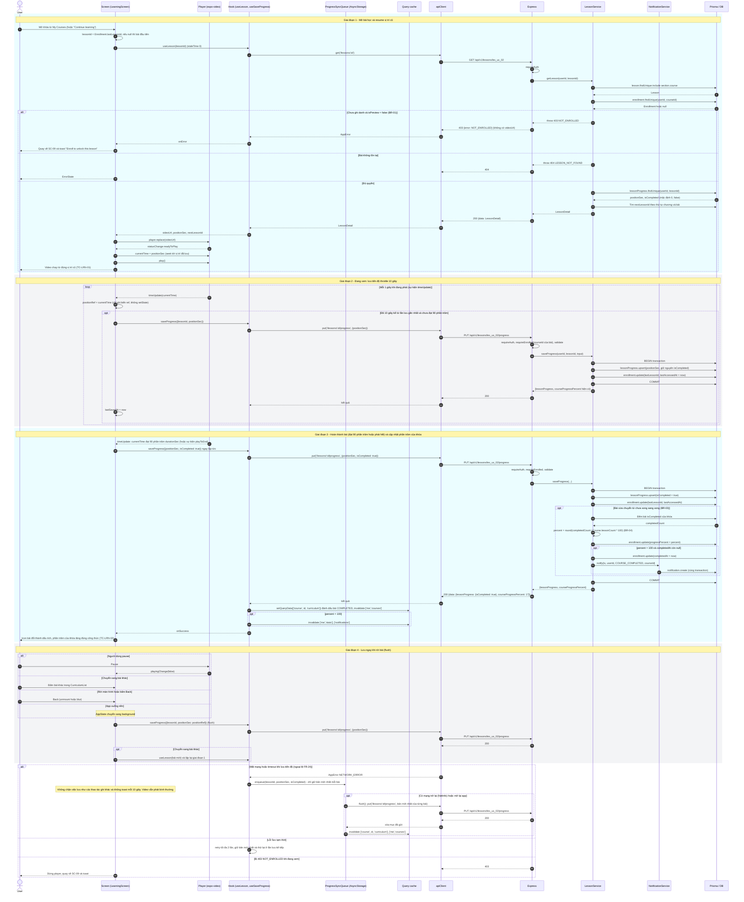
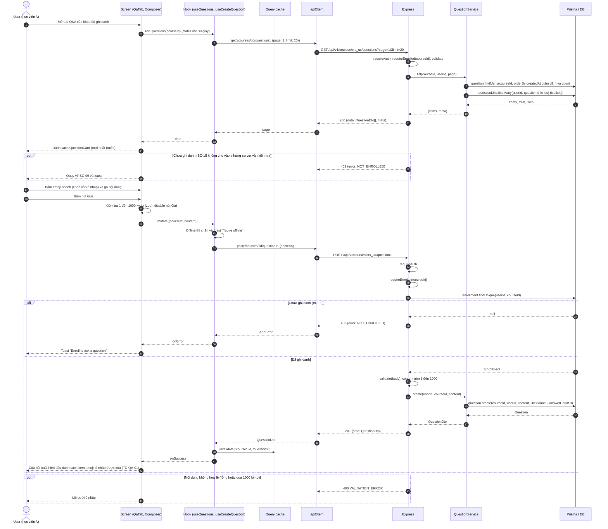
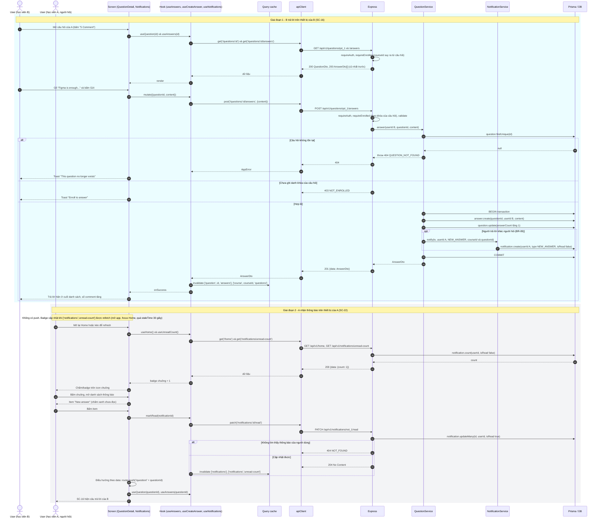
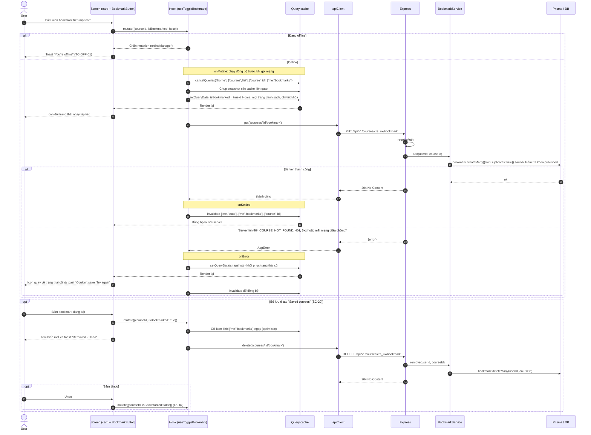

# Sequence diagrams (D-04)

> **Tài liệu:** `docs/02-design/sequence-diagrams.md` · **Task:** D-04 · **Owner:** C (Hoàng Ngọc Hải)
> **Nguồn:** [PLAN.md §7.3](../../PLAN.md) (đặc tả màn hình), [§6.5](../../PLAN.md) (business rules), [§9](../../PLAN.md) (API), [§10](../../PLAN.md) (cache). Liên quan: [api-spec.md](api-spec.md) · [class-diagram.md](class-diagram.md) · [SDS.md](SDS.md).

## Mục lục

0. [Cách đọc và quy ước](#0-cách-đọc-và-quy-ước)
1. [Đăng nhập và bootstrap tự đăng nhập lại](#1-đăng-nhập-và-bootstrap-tự-đăng-nhập-lại) (1a, 1b)
2. [Tìm kiếm có debounce và cache](#2-tìm-kiếm-có-debounce-và-cache)
3. [Add to cart và Checkout](#3-add-to-cart-và-checkout) (3a, 3b)
4. [Học video: resume, lưu tiến độ, hoàn thành](#4-học-video-resume-lưu-tiến-độ-hoàn-thành)
5. [Đặt câu hỏi Q&A và trả lời sinh thông báo](#5-đặt-câu-hỏi-qa-và-trả-lời-sinh-thông-báo) (5a, 5b)
6. [Bookmark với optimistic update và rollback](#6-bookmark-với-optimistic-update-và-rollback)
7. [Bảng truy vết](#7-bảng-truy-vết)

---

## 0. Cách đọc và quy ước

Tài liệu có **6 luồng nghiệp vụ, gồm 9 sơ đồ tuần tự** (1a, 1b, 2, 3a, 3b, 4, 5a, 5b, 6). Năm luồng đầu (1 đến 5) là 5 luồng bắt buộc của PLAN §12; luồng 6 bổ sung vì là điểm nhấn "Nội dung đặc biệt" (optimistic UI).

**Người tham gia (participants) dùng chung**

| Ký hiệu | Thành phần | Ghi chú |
|---|---|---|
| `U` | User | Người dùng cầm điện thoại |
| `S` | Screen | Màn hình React Native (`features/<x>/screens`), gồm component con |
| `H` | Hook | `features/<x>/hooks.ts` — `useQuery` / `useMutation` / `useInfiniteQuery` của TanStack Query |
| `A` | apiClient | `lib/apiClient.ts` — axios, gắn token, chuẩn hóa lỗi thành `AppError` |
| `X` | Express | Chuỗi middleware (`rateLimit`, `optionalAuth`/`requireAuth`, `requireEnrolled`, `upload`, `validate`) + controller |
| `V` | Service | `modules/<x>/<x>.service.ts` — quy tắc nghiệp vụ |
| `D` | Prisma / DB | `PrismaClient` → PostgreSQL |

Một số sơ đồ thêm: `T` (AuthStore — Zustand + SecureStore), `Q` (Query cache — bộ nhớ + AsyncStorage), `P` (Player `expo-video`), `N` (NotificationService), `C` (cache in-memory của server).

**Quy ước**

- `autonumber` đánh số bước để tham chiếu khi review.
- `alt / else` = rẽ nhánh loại trừ (thành công/lỗi); `opt` = bước tùy chọn; `loop` = lặp; `par` = song song; khung màu nhạt = một giai đoạn.
- Mọi lỗi đi ngược: Service `throw ApiError` → `errorHandler` → JSON `{ error: { code, message, details } }` → `apiClient` chuẩn hóa thành `AppError` → hook `onError` → Screen hiển thị (skeleton/ErrorState/toast/lỗi dưới field).
- Tên endpoint/body/mã lỗi khớp [api-spec.md](api-spec.md); query key khớp PLAN §10 (`queryKeys.ts`).

---

## 1. Đăng nhập và bootstrap tự đăng nhập lại

**Liên quan:** FR-01, FR-02, FR-03 · UC-01, UC-02 · SC-01, SC-02 · NFR-05 · ADR-07 (JWT 7 ngày, SecureStore).

### 1a. Bootstrap khi mở app (SC-01)

Splash được giữ cho đến khi load xong font, đọc token và restore cache đã persist. Có token thì xác thực bằng `GET /auth/me`; mạng lỗi mà đã có user trong cache thì vào app ở chế độ offline.

**Điểm cần lưu ý**

- Auth guard dùng `Stack.Protected guard={isLoggedIn}` trong `app/_layout.tsx` (PLAN §7.3 SC-01): route `(auth)` chỉ vào được khi chưa đăng nhập, `(tabs)` khi đã đăng nhập; đổi `status` là guard tự chuyển màn.
- Một request 401 bất kỳ về sau (không chỉ `/auth/me`) cũng kích hoạt `logout()` qua interceptor của `apiClient`.
- Đăng xuất chủ động (FR-03) dùng cùng hàm `logout()` để không lộ dữ liệu người trước.

### 1b. Đăng nhập (SC-02)

**Điểm cần lưu ý**

- Đăng ký (`POST /auth/register`) đi cùng luồng này: sau `201` cũng `login(token, user)` rồi vào Home; lỗi `409 EMAIL_TAKEN` hiện "Email already in use" (TC-AUTH-02).
- Token **không** lưu ở AsyncStorage (CLAUDE.md §7). `passwordHash` không bao giờ rời server.
- Cả hai trường hợp "email không tồn tại" và "sai mật khẩu" cùng trả `INVALID_CREDENTIALS` để không lộ email nào đã đăng ký.

---

## 2. Tìm kiếm có debounce và cache

**Liên quan:** FR-05, FR-06 · UC-05, UC-06 · SC-05, SC-06, SC-07 · BR-13 · NFR-01, NFR-03 · PLAN §17.1, §17.2 (số request khi gõ "javascript": 10 → 1–2).

**Điểm cần lưu ý**

- **Hai lớp giảm request:** debounce 400 ms (giảm số lần gõ thành request) và cache TanStack Query theo key gồm cả `params` (mở lại đúng từ khóa/bộ lọc thì không gọi mạng khi còn tươi).
- `['courses','list',params]` **không persist** offline (PLAN §10) nên mất mạng thì không có kết quả cũ cho từ khóa mới; nhưng các key khác (`['home']`, `['categories']`, `['tags','hot']`) vẫn đọc được từ cache.
- Phân trang: `getNextPageParam = meta.page < meta.totalPages ? meta.page + 1 : undefined`; `limit = 20`.
- Server tính `total` cùng lúc với trang dữ liệu (`Promise.all`) để màn hình hiển thị "{total} Results" chính xác.

---

## 3. Add to cart và Checkout

**Liên quan:** FR-13, FR-14 · UC-11, UC-12 · SC-09, SC-12, SC-13 · BR-06, BR-07, BR-17 · NFR-10 (checkout trong 1 transaction) · ADR-10 (thanh toán giả lập).

### 3a. Thêm khóa học vào giỏ

### 3b. Xem giỏ và Checkout (thanh toán giả lập)

**Điểm cần lưu ý**

- **Một transaction duy nhất** (BR-07, NFR-10): tạo đơn, ghi danh, tăng `enrollmentCount`, xóa giỏ, tạo thông báo đều nằm trong `prisma.$transaction`; lỗi bất kỳ thì rollback toàn bộ. Xóa cache server làm **sau khi commit** để không xóa cache cho giao dịch bị hủy.
- Độ trễ ~1,5 s ở màn thanh toán là hiệu ứng phía client; server phản hồi ngay.
- **Mô phỏng thất bại (BR-07):** khi `simulateFailure = true`, server lưu `Order` `FAILED` rồi trả `402 PAYMENT_FAILED` — đây là kết quả nghiệp vụ hợp lệ, **khác** lỗi kỹ thuật `500` (rollback). Cả hai đều giữ nguyên giỏ và không ghi danh; màn hình cho phép "Try again" hoặc về giỏ. Công tắc "Simulate payment failure" chỉ phục vụ demo/kiểm thử luồng lỗi.
- Bấm Pay hai lần liên tiếp: nút bị disable; nếu vẫn lọt request thứ hai thì giỏ đã rỗng nên nhận `422 CART_EMPTY` (an toàn, không mua hai lần).
- Sau `201`, `['course', id]` bị invalidate nên nút ở trang chi tiết đổi thành "Continue learning" (BR-17), My Courses có khóa mới với 0 %, và có thông báo `ORDER_PAID` (TC-PAY-01).
- Khóa miễn phí không đi qua giỏ: dùng `POST /courses/:id/enroll` (`422 PAID_COURSE` nếu khóa có phí).

---

## 4. Học video: resume, lưu tiến độ, hoàn thành

**Liên quan:** FR-16 · UC-14 · SC-15 · BR-01, BR-02, BR-03, BR-04 · NFR-06, NFR-10 · ADR-08 (expo-video, sự kiện `timeUpdate`) · PLAN §17.1 (throttle 10 s: ~30 request thay vì ~300 cho 5 phút xem).

**Điểm cần lưu ý**

- **Hai nguồn kích hoạt hoàn thành:** client gửi `isCompleted: true` khi đạt 90 % hoặc `playToEnd`; server cũng tự nâng cờ nếu `positionSec` ≥ ⌊0,9 × `durationSec`⌋ (phòng thủ kép — [api-spec E35](api-spec.md#e35--put-lessonsidprogress)). Đã hoàn thành thì **không** bị bỏ hoàn thành khi xem lại.
- **Tối ưu server:** chỉ đếm lại bài đã xong và tính lại `progressPercent` khi bài *vừa chuyển trạng thái* sang hoàn thành; các lần lưu vị trí thường chỉ là một `upsert` + một `update` nhỏ.
- **Không mất tiến độ (NFR-10):** lưu định kỳ mỗi 10 s + lưu khi pause/chuyển bài/rời màn/xuống nền, nên trường hợp xấu nhất mất tối đa ~10 s vị trí nếu app bị kill đột ngột.
- **Offline là ngoại lệ của quy tắc "chặn ghi" (FR-24):** mọi mutation khác bị chặn khi offline, riêng tiến độ video được lưu tạm vào AsyncStorage (bản mới nhất mỗi bài) và tự đồng bộ khi có mạng; server nhận theo thứ tự đến và không bao giờ hạ `isCompleted`.
- **`timeUpdate` mỗi giây** chỉ cập nhật `ref` (không `setState`) để tránh render lại toàn màn; thanh tiến độ do `VideoView` native tự vẽ.
- Xem preview khi **chưa ghi danh** vẫn phát được (BR-01) nhưng client không gọi `PUT /progress` (sẽ bị `403`).

---

## 5. Đặt câu hỏi Q&A và trả lời sinh thông báo

**Liên quan:** FR-19, FR-23 · UC-16 · SC-15 (tab Q&A), SC-16, SC-22 · BR-09 · NFR-06.

### 5a. Đặt câu hỏi (học viên A)

### 5b. Học viên B trả lời và học viên A nhận thông báo

**Điểm cần lưu ý**

- **Cùng transaction:** tạo `Answer`, tăng `answerCount` và tạo `Notification` nằm chung một `prisma.$transaction` (`NotificationService.notify` nhận `tx`), nên không thể có câu trả lời mà thiếu thông báo (hoặc ngược lại).
- **Không tự thông báo cho mình:** khi chính người hỏi tự trả lời câu hỏi của mình thì bỏ qua `notify`.
- **Thông báo là pull, không phải push** (push thật thuộc mục *Won't*, PLAN §2.2): badge cập nhật khi refetch. `['notifications','unread-count']` (từ `GET /notifications/unread-count`) và `['notifications']` đều có `staleTime` 30 s; khi mở danh sách thông báo thì `meta.unreadCount` của `GET /notifications` cho cùng giá trị. Đọc thông báo, `read-all` hoặc có câu trả lời mới đều invalidate cả hai key.
- `requireEnrolled` cho `POST /questions/:id/answers` suy ra `courseId` từ chính câu hỏi (không tin `courseId` do client gửi).

---

## 6. Bookmark với optimistic update và rollback

**Liên quan:** FR-12 · UC-10 · nhiều màn (Home, Search, Details, Profile, Teacher) · PLAN §10 (mutation toggle), §17.1 (Optimistic UI). Cùng mẫu áp dụng cho like khóa học, follow giảng viên, like câu hỏi.

**Điểm cần lưu ý**

- `PUT` và `DELETE` đều **idempotent** ở server nên việc retry hoặc bấm nhanh nhiều lần không gây trùng dữ liệu.
- Cập nhật lạc quan phải chạm **mọi** cache chứa khóa đó (Home, các trang `infinite` của danh sách, chi tiết, `Saved courses`) — đây là lý do hook `useToggleBookmark` do C viết một lần và dùng chung cho mọi card.
- Rollback dùng snapshot chụp ở `onMutate`, không refetch cả màn nên phản hồi vẫn tức thì kể cả khi lỗi.

---

## 7. Bảng truy vết

| Sơ đồ | Luồng | FR / UC | Endpoint (api-spec) | Query key (PLAN §10) | Màn hình | Test case mẫu |
|---|---|---|---|---|---|---|
| 1a | Bootstrap | FR-02, FR-03 | E04 | `['me']` | SC-01 | TC-AUTH-04 |
| 1b | Đăng nhập | FR-01, FR-02 · UC-02 | E03 (E02 khi đăng ký) | `['me']` | SC-02, SC-03 | TC-AUTH-01, 02, 03 |
| 2 | Tìm kiếm | FR-05, FR-06 · UC-05, UC-06 | E08, E07, E06 | `['courses','list',params]`, `['tags','hot']`, `['categories']` | SC-05, SC-06, SC-07 | TC-SRCH-01, 02 |
| 3a | Thêm giỏ | FR-13 · UC-11 | E28 | `['cart']`, `['course',id]` | SC-09 | TC-CART-01 |
| 3b | Giỏ và Checkout (gồm mô phỏng thất bại) | FR-13, FR-14 · UC-11, UC-12 | E27, E29, E30 (402 `PAYMENT_FAILED`) | `['cart']`, `['me','courses']`, `['me','stats']`, `['course',*]`, `['home']`, `['notifications']`, `['notifications','unread-count']` | SC-12, SC-13 | TC-PAY-01 |
| 4 | Học video (gồm lưu tạm khi offline) | FR-16, FR-24 · UC-14 | E34, E35 (E10) | `['lesson',id]`, `['course',id,'curriculum']`, `['me','courses']` | SC-15 | TC-LRN-01, TC-LRN-02, TC-SEC-01 |
| 5a | Đặt câu hỏi | FR-19 · UC-16 | E36, E37 (`✓E`) | `['course',id,'questions']` | SC-15 | TC-QA-01 |
| 5b | Trả lời và thông báo | FR-19, FR-23 · UC-16 | E38, E39, E40, E52, E49, E50 | `['question',id,'answers']`, `['notifications']`, `['notifications','unread-count']` | SC-16, SC-22 | TC-QA-01 (mở rộng) |
| 6 | Bookmark optimistic | FR-12 · UC-10 | E12, E13, E14 | `['home']`, `['courses','list']`, `['course',id]`, `['me','bookmarks']`, `['me','stats']` | Nhiều màn | TC-OFF-01 |
