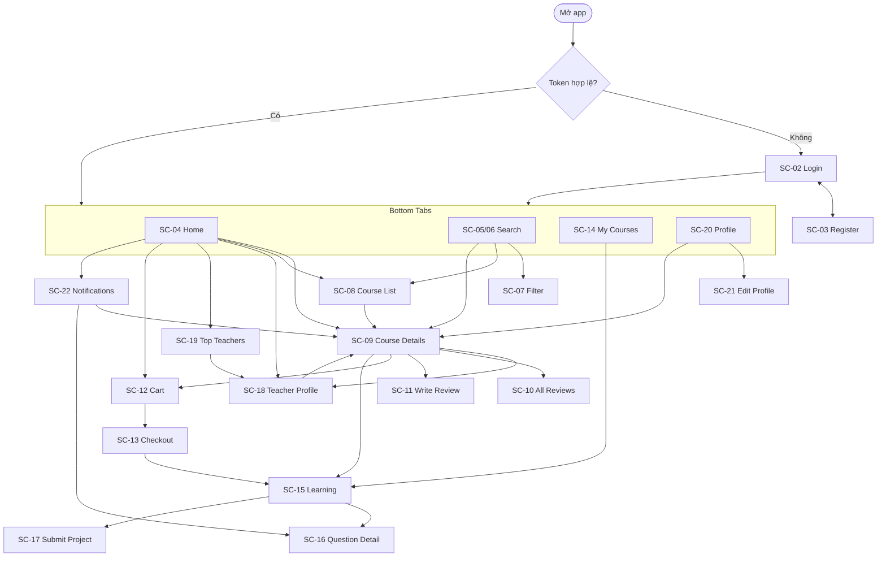
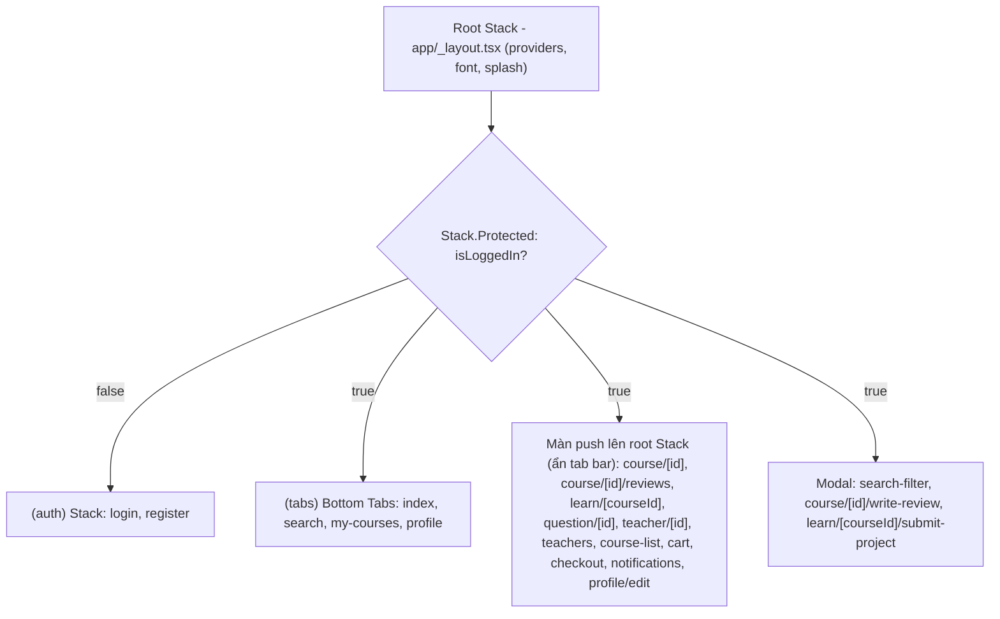

# Thiết kế UI/UX (D-06)

> **Tài liệu:** `docs/02-design/ui-design.md` · **Task:** D-06 (dùng lại cho M-32) · **Owner:** B (Nguyễn Văn Sỹ)
> **Nguồn sự thật về UI:** `design/screens/*.png` (12 màn) + tokens ở [CLAUDE.md §7](../../CLAUDE.md). **Thứ tự ưu tiên khi mâu thuẫn** (CLAUDE.md §12): design gốc + tokens → PLAN.md → CLAUDE.md → skill. Skill (`impeccable`) chỉ nâng chất lượng triển khai, **không đổi phong cách thị giác**.
> Sau khi có `DESIGN.md` (D-09, sinh từ `src/theme` + UI kit), tài liệu này sẽ dẫn link sang `DESIGN.md` cho phần token thay vì chép lại; trước đó, mục 2 là nguồn tham chiếu.
> Liên quan: [SDS.md](SDS.md) · [class-diagram.md](class-diagram.md) · [api-spec.md](api-spec.md) · [PLAN.md §7](../../PLAN.md).

## Mục lục

1. [Nguyên tắc thiết kế](#1-nguyên-tắc-thiết-kế)
2. [Design tokens](#2-design-tokens)
3. [Inventory component](#3-inventory-component)
4. [Inventory màn hình](#4-inventory-màn-hình)
5. [Sơ đồ điều hướng](#5-sơ-đồ-điều-hướng)
6. [Wireframe 7 màn không có design](#6-wireframe-7-màn-không-có-design)
7. [Checklist polish từng màn (M-32)](#7-checklist-polish-từng-màn-m-32)
8. [Sai khác có chủ đích so với design](#8-sai-khác-có-chủ-đích-so-với-design)
9. [Trợ năng (accessibility)](#9-trợ-năng-accessibility)

---

## 1. Nguyên tắc thiết kế

1. **Bám design gốc:** màu, font, bố cục, hình dạng component lấy từ ảnh trong `design/screens/`. Ảnh rộng **375 px ⇒ 1 px ≈ 1 dp**; kích thước đo từ ảnh được làm tròn về thang spacing bội số 4.
2. **Màn hình không có trong design** (Login, Register, Filter, Cart, Checkout, Notifications, Edit profile) phải dùng **cùng tokens, cùng kiểu card/nút/chip/input** của design gốc — không tạo phong cách mới.
3. **Không dùng thư viện UI ngoài** (ADR-09): `StyleSheet.create` + tokens ở `src/theme`. Không hard-code màu/cỡ chữ.
4. **Mỗi màn có dữ liệu đủ 4 trạng thái:** loading (skeleton) · error (nút Retry) · empty · success; danh sách có pull-to-refresh.
5. **Bảo đảm hệ thống (Android + iOS):** safe area, Back hệ thống luôn hoạt động, bàn phím không che input, chữ scale theo cỡ chữ hệ thống mà layout không vỡ, touch target ≥ 48 dp / 44 pt, `accessibilityLabel` cho nút chỉ có icon.
6. **Dung sai khi đối chiếu design:** chênh ≤ 2 dp về kích thước/khoảng cách và ≤ 1 bậc thang chữ được coi là khớp; chênh lệch có chủ đích ghi ở [mục 8](#8-sai-khác-có-chủ-đích-so-với-design).

---

## 2. Design tokens

Tokens nằm ở `mobile/src/theme/{colors,typography,spacing,radius,shadows,index}.ts`. Tên token dưới đây là tên dùng trong code.

### 2.1 Màu

**Bảng màu gốc** (CLAUDE.md §7 — trích từ design):

| Token | Hex | Dùng cho | Tương phản trên nền trắng |
|---|---|---|---|
| `primary` | `#00BDD6` | Nút chính, tab active, giá, link "View more", viền chip, chấm chưa đọc, thanh progress | 2,27 : 1 |
| `primaryLight` | `#EBFDFF` | Nền bài học đang học, nền nút Follow, chip nhạt, ô Upload, khung thông tin | (nền) |
| `primaryTrack` | `#A6F5FF` | Nền track của thanh progress, nền avatar hồ sơ người dùng | (nền) |
| `secondary` | `#8353E2` | Banner, badge "x% Off", hero khóa học, category Design/Movie | 4,88 : 1 |
| `secondaryLight` | `#D9CBF6` | Nền avatar giảng viên / avatar mặc định | (nền) |
| `textPrimary` | `#171A1F` | Tiêu đề, text chính | 17,44 : 1 |
| `textSecondary` | `#565E6C` | Text phụ, nhãn, icon không active | 6,54 : 1 |
| `textMuted` | `#9095A0` | Tên giảng viên, số review, thời lượng, placeholder | 3,00 : 1 |
| `border` | `#DEE1E6` | Viền card, đường kẻ, viền tab | 1,31 : 1 |
| `surface` | `#F3F4F6` | Ô search, nền input, nền skeleton | (nền) |
| `background` | `#FFFFFF` | Nền màn hình, card | — |
| `backgroundAlt` | `#F8F9FA` | Nền card review / câu hỏi | (nền) |
| `star` | `#F3C63F` | Sao đánh giá | 1,62 : 1 (chỉ trang trí, luôn kèm số) |
| `danger` | `#E05858` | Lỗi, tim đã like, category Code | 3,68 : 1 |
| `orange` | `#ED7D2D` | Category Language | 2,77 : 1 |
| `blue` | `#4069E5` | Category Writing | 4,81 : 1 |

**Token mở rộng có kiểm soát** (không có trong design gốc, chỉ để phục vụ màn mới và trạng thái; **không** đổi phong cách):

| Token | Giá trị | Dùng cho |
|---|---|---|
| `white` | `#FFFFFF` | Chữ/icon trên nền `primary`, `secondary`, `danger` |
| `overlay` | `rgba(23, 26, 31, 0.5)` | Nền mờ của modal, lớp phủ khi đang tải |
| `primaryDisabled` | `#99E5EF` | Nền nút primary khi disabled (`primary` 40 % trên trắng) |
| `dangerLight` | `#FCEEEE` | Nền khung báo lỗi (`danger` 10 % trên trắng) |
| `skeletonBase` | `#F3F4F6` | Màu nền khối skeleton (= `surface`) |
| `skeletonHighlight` | `#E9EBEF` | Dải sáng chạy qua skeleton |
| `focusBorder` | `#00BDD6` | Viền ô nhập khi focus (= `primary`) |

**Màu theo category** (icon; khớp design Home/Search; lưu ở `Category.color` trong DB):

| Category | Icon Feather | Màu | Token |
|---|---|---|---|
| Business | `trending-up` | `#00BDD6` | `primary` |
| Design | `pen-tool` | `#8353E2` | `secondary` |
| Code | `code` | `#E05858` | `danger` |
| Writing | `file-text` | `#4069E5` | `blue` |
| Movie | `video` | `#8353E2` | `secondary` |
| Language | `globe` | `#ED7D2D` | `orange` |

```ts
// mobile/src/theme/colors.ts
export const colors = {
  primary: '#00BDD6',
  primaryLight: '#EBFDFF',
  primaryTrack: '#A6F5FF',
  primaryDisabled: '#99E5EF',
  secondary: '#8353E2',
  secondaryLight: '#D9CBF6',
  textPrimary: '#171A1F',
  textSecondary: '#565E6C',
  textMuted: '#9095A0',
  border: '#DEE1E6',
  surface: '#F3F4F6',
  background: '#FFFFFF',
  backgroundAlt: '#F8F9FA',
  star: '#F3C63F',
  danger: '#E05858',
  dangerLight: '#FCEEEE',
  orange: '#ED7D2D',
  blue: '#4069E5',
  white: '#FFFFFF',
  overlay: 'rgba(23, 26, 31, 0.5)',
  skeletonBase: '#F3F4F6',
  skeletonHighlight: '#E9EBEF',
} as const;
```

**Lưu ý tương phản (đã tính theo công thức WCAG):** chữ/icon `primary` trên trắng chỉ 2,27 : 1 và chữ trắng trên nền `primary` cũng 2,27 : 1 — thấp hơn ngưỡng AA (4,5 : 1 cho chữ thường, 3 : 1 cho chữ lớn). Đây là thuộc tính của **màu thương hiệu trong design gốc nên giữ nguyên** (design gốc luôn thắng); giảm rủi ro bằng: cỡ chữ ≥ 14 và weight ≥ 500 cho mọi chữ màu `primary`/trắng-trên-`primary`, không dùng màu làm dấu hiệu duy nhất (luôn kèm chữ/icon/hình dạng), và ghi nhận vào báo cáo `ui-audit.md`. `textMuted` (3,00 : 1) chỉ dùng cho thông tin phụ (caption), không dùng cho nội dung bắt buộc phải đọc. Nếu nhóm chấp nhận điều chỉnh, phương án nhẹ nhất là dùng chữ `textPrimary` (7,68 : 1 trên `primary`) cho nút primary — **cần hỏi nhóm trước** vì đổi diện mạo so với design.

### 2.2 Typography

**Font:** heading **Epilogue** (600, 700) · body **Inter** (400, 500, 600) — `@expo-google-fonts/epilogue`, `@expo-google-fonts/inter`. Trên React Native, `fontWeight` không chọn được biến thể của font tùy chỉnh (đặc biệt Android), nên mỗi weight là một `fontFamily` riêng:

| Family key | Tên `fontFamily` | Import |
|---|---|---|
| Epilogue SemiBold | `Epilogue_600SemiBold` | `@expo-google-fonts/epilogue` |
| Epilogue Bold | `Epilogue_700Bold` | `@expo-google-fonts/epilogue` |
| Inter Regular | `Inter_400Regular` | `@expo-google-fonts/inter` |
| Inter Medium | `Inter_500Medium` | `@expo-google-fonts/inter` |
| Inter SemiBold | `Inter_600SemiBold` | `@expo-google-fonts/inter` |

**Thang chữ (đo từ ảnh design 375 px):** kích thước suy ra từ chiều cao chữ đo được (Epilogue: ascender ≈ 0,75 em, cap ≈ 0,70 em; Inter: cap ≈ 0,73 em) và đối chiếu bề rộng chuỗi. Ví dụ các phép đo: "Categories" / "Popular courses" cao 16–17 px gồm cả phần thòi → 18 · "PHP in One Click" cao 11 px → 14 · "Ramono Wultschner" cao 9 px → 12 · "20% OFF" cao 18 px → 24 · thân bài mô tả rộng 298 px / 45 ký tự → Inter 14.

| Variant (`AppText`) | Font | Cỡ / dòng (dp) | Dùng ở (theo design) |
|---|---|---|---|
| `h1` | Epilogue Bold 700 | 24 / 32 | "20% OFF" ở banner; tiêu đề Login/Register ("Welcome back!"); "Payment successful" |
| `h2` | Epilogue Bold 700 | 20 / 28 | "Hello, Rosie!" ở Home; giá lớn ở thanh dưới của Course details ("$59"); điểm "4.5/5" ở tab Review |
| `h3` | Epilogue SemiBold 600 | 18 / 24 | Tiêu đề màn hình ("Course details", "My Courses"); tiêu đề section ("Categories", "Popular courses", "Description"); tiêu đề khóa ở Course details / Learning; tên ở hồ sơ ("Martha Rosie", "Sara Weise"); tiêu đề chương ("I - Introduction"); số thống kê ("25", "24", "98") |
| `title` | Epilogue SemiBold 600 | 14 / 20 | Tiêu đề card ("PHP in One Click"); tên trong hàng (giảng viên, người dùng); "120 Results"; giá trên card (đổi `weight="bold"`, màu `primary`) |
| `body` | Inter Regular 400 | 14 / 22 | Đoạn mô tả, tiêu đề bài học, nhãn category, nội dung input, nhãn chip |
| `bodySm` *(bổ sung)* | Inter Regular 400 | 12 / 20 | Nội dung review, câu hỏi, câu trả lời (nhiều dòng) |
| `caption` | Inter Regular 400 | 12 / 16 | Phụ đề dưới tiêu đề ("What do you want to learn today?"), tên giảng viên, thời lượng ("01:23 mins"), "(1233)", "A day ago", "612 Kb" |

`AppText` nhận thêm `weight` (`'regular' | 'medium' | 'semibold' | 'bold'` — chỉ những weight có font tương ứng của họ font đó), `color` (token màu) và mặc định `allowFontScaling` bật với `maxFontSizeMultiplier = 1.3` (chữ scale theo cài đặt hệ thống nhưng giới hạn để layout không vỡ). Không tắt `allowFontScaling`.

**Token typography cho component nội bộ** (không phải variant của `AppText`, dùng trực tiếp trong `Button`, `SegmentedTabs`, `Badge`, tab bar):

| Token | Font | Cỡ / dòng | Dùng ở |
|---|---|---|---|
| `button` | Inter SemiBold 600 | 14 / 20 | Nhãn nút ("Add to cart", "Filter", "JOIN NOW", "Check Now") |
| `link` | Inter Medium 500 | 14 / 20 | "View more", "See more", "View all" (màu `primary`) |
| `tab` | Inter Medium 500 (active: SemiBold 600) | 14 / 20, chữ HOA | Nhãn `SegmentedTabs` (OVERVIEW, LESSONS, ALL, ON GOING…) |
| `badge` | Inter Medium 500 | 11 / 16 | "Best-seller", "20% Off", "Teacher", "Top-rated" |
| `micro` | Inter Medium 500 | 10 / 14 | Nhãn tab bar dưới (Home, Search…), nhãn thống kê ("Save", "On Going") |

```ts
// mobile/src/theme/typography.ts
export const fontFamily = {
  headingSemiBold: 'Epilogue_600SemiBold',
  headingBold: 'Epilogue_700Bold',
  bodyRegular: 'Inter_400Regular',
  bodyMedium: 'Inter_500Medium',
  bodySemiBold: 'Inter_600SemiBold',
} as const;

export const typography = {
  h1: { fontFamily: fontFamily.headingBold, fontSize: 24, lineHeight: 32 },
  h2: { fontFamily: fontFamily.headingBold, fontSize: 20, lineHeight: 28 },
  h3: { fontFamily: fontFamily.headingSemiBold, fontSize: 18, lineHeight: 24 },
  title: { fontFamily: fontFamily.headingSemiBold, fontSize: 14, lineHeight: 20 },
  body: { fontFamily: fontFamily.bodyRegular, fontSize: 14, lineHeight: 22 },
  bodySm: { fontFamily: fontFamily.bodyRegular, fontSize: 12, lineHeight: 20 },
  caption: { fontFamily: fontFamily.bodyRegular, fontSize: 12, lineHeight: 16 },
  button: { fontFamily: fontFamily.bodySemiBold, fontSize: 14, lineHeight: 20 },
  link: { fontFamily: fontFamily.bodyMedium, fontSize: 14, lineHeight: 20 },
  tab: { fontFamily: fontFamily.bodyMedium, fontSize: 14, lineHeight: 20 },
  badge: { fontFamily: fontFamily.bodyMedium, fontSize: 11, lineHeight: 16 },
  micro: { fontFamily: fontFamily.bodyMedium, fontSize: 10, lineHeight: 14 },
} as const;
```

**Ghi chú:** design gốc không nhất quán tuyệt đối giữa các màn (vd nhãn category ~12 dp ở Home nhưng ~14 dp ở Search; "View more" ~12 dp ở "Popular courses" nhưng ~14 dp ở "Categories"). Thang trên **chuẩn hóa** về một giá trị cho mỗi vai trò; chênh ≤ 2 dp so với ảnh là chấp nhận được.

### 2.3 Spacing và layout

**Thang spacing** (bội số 4): `xs = 4`, `sm = 8`, `md = 12`, `lg = 16`, `xl = 20`, `xxl = 24`, `xxxl = 32`.

| Giá trị đo được trong design | Token | Áp dụng |
|---|---|---|
| Lề ngang màn hình 20 | `xl` | `paddingHorizontal` của mọi màn (banner, card, section đều căn theo lề này) |
| Padding trong card 12 | `md` | Card khóa học, card danh mục, card review/câu hỏi |
| Khoảng giữa các card trong danh sách dọc ≈ 16 | `lg` | `CourseCardHorizontal`, `CourseProgressCard`, `QuestionCard` |
| Khoảng giữa các card trong danh sách ngang ≈ 8 | `sm` | `CourseCardVertical`, `TeacherCard` |
| Khoảng giữa hai section ≈ 32 | `xxxl` | Giữa "Categories", "Popular courses"… |
| Khoảng từ tiêu đề section tới nội dung ≈ 12–16 | `md`–`lg` | Dưới `SectionHeader` |
| Khoảng giữa ảnh và nội dung trong card ngang 8 | `sm` | `CourseCardHorizontal` |
| Khoảng giữa các chip 8 | `sm` | Hot topics, chip lọc sao |
| Khoảng giữa hai ô category 12 | `md` | Lưới 2 cột ở Home |

```ts
// mobile/src/theme/spacing.ts
export const spacing = { xs: 4, sm: 8, md: 12, lg: 16, xl: 20, xxl: 24, xxxl: 32 } as const;
export const layout = { screenPadding: 20, sectionGap: 32, cardGap: 16, listItemGap: 8 } as const;
```

Màn hình thiết kế cho chiều rộng 360–430 dp (NFR-08); **không** cố định chiều rộng card bằng số cứng trừ khi cần (dùng `flex`, tỷ lệ theo `useWindowDimensions`). Căn theo ảnh 375 dp làm chuẩn.

### 2.4 Radius

| Token | Giá trị | Dùng cho |
|---|---|---|
| `radius.xs` | 4 | Badge ("Best-seller", "20% Off", "Top-rated"), banner, nút "JOIN NOW" |
| `radius.sm` | 6 | Button (theo CLAUDE.md), nút Follow, ô icon category ở Home |
| `radius.md` | 8 | Card, ô input, ô search, ảnh thumbnail, item bài học, ô Upload |
| `radius.pill` | 999 | Chip, badge "Teacher", avatar, thanh progress, chấm chưa đọc |

### 2.5 Shadow, viền, elevation

Design gốc **không dùng shadow** cho card: card = nền trắng + **viền 1 dp `border`** + radius 8. Vì vậy:

| Token | Giá trị | Dùng cho |
|---|---|---|
| `borderWidth.hairline` | 1 | Card, ô input, đường kẻ dưới header, đường trên của tab bar / thanh hành động |
| `borderWidth.tab` | 2 (nền tab) / 3 (gạch chân tab active) | `SegmentedTabs` |
| `shadows.none` | — | Mặc định cho card, header |
| `shadows.sm` | `shadowColor #171A1F`, offset (0, 2), opacity 0,08, radius 8, `elevation 2` | Toast, nút nổi, dropdown |
| `shadows.md` | offset (0, 4), opacity 0,12, radius 16, `elevation 8` | Bottom sheet / action sheet ⋮, modal |

### 2.6 Icon (Feather)

Thư viện `@expo/vector-icons` bộ **Feather** (nét, không tô đặc). Trạng thái "đã lưu" của bookmark chỉ đổi **màu** (`textSecondary`/`textPrimary` → `primary`), không đổi hình — đúng design.

| Cỡ | Dùng cho |
|---|---|
| 14 | Sao trong `RatingInline`, chevron nhỏ |
| 16 | Kính lúp trong ô search, icon trong nút Filter, nút xóa ô search, khóa 🔒 |
| 20 | Chevron accordion, icon trạng thái bài học (check / play), icon benefit |
| 24 | Icon header (back, bookmark, more-vertical, cart, bell), icon tab bar, `BookmarkButton`, icon category ở danh sách |
| 40–48 | Icon lớn trên `EmptyState` / kết quả thanh toán (đặt trong vòng tròn 96) |

| Ngữ cảnh | Tên icon Feather |
|---|---|
| Tab bar | `home`, `search`, `book-open`, `user` |
| Header | `chevron-left` (back), `bookmark`, `more-vertical`, `shopping-cart`, `bell`, `x` (đóng), `share-2` |
| Category | `trending-up`, `pen-tool`, `code`, `file-text`, `video`, `globe` |
| Search / Filter | `search`, `sliders`, `x`, `chevron-right` |
| Bài học | `check` (hoàn thành), `play` (đang học: nền primary; mở khóa: viền xám), `lock` (khóa), `chevron-up` / `chevron-down` (accordion) |
| Khóa học | `star` (rating outline), `heart` (like), `share-2` (share), `play-circle` (nút ▶ hero) |
| Sao đặc (ngoại lệ) | `Ionicons` `star`, `star-half`, `star-outline` — cùng gói `@expo/vector-icons`, chỉ cho `ReviewCard` và `StarRating` vì Feather không có glyph đặc |
| Benefits (5 mục, không có "Certificate" — BR-18) | `video`, `globe`, `file-text`, `clock`, `check-circle` (24/7 support) |
| Tài liệu / Project | `download`, `upload-cloud`, `file-text` |
| Q&A | `heart`, `message-circle`, `send` |
| Hồ sơ | `map-pin`, `camera`, `edit-2`, `log-out`, `mail` |
| Giỏ / thanh toán | `trash-2`, `credit-card`, `smartphone`, `check-circle`, `alert-circle`, `info` |
| Thông báo | `shopping-cart` (ORDER_PAID), `message-circle` (NEW_ANSWER), `award` (COURSE_COMPLETED), `bell` (SYSTEM) |
| Trạng thái | `wifi-off` (offline), `alert-triangle` (lỗi), `inbox` (empty) |

### 2.7 Kích thước chuẩn của thành phần

Đo từ ảnh design (đã làm tròn); dùng làm giá trị mặc định trong UI kit.

| Thành phần | Kích thước | Ghi chú |
|---|---|---|
| Touch target tối thiểu | 48 × 48 dp (Android) / 44 × 44 pt (iOS) | Icon 24 → `hitSlop` 12 mỗi cạnh |
| `Button` `md` | cao 48, radius 6, padding ngang 16 | Nút toàn chiều rộng ở form |
| `Button` `sm` | cao 36 (đúng design), `hitSlop` dọc 6 → vùng chạm 48 | "Add to cart", "JOIN NOW", "Check Now", "Filter" |
| `Button` `xs` | cao 28, rộng ≈ 67, nền `primaryLight`, chữ `primary` 12/500, `hitSlop` dọc 10 → vùng chạm 48 | Chỉ dùng cho "Follow" / "Following" (nút Follow thuộc FR-20 — Should) |
| `TextField` | cao 48, radius 8, nền `surface` hoặc viền `border`, padding ngang 12 | Label `caption` trên ô; lỗi `caption` màu `danger` dưới ô |
| `SearchBar` | cao 40, radius 8, nền `surface`, icon 16 | Nút Filter cao 40, rộng ≈ 80, radius 6 |
| Header màn (`ScreenHeader`) | cao 56 (dưới status bar), tiêu đề `h3` căn giữa | Back 24 bên trái, action 24 bên phải |
| Header Home | nền `primary`, cao nội dung ≈ 64 + status bar | Lời chào `h2` trắng + phụ đề `caption` trắng; icon giỏ và chuông 24 trắng |
| Banner | rộng bằng nội dung (335), cao ≈ 156, radius 4, nền `secondary` | Chữ bên trái, ảnh người cắt nền bên phải |
| Ô category (Home) | ≈ 161 × 60, viền `border`, radius 8; ô icon 40 × 40 (radius 6, nền màu category, icon trắng 20) | Lưới 2 cột, khoảng cách 12 |
| Hàng category (Search) | cao ≈ 48–56, viền `border`, radius 8, icon 24 màu category (không nền), chevron-right 20 | |
| `CourseCardVertical` | rộng ≈ 200; ảnh 174 × 116 radius 8; padding 12 | Peek card kế tiếp để gợi ý cuộn ngang |
| `CourseCardHorizontal` | rộng đầy; ảnh 96 × 96 radius 8; padding 12; cao ≈ 120 | Bookmark 24 góc trên phải |
| `TeacherCard` | rộng ≈ 152; ảnh 128 × 92 radius 8; padding 12 | Tên `title`, tổ chức `caption`, rating |
| `Chip` `md` | cao 36, padding ngang 16, viền 1 `primary`, radius pill, chữ 14 | Hot topics, Filter. Được chọn: nền `primary`, chữ trắng |
| `Chip` `sm` | cao 28, padding ngang 12, chữ 12/500, có icon sao 14 | Chip lọc số sao ở tab Review (All, 5 … 1) |
| `Badge` | cao 20, padding ngang 8, radius 4 | Badge "Teacher": pill |
| `Avatar` | 24 · 32 (review/composer) · 40 (hàng giảng viên) · 56 · 96 (hồ sơ, đè lên ảnh bìa) | Fallback: chữ cái đầu trên `secondaryLight` |
| `ProgressBar` | cao 6, radius pill, track `primaryTrack`, fill `primary` | |
| `SegmentedTabs` | cao 44, mỗi tab rộng bằng nhau, nền tab 2 dp `border`, gạch chân active 3 dp `primary` | Nhãn chữ HOA |
| Tab bar dưới | cao 60 + safe area, viền trên 1 `border`, icon 24, nhãn `micro` | Active `primary`, inactive `textSecondary` |
| Thanh hành động dưới (Course details) | cao ≈ 72 + safe area, viền trên 1 `border`, padding ngang 20 | Giá bên trái, nút `sm` rộng ≈ 162 bên phải |
| Hero (Course details / Learning) | rộng đầy × ≈ 244 (16 : 9 khi có video) | Nút ▶ trắng tròn ≈ 44 ở giữa |
| Cover hồ sơ | rộng nội dung (335) × ≈ 128, radius 8 | Avatar 96 đè lên mép dưới, viền trắng |

### 2.8 Chuyển động

- Thời lượng ngắn: phản hồi bấm 100–150 ms, mở/đóng accordion và toast 200–250 ms, easing `ease-out`. Skeleton dùng dải sáng chạy ngang ~1,2 s.
- Tôn trọng **Reduce Motion** của hệ thống (`AccessibilityInfo.isReduceMotionEnabled`): tắt hiệu ứng chạy của skeleton và animation accordion.
- `animate` chỉ cho micro-interaction đã có trong PLAN (bookmark, accordion, toast). Không thêm hiệu ứng mới.

---

## 3. Inventory component

UI kit dùng chung ở `mobile/src/components/ui/`; component nghiệp vụ nằm trong `features/<feature>/components/`. Owner theo PLAN §3.2/§7.4. Mọi component: named export, `StyleSheet.create` + tokens, `React.memo` cho item danh sách, không gọi API trực tiếp.

### 3.1 Nền tảng

| Component | Mục đích | Biến thể / trạng thái | Owner |
|---|---|---|---|
| `AppText` | Chữ theo thang typography | `variant`: `h1｜h2｜h3｜title｜body｜bodySm｜caption`; `weight`, `color`, `align`, `numberOfLines` | B |
| `Button` | Nút hành động | `variant`: `primary｜secondary｜outline｜ghost`; `size`: `xs｜sm｜md`; trạng thái: default · pressed · disabled · loading (spinner, chặn bấm lại); có `leftIcon` | B |
| `IconButton` | Nút chỉ có icon (back, more, đóng, xóa) | `size` icon 16–24, vùng chạm ≥ 48 (hitSlop); bắt buộc `accessibilityLabel` | B |
| `TextField` | Ô nhập có nhãn | Trạng thái: default · focus (viền `primary`) · error (viền + chữ `danger`) · disabled/readOnly; `secureTextEntry` có nút ẩn/hiện; `leftIcon` | B |
| `SearchBar` | Ô tìm kiếm | Có/không giá trị (hiện nút xóa); `autoFocus`; submit bàn phím | B |
| `Chip` | Nhãn chọn được | `variant`: `outline｜filled`; `size`: `sm｜md`; `selected`; có `leftIcon` (sao cho lọc rating) | B |
| `Badge` | Nhãn nhỏ | `tone`: `primary｜secondary｜danger`; `shape`: `square｜pill`; dạng số (badge giỏ/chuông: ẩn khi 0, hiện "9+" khi lớn hơn 9) | B |
| `SectionHeader` | Tiêu đề section + "View more" | Có/không nút "View more" | B |
| `ScreenHeader` | Thanh tiêu đề màn | Trái: back/không; giữa: tiêu đề; phải: 0–2 `IconButton` | B |
| `SegmentedTabs` | Tab gạch chân | `tabs`, `value`, `onChange`; active = `primary` + gạch chân 3 dp | B |
| `Accordion` (`SectionAccordion`) | Chương có thể thu/mở | Mở · đóng; chevron-up/down | C |

```ts
type AppTextProps = TextProps & {
  variant?: 'h1' | 'h2' | 'h3' | 'title' | 'body' | 'bodySm' | 'caption';
  weight?: 'regular' | 'medium' | 'semibold' | 'bold';
  color?: keyof typeof colors;
  align?: 'left' | 'center' | 'right';
};
type ButtonProps = {
  label: string; onPress: () => void;
  variant?: 'primary' | 'secondary' | 'outline' | 'ghost';
  size?: 'xs' | 'sm' | 'md'; loading?: boolean; disabled?: boolean;
  leftIcon?: FeatherName; fullWidth?: boolean; accessibilityLabel?: string;
};
type IconButtonProps = {
  icon: FeatherName; onPress: () => void; accessibilityLabel: string;
  size?: 16 | 20 | 24; color?: keyof typeof colors; badgeCount?: number;
};
type TextFieldProps = TextInputProps & {
  label: string; error?: string; secureToggle?: boolean; leftIcon?: FeatherName; editable?: boolean;
};
type SearchBarProps = {
  value: string; onChangeText: (t: string) => void; onSubmit?: () => void;
  placeholder?: string; autoFocus?: boolean; onClear?: () => void;
};
type ChipProps = { label: string; selected?: boolean; onPress: () => void; leftIcon?: FeatherName; variant?: 'outline' | 'filled'; size?: 'sm' | 'md' };
type BadgeProps = { label: string | number; tone?: 'primary' | 'secondary' | 'danger'; shape?: 'square' | 'pill' };
type SectionHeaderProps = { title: string; onViewMore?: () => void; viewMoreLabel?: string };
type ScreenHeaderProps = {
  title: string; onBack?: () => void;
  right?: { icon: FeatherName; onPress: () => void; accessibilityLabel: string; badgeCount?: number }[];
};
type SegmentedTabsProps<T extends string> = {
  tabs: { key: T; label: string }[]; value: T; onChange: (key: T) => void;
};
```

### 3.2 Hiển thị dữ liệu và phản hồi trạng thái

| Component | Mục đích | Biến thể / trạng thái | Owner |
|---|---|---|---|
| `Avatar` | Ảnh đại diện tròn | `size`; có ảnh (expo-image) hoặc chữ cái đầu; nền `secondaryLight`/`primaryTrack` | B |
| `RatingInline` | "★ 4.5 (1233) • 12 lessons" | Có/không số bài; dấu chấm phân cách | B |
| `StarRating` | Hiển thị/chọn sao | `readonly` (nhiều mức, cả nửa sao) · `interactive` (chọn 1–5, cỡ lớn ở Write review) | C |
| `ProgressBar` | Thanh tiến độ | `value` 0–100; `accessibilityValue` | B |
| `PriceTag` | Giá | Giá thường (`primary`) · miễn phí ("Free") · có giá gốc gạch ngang + "x% Disc." (thanh dưới) | B |
| `Skeleton` | Khối chờ tải | `width`, `height`, `radius`; bộ dựng sẵn cho card/hàng/khối hồ sơ | B |
| `EmptyState` | Danh sách trống | Icon + tiêu đề + mô tả + nút hành động (vd "Explore courses") | B |
| `ErrorState` | Lỗi tải | Icon, thông điệp theo `AppError`, nút **Retry** | B |
| `Toast` | Thông báo ngắn | `tone`: `default｜success｜error`; tự ẩn 3 s; có hành động phụ ("Undo") | B |
| `OfflineBanner` | Dải "You're offline" | Hiện khi mất mạng; `role="alert"` | C |

```ts
type AvatarProps = { uri?: string | null; name?: string; size?: 24 | 32 | 40 | 56 | 96; tone?: 'secondaryLight' | 'primaryTrack' };
type RatingInlineProps = { ratingAvg: number; ratingCount: number; lessonCount?: number };
type StarRatingProps = { value: number; onChange?: (v: number) => void; size?: 14 | 16 | 32 };
type ProgressBarProps = { value: number };
type PriceTagProps = { priceCents: number; originalPriceCents?: number | null; discountPercent?: number | null; size?: 'card' | 'bar' };
type SkeletonProps = { width?: number | `${number}%`; height: number; radius?: number };
type EmptyStateProps = { icon: FeatherName; title: string; description?: string; actionLabel?: string; onAction?: () => void };
type ErrorStateProps = { error: AppError; onRetry: () => void };
type ToastOptions = { message: string; tone?: 'default' | 'success' | 'error'; actionLabel?: string; onAction?: () => void };
```

### 3.3 Card và component nghiệp vụ

| Component | Dùng ở | Nội dung / biến thể / trạng thái | Owner |
|---|---|---|---|
| `CourseCardVertical` | Home (Popular, Recommended), Search (Recommended), Teacher (Courses) | Ảnh + `Badge` góc trên trái · tiêu đề 1 dòng + `BookmarkButton` · giảng viên · giá · `RatingInline` · skeleton | B |
| `CourseCardHorizontal` | Search results, Course list, Home (Inspires), Profile (Saved), Similar courses | Ảnh 96 + nội dung; badge Best-seller trên ảnh; bookmark bật/tắt; skeleton | B |
| `BookmarkButton` | Mọi card, header chi tiết/learning | Tắt (`textSecondary`) · bật (`primary`); optimistic; chặn khi offline | C |
| `TeacherCard` | Home (Top teachers), SC-19 | Ảnh, tên, tổ chức, rating; skeleton | A |
| `CourseProgressCard` | My Courses | Ảnh, tiêu đề, "2 hrs 25 mins", "30% Complete", `ProgressBar` | C |
| `CurriculumList` (`SectionAccordion` + `LessonRow`) | Course details (Lessons), Learning (Lessons) | `LessonRow` 4 trạng thái theo BR-02: COMPLETED · IN_PROGRESS · UNLOCKED · LOCKED | C |
| `ReviewCard`, `ReviewSummary` | Course details (Review), All reviews, Teacher (Review) | Thẻ nền `backgroundAlt`: avatar, tên, thời gian tương đối, sao, nội dung ≤ 3 dòng · tóm tắt điểm + phân bố sao | C |
| `QuestionCard`, `Composer` | Learning (Q&A), Question detail | Thẻ **nền trắng + viền `border`**: avatar, tên, thời gian, nội dung, ♡ like (toggle), 💬 "n Comment" · ô soạn cố định đáy + hàng emoji nhanh | C |
| `ResourceItem`, `ProjectCard`, `UploadBox` | Learning (Projects), Submit project | Tài liệu: icon .txt/.pdf, tên, dung lượng, nút tải (đang tải/đã có) · card project ngang (tối đa 10 card, **không** có "View more") · ô nét đứt `primaryLight` | B |
| `NotificationItem` | Notifications | Icon tròn theo loại, tiêu đề, nội dung, thời gian; chấm `primary` nếu chưa đọc | A |
| `CartItemRow` | Cart, Checkout (tóm tắt) | Ảnh 72, tiêu đề 2 dòng, giảng viên, giá, nút xóa | B |

```ts
type LessonRowProps = {
  number: number; title: string; durationSec: number;
  status: 'COMPLETED' | 'IN_PROGRESS' | 'UNLOCKED' | 'LOCKED';
  isPreview: boolean; isActive?: boolean; onPress: () => void;
};
type CourseCardProps = {
  course: CourseSummary; onPress: (id: string) => void;
  onToggleBookmark: (id: string, next: boolean) => void;
};
type QuestionCardProps = {
  question: QuestionDto; onToggleLike: (id: string, next: boolean) => void; onOpen?: (id: string) => void;
};
type ComposerProps = {
  avatarUri?: string | null; placeholder: string; submitting: boolean;
  onSubmit: (text: string) => void; showEmojiRow?: boolean;
};
```

Hàng emoji nhanh của `Composer` (đúng design): `🙌 😍 💖 👏 😱 😂 🔥` — bấm để chèn vào ô nhập.

**Trạng thái `LessonRow`** (khớp `Course Details - Lessons.png`, `Learning - Lessons.png`):

| Trạng thái | Nền / viền | Icon phải | Hành vi khi bấm |
|---|---|---|---|
| `COMPLETED` | trắng | `check` `primary` | Phát bài |
| `IN_PROGRESS` | nền `primaryLight`, viền 1 `primary`, radius 8 | `play` `primary` | Phát bài (tiếp tục) |
| `UNLOCKED` | trắng | `play` viền xám (`textMuted`) | Phát bài; nếu `isPreview` và chưa ghi danh → phát preview |
| `LOCKED` | trắng | `lock` `textMuted` | Toast "Enroll to unlock this lesson" |

Ở màn chi tiết khóa (chưa ghi danh) các bài không preview hiện `lock` (như design); ở màn Learning (đã ghi danh) không còn `LOCKED`.

---
## 4. Inventory màn hình

22 màn hình theo PLAN §7.1. **Tab bar** = có thanh tab dưới hay không (màn chi tiết được push lên root Stack nên ẩn tab bar — xem [mục 8](#8-sai-khác-có-chủ-đích-so-với-design)).

| SC | Màn hình | Route (Expo Router) | Loại | Tab bar | Design tham chiếu (`design/screens/`) | Query / mutation chính | Owner · Ưu tiên · Sprint |
|---|---|---|---|---|---|---|---|
| SC-01 | Khởi động (bootstrap) | `app/_layout.tsx`, `app/index.tsx` | Splash + redirect | — | — | `['me']` | B · Must · S1 |
| SC-02 | Login | `(auth)/login.tsx` | Stack (auth) | Ẩn | — (wireframe [6.1](#61-sc-02-login)) | mutation login | B · Must · S1 |
| SC-03 | Register | `(auth)/register.tsx` | Stack (auth) | Ẩn | — (wireframe [6.2](#62-sc-03-register)) | mutation register | B · Must · S1 |
| SC-04 | Home | `(tabs)/index.tsx` | Tab | Hiện | `Home - Course Listing.png` | `['home']`, `['cart']`, `['notifications','unread-count']` (badge chuông) | B · Must · S1 |
| SC-05 | Search — khám phá | `(tabs)/search.tsx` | Tab | Hiện | `Course Searching.png` | `['tags','hot']`, `['categories']`, `['home']` | B · Must · S2 |
| SC-06 | Search — kết quả | `(tabs)/search.tsx` (chế độ results) | Tab | Hiện | `Course Listing - Search Results.png` | `['courses','list',params]` | B · Must · S2 |
| SC-07 | Filter | `search-filter.tsx` | Modal | Ẩn | — (wireframe [6.3](#63-sc-07-filter)) | `searchFilterStore`, đếm kết quả | B · Should · S2 |
| SC-08 | Course list (danh mục / View more) | `course-list.tsx` | Stack | Ẩn | — (dùng layout SC-06) | `['courses','list',params]` | B · Must · S2 |
| SC-09 | Course Details (Overview / Lessons / Review) | `course/[id]/index.tsx` | Stack | Ẩn | `Course Details - Overview.png`, `Course Details - Lessons.png`, `Course Details - Review.png` | `['course',id]`, `['course',id,'curriculum']`, `['course',id,'reviews',filter]` | B (khung, Overview) · C (Lessons, Review) · Must · S2 (nút Follow thuộc FR-20 — Should) |
| SC-10 | All reviews | `course/[id]/reviews.tsx` | Stack | Ẩn | — (dùng `ReviewCard`) | `['course',id,'reviews',filter]` | C · Should · S4 |
| SC-11 | Write review | `course/[id]/write-review.tsx` | Modal | Ẩn | — | review của tôi, mutation | C · Should · S4 |
| SC-12 | Cart | `cart.tsx` | Stack | Ẩn | — (wireframe [6.4](#64-sc-12-cart)) | `['cart']` | B · Must · S3 |
| SC-13 | Checkout + kết quả thanh toán | `checkout.tsx` | Stack | Ẩn | — (wireframe [6.5](#65-sc-13-checkout-và-kết-quả)) | `['cart']`, mutation checkout (`paymentMethod`, `simulateFailure?`) | B · Must · S3 |
| SC-14 | My Courses | `(tabs)/my-courses.tsx` | Tab | Hiện | `My Courses - Course Listing.png` | `['me','courses',status]` | C · Must · S3 |
| SC-15 | Learning (Lessons / Projects / Q&A) | `learn/[courseId]/index.tsx` | Stack | Ẩn | `Learning - Lessons.png`, `Learning - Projects.png`, `Learning - Q&A.png` | `['lesson',id]`, `['course',id,'curriculum']`, `['course',id,'project']`, `['course',id,'submissions']`, `['course',id,'questions']` (Student Projects: tối đa 10 card) | C (Lessons, Q&A) · B (Projects) · Must (Lessons) / Should (Projects, Q&A) · S3–S4 |
| SC-16 | Question detail | `question/[id].tsx` | Stack | Ẩn | — (dùng `QuestionCard`, `Composer`) | `['question',id,'answers']` | C · Should · S4 |
| SC-17 | Submit project | `learn/[courseId]/submit-project.tsx` | Modal | Ẩn | — | mutation upload | B · Should · S4 |
| SC-18 | Teacher profile | `teacher/[id].tsx` | Stack | Ẩn (design: hiện) | `Teacher Profile.png` | `['teacher',id]`, `['teacher',id,'courses']`, `['teacher',id,'reviews']` | A · Should · S4 |
| SC-19 | Top teachers | `teachers.tsx` | Stack | Ẩn | — (lưới `TeacherCard`) | danh sách giảng viên | A · Could · S4 |
| SC-20 | User profile | `(tabs)/profile.tsx` | Tab | Hiện | `User Profile.png` | `['me']`, `['me','stats']`, `['me','bookmarks']` | B · Must · S3 |
| SC-21 | Edit profile | `profile/edit.tsx` | Stack | Ẩn | — (wireframe [6.7](#67-sc-21-edit-profile)) | `['me']`, mutation | A · Should · S3 |
| SC-22 | Notifications | `notifications.tsx` | Stack | Ẩn | — (wireframe [6.6](#66-sc-22-notifications)) | `['notifications']` | A · Should · S4 |

**Đối chiếu 12 ảnh design → màn hình:** `Home - Course Listing` → SC-04 · `Course Searching` → SC-05 · `Course Listing - Search Results` → SC-06 · `Course Details - Overview / Lessons / Review` → SC-09 (3 tab) · `My Courses - Course Listing` → SC-14 · `Learning - Lessons / Projects / Q&A` → SC-15 (3 tab) · `Teacher Profile` → SC-18 · `User Profile` → SC-20.

**Trạng thái dữ liệu bắt buộc cho từng màn có dữ liệu** (PLAN §7.3): Skeleton khi tải · `ErrorState` + Retry · `EmptyState` · pull-to-refresh (nếu là danh sách). Thông điệp `EmptyState` chuẩn:

| Màn / tab | Tiêu đề | Hành động |
|---|---|---|
| Search kết quả | "No courses found" | Gợi ý hot topics |
| My Courses — All / On going | "You haven't started any course yet" | "Explore courses" → tab Search |
| My Courses — Completed | "No completed courses yet" | "Continue learning" → tab On going |
| Saved courses (Profile) | "No saved courses yet" | "Explore courses" |
| Cart | "Your cart is empty" | "Explore courses" |
| Notifications | "No notifications yet" | — |
| Q&A | "No questions yet. Be the first to ask!" | Focus vào Composer |
| Reviews | "No reviews yet" | "Write a review" (nếu đã ghi danh) |
| Student Projects | "No projects yet" | "Upload your project here" |

---

## 5. Sơ đồ điều hướng

### 5.1 Bản đồ điều hướng (PLAN §7.2)



### 5.2 Cấu trúc navigator (Expo Router)



**Quy tắc điều hướng**

| Tình huống | Hành vi |
|---|---|
| Nút/cử chỉ Back hệ thống | Luôn hoạt động. Ở tab Home, Back thoát app; ở các tab khác, Back về Home (`backBehavior: 'initialRoute'`) |
| Đăng nhập / đăng ký thành công | `router.replace('/(tabs)')` — Back không quay về Login |
| Đăng xuất | Xóa token + cache, guard chuyển về `(auth)/login`; không thể Back vào màn đã đăng nhập |
| Sau thanh toán thành công | `router.replace` sang Learning hoặc My Courses — Back không quay lại Checkout |
| Modal (Filter, Write review, Submit project) | Đóng bằng nút ✕ / vuốt xuống / Back; dữ liệu đã nhập hỏi xác nhận trước khi bỏ |
| Rời màn Learning | Lưu tiến độ video ngay (flush) trước khi điều hướng |
| Người chưa ghi danh vào `learn/[courseId]` | API 403 → điều hướng về SC-09 + toast (PLAN §7.3) |
| Mở từ thông báo | `data.questionId` → SC-16; `data.courseId` → SC-09 (hoặc SC-15 nếu đã ghi danh) |
| Deep link | Scheme của app (`app.json`) + đường dẫn theo bảng route; mở link khi chưa đăng nhập → Login rồi quay lại đích |

---

## 6. Wireframe 7 màn không có design

Bám tokens và phong cách design gốc: card = nền trắng + viền 1 `border` + radius 8; nút primary nền `primary` chữ trắng radius 6; input nền `surface` radius 8; tiêu đề màn `h3`; lề ngang 20; khoảng dọc theo thang 4/8/12/16/24/32. Ký hiệu trong wireframe: `[ Nhãn ]` nút/chip được chọn · `( Nhãn )` chip chưa chọn · `(icon)` icon Feather · `*` chấm chưa đọc · `(o)` radio chọn · `( )` radio chưa chọn.

> Theo CLAUDE.md §12, trước khi code từng màn dưới đây B chạy `/impeccable shape <màn>` để có UX brief; wireframe này là đầu vào và không thay thế brief đó. Giá hiển thị bằng `formatPrice(cents)`: `5900 → "$59"`, `5950 → "$59.50"`, `0 → "Free"`.

### 6.1 SC-02 Login

```
+----------------------------------------+
| 9:41                            status |
|                                        |
|               +--------+               |
|               |  LOGO  |               |
|               +--------+               |
|                                        |
|  Welcome back!                         |  h1
|  Log in to continue learning           |  body, textSecondary
|                                        |
|  Email                                 |  caption
|  +----------------------------------+  |
|  | (mail)  you@example.com          |  |  TextField
|  +----------------------------------+  |
|  Password                              |
|  +----------------------------------+  |
|  | (lock)  ********          (eye)  |  |  TextField, secureToggle
|  +----------------------------------+  |
|  (alert-circle) Incorrect email or     |  form error, danger
|  password                              |
|                                        |
|  +----------------------------------+  |
|  |             Log in               |  |  Button primary md, fullWidth
|  +----------------------------------+  |
|                                        |
|    Don't have an account? Sign up     |  body + link primary
+----------------------------------------+
```

**Thành phần (từ trên xuống)**

| # | Thành phần | Component / token | Ghi chú |
|---|---|---|---|
| 1 | Logo / tên app | `Image` 64 × 64 (icon app), `AppText` `h3` | Căn giữa, cách đỉnh 32 |
| 2 | Tiêu đề | `AppText` `h1` "Welcome back!" + `body` `textSecondary` | Cách logo 32 |
| 3 | Email | `TextField` `label="Email"`, `keyboardType="email-address"`, `autoCapitalize="none"`, `autoComplete="email"`, `textContentType="emailAddress"`, `returnKeyType="next"` | |
| 4 | Password | `TextField` `secureToggle`, `autoComplete="password"`, `textContentType="password"`, `returnKeyType="done"` | Icon mắt `hitSlop` 12 |
| 5 | Lỗi form | Dòng `caption` `danger` + icon `alert-circle` | Hiện khi 401; `accessibilityLiveRegion="polite"` |
| 6 | Nút Log in | `Button` `primary` `md` `fullWidth`, `loading` | Cách ô Password 24 |
| 7 | Liên kết đăng ký | `AppText` `body` + link `primary` (`weight="medium"`) → SC-03 | Vùng chạm ≥ 48 |

**Trạng thái**

| Trạng thái | Hiển thị | Hành vi |
|---|---|---|
| Mặc định | Nút enabled | — |
| Focus ô nhập | Viền 1 dp `primary` | Bàn phím không che ô (KeyboardAvoidingView + ScrollView) |
| Lỗi validate (client) | Lỗi `caption` `danger` dưới từng field; viền `danger` | Không gửi request. Email hợp lệ; mật khẩu không rỗng |
| Đang gửi | Nút `loading` + spinner, các ô `editable=false` | Chặn bấm lại |
| Sai thông tin (401) | Lỗi form "Incorrect email or password" | Vẫn ở Login, giữ email, xóa mật khẩu |
| Quá tần suất (429) | Toast "Too many attempts. Please try again later" | |
| Mất mạng / timeout | Lỗi form "Can't reach the server. Check your connection" | Nút vẫn bấm được để thử lại |

### 6.2 SC-03 Register

```
+----------------------------------------+
| (<)                                    |
|                                        |
|  Create your account                   |  h1
|  Start learning in minutes             |  body, textSecondary
|                                        |
|  Full name                             |
|  +----------------------------------+  |
|  | (user)  Martha Rosie             |  |
|  +----------------------------------+  |
|  Email                                 |
|  +----------------------------------+  |
|  | (mail)  you@example.com          |  |
|  +----------------------------------+  |
|  Password                              |
|  +----------------------------------+  |
|  | (lock)  ********          (eye)  |  |
|  +----------------------------------+  |
|  At least 8 characters, letters and    |  hint caption, textMuted
|  numbers                               |
|  Confirm password                      |
|  +----------------------------------+  |
|  | (lock)  ********          (eye)  |  |
|  +----------------------------------+  |
|                                        |
|  +----------------------------------+  |
|  |         Create account           |  |  Button primary md
|  +----------------------------------+  |
|                                        |
|    Already have an account? Log in     |
+----------------------------------------+
```

**Thành phần:** `ScreenHeader` (chỉ nút back) · `AppText` `h1`/`body` · 4 × `TextField` (`Full name` `autoCapitalize="words"`; `Email`; `Password` + gợi ý luật; `Confirm password`) · `Button` `primary` `md` "Create account" · liên kết "Log in" → SC-02.

**Trạng thái**

| Trạng thái | Hiển thị | Hành vi |
|---|---|---|
| Validate client (zod, FR-01) | `Full name` 2–60 ký tự · email hợp lệ · mật khẩu ≥ 8 ký tự có chữ và số · confirm khớp | Lỗi dưới từng field khi blur/submit |
| Đang gửi | Nút loading, ô khóa | |
| Email trùng (409 `EMAIL_TAKEN`) | Lỗi dưới ô Email: "Email already in use" | Focus vào ô Email |
| Lỗi validate từ server (400) | `details[].field` → lỗi dưới field tương ứng | |
| Thành công | Tự đăng nhập, `router.replace('/(tabs)')`, Home chào "Hello, {tên}!" | |

### 6.3 SC-07 Filter

```
+----------------------------------------+
| (x)           Filter            Reset  |  IconButton, h3, link primary
|----------------------------------------|
|  Category                              |  h3
|  [Business] (Design) (Code)            |  Chip multi-select
|  (Writing) [Movie] (Language)          |
|                                        |
|  Price                                 |  h3
|  [All] (Free) (Paid)                   |  Chip single-select
|  Min ($)            Max ($)            |  hiện khi chọn Paid
|  +-------------+    +-------------+    |
|  | 0           |    | 200         |    |
|  +-------------+    +-------------+    |
|                                        |
|  Rating                                |  h3
|  (star 4.5+) [star 4.0+] (star 3.5+)   |  Chip + icon sao, chọn 1
|  (star 3.0+)                           |
|                                        |
|  Sort by                               |  h3
|  (o) Most popular                      |  radio
|  ( ) Highest rated                     |
|  ( ) Newest                            |
|  ( ) Price: low to high                |
|  ( ) Price: high to low                |
|----------------------------------------|
|  +----------------------------------+  |
|  |      Apply (120 results)         |  |  Button primary md, sticky đáy
|  +----------------------------------+  |
+----------------------------------------+
```

**Thành phần:** header modal (`IconButton` ✕, `h3` "Filter", link "Reset") · 4 nhóm với tiêu đề `h3`: **Category** (`Chip` `md` chọn nhiều, 6 danh mục từ `['categories']`), **Price** (`Chip` All/Free/Paid + 2 `TextField` số Min/Max đơn vị USD → đổi sang cent khi gọi API), **Rating** (`Chip` có icon sao: ≥ 4.5, ≥ 4.0, ≥ 3.5, ≥ 3.0), **Sort by** (5 radio: Most popular, Highest rated, Newest, Price: low → high, Price: high → low) · nút **Apply (n results)** dính đáy (`safe area`).

**Trạng thái**

| Trạng thái | Hiển thị | Hành vi |
|---|---|---|
| Mặc định | Chưa chọn gì; sort = Most popular; nút "Apply (n results)" | `n` lấy từ `GET /courses?...&limit=1` → `meta.total`, debounce 300 ms |
| Đang đếm | "Apply" kèm spinner nhỏ | Vẫn bấm được |
| Có thay đổi | "Reset" enabled | "Reset" xóa hết về mặc định (vẫn ở modal) |
| Min > Max | Lỗi dưới ô Max: "Max must be greater than min" | Disable Apply |
| Áp dụng | Đóng modal, ghi `searchFilterStore`, SC-06 chạy query mới; nút Filter ở Search hiện badge số bộ lọc đang bật | |
| Đóng bằng ✕ khi có thay đổi | Hỏi "Discard changes?" | |
| `n = 0` | Nút "Apply (0 results)" vẫn áp dụng được, SC-06 hiện EmptyState | |

### 6.4 SC-12 Cart

```
+----------------------------------------+
| (<)             My cart                |  ScreenHeader
|----------------------------------------|
|  +----------------------------------+  |
|  | +------+ UX Foundation: Introduc.. |  |  CartItemRow
|  | | img  | Sara Weise                |  |  ảnh 72 x 72
|  | +------+ $59   $73.75     (trash)  |  |  giá primary + giá gốc gạch
|  +----------------------------------+  |
|  +----------------------------------+  |
|  | +------+ Design Basics             |  |
|  | | img  | Kelly Hamilton            |  |
|  | +------+ $89             (trash)   |  |
|  +----------------------------------+  |
|                                        |
|----------------------------------------|
|  Total                                 |  caption textSecondary
|  $148              +----------------+  |  h2  |  Button primary md
|                    |    Checkout    |  |
|                    +----------------+  |
+----------------------------------------+

Giỏ trống:
+----------------------------------------+
|                (cart 48)               |
|            Your cart is empty          |  h3
|     Courses you add will show up here  |  body textSecondary
|        [   Explore courses   ]         |  Button primary sm
+----------------------------------------+
```

**Thành phần:** `ScreenHeader` "My cart" · `FlashList`/`FlatList` các `CartItemRow` (ảnh `expo-image` 72 × 72 radius 8, tiêu đề `title` tối đa 2 dòng, giảng viên `caption` `textMuted`, `PriceTag`, `IconButton` `trash-2` 24 với `accessibilityLabel="Remove {tên khóa} from cart"`) · thanh dưới cố định: nhãn "Total" `caption`, tổng `h2`, `Button` "Checkout".

**Trạng thái**

| Trạng thái | Hiển thị | Hành vi |
|---|---|---|
| Đang tải | 3 `Skeleton` hàng | |
| Có hàng | Danh sách + tổng tiền | Bấm hàng → SC-09 |
| Xóa | Hộp xác nhận "Remove this course from your cart?" (Cancel / Remove) | `DELETE /cart/items/:courseId`, cập nhật ngay; toast "Removed from cart" |
| Trống | `EmptyState` như wireframe; nút Checkout ẩn/disable | "Explore courses" → tab Search |
| Lỗi tải | `ErrorState` + Retry | |
| Offline | `OfflineBanner`; nút xóa/Checkout bị chặn với toast "You're offline" | Giỏ không persist (PLAN §10) nên không hiện dữ liệu cũ |
| Giá đổi / khóa gỡ | Tổng luôn tính lại theo server | |

### 6.5 SC-13 Checkout và kết quả

```
Bước 1 - Xác nhận và chọn phương thức
+----------------------------------------+
| (<)            Checkout                |
|----------------------------------------|
|  Order summary                         |  h3
|  +----------------------------------+  |
|  | UX Foundation: Introd...    $59  |  |  hàng: title + giá
|  | Design Basics               $89  |  |
|  |----------------------------------|  |
|  | Total                      $148  |  |  title + h3
|  +----------------------------------+  |
|                                        |
|  Payment method                        |  h3
|  +----------------------------------+  |
|  | (o) (credit-card)  Mock Card     |  |  radio card, chọn: viền primary
|  +----------------------------------+  |
|  +----------------------------------+  |
|  | ( ) (smartphone)  Mock E-wallet  |  |
|  +----------------------------------+  |
|  +----------------------------------+  |
|  | (info) Demo payment - no real    |  |  khung primaryLight
|  | card needed                      |  |
|  +----------------------------------+  |
|  Simulate payment failure  [ o    ]    |  Switch (demo), mặc định tắt
|----------------------------------------|
|  +----------------------------------+  |
|  |             Pay $148             |  |  Button primary md, sticky đáy
|  +----------------------------------+  |
+----------------------------------------+

Bước 2 - Đang xử lý (khoảng 1,5 giây)
+----------------------------------------+
|                                        |
|              (spinner)                 |
|          Processing payment...         |  body
|                                        |
+----------------------------------------+

Bước 3a - Thành công
+----------------------------------------+
|             .-----------.              |
|            |   (check)   |             |  vòng tròn 96, nền primaryLight,
|             '-----------'              |  icon check 48 primary
|                                        |
|          Payment successful            |  h1
|   You've enrolled in 2 courses.        |  body textSecondary
|                                        |
|  +----------------------------------+  |
|  |          Start learning          |  |  Button primary md
|  +----------------------------------+  |
|  +----------------------------------+  |
|  |         Go to My Courses         |  |  Button outline md
|  +----------------------------------+  |
+----------------------------------------+

Bước 3b - Thất bại
+----------------------------------------+
|             .-----------.              |
|            | (alert-circle)|           |  nền dangerLight, icon danger
|             '-----------'              |
|            Payment failed              |  h1
|   Something went wrong. You were not   |  body
|   charged. Please try again.           |
|  [           Try again           ]     |  primary
|  [          Back to cart         ]     |  outline
+----------------------------------------+
```

**Thành phần:** `ScreenHeader` · thẻ tóm tắt đơn (danh sách `title` + `PriceTag`, dòng Total) · nhóm radio (2 thẻ chọn được, `accessibilityRole="radio"`, `accessibilityState.checked`) · khung thông tin `primaryLight` với icon `info` · công tắc **"Simulate payment failure"** (`Switch`, mặc định tắt; gửi `simulateFailure: true` — đề xuất UI cho BR-07 vì PLAN chưa mô tả cách kích hoạt, dùng để demo/kiểm thử luồng lỗi thanh toán) · nút **Pay $X** dính đáy · màn kết quả (icon vòng tròn 96, `h1`, `body`, 2 `Button`).

**Trạng thái**

| Trạng thái | Hiển thị | Hành vi |
|---|---|---|
| Mặc định | "Mock Card" được chọn sẵn; công tắc "Simulate payment failure" tắt; Pay enabled | |
| Đang xử lý | Overlay/màn "Processing payment..."; **không thể Back**, nút bị khóa | Tối thiểu ~1,5 s (giả lập) rồi gọi `POST /orders/checkout` |
| Thành công | Màn 3a | Invalidate `['cart']`, `['me','courses']`, `['me','stats']`, `['course',*]`, `['home']`, `['notifications']` (PLAN §7.3); "Start learning" → SC-15 của khóa đầu, "Go to My Courses" → tab My Courses |
| Giỏ rỗng (422 `CART_EMPTY`) | Toast "Your cart is empty" và về Cart | |
| Thất bại giả lập (402 `PAYMENT_FAILED`, khi bật công tắc) | Màn 3b: "Payment failed", "You were not charged" | Giỏ **còn nguyên**, không ghi danh; "Try again" quay về bước 1 (công tắc giữ trạng thái), "Back to cart" về SC-12; **không** invalidate `['cart']`, không có thông báo `ORDER_PAID` |
| Lỗi kỹ thuật (5xx, mất mạng giữa chừng) | Màn 3b (cùng giao diện thất bại, nội dung "Something went wrong") | Server rollback; giỏ còn nguyên |
| Offline | Nút Pay disable + toast | |

### 6.6 SC-22 Notifications

```
+----------------------------------------+
| (<)     Notifications  Mark all as read|  ScreenHeader + link primary
|----------------------------------------|
|  +----+                                |
|  |cart| Payment successful          *  |  NotificationItem (chưa đọc: chấm)
|  +----+ You have enrolled in 2         |  icon tròn 40, nền primaryLight
|         courses. Start learning now!   |
|         2 hours ago                    |  caption textMuted
|----------------------------------------|
|  +----+                                |
|  |chat| New answer                  *  |
|  +----+ Jenny Barry replied to your    |
|         question.                      |
|         3 hours ago                    |
|----------------------------------------|
|  +----+                                |
|  |star| Course completed               |  đã đọc: không có chấm
|  +----+ Congratulations! You completed |
|         Palettes for Your App.         |
|         2 days ago                     |
+----------------------------------------+
```

**Thành phần:** `ScreenHeader` với action chữ "Mark all as read" (`link`, disable khi không còn chưa đọc) · `FlashList` các `NotificationItem`: icon tròn 40 theo loại (`shopping-cart` ORDER_PAID, `message-circle` NEW_ANSWER, `award` COURSE_COMPLETED, `bell` SYSTEM; nền `primaryLight`, icon `primary`), tiêu đề `title` (chưa đọc: `weight="bold"`), nội dung `caption` tối đa 2 dòng, thời gian tương đối `caption` `textMuted`, chấm 8 dp `primary` ở góc phải nếu chưa đọc; ngăn cách bằng đường kẻ 1 `border`. *(PLAN mô tả icon bằng emoji; dùng Feather để đồng bộ giữa Android/iOS.)*

**Trạng thái**

| Trạng thái | Hiển thị | Hành vi |
|---|---|---|
| Đang tải | 5 `Skeleton` hàng | |
| Có dữ liệu | Danh sách mới nhất trước, phân trang cuộn vô hạn | Pull-to-refresh |
| Bấm một mục | Đánh dấu đã đọc (`PATCH /notifications/:id/read`) rồi điều hướng theo `data` | `questionId` → SC-16; `courseId` → SC-09/SC-15 |
| Mark all as read | Mọi chấm biến mất, badge chuông ở Home về 0 | `PATCH /notifications/read-all`, invalidate `['notifications']` và `['notifications','unread-count']` |
| Trống | `EmptyState` "No notifications yet" (icon `bell`) | |
| Lỗi | `ErrorState` + Retry | |
| Offline | Hiện bản đã tải nếu có, banner offline; thao tác đánh dấu bị chặn | |

### 6.7 SC-21 Edit profile

```
+----------------------------------------+
| (<)            Edit profile            |
|----------------------------------------|
|              +--------+                |
|              | avatar |                |  Avatar 96
|              +--------+ (camera)       |  badge camera 32 góc dưới phải
|             Change photo               |  link primary
|                                        |
|  Full name                             |
|  +----------------------------------+  |
|  | Martha Rosie                     |  |
|  +----------------------------------+  |
|  Headline                              |
|  +----------------------------------+  |
|  | UX/UI Designer                   |  |
|  +----------------------------------+  |
|  Email                                 |
|  +----------------------------------+  |
|  | martha.rosie@example.com  (lock) |  |  chỉ đọc, chữ textMuted
|  +----------------------------------+  |
|                                        |
|  +----------------------------------+  |
|  |               Save               |  |  Button primary md
|  +----------------------------------+  |
+----------------------------------------+
```

**Thành phần:** `ScreenHeader` · `Avatar` `96` (bấm hoặc "Change photo" → `expo-image-picker`, crop vuông) + badge `camera` · `TextField` Full name, Headline, Email (`editable={false}`) · `Button` "Save".

**Trạng thái**

| Trạng thái | Hiển thị | Hành vi |
|---|---|---|
| Mặc định | Điền sẵn từ `['me']`; Save **disable** khi chưa đổi gì | |
| Có thay đổi hợp lệ | Save enabled | Full name 2–60 ký tự; Headline ≤ 80 ký tự |
| Lỗi validate | Lỗi dưới field | |
| Đang lưu | Nút loading | `PATCH /me` |
| Đang tải ảnh | Vòng spinner phủ lên avatar | `POST /me/avatar`, tối đa 5 MB png/jpg |
| Ảnh sai loại / quá lớn | Toast "Photo must be PNG or JPG up to 5 MB" | Kiểm tra ở client trước; server trả 413/415 |
| Thành công | Toast "Profile updated", cập nhật `['me']`, quay về SC-20 | |
| Rời màn khi chưa lưu | Hỏi "Discard changes?" | |
| Offline | Save disable + toast "You're offline" | |

---
## 7. Checklist polish từng màn (M-32)

Dùng cho **M-32** (B): so sánh từng màn với `design/screens/*.png`, sau đó chạy `/impeccable polish <màn>` (1 vòng + tối đa 1 vòng xác nhận, không đổi phong cách design). Kích thước bên dưới đo từ ảnh 375 px (≈ dp); dung sai ±2 dp.

**Cách thực hiện cho mỗi màn:** (1) chụp màn hình trên máy thật ở chiều rộng ~375 dp; (2) đặt cạnh PNG gốc, đối chiếu theo danh sách; (3) tick từng mục; (4) mục nào chưa khớp mà **có chủ đích** thì ghi vào [mục 8](#8-sai-khác-có-chủ-đích-so-với-design) và PR; (5) đính ảnh so sánh vào PR.

### 7.1 Checklist chung cho mọi màn

- [ ] Màu chỉ lấy từ `theme.colors`; không còn mã hex hoặc `rgba` rải rác trong component.
- [ ] Mọi chữ đi qua `AppText`; đúng họ font (Epilogue cho tiêu đề, Inter cho nội dung), đúng weight bằng `fontFamily` (không dựa vào `fontWeight`).
- [ ] Lề ngang 20 dp; khoảng cách dọc theo thang 4/8/12/16/20/24/32; lệch ≤ 2 dp so với ảnh.
- [ ] Card: nền trắng, viền 1 dp `border`, radius 8, **không** shadow (trừ Toast/Bottom sheet).
- [ ] Icon đúng tên Feather, đúng cỡ (16/20/24) và đúng màu theo trạng thái (mục 2.6).
- [ ] Nội dung nằm trong safe area (`react-native-safe-area-context`); thanh dưới cố định không đè lên vùng cử chỉ hệ thống.
- [ ] Mọi vùng chạm ≥ 48 × 48 dp (Android) / 44 × 44 pt (iOS); icon 24 có `hitSlop`; nút chỉ có icon có `accessibilityLabel`.
- [ ] Đủ 4 trạng thái: loading (skeleton **cùng hình dạng** với nội dung thật) · error (Retry) · empty · success; danh sách có pull-to-refresh.
- [ ] Ảnh dùng `expo-image` với `cachePolicy="memory-disk"`, có `placeholder` và `transition`; đúng radius.
- [ ] Danh sách > 20 item dùng `FlashList` (`estimatedItemSize`, `keyExtractor` ổn định); `renderItem`/callback bọc `useCallback`, item bọc `React.memo`.
- [ ] Thử cỡ chữ hệ thống lớn nhất (≈ 130 %): không cắt chữ, không chồng chéo, nút vẫn bấm được.
- [ ] Nút/cử chỉ Back hệ thống hoạt động đúng; bàn phím không che ô nhập.
- [ ] Offline: màn đọc được từ cache (nếu key có persist), thao tác ghi bị chặn kèm toast "You're offline" — **ngoại lệ duy nhất:** tiến độ video (SC-15) vẫn được lưu tạm và tự đồng bộ khi có mạng (FR-24).
- [ ] TalkBack/VoiceOver: thứ tự đọc hợp lý, nhãn có ý nghĩa, trạng thái (đã chọn, đã khóa, tiến độ) được đọc ra.
- [ ] Không còn `console.log`, không còn dữ liệu giả trong bản commit.
- [ ] Đã chạy `/impeccable audit <màn>` 1 vòng, không còn lỗi P0/P1 về accessibility / touch target / safe area (CLAUDE.md §13).

### 7.2 Checklist riêng từng màn

#### SC-04 Home — `Home - Course Listing.png`
- [ ] Header nền `primary` cao ≈ 108 dp (gồm status bar); "Hello, {tên}!" `h2` trắng ở lề 20; phụ đề "What do you want to learn today?" `caption` trắng bên dưới.
- [ ] Icon giỏ hàng và chuông trắng 24 dp ở phải, lề phải 20; badge số (nền `danger`, chữ trắng `micro`) đúng góc trên phải icon; badge giỏ = `items.length` của `['cart']`, badge chuông = `count` của `GET /notifications/unread-count` (`['notifications','unread-count']`); ẩn khi 0, "9+" khi lớn hơn 9.
- [ ] Banner 335 × 156, radius 4, nền `secondary`, cách header 16; "PROJECT MANAGEMENT" chữ hoa trắng 14; "20% OFF" `h1` trắng; nút "JOIN NOW" nền `primary` 96 × 36 radius 4; ảnh người cắt nền ở bên phải, không tràn ra ngoài banner.
- [ ] "Categories" `h3` + "View more" `link` `primary` căn phải; lưới 2 cột × 3 hàng, mỗi ô ≈ 161 × 60, khoảng cách 12; ô icon 40 × 40 radius 6 nền theo màu category, icon trắng 20; nhãn `body` `textSecondary`.
- [ ] "Popular courses", "Recommended for you": `CourseCardVertical` ≈ 200 rộng, ảnh 174 × 116 radius 8, badge góc trên trái (Best-seller = `primary`, "x% Off" = `secondary`), tên 1 dòng cắt "…", giá `primary` đậm, hàng rating (sao outline `star`, "4.5", "(1233)", chấm, "18 lessons"); card kế tiếp **lấp ló** bên phải để gợi ý cuộn ngang.
- [ ] "Course that inspires": 3 `CourseCardHorizontal` cách nhau ≈ 20 dp; ảnh 96 × 96; bookmark 24 góc trên phải màu `textSecondary`.
- [ ] "Top teachers": `TeacherCard` ≈ 152 rộng, ảnh 128 × 92, tên `title`, tổ chức `caption` `textMuted`, rating; card thứ ba lấp ló.
- [ ] Khoảng cách giữa các section ≈ 32; cuối trang chừa chỗ cho tab bar.
- [ ] Tab bar: icon 24, nhãn `micro`, tab Home active = `primary`, còn lại `textSecondary`; viền trên 1 dp `border`.
- [ ] Bấm bookmark đổi màu ngay (optimistic); kéo xuống refresh; skeleton của banner, ô category, card khi tải.

#### SC-05 Search khám phá — `Course Searching.png`
- [ ] Ô search cao 40, nền `surface`, radius 8, icon kính lúp 16, placeholder "Search course" `textMuted`; nút Filter nền `primary` ≈ 80 × 40, icon `sliders` 16 + nhãn "Filter" trắng.
- [ ] "Hot topics" `h3`; chip viền 1 `primary`, cao 36, radius pill, chữ `primary` 14; xuống dòng khi hết chỗ với khoảng cách 8; bấm chip → điền từ khóa và tìm.
- [ ] "Categories" `h3` + "View more"; mỗi hàng viền `border`, radius 8, icon 24 màu category (không nền), nhãn `body` `textSecondary`, chevron phải `textSecondary`; khoảng cách giữa hàng ≈ 9–12.
- [ ] "Recommended for you" cuộn ngang bằng `CourseCardVertical` như Home.
- [ ] Tab bar: tab Search active.

#### SC-06 Search kết quả — `Course Listing - Search Results.png`
- [ ] Ô search hiện từ khóa (`textPrimary`), nút Filter có badge số bộ lọc đang bật.
- [ ] "{total} Results" `title` ở lề 20, cách ô search 16–20.
- [ ] `CourseCardHorizontal` cách nhau ≈ 16; thumb 96 × 96 radius 8 có badge Best-seller trên ảnh; tên `title`, giảng viên `caption` `textMuted`, giá `primary`, hàng rating; bookmark góc trên phải (đã lưu = `primary`).
- [ ] FlashList cuộn vô hạn (20/lần), footer spinner khi tải trang kế; EmptyState "No courses found".

#### SC-08 Course list
- [ ] `ScreenHeader` có back + tiêu đề đúng ngữ cảnh (tên danh mục / "Popular courses" / "Recommended for you" / "Course that inspires"); nội dung dùng lại layout SC-06.

#### SC-09 Course Details — `Course Details - Overview.png`
- [ ] Header: back (trái), "Course details" `h3` căn giữa, bookmark 24 và more-vertical 24 (phải); cao 56.
- [ ] Hero rộng đầy × ≈ 243, nền `secondary`; nút ▶ trắng tròn ≈ 44 ở giữa; ảnh không méo.
- [ ] Tiêu đề khóa `h3` tối đa 2 dòng; hàng rating: sao outline `star` 14, "4.5", "(1233)", chấm, "12 lessons" `caption`.
- [ ] `SegmentedTabs` OVERVIEW / LESSONS / REVIEW: cao 44, nhãn HOA `tab`, tab active `primary` + gạch chân 3 dp; nền tab 2 dp `border`; đổi tab không gọi lại API đã có.
- [ ] Hàng giảng viên: avatar 40 (nền `secondaryLight`), tên `title`, `jobTitle` `caption`; nút "Follow" nền `primaryLight` chữ `primary`, 67 × 28 (`Button` `xs`, `hitSlop` bù), đổi thành "Following" khi đã follow. Nút Follow thuộc **FR-20 (Should)**: nếu bị cắt giảm (PLAN §3.4) thì ẩn nút, hàng giảng viên vẫn bấm được sang SC-18.
- [ ] "Description" `h3`, 4 dòng `body` `textPrimary`, "See more" `primary` nối cuối dòng 4.
- [ ] "Benefits": 5 dòng (video hours, native teacher, document, lifetime access, 24/7 support), cách nhau 40, icon 20 `primary` + nhãn `body`. **Không** có dòng "Certificate of complete" của ảnh design vì chứng chỉ là Won't (BR-18).
- [ ] "Similar courses": 3 `CourseCardHorizontal`.
- [ ] Thanh dưới: viền trên 1 dp; giá `h2`; "x% Disc." + giá gốc gạch ngang `caption` `textMuted` (x = `discountPercent` theo BR-10, **không** chép "80% Disc." của design — BR-18); nút `primary` 162 × 36 có icon `shopping-cart` 16 trắng; nhãn đổi theo BR-17 (Continue learning / Enroll for free / Go to cart / Add to cart).

#### SC-09 tab Lessons — `Course Details - Lessons.png`
- [ ] Tiêu đề chương `h3` ở lề 28, chevron-up/down 20 ở phải; chương đầu mở, các chương sau đóng.
- [ ] Hàng bài: số "01" `body` `textSecondary` ở lề 28; tiêu đề `body` (tối đa 2 dòng); thời lượng "01:23 mins" `caption` `textMuted`; icon phải 20.
- [ ] Bài đang học: nền `primaryLight`, viền 1 `primary`, radius 8, icon `play` `primary`; bài hoàn thành `check` `primary`; bài khóa `lock` 16 `textMuted`.
- [ ] Bấm bài khóa → toast "Enroll to unlock this lesson"; bấm bài preview → phát preview.

#### SC-09 tab Review — `Course Details - Review.png`
- [ ] Hàng tóm tắt: sao `star`, "4.5/5" `h2`, "(1233+ reviews)" `caption`, "View all" `link` căn phải.
- [ ] Chip lọc: "All" (nền `primary`, chữ trắng, icon sao) + "5 … 1" (viền `primary`, icon sao); cao 28, cuộn ngang.
- [ ] `ReviewCard`: nền `backgroundAlt`, radius 8, không viền, cách nhau ≈ 16; avatar 32; tên `caption` đậm; thời gian `caption` `textMuted`; 5 sao đặc màu `star` (sao rỗng màu `border`) ở phải; nội dung `bodySm` tối đa 3 dòng.
- [ ] Đã ghi danh: có nút "Write a review".

#### SC-10 All reviews · SC-11 Write review
- [ ] SC-10: tóm tắt điểm + phân bố 5 → 1 sao dạng thanh (`ProgressBar` cao 6); chip lọc; FlashList cuộn vô hạn.
- [ ] SC-11 (modal): `StarRating` lớn (32), ô nội dung có đếm ký tự (10–1000), nút Submit; nếu đã có review thì điền sẵn; thành công → toast + đóng modal.

#### SC-14 My Courses — `My Courses - Course Listing.png`
- [ ] Tiêu đề "My Courses" `h3` căn giữa (không có nút back); không hiện tab bar thiếu (tab My Courses active).
- [ ] Banner 335 × 150, nền `secondary`, "Courses that boost your career!" chữ `primary` đậm 2 dòng, nút "Check Now" `primary` 82 × 36, ảnh người bên phải.
- [ ] Tabs ALL / ON GOING / COMPLETED như `SegmentedTabs`.
- [ ] `CourseProgressCard`: ảnh 96 × 96; tiêu đề `title`; "2 hrs 25 mins" `caption` `textMuted`; "30% Complete" `caption` `textSecondary`; `ProgressBar` cao 6, fill `primary` trên track `primaryTrack`; card cách nhau ≈ 16.
- [ ] Refetch khi focus; EmptyState theo từng tab.

#### SC-15 Learning tab Lessons — `Learning - Lessons.png`
- [ ] Header: back, tên ngắn của khóa `h3`, bookmark, more-vertical; player rộng đầy × ≈ 250 (VideoView, native controls).
- [ ] Tiêu đề khóa `h3` 2 dòng; hàng "♡ 231 Like • Share 16 Share": icon `heart` 24 outline (đỏ `danger` khi đã like), `share-2` 24, chữ `caption`/`body` 12–14.
- [ ] `SegmentedTabs` LESSONS / PROJECTS / Q&A; `CurriculumList` như SC-09 nhưng bài mở khóa dùng `play` viền xám, không còn `lock`; bài đang phát có nền `primaryLight`.

#### SC-15 tab Projects — `Learning - Projects.png`
- [ ] "Upload your project" `h3`; `UploadBox` 335 × 60, viền nét đứt 1,5 dp `primary`, nền `primaryLight`, radius 8, icon `upload-cloud` `primary` + chữ "Upload your project here".
- [ ] "{n} Student Projects" `h3` (n = `submissionCount`) **không có nút "View more"** (danh sách đầy đủ là Could); `ProjectCard` cuộn ngang tối đa **10** bài mới nhất: ảnh, tiêu đề `title`, tác giả `caption` `textMuted`, viền `border` radius 8.
- [ ] "Project Description" (sửa lỗi chính tả "Desscription" của design), 4 dòng `body` + "See more".
- [ ] "Resources (n)"; `ResourceItem` viền `border` radius 8, cao ≈ 64: icon tệp theo loại, tên `body`, dung lượng `caption` `textMuted`, nút `download` 24 `textSecondary`; đang tải có tiến trình.

#### SC-15 tab Q&A — `Learning - Q&A.png`
- [ ] `QuestionCard`: nền trắng, viền 1 `border`, radius 8, padding 12; avatar 32, tên `caption` đậm, thời gian `caption` `textMuted`; nội dung `bodySm`; hàng dưới: `heart` 24 + số, `message-circle` 24 + "5 Comment".
- [ ] `Composer` cố định đáy: viền trên 1 `border`; hàng emoji `🙌 😍 💖 👏 😱 😂 🔥` (≈ 16 dp) phía trên; avatar 40 + ô "Write a Q&A..." nền `surface` radius 6; nút gửi `send`; không bị bàn phím che.

#### SC-16 Question detail · SC-17 Submit project
- [ ] SC-16: câu hỏi ở đầu (`QuestionCard` đầy đủ), danh sách trả lời (avatar, tên, thời gian, nội dung), `Composer` "Write a reply..." cố định đáy.
- [ ] SC-17 (modal): `Title` bắt buộc, `Description`, chọn tệp (kiểm tra ≤ 10 MB ở client, lỗi "File must be ≤ 10 MB"), ảnh bìa tùy chọn, nút Submit hiện đang upload.

#### SC-18 Teacher profile — `Teacher Profile.png`
- [ ] Header: back, "Teacher's profile" `h3`, more-vertical.
- [ ] Ảnh bìa 335 × 128 radius 8; avatar 96 đè lên mép dưới bìa, căn giữa, nền `secondaryLight`.
- [ ] Tên `h3` + badge "Teacher" (pill `primary`, chữ trắng `badge`) cùng hàng; `jobTitle` `body` `textSecondary` căn giữa; hàng địa điểm: `map-pin` 16 + "New York - 09:30 AM".
- [ ] Tabs OVERVIEW / COURSES / REVIEW.
- [ ] Tab Courses: tiêu đề nhóm `h3` + badge "Top-rated" (`primary`, radius 4) + "View all" `link` căn phải; danh sách ngang `CourseCardVertical`.
- [ ] Tab Overview: bio, 4 thống kê (Courses, Students, Rating, Followers), nút Follow/Following.

#### SC-20 User profile — `User Profile.png`
- [ ] Header "User's profile" `h3` căn giữa + more-vertical phải (action sheet: Edit profile, Notifications, Log out có xác nhận).
- [ ] Ảnh bìa 335 × 128; avatar 96 nền `primaryTrack` đè mép dưới bìa; tên `h3` căn giữa; headline `body` `textMuted`.
- [ ] Thống kê 3 cột chia đều, có đường kẻ dọc `border`: số `h3` `textPrimary`, nhãn `micro` `textMuted` ("Save", "On Going", "Completed"); bấm On Going/Completed → tab tương ứng ở My Courses.
- [ ] "Saved courses" `h3`; `CourseCardHorizontal` với bookmark bật (`primary`); bỏ lưu → item biến mất (optimistic) + toast "Removed — Undo".
- [ ] Tab Profile active.

#### Màn không có design (so với wireframe và tokens)
- [ ] **SC-02, SC-03:** đúng wireframe 6.1/6.2; cùng kiểu ô nhập (radius 8, cao 48) và nút (radius 6) như các màn khác; KeyboardAvoidingView; lỗi hiển thị dưới field.
- [ ] **SC-07:** chip cùng kiểu Hot topics; radio đủ vùng chạm; nút Apply dính đáy trong safe area.
- [ ] **SC-12, SC-13:** hàng giỏ cùng kiểu card viền `border`; màn kết quả dùng `h1` + vòng tròn `primaryLight`; nút không bị bàn phím/gesture che; công tắc "Simulate payment failure" → màn "Payment failed" (402), giỏ còn nguyên, có "Try again" và "Back to cart".
- [ ] **SC-21, SC-22:** tuân wireframe 6.7/6.6; icon Feather theo loại thông báo; chấm chưa đọc `primary` 8 dp.
- [ ] Splash (SC-01): màu nền theo `app.json`, icon app đúng, không nháy trắng trước khi vào app.

---

## 8. Sai khác có chủ đích so với design

Mọi sai khác dưới đây được chấp thuận ở mức tài liệu; chỉ thêm sai khác mới sau khi hỏi nhóm.

| # | Nội dung | Design gốc | App | Lý do |
|---|---|---|---|---|
| 1 | **Màn chi tiết ẩn tab bar** | `Teacher Profile.png` vẫn hiện tab bar (Home active) | Course details, Teacher profile, Learning, Cart, Checkout… được push lên **root Stack nên ẩn tab bar** | Điều hướng đơn giản, nhất quán, không phải lồng stack trong từng tab (PLAN §7.1) |
| 2 | Vùng chạm | Nút nhỏ (Follow 67 × 28, "Add to cart" 36, icon 16–24) | Giữ kích thước hiển thị đúng design nhưng mở rộng vùng chạm bằng `hitSlop` để đạt ≥ 48 dp / 44 pt | CLAUDE.md §7, NFR-07 |
| 3 | Chuẩn hóa cỡ chữ | Một số chỗ không nhất quán (nhãn category 12 vs 14; "View more" 12 vs 14) | Một giá trị cho mỗi vai trò (mục 2.2) | Dùng được `AppText` một cách nhất quán |
| 4 | Tên trong lời chào | "Hello, Rosie!" cho người dùng "Martha Rosie" | Lấy **từ cuối** của `fullName` (`getGivenName`) — hợp với cả tên phương Tây trong design lẫn tên Việt Nam | PLAN nói "firstName" nhưng design lại dùng họ; chọn quy tắc khớp cả hai |
| 5 | Thanh giá: "80% Disc." | Ví dụ "80% Disc. ~~$73.75~~" cạnh giá $59 (số liệu mẫu) | Hiển thị `discountPercent` tính theo BR-10 (ví dụ $59 / $73.75 → "20% Disc.") | Số trong design là chữ mẫu, công thức BR-10 mới đúng |
| 6 | Tên nhóm ở tab Courses của giảng viên | "UI/UX Design", "Graphic Design" | Tên **danh mục** (chỉ 6: Business, Design, Code, Writing, Movie, Language) | Dữ liệu nhóm lấy theo `Category` (PLAN §7.3 SC-18) |
| 7 | Icon 24/7 support | Hai dấu tích ✓✓ | `check-circle` (Feather) | Feather không có glyph ✓✓ |
| 8 | Sao đánh giá đặc | Sao vàng đặc trong `ReviewCard` | Dùng `Ionicons` (`star`, `star-half`, `star-outline`) cùng gói `@expo/vector-icons` **chỉ cho sao đặc**; mọi icon khác là Feather | Feather chỉ có nét, không có glyph đặc |
| 9 | Icon thông báo | PLAN dùng emoji 🛒 💬 🏆 | Icon Feather trong vòng tròn `primaryLight` | Emoji khác nhau giữa Android/iOS; đồng bộ phong cách |
| 10 | Nhãn tab "My Course" | `User Profile.png` ghi "My Course" | "My Courses" ở mọi nơi | Đồng nhất với các màn khác và PLAN (M-08) |
| 11 | Lỗi chính tả | "Project Desscription" | "Project Description" | Sửa lỗi gõ |
| 12 | Đồng hồ / status bar | "9:41", pin, sóng (ảnh mock) | Status bar thật của hệ thống | Không phải nội dung của app |
| 13 | Mở rộng typography | 6 variant của `AppText` (PLAN §7.4) | Thêm `bodySm` (12/20) và token `button`, `link`, `tab`, `badge`, `micro` cho component nội bộ | Design dùng cỡ 12 nhiều dòng (review, Q&A) và cỡ 10–11 cho nhãn tab/badge mà 6 variant không phủ hết |
| 14 | Kích thước nút Follow | 67 × 28 | Thêm `size="xs"` (28) cho `Button` chỉ dùng ở Follow/Following | Bám design; vùng chạm bù bằng `hitSlop`. Nút Follow ở SC-09 thuộc FR-20 (Should) nên có thể bị ẩn khi cắt giảm phạm vi |
| 15 | Benefits | Có dòng "Certificate of complete" | Bỏ dòng này (5 benefits) | Chứng chỉ thuộc mục Won't; BR-18 |
| 16 | Student Projects | "View more" cạnh "12 Student Projects" | Ẩn "View more", chỉ hiện tối đa 10 card | Danh sách đầy đủ là Could (PLAN §7.3 SC-15) |
| 17 | Công tắc "Simulate payment failure" | Không có (màn Checkout không có design) | Thêm `Switch` trên SC-13 để kích hoạt `simulateFailure` | BR-07 yêu cầu mô phỏng thất bại nhưng PLAN không mô tả cách kích hoạt; chỉ phục vụ demo/kiểm thử |

---

## 9. Trợ năng (accessibility)

Bảo đảm hệ thống áp dụng cho cả Android (thiết bị chính) và iOS (CLAUDE.md §7, §12; NFR-07). Phần màu/font/bố cục **không** được đổi vì lý do trợ năng nếu chưa hỏi nhóm.

| Chủ đề | Quy tắc |
|---|---|
| Nhãn cho icon | `IconButton`/`BookmarkButton` bắt buộc `accessibilityLabel` mô tả hành động ("Save course", "Remove from cart", "Open notifications, 2 unread"); trạng thái bật/tắt dùng `accessibilityState.selected`/`checked` |
| Vai trò | `SegmentedTabs`: mỗi tab `accessibilityRole="tab"` + `selected`; `Chip`: `button` + `selected`; radio (Filter, Checkout): `radio` + `checked`; tiêu đề: `header` |
| Đọc trạng thái bài học | `LessonRow` đọc dạng "Lesson 3, Exercitation elit incididunt esse, 1 minute 23 seconds, locked" — không chỉ dựa vào icon/màu |
| Sao và tiến độ | `RatingInline`: "Rated 4.5 out of 5, 1233 reviews"; `ProgressBar`: `accessibilityValue={{ min: 0, max: 100, now }}` |
| Cỡ chữ | Không tắt `allowFontScaling`; `maxFontSizeMultiplier` 1.3 ở `AppText` (1.2 cho `micro`, `badge`); layout dùng `minHeight` thay vì `height` cố định cho nút và hàng |
| Tương phản | Xem mục 2.1: `primary` trên trắng 2,27 : 1 và `textMuted` 3,00 : 1 thấp hơn AA — giữ theo design, giảm rủi ro bằng cỡ ≥ 14 / weight ≥ 500 và không truyền thông tin chỉ bằng màu; ghi vào `ui-audit.md` |
| Vùng chạm | ≥ 48 dp / 44 pt, khoảng cách giữa hai vùng chạm ≥ 8 dp |
| Chuyển động | Tôn trọng Reduce Motion (mục 2.8) |
| Thông báo động | Toast và lỗi form dùng `accessibilityLiveRegion="polite"` (Android) / `AccessibilityInfo.announceForAccessibility` |
| Bàn phím | `returnKeyType` phù hợp, `autoComplete`/`textContentType` đúng cho Login/Register, chuyển ô bằng phím Next |
| Video | Player dùng controls native (có TalkBack); nút ▶ trên hero có `accessibilityLabel="Play preview"` |
